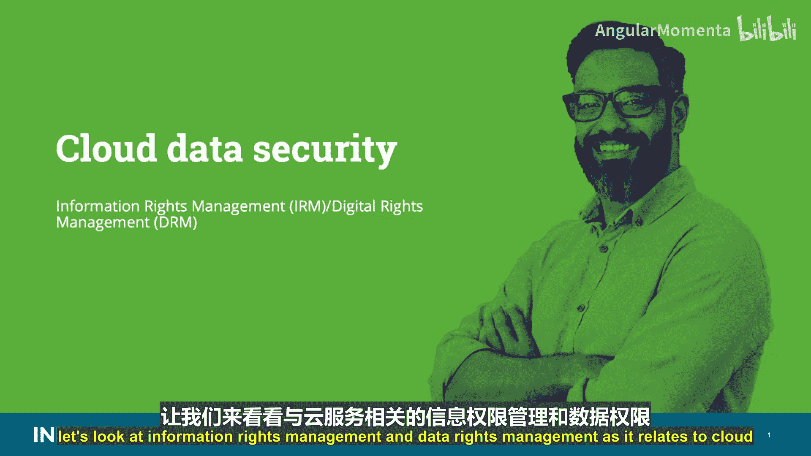
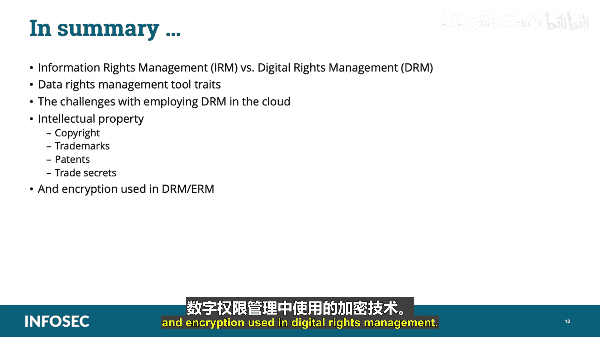

# 【Infosec】认证云安全专家 ｜ Certified Cloud Security Professional (CCSP) p18 03_01_03_information-rights-management-irm-and-digital-rights-management-drm -BV1TWrHBrEbk_p18-

As part of the cloud data security domain of the CCSP certification。

 let's look at information rights management and data rights management as it relates to cloud services Before we dive into this learning path。

 I want to point out that I will be calling out specific information you must know for the CCSP exam by highlighting it in a different color as depicted by the double asterisk callout as seen on the screen everything highlighted in that color is relevant for the exam Information rights management IRM is a form of IT security technology used to protect documents containing sensitive information from unauthorized access。

Unlike traditional digital rights management DRM that applies to mass production media like songs and movies。

 IRM applies to documents， spreadsheets and presentations created by individuals。

 listed on this screen are the key capabilities common to IRM information rights management solutions and should provide them regardless of the type of content or format。

😡，Let's go ahead and break these down。 Peristent protection ensures that documents。

 messages and attachments are protected at rest in transit and even after they've been distributed to recipients。

 the digital rights management should follow the content it protects。

 regardless of where the content is located whether it is a duplicate copy or the original file or how it is being utilized。

 The protection should not be rendered useless through simple operations in the production environment。

 Dyna policy control。The digital rights management tool should allow content creators and data owners to modify access control lists and permissions for the protected data under their control。

 it allows content owners to define and change user permissions such as view forward。

 copy or print and recall or expire content even after distribution。

Automatic expiration provides the ability to automatically revoke access to documents。

 emails and attachments at any point， allowing information security policies to be enforced wherever content is distributed or stored because of the nature of some legal protections of intellectual property。

 a significant amount of digital content will not be protected in perpetuity。

 the digital rights management protections should cease when the legal protections cease， conversely。

 licenses also expire， access and permissions for protected content should likewise expire。

 no matter where the content exists at the end of the license period。

Continuous auditing the digital rights management should allow for comprehensive monitoring of the content's use and access history。

 it provides confirmation that content was delivered and viewed and offers proof of compliance with your organization's information security policies。

Replication restrictions much of the purpose of the digital rights management is to restrict illegal or unauthorized duplication of protected content。

 therefore， the DRM solutions should enforce these restrictions across the many forms of copying that exist to include screen scraping。

 printing， electronic duplication， email attachments and so on remote rights revocation the owner of the rights to specific intellectual property should have the ability to revoke those rights at any time this capability might be used as a result of litigation or infringement support for existing authentication security infrastructure reduces administrator' involvement and speeds。

 deployment by leveraging user and group information that exist in directories and authentication systems。

Mapping for repository access control L ACLs automatically maps the ACL based permissions into policies that control the content outside the repository。

Integration with all thirdparty email filtering engines allows organizations to automatically secure outgoing email messages in compliance with corporate information security policies and federal regulatory requirements support for email applications provides interface and support for email programs like Microsoft outlook and IBM Lous notes。

 support for other document types besides Microsoft Office and PDF can be supported as wellAdditional security and protection capabilities。

 allows users additional capabilities like determining who can access the document。

 prohibiting printing of an entire document or selected portions， disabling copying。

 pasting and screen capture capabilities， watermarking pages if printing privileges are granted。

 expiring or revoking document access at any time and tracking all document activities through a complete audit trail digital rights management。

At its core encrypts content and then applies a series of rights rights can be as simple as preventing copying or as complex as specifying groups or user based restrictions on activities like cutting and pasting。

 emailing， changing the content， etc Any application or system that works with DRM protected data must be able to interpret and implement the rights。

 which typically also means integrating with a key management system。

There are two broad categories of digital rights management， DRM， consumer DRM and enterprise DRM。

 consumer digital rights management is used to protect broadly distributed content like audio。

 video and electronic books destined for a mass audience。

 There are a variety of different technologies and standards。

 The emphasis is on one way distribution。 Consumer DRM offers good protection for distributing content to consumers。

 but does not have a good track record。 Most technologies being cracked at some point。

Enterprise Digital Rights management is used to protect the content of an organization internally and with business partners。

The emphasis is on more complex rights， policies and integration with business environments。

 particularly the corporate directory service。Enterprise DRMs can secure content stored in the cloud well。

 but requires deep infrastructure integration it's most useful for document based content management and distribution digital rights management focuses on security and encryption to prevent unauthorized copying。

 limiting distribution to only those who are authorizedized。As with data loss prevention DLP systems。

 this is typically an employee security control that isn't always applicable in the cloud since all digital rights management enterprise rights management systems are based on encryption existing tools may break cloud capabilities。

 especially in software as a service there are two types of DRM implementations full DRM and providerbased control DM full DRM is the traditional digital rights management using an existing tool。

 for example， applying rights to a file before storing it in the cloud service As I mentioned。

 this may break cloud provider features such as browser preview or collaboration unless there is some sort of integration which is rare at this time provider based controls with this DM the cloud platform may be able to enforce controls very similar to full DRM by using native capability。

For example， user device view versus edit。A policy that only allows certain users to view a file in a web browser while other users can download and or edit the content。

 some platforms can even tie these policies to specific devices not just on a user level The industry has taken to referring to technology solutions that protect intellectual property as digital rights management tools。

 Dms or digital rights management can be implemented in enterprises by manufacturers。

 vendors or content creators usually material protected by DrM solutions need some form of labeling or metadata associated with the material in order for the Drm tool to function properly。

 Here are some ways that a DrM could be applied。 rudimentary reference checks。

 The content itself can automatically check for proper usage or ownership。 For instance。

 in many vintage computer games the game would pause。

Operation until the player entered some information that could only have been acquired with the purchase of a license copy of the game like a word or a phrase from the manual that shipped with the game online reference checks Microsoft packages including Windows operating systems and office programs are often locked in the same manner requiring users to enter a product key at installation the program would then later check the product key against an online database when the system is connected to the Internet。

Local agent checks， the user installs a reference tool that checks the protected content against the user's license again。

 gaming engines often work this way， the gamers having to download an agent or a stream from a digital distribution platform for video games and film like Good old games GG。

com when installing games purchased from those distributors the agent checks the user's system against the online license database to ensure the games are not pirated。

And supportbased licensing， some digital rights management implementations are predicted on the need of continual support for content。

 This is particularly true of production software license software might be allowed ready access to updates and patches while the vendor could prevent unlicensed versions from getting this type of support employing digital rights management in the cloud poses some challenges These include replication restriction because DRM often involves preventing unauthorized duplication and the cloud necessitates creating closing and replicating virtualized host instances including userspec content stored locally on the virtual host digital rights management might interfere with automatic resource allocation processes。

Jurisdictional conflicts， the cloud extends across boundaries and borders。

 often in a manner unknown and uncontrolled by the data owner。

 which could pose problems when intellectual property rights are restricted by locale。

 agent or enterprise conflicts， digital rights management solutions that require local installation of software agents for enforcement purposes might not always function properly in the cloud environment with virtualized engines or with the various platforms used in a bring your own device BYOD enterprise。

Mapping DRM and identity access management IAM because of the extra layers of access control often involving contentspec access control lists。

 the DRM identity access management processes might conflict or not work properly with the enterprise or cloud identity access management。

 this is even truer when cloud identity access management functions are outsourced to a third party。

 such as a cloud access security broker， a CASB。And finally， API Coms。

Because the digital rights management tool is often incorporated into the content。

 usage of the material might not offer the same level of performance across different applications such as content readers or media players。

 Digital rights management solutions are used to protect intellectual property in order to comply with relevant protections and to maintain ownership rights。

Intellectual property is that class of valuable belongings that are intangible。

 literally assets of the mind， there are legal protections for intellectual property that you should be familiar with for the exam they are copyright。

 trademarks， patents， trademark secrets over the next few screens will break these down for you。

The legal protection for an expression of ideas is known as copyright in the United States。

 copyright is granted to anyone who first creates an expression of an idea。

 usually this involves literary works， films， music， software and artistic works。

Copyright does not cover ideas， specific words， slogans， recipes， or formulas。

 those things can often be secured with other intellectual property protections。

 which we'll discuss in a few minutes。Copyright protects the tangible expression of an idea。

 not the form of an idea。 For instance， copyright protects the content of a book。

 not the hard copy version of the book itself， illegal copying of the contents of the book would be a copyright infringement。

 whereas stealing the physical book itself would be theft。

 the copyrights belong to the author or whomever the author sells or grants the rights to。

 not to someone who currently holds the physical copy of the book。

The duration of copyrights vary based on the terms under which they were created。

 depending on if an individual created the works themselves or if the work was created under a contract。

 In other words， a work for hire typicallyypically copyrights last either 70 years from the author's death or 120 years after the first publication of a work for hire the contract Copy gives exclusive use of the work to the creator with some exceptions。

 The creator is the only entity legally allowed to perform the work publicly， profit from the work。

 make copies of the work make derivative works from the original import or export the work。

 broadcast a work or sell or otherwise assign these rights。

 There are exceptions to the exclusivity of these rights。 Excepts include the Fair use Act。

 There is a family of exceptions to copyright exclusivity known as fair use。

 Fair use includes A fair use。This is where instructors can make limited copies or presentations of copyrighted works for educational purposes。

Another exception would be for critiques。 The works may be reviewed or discussed for purposes of assessing its merit and portions of the work may be used in these critical reviews。

 another exception would be news reporting because an informed populace is essential to a free society we have waived some intellectual property protections for reporting purposes。

 and finally， for scholarly research， similar to academic fair use。

 but among researchers instead of teachers and students。

 All of those are exceptions that fall under the fair use principle。

 another exception would be satire， where a mocking sendup of the work may be created using a significant portion of the original work。

Library preservation libraries and archives are allowed to make limited numbers of copies of original works in order to preserve the work itself。

Personal backup， someone who has legally purchased a license work may make single backup copies for themselves for use if the original fails。

 this explicitly includes computer programs。And versions for people with disabilities。

 it is legal to make specialized copies of license works for use by someone with a disability This could。

 for instance， include making a Braille or audioco of a book for use by the blind These exceptions are not unlimited Anyone making use of a copyright exception has to take into account many factors。

 including the possible commercial market for the work and the size scope and nature of the original work。

Copyright infringement is usually dealt with as a civil case。

 The copyright owner has to bring a lawsuit against someone they believed has illegally copied or used their work。

 However， in some cases demonstrated willful infringement can be investigated by the government as a criminal matter。

 Unlike copyright， trademark protection is intended to be applied to specific words and graphics。

 Trades are the representations of an organization， It brand。

A trademark is meant to protect the esteem and goodwill that an organization has built among the marketplace。

 especially in public perception。A trademark can be the name of the organization， a logo。

 a phrase associated with an organization， even a specific color sound or a combination of these in order to have a trademark protected by law it must be registered within a jurisdiction commonly that is the US patent and trademark office USPtoO the federal entity for registering trademarks trademarks registered with the USPTO can use the circle R symbol signifying registration states also offer trademark registration and trademarks registered with states often use the TM symbol trademarks last into perpetuity as long as the trademark owner continues to use them for commercial purposes trademark infringement is actionable and trademark owners consume court for infringement the US Pat and trademark office USPTO as the name indicates is also responsible for registering patents patents are the。

Legal mechanismchan for protecting intellectual property in the form of inventions， processes。

 materials， decorations， and plant life in securing a patent。

 the patent owner gains exclusivity in the production， sale and importation of the patented property。

Patents typically last 20 years from the time of the patent application， patent infringement。

 as with other intellectual property protections， is caused to sue for relief in federal court。

Trade secrets are intellectual property that involve many of the same aspects as patented materials。

 They could also include some things that are not patented， such as aggregations of information。

 for instance， this might include a list of clients or suppliers trade secrets are also somewhat like copyrights in the United States in that protections for them exist upon creation without any additional requirements for registration。

 however， unlike intellectual property protections。

 materials considered trade secrets must be just that secret。

 they cannot be disclosed to the public and efforts must be made to maintain secrecy in order to keep this legal protection。

Trade secrets are then provided legal protections from illicit acquisition。

 Anyone who tries to acquire trade secrets by theft or misappropriation can be sued in civil court。

 similar to other forms of intellectual property， but can also be prosecuted in federal court for this crime。

 Trade secret protection does not， however， confer the exclusivity granted by other intellectual protections。

 Anyone other than the owner of that trade secret who discovers or invents the same or similar methods。

 processes and information through legal means is justified and legally free to use that knowledge to their own benefit。

 In fact， someone who discovers someone else's trade secret through legitimate means。

 is also free to patent it， assuming that there is no existing patent on the same material or concept and like trademarks。

 a trade secret lasts into perpetuity， as long as the owner is still using it commercially。

 encryption support。The confidentiality leg of the CIA Triad。

 which is confidentiality integrity and availability how by preventing unauthorized data viewing having encryption enabled on all data across the enterprise architecture could reduce the risks associated with unauthorized data access and exposure but there are performance constraints and concerns that would need to be addressed What I want you to remember here is that we use encryption to protect data in transit at rest and in use data in transit also known as data in motion in order to avoid information exposure or data leakage while in motion we use encryption techniques like IPs or VPN and other wirele protocols an example of data in motion data in transit would be when data moves in and out of the cloud for processing archiving and sharing when we deploy data loss prevention in the cloud for data in motion this is sometimes referred。

To as network based or gateway DLPs in this topology。

 the monitoring engine is deployed near the organizational gateway to monitor outgoing protocols like HttP。

 HttPS， SMmTP and FtP file transfer protocol。Data at rest encryptpting data at rest is a great way to prevent anyone from seeing data they are not authorized to see when the data is archived or stored。

 different encryption techniques could be used based on the requirements， for example。

 if we're implementing an extended retention versus shortterm storage or is the data located in a database versus a file system the encryption mechanism itself varies as well as the manner in which it is deployed when we deploy data loss prevention in the cloud for data at rest。

 this is sometimes referred to as storage based in this topology。

 the data loss prevention engine is installed where the data is at rest。

 usually one or more storage subsystems and file application servers。

Data in use is data that is being shared， processed or viewed this stage of the data lifecycl is less mature than the other encryption techniques and typically focuses on technologies like data loss prevention systems。

Data loss prevention， also known as data leakage prevention can be used to detect unauthorized sharing and information rights management or DM's digital rights management solutions can be used to maintain control over the information There may also be a requirement to comply with regulations like HIPAA or PCIsS which in turn requires relevant protection of data traversing untrusted networks along with protections of certain types of data when we deploy data loss prevention in the cloud in support of data in use this is sometimes referred to as client or endpointbased DLP applications。

 and it is installed on the user's workstation and endpoint devices There are basically three options for database encryption you need to understand for the exam filele encryption Data servers typically reside on volume storage for this deployment。

Are encrypting the volume or folder of the database with the encryption engine and the keys residing on the instance attached to the volume。

Transparent encryption many database management systems contain the ability to encrypt the entire database or specific portions like tables。

 the encryption engine resides within the database and it is transparent to the application and finally application level encryption in application level encryption the encryption engine resides at the application that is utilizing the database since the data is encrypted before reaching the database。

 this is challenging to perform indexing searches and metadata collection。In summary， in this course。

 we discussed information rights Management IRM versus Digital rights Management DRM。

Digital rights management tool traits， the challenges with employing digital rights management in the cloud。

 intellectual property such as copyright trademarks。

 patent and trade secrets and encryption used in digital rights management。

