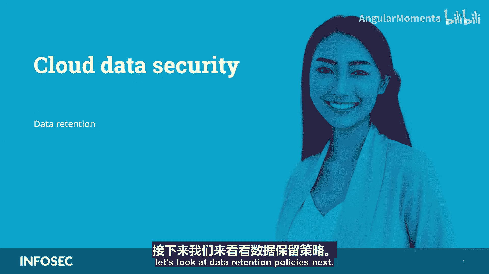
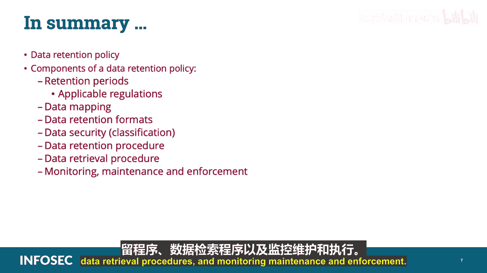

# 【Infosec】认证云安全专家 ｜ Certified Cloud Security Professional (CCSP) p19 03_01_04_data-retention -BV1TWrHBrEbk_p19-

As part of the cloud data security domain of the CCSB certification。

 let's look at data retention policies next。

Before we dive into this course， I want to point out that I will be calling out specific information you must know for the CCSP exam by highlighting it in a different color as depicted by the double asterisk call out as seen on the strain Everything highlighted in that color is relevant for the exam。

A data retention policy is an organization's protocol for maintaining required operational information or meeting regulatory compliance needs。

The objectives of a data retention policy are to keep important information for future use or reference。

 to organize information so that it can be searched and accessed at a later date and to dispose of information that is no longer needed the policy balances the legal。

 regulation and business data archival requirements against data storage cost。

 complexity and other data considerations。A good data retention policy should define each of the components listed on this strain。

 retention period， data formats， data security and data retrieval procedures for the enterprise。

 will'll break these down over the next couple strains， But before we do that。

 you should already know that a policy defines the direction in which an organization should go。

 a standard is a level below a policy， it should call out which actions or behaviors are acceptable or unaccept。

 That means the organization has to agree to what is considered acceptable as a baseline。

 If the organization has no standard， it has no quality because there is no consistency in their process。

 a process is a system of inputs and outputs to reach a desired goal and can support a standard or a policy a procedure establishes steps of who does what。

 when， where and how in support of a standard and finally support。

DomentsThey can contain detailed steps or piial graphics in the form of workbook instructions。

 including online manuals， guidelines， handbooks， plans， templates， forms， job aids， or checklists。

 supporting a process or a procedure。A retention policy for cloud services should contain a retention period。

 in other words， how long the data should be kept by the organization。

 this usually refers to data that is being archived for long-term storage， said another way。

 data not currently being used in the production environment。

The data retention period is often expressed in a number of years and is frequently set by regulation or legislation data retention periods can also be mandated or modified by contractual agreements Some examples are provided for you on the screen as reference only As we just mentioned the retention period can be mandated by regulatory requirements。

 statute or contract the retention policy should refer to all applicable regulatory guidance this is especially true in cases where there is conflicting regulations the policy should then also highlight any such disparity and include a method for senior management to resolve the disparity as a matter of reference some examples are listed for you on the screen data mapping。

 this is the process of mapping all relevant data to understand data types structured and unstructured data formats file types and data locations whether on network drives database。

Objects or volume storage retention formats。 the policy should contain a description of how the data is actually archived。

 That is what type of media it is stored on and any handling specifications particular to that data。

 for example， some types of data are required by regulation to be kept encrypted while in storage like PC DSsS In these cases。

 the policy should include a description of the encryption engine key storage and retrieval procedures and reference to the applicable regulation。

 data classification， This involves classifying the data based on location compliance requirements。

 ownership or business usage In other words， its value to the organization classification is also used to decide on the proper retention procedures for the enterprise The organization should have an overarching data classification policy that serves as guidance for data creators。

Cators and users describing how and when data should be classified and the security procedures and controls for handling the various classifications。

 as well as an enforcement mechanism for dealing with policy andfrs in addition to the main policy the data retention policy should include specific mention of how the various classes of data will be archived and retrieved data retention procedures for each data category the data retention procedures should be followed based on the appropriate data retention policy that governs the data type。

How long the data is to be kept， where physical location are and jurisdiction， and how。

 in other words， which technology and format should all be spelled out in the policy and implemented via the procedure。

The procedure should also include backup options， retrieval requirements。

 and restore procedures as required and necessary for the data types being managed。

Data retrieval procedures。 having data and storage is useful。

 Store data can be used to correct production errors can serve as the business continuity and disaster recovery backups and can be data mindd for business intelligence purposes。

 but stored data is only useful if it can be retrieved and be put back into production in an efficient and costeff manner。

 The policy should include a detailed description of the processes。

 both for sending data into storage and for recovering it。

 This element of the policy the detailed processes might be included as an attachment or mentioned by reference to the actual documentation for the processes。

 The process might require more frequent updates and editing than the policy and could be kept separate。

 Mon maintenance and enforcement are the procedures for making sure that the entire processes working。

 including review of the policy and requirements to make sure there are no changes without。

Going through the CCB， the change control board， as with all policies and organizations。

 the policy should list in detail how often the policy should be reviewed and amended by whom consequences for failure to adhere to the policy and which entity within the organization is going to be responsible for the enforcement of the policy it is useful and in some cases required by regulation to test your organization's recovery process from stored backups to ensure the processes work and the people are trained to recover the data in case of a disruption managing data retention in the cloud can be especially tricky it may be difficult to ensure。

 for instance， that the cloud provider is not retaining the organization's data beyond the retention period they've specified when considering cloud migration and during negotiations with potential cloud providers the organization should make a point to ensure the provider can support the organization's retention policy in a service level agreement。

In summary， in this course we have discussed the importance of having a data retention policy。

 the components of the data retention policy， retention periods， data mapping。

 data retention formats， data security classification， data retention procedures。

 data retrieval procedures， and monitoring maintenance and enforcement。

