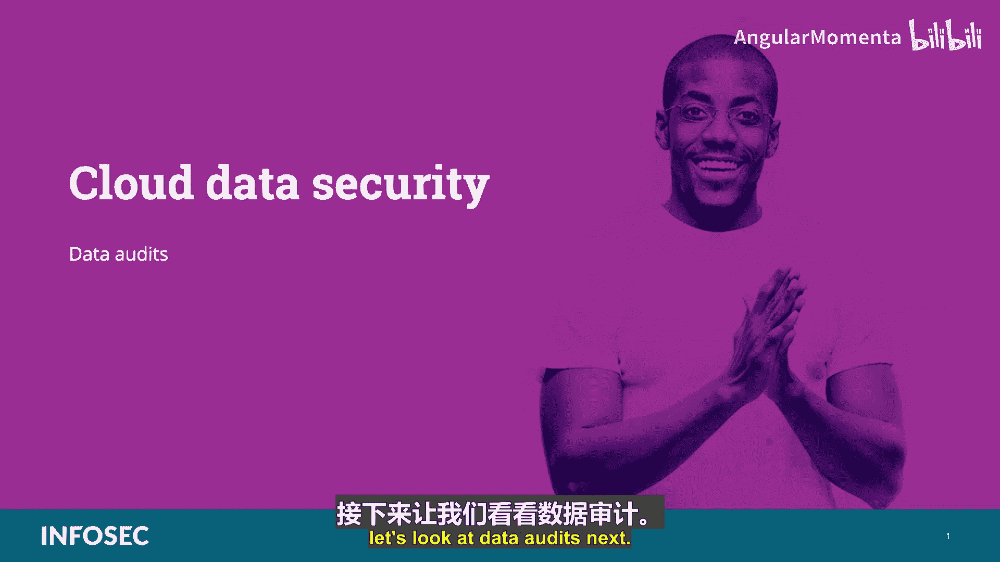
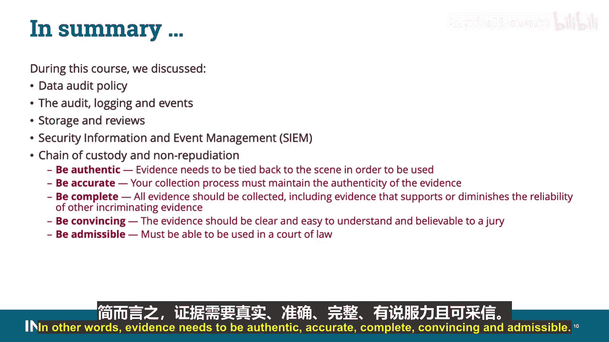

# 【Infosec】认证云安全专家 ｜ Certified Cloud Security Professional (CCSP) p20 03_01_05_data-audits -BV1TWrHBrEbk_p20-

As part of the cloud data security domain of the CCSP certification。

 let's look at data audits next Before we dive into this course。

 I want to point out that I will be calling out specific information you must know for the CCSP exam by highlighting it in a different color as depicted by the double asterisk callout as seen on the screen everything highlighted in that color is relevant for the exam as with all other assets the organization needs to regularly review inventory and inspect usage and conditions of the data it owns by conducting data audits。

And just like other elements of data management， the organization should have a policy for conducting audits of its data The policy should include detailed descriptions of audit periods。

 audit scope， audit responsibilities， both internal and external audit processes and procedures。

 applicable regulations and monitoring maintenance and enforcement as with all types of audits the organization should be particularly careful about ensuring that auditors do not report to anyone in the management structure that owns or is affected by the data they are auditing Cons of interest must be avoided for the audits to have validity and utility in most organizations audits are predicated on logging logging can happen in many forms。

 for example， event logging， security logging or traffic logging。

Events can be defined as things that happen， not all events are important。

 but many are and being able to distinguish which event you need to pay attention to can be challenging。

 depending on the number of events and attributes be in tracked。

 a large volume of data could be produced that data will need to be stored and then analyzed to uncover patterns of activities that may indicate threats or vulnerabilities are present in the system and have to be addressed you can use a security information and event management system which I'll explain in a few minutes to gather and analyze the data flows from multiple systems like event security and traffic logging in conjunction with tools like Tau Spunk log logic to analyze the log data。

Logs can be generated by applications， operating systems and devices and for general or specific purposes。

 for example， devices that collect logs as a byproduct of operations such as servers or devices that do logging as their main purpose like intrusion detection systems or security information and event management systems in order to be able to perform effective audits and investigations。

 the event logs should contain as much of the relevant data for the processes be examined as possible。

The Open Web Application Security Project OOSP， which is an online community that produces freely available articles。

 methodologies， documentations， tools， and technologies in the field of web application security recommends that these attributes listed on the screen be integrated into event data。

 think of the4 Ws， when， where， who and what。First， the when， such as log date and time。

 event date and time and the event timestamp， the event timestamp may be different to the time of logging。

 for example， server logging where the client application is hosted on a remote device that is only periodically or intimatemittently online and interaction identifiers。

😡，The where， like application identifiers， for example， name and version。

 application addresses like clusters or host names or server IPV4 or IPV6 address and port numbers。

 workstation identity or local device identifiers。Service name and protocol， geolocations。

 window or forms or pages， for example， entry point URLs and HTTP methods for a web application and dialog box name。

 and finally code location including the script and module name。The who。

 whether it's a human or machine user source address。

 including the user's device or machine identifier， user's IP address， cell。

 RF tower ID and mobile telephone number user identity if authenticated or otherwise known including the user's database table primary key value user name and license number and finally the what like what type of event is it。

 the severity of the event usually assigned a numeric rating like zero may equal emergency or a potential fatal operation a1 would equal an alert because of an error occurring with a higher numbers being less immediate like a7 which may equal debug or trace for future actions or remediation security relevant event flags and if the logs contain non-security events data as well。

 and finally the description of the event。Be engged。

Log review and audit is a specialized task for personnel with specific training and experience The reviewer needs to have an understanding of the operations if the reviewer cannot distinguish between what is authorized activities and what is not they are not adding security value to the process the person assigned to review logs must perform the task often enough that they recognize baseline activity and therefore deviations from it。

A natural inclination of a security practitioner might be to log everything people on our field notoriously lu to part with data and want to know everything about everything the problem with that is that logging everything creates additional risks and costs。

 having so much log data aggregated creates additional vulnerabilities and requires additional protections and the storage required for logging everything will entail a wholesale duplication of storage systems and space。

Data audit in the cloud can pose some almost impossible challenges。

The cloud provider may not want to or indeed even be able to for operational contractual reasons。

 disclose log data with the customer for security liability or competitive reasons therefore the organization must consider again specific audit requirements when opting for cloud migration and include any such specifications in the contract or service level agreement with the cloud provider the data audit policy addresses activities that take place in all phases of the data lifecycle a security information and event management system Seemi will typically provide the capabilities listed here let's break these down a little。

Data aggregation log management aggregates data from many sources， including network。

 security servers， database and applications， providing the ability to consolidate。

 monitor data to help avoid missing critical events。

 Corlation looks for common attributes and links events together into meaningful bundles。

 This technology provides the ability to perform a variety of correlation techniques to integrate different sources in order to turn data into useful information。

 Correlation is typically a function of the security event management portion of a full semimi solution。

As a result of automated analysis of correlated events。

 the system can produce alerts to notify recipients of immediate issues。

 alerting can be to a dashboard or sent via third party channels like emails。

Dashboards provide tools that can take event data and turn it into informational charts to assist in seeing patterns or identifying activities that is not forming a standard pattern；

 applications can be employed to automate the gathering of compliance data。

 producing reports that adapt to existing security governance and auditing processes。

Retenenstion is basically employing long term storage of historical data to facilitate its correlation over time and provide the retention necessary for compliance requirements。

 Long term log data retention is critical in forensics investigations because it's unlikely that the discovery of a network breach will occur at the time the breach is occurring。

Forensics analysis is the ability to search across logs on different nodes and time periods based on specific criteria this mitigates having to aggregate log information in your head or having to search through thousands and thousands of logs for specific data in order to support continuous operations。

 the principles listed here should be adopted as part of the security operations policy。

Audit logging needs to have a higher level of assurance for protection。

 retention and lifecycle management。 There may be legal statutory or regulatory compliance obligations for audit logs。

 which impose accountability and integrity requirements。

 the continuous operation of audit logging is comprised of three important processes。

 new event detection adding new rules and reduction of false positives new event detection to detect information security events。

 policies should be created that define what a security event is and how to address it rules are built in order to allow detection of new events。

 rules allow for the mapping of expected values to log files in order to detect events in continuous operation mode。

 rules have to be updated to address new risks。 and finally， the reduction of false positives。

 The quality of the continuous operation audit logging is dependent on the ability to reduce over time the amount of false。

In order to maintain operational efficiency， this requires constant improvement of the rule set in use。

 Remember， new event detection， adding new rules and reduction of false positives are all part of audit logging。

The next area is contract or authority maintenance points of contact for applicable regulatory authorities。

 national and local law enforcement and other legal jurisdictional authorities should be maintained and regularly updated as per the business needs This will ensure that direct compliance liaisons have been established and will prepare the organization for a forensics investigation requiring rapid engagement with law enforcement Se disposal policies and procedures must be established with supporting business processes and technical measures implemented for the secure disposal and complete removal of data from all storage media This is to ensure that the data is not recoverable by any computer forensics means。

Incident response and legal preparation In the event。

 a followup action concerning a person or organization after an information security incident requires legal action。

 proper forensics procedures， including chain of custody should be required for preservation and presentation of evidence to support potential legal action subject to the relevant jurisdictions upon notification。

 impacted customers or tenants and other external business relationships of a security breach should be given the opportunity to participate as is legally permissible in the forensics investigation。

 Remember， storage costs money， so when planning for event data preservation。

 storage has to be carefully considered against business and regulatory requirements and the retention responsibilities of the organization like a discovery or financial retention requirements。

 preservation is defined by ISO 27037 as the process to。

Maintain and safeguard the integrity and or original condition of the potential digital evidence。

 Remember that definition for the exam。 Evidence preservation helps assure admissibility in a court of law。

 but digital evidence is notoriously fragile and is easily changed or destroyed and because of the backlog of many forensics laboratories。

 Po evidence may spend a significant period of time in storage before it is analyzed or used in illegal proceedings。

 St requires strict access controls and protections from accidental or deliberate modification。

 which is why we hash digital evidence。There are two concepts that are at the heart of dealing effectively with physical。

 digital or electronic evidence， chain of custody and authenticity。

Chain of custody is the preservation and protection of evidence from the time it's collected until the time is' presented in court。

 It's the who， what， when， where and how the evidence was handled through its entire lifecycl from collection to destruction or permanent archiving in order for evidence to be considered admissible in court documentation on the chain of custody should exist and articulate the collection。

 process， condition， location， transfer， access to and any analysis performed on an item from acquisition through eventual final disposition。

 any break in the chain of custody can cast doubt on the integrity of the evidence。

 that's why we follow a formal well documentcumented process。 In other words。

 a standard operating procedure for digital or electronic evidence the current protocol for demonstrating authenticity and integrity relies on hashing which creates a unique numerical signature that's sensitive to any。

Bit changes， for example， Sha 256 or Sha 512。 If the signatures match the original or have not changed since the original collection。

 the court will accept that integrity has been established。 remember。

 any evidence collected needs to be authentic evidence needs to be tied back to the scene in order be used accurate。

 your collection process must maintain the authenticity of the evidence， be complete。

 All evidence should be collected， including evidence that supports or diminishes the reliability of other incriminating evidence。

 be convincing the evidence should be clear and easy to understand and believable to the jury and finally be admissible。

 It must be able to be used in a court of law。The issue is providing a chain of custody could be challenging if you have multiple jurisdictions。

 Sometimes the only way to provide a chain of custody is to include provisions in the service contract and ensure that the cloud provider will comply with requests pertaining to chain of custody issues In summary during this course we discussed data audit policy。

 the audit logging and events， storage and reviews， security information and event management。

 chain of custody and nonreudiation。 In other words， evidence needs to be authentic， accurate。

 complete， convincing and admissible。

