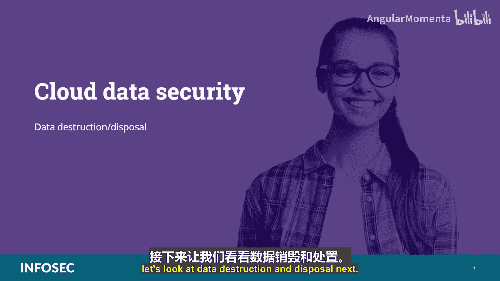
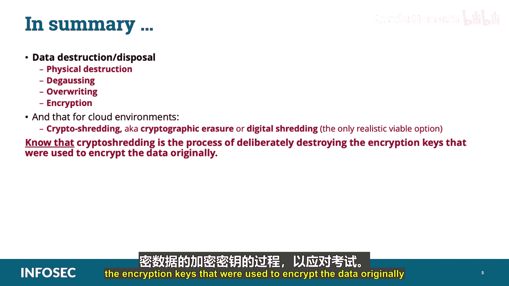

# 【Infosec】认证云安全专家 ｜ Certified Cloud Security Professional (CCSP) p21 03_01_06_data-destruction-and-disposal -BV1TWrHBrEbk_p21-

As part of the data security domain of the CCSP certification。

 let's look at data destruction and disposal next Before we dive into this course。

 I want to point out that I will be calling out specific information you must know for the CCSP exam by highlighting it in a different color as depicted by the double asterisk call out as seen on the strain Everything highlighted in that color is relevant for the exam。

A key part of data destruction procedures is the safe disposal of data once it's no longer needed failureils to do so may result in data breaches or compliance failures Safe disposal procedures are designed to ensure that there are no files。

 pointers or data remnant left behind in a system that could be used to restore the original data。

 as with other data management functions， the organization needs to create a policy for data disposal This policy should include detailed descriptions of the process for data disposal。

 any applicable regulations the organization needs to comply with and clear direction of when data should be destroyed。

A data deletion policy is sometimes required for the following reasons。

 regulation or legislation or business and technical requirements。

Certain laws and regulations require specific degrees of safe disposal for certain records。

 for example， records that contain PI or HII information a business policy may require safe disposal of data。

 also processes such as encryption might require safe disposal of the cleart data after creating the encrypted copy Of course。

 we are also concerned with data remnants that is any data left over after sanitization and disposal methods have been attempted restoring deleted data in a cloud environment is not an easy task for an attacker because cloudbased data is scattered。

 typically being stored in different physical locations with unique pointers。

 achieving any level of physical access by the attacker to the media at the CSP location would be a challenge because of the physical security measures taken by the CSP nevertheless it is still an existing attack vector that you should consider when evaluating the business requirements。

For data disposal， the data disposal policy addresses activities that take place in the destroy phase of the data life cycle。

In the legacy environment where the organization has ownership and control of all of the infrastructure。

 including the data hardware and software， data disposal options are direct and straightforward。

 Data disposal options in the legacy environment include physical destruction。

 degausing overriding and encryption Let's break these down First physical destruction of media and hardware。

 this is physically destroying the media。 any hardware or portable media containing data can be destroyed by burning。

 melting， impact in other words beating， drilling， grinding and so forth or industrial shredding。

 This is the preferred method of sanitization since the data is physically unrecoverable Next we have degausing。

 This involves applying strong magnetic fields to hardware and media where the data resides effectively making them blank。

 It does not work on solid state drives however the next option would be overriding which is when multiple passes of random characters are written to the storage area。

Particular disk sectors where the data resides with the final pass of all zeros and ones this can be extremely timecons for large storage areas and finally encryption。

 which is using an encryption method to override the data in an encrypted format to make it unreadable without the encryption key because the first three options are not fully applicable to cloud computing the only reasonable method remaining is encrypting the data remember in the cloud data disposal is much more difficult and risky the process of encrypting the data to dispose of it is called crypptto shredding also known as cryptographic erasure or digital shredding cryptto shredding is the process of deliberately destroying the encryption keys that were used to encrypt the data originally this involves encrypting the data with a strong encryption engine and then taking the keys generated in that process encrypting them with a different encryption engine and then destroying those keys。

To perform crypto shredding properly， the data should be encrypted completely without leaving clear text remaining。

 and the technique must make sure that the encryption keys are completely unrecoverable。

 This can be hard to accomplish if an external cloud service provider or other thirdpart is managing the keys hardware and media can never be sanitized by simply deleting the data。

 Deleting as an operation does not erase the data。 It simply removes the logical pointers to the data for processing purposes in the cloud many of the legacy options like physical destruction to gausing and overriding are unavailable or not feasible because the cloud provider。

 not the data owner owns the hardware physical destruction is usually out of the question Moreover。

 because of the difficulty of knowing the actual specific physical locations of the data at any given moment or historically。

 it would be next to impossible to determine all of the components。

And media that would need to be destroyed Likewise， for the same reason。

 overriding is not a practical means of sanitizing data in the cloud that leaves crypto shredding as the sole programmatic option for data disposal in the cloud。

 If crypto shredding is performed correctly， there should be no remnants。 however。

 material that is somehow not included in the original encryption。

 say a virtual instance that was offline during the encryption process。

 then added to the cloud environment might be considered remnants。As in all cryptographic practices。

 proper implementation is essential for success。 In summary， during this course。

 we discussed data destruction and disposal， physical destruction， degausing。

 overriding and encryption。 and that for the cloud environments。

 cryptto shredding also known as cryptographic erasure or digital shredding is the only realistic viable option。

 I also stated that you needed to know for the exam that crypto shredding is the process of deliberately destroying the encryption keys that were used to encrypt the data originally。

