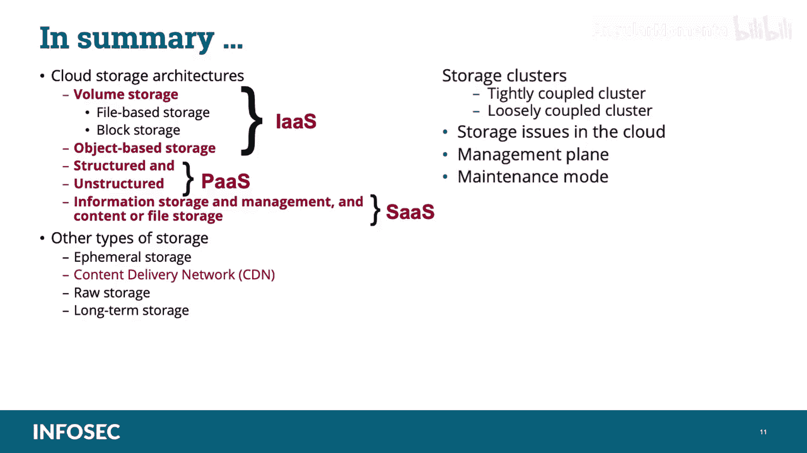

# 【Infosec】认证云安全专家 ｜ Certified Cloud Security Professional (CCSP) p22 04_01_01_cloud-storage-architecture -BV1TWrHBrEbk_p22-

As part of the cloud platform and infrastructure security domain of the CCSP certification。

 let's look at cloud storage and architecture next。 Before we dive into this course。

 I want to point out that I will be calling out specific information you must know for the CCSP exam by highlighting it in a different color as depicted by the double asterisk call out as seen on the screen。

 Everything highlighted in that color is relevant for the exam There are various ways to store data in the cloud Each with its own benefits and costs over the next few screens will cover volume storage and its subsets of file based storage and block storage。

Objectbased storage， structured and unstructured storage。

 information storage and management and content or file storage。 with volume storage。

 the customer is allocated a storage space within the cloud。

 This storage space is represented as an attached drive to the user's virtual machines from the customer's perspective。

 the virtual drive performs very much in the same manner as would a physical drive attached to a tangible device。

 actual location and memory addresses are transparent to the user。

 Volume storage architectures can take different forms。

 There is a great deal of discussion among cloud professionals about what type of volume might be preferred。

 file storage or block storage。 Let's look at both of these。 First。

 file storage also known as file level storage or file based storage。

 The data is storage and displayed just as with a file structure in a legacy environment as files and folders。

With all the same hierarchical and naming functions。

 file storage architectures have become more popular with cloud technology and big data analytic tools and processes Next we have block storage whereas file storage has a hierarchy of folders and files。

 block storage is a blank volume that the customer or user can actually put things into block storage might allow more flexibility in higher performance。

 but it requires a greater amount of administration and might entail installation of an operating system or other applications to store sort and retrieve the data block storage might be better suited for a volume and purpose that includes data of multiple types and kinds such as enterprise backup services the storage architecture for volumes can include erasure coding。

 which is basically a means of implementing a redundant array of inexpensive disks。

 raid as a data protection solution。In the cloud I'll explain what a raid system is in a few minutes Volume storage can be offered in any of the cloud service models。

 but is often associated with infrastructure as a service objects storage is just like it sounds data is stored as objects not as files or blocks objects include not only the actual production content but metadata describing the content and object and a unique address identifier for locating that specific object across the entire storage space these objects are accessible through application programming interfaces As and potentially through a web user interface。

Object storage systems provide representational state transfer rest APIs that allow programmers to work with the containers and objects application programming interface API normally consumes tokens rather than traditional username and passwords APIs can be broken down into multiple formats。

 two of which are representational state transfer rest。

 a software architectural style consisting of guidelines and best practices for creating scalable web services and simple object access protocol So。

 a protocol specification for exchanging structured information in the implementation of web services in computer networks。

 instead of organizing files in a directory hierarchy objectject storage system store files in a flat organization of containers called buckets and use unique Is called keys to retrieve them objectject storage is typically the way to store operating systems。

Images which the hypervisor boots into running instances typically object storage can implement redundancy as a way to improve resiliency by dispersing data via fragmenting and duplicating it across multiple object storage servers this can increase resiliency and performance and may reduce data loss risks。

Object storage architectures allow for a significant level of description， including the marking。

 label classification and categorization specifications this also enhances the opportunity for indexing capabilities data policy enforcement such as digital rights management or data loss prevention systems and centralization of some data management functions Again any of the cloud service models can include object storage architectures but object storage is usually associated with infrastructure as a service remember for the exam infrastructure as a service uses to storage types volume storage and object storage Vol storage is a virtual hard drive that can be attached to a virtual machine instance and can be used to host data within a file system volumes attached to an infrastructure as a service instance behave just like a physical drive or。

An array does objectject storage is similar to a file shared access via APIs or a web interface remember this for the exam Also make sure you understand that infrastructure as a service users are responsible for managing applications data runtime middleware and operating systems the provider still manages the virtualization servers。

 hard drive storage and networking in infrastructure as a service the user or the organization has the most amount of responsibility and control。

Like your legacy counterparts， databases in the cloud provide some sort of structure for stored data data will be arranged according to the characteristics and elements in the data itself。

 including a specific trait required to file the data known as the primary key in the cloud the database is usually backend storage in the data center access by users utilizing online apps or As through a browser Datas can be implemented in any cloud service model。

 but they are most often configured to work with platform as a service and software as a service。

 remember for the exam platform as a service utilizes two data storage types structured and unstructured structured information is information with a high degree of organization like that of a relational database It's seamless and readily searchable by simple straightforward search engine algorithms or other。

Operations。Unstructured is information that does not reside in a traditional roll column database。

 Unstructured data files often include text and metadata content。 Exles include email messages。

 Word processing documents， videos， photos， audio files， presentations。

 web pages and many other kinds of business documents Note that while these sorts of files may have an internal structure。

 they are still considered unstructured because the data they contain。

 does not fit neatly into a database for the exam make sure you understand that platform as a service makes the development testing and deployment of applications。

 Quick， simple and cost effective。With this technology。

 enterprise operations or thirdpart providers can manage operating systems， virtualization。

 server storage， networking and the platform as a service software itself the developers manage the applications they install and the data they generate you also need to remember for the exam that software as a service utilizes two main data storage types information storage and management and content or file storage。

Information storage and management is data that's entered into the system via the web interface and stored within the software as a service application。

 usually a backend database， this data storage utilizes databases。

 which in turn are installed on objects or volume storage。

 whereas content or file storage is stored within the application。😡。

Other types of storage you should be familiar with for the exam include ephemeral storage。

 this type of storage is relevant for infrastructure as a service instances and exists only as long as the instances up。

 it will typically be used for swapping files and other temporary storage needs and will be terminated with its instance。

 you need to remember that for the exam。Content delivery network CN。

 a content delivery network is a form of data caching。

 usually near geographical locations of high use demand for copies of data commonly requested by users perhaps the best examples of why an organization would want to use a CN is online multimedia streaming services instead of dragging the data from the data center to the users at variable distances across the continent。

 the streaming service provider can place copies of the most requested media near metropolitan areas where those requests are likely to be made。

 thus improving the bandwidth and delivery quality。

 examples of a CDn would be something like Akiai Technologies's Amazon Cloudfront or Azure CDN Another storage type you should be familiar with is raw storage and longterm storage raw device mapping RDM is an option in Vmware server virtualization environment。

That enables a storage logical unit number L or L to be directly connected to a virtual machine from a storage area network or a SA in Microsoft hyperv platforms this is accomplished using pass through disks and finally longterm storage Some vendors offer a cloud storage service tailored to the needs of the data archiving These include features like search。

 guaranteed im mututability and lifecycle management for the exam know that software as a service uses the web to deliver applications that are managed by thirdparty vendors and whose interface is accessed on the client side with software as a service it's easy for the enterprise to streamline their maintenance and support because everything can be managed by vendors application runtime data Midware operating system。

 virtualization server storage and networking the client is only responsible for the data they generate in the software。

And possibly some application interfaces at the front end on the client' side cluster storage is the use of two or more storage servers working together to increase performance capacity and reliability clustering distributes workloads to each server manages the transfer of workloads between servers and provides access to all files from any server regardless of the physical location of the file two basic clustered storage architectures exist known as tightly coupled and loosely coupled a tightly coupled cluster has a physical backplane which delivers a highper interconnection between servers for load balanceance performance and maximum scalability as the cluster grows a loosely coupled cluster offers cost effective building blocks that can start small and grow as the application demands St clusters should be designed to meet the required service levels as specified in the service level agreement。

Provide for the ability to separate customer data in multitenant hosting environments and securely store and protect data through the use of confidentiality。

 integrity and availability mechanisms like encryption， hashing， masking， and multipathing。

On a technical level， persistent mass storage in cloud computing typically consists of spinning hard drives or solid state drives for reliability purposes。

 disk drives are often grouped to provide redundancy the typical approach is redundant array of inexpensive disks raid which is actually a group of techniques raid groups have redundant disks configured so that the disk controller can still retrieve data when one of the disks fails the average disk drive has a3 to5% failure rate per year roughly speaking on 5000 installed disks。

 you can expect one failure every day rate techniques differ in the percentage of redundant disks and in the aggregate performance they can deliver part of the storage functionality is to slice and group disks into logical volumes and arbitrary sizes alternatively called logical unit numbers L virtual hard disk。

Volume storage， elastic block storage， Amazon EBS and rackspace cloud block storages are all examples of this。

 These storage volumes have no file systems。 The file system structure is applied by the operating system on the virtual machine instance to which they are provisioned for the exam。

 you should be familiar with the raid levels that I have listed for you on this screen Ra 0 uses only striping。

 there is no benefit here for redundancy。 If one of the disks fails then the information is lost。

 Ra 1 uses only mirroring。 there is no performance benefit in a raid1， but you do have redundancy。

 Ra 3 uses parity and striping， so you do have redundancy in the sense that the parodity disk can recreate the information from a lost disk and Ra 5 uses parity and striping with the parity interleveed on the drive instead of on a separate drive。

The management plane allows the administrator to remotely manage any or all of the hosts as opposed to having to visit each server physically to turn it on or install software on it。

The key functionality of the management plane is to create。

 start and stop virtual machine instances and provision them with the proper virtual resources such as CPU。

 memory， permanent storage and network conductivity when the hypervisor supports it。

 The management plane also controls live migration of Vm instances。

 the management plane can then manage all of these resources across the entire farm of equipment。

 The management plane software typically runs on its own set of servers and has dedicated connectivity to the physical machines under management because the management plane is the most powerful tool in the entire cloud infrastructure。

 It also integrates authentication access control and logging and monitoring of resources being used The management plane is used by the most privileged users Those who install and remove hardware system software。

 firmware and so on。 The management plane is also the pathway for。

Individual tenants who have limited and controlled access to the clouds resources the management plane's primary interface is the API both towards the resources being managed as well as towards the users a graphical user interface GuI or web page is typically built on top of those APIs。

These APIs allow automation of controlled tasks， examples include scripting and orchestrating the setup of complex application architectures。

 populating the configuration management database， allocating resources over physical assets and provisioning and rotation of user access credentials。

Maintenance mode is utilized when updating or configuring different components of the cloud environment while in maintenance mode。

 customer access is blocked and alerts are turned off or disabled。

 although logging is still enabled you need to remember that for the exam you should never enter maintenance mode operate within it and exit it successfully using the vendorspec guidance and best practices。

 any hosted VMs or data should be migrated prior to entering maintenance mode if it still needs to be available for use while the system undergoes maintenance。

Maintenance mode can apply to both data stores as well as hosts。

 The service level agreements should describe the IT service。

 document the service level targets and specify theresponsibilities of the IT service provider and the customer while entering and conducting maintenance mode In summary。

 in this course we discussed cloud storage architectures， volume storage， object storage。

 structured and unstructured storage， information storage and management content or file storage We also discussed other types of storage that you should be familiar with ephemeral storage。

 content delivery networks， raw storage and long-term storage We talked about cloud storage clusters and whether they're tightly coupled clusters or loosely coupled clusters we talked about storage issues in the cloud management plane and finally and finally maintenance mode。

