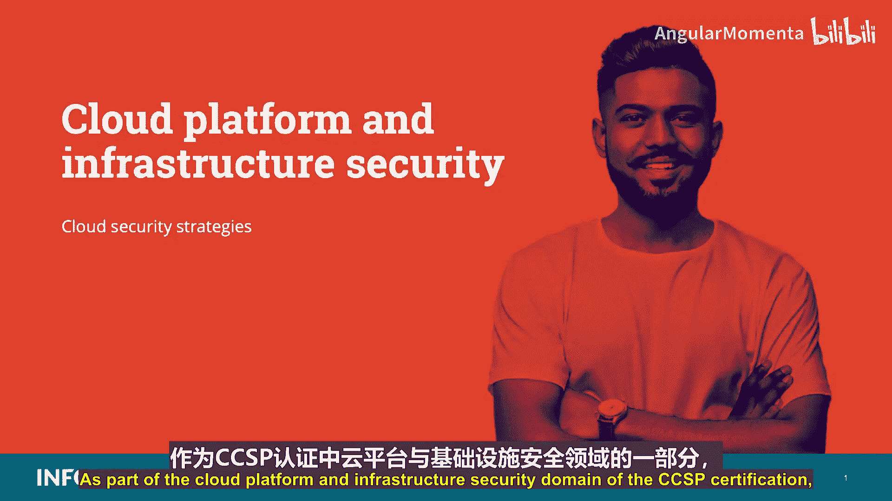
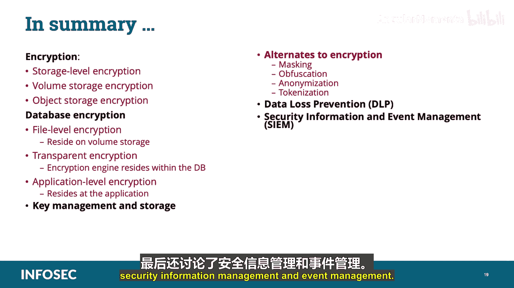

# 【Infosec】认证云安全专家 ｜ Certified Cloud Security Professional (CCSP) p23 04_01_02_cloud-security-strategies -BV1TWrHBrEbk_p23-

As part of the cloud platform and infrastructure security domain of the CCSP certification。

 let's look at cloud security strategies next Before we dive into this course。

 I want to point out that I will be calling out specific information you must know for the CCSP exam by highlighting it in a different color as depicted by the double asterisk callout as seen on the strain everything highlighted in that color is relevant for the exam the challenge when using encryption is that it should be directly related to business considerations。

 regulatory requirements and any additional constraints that the organization may have to address Different techniques are used based on the location of the data。

 whether at rest in transit or in use while in the cloud。

  different options might apply when dealing with specific threats like protecting personally identifiable information or legally regulated information or when defending against unauthorized access and viewing from system and platform administrator。

With storage level encryption， the encryption engine is located on the storage management level with the keys usually held or stored or retained by the cloud provider。

 The engine will encrypt the data written to the storage and decrypted when exiting the storage。

 for example， being used。 This type of encryption is relevant to both object and volume storage。

 but it will only protect from hardware theft or lost。

 It will not protect from cloud provider administrator access or unauthorized access coming from the layers above the storage Vol storage encryption requires that the encrypted data reside on the volume storage。

 This is typically done through an encrypted container， which is mapped as a folder or volume。

 Volume storage encryption does not provide protection against any access made through the instance like an attack that is manipulating or operating within the application running on the instance。

 There are two methods that can be used to implement volume storage encryption instance based encryption。

And proxybased encryption when instancebased encryption is used。

 the encryption engine is located on the instance itself Keys can be guarded locally。

 but should be managed externally to the instance instancebased encryption allows access to data only through the volume operating system and provides protection from physical loss or theft external administrators accessing the storage and snapshots or storage level backups being taken and removed from the system when proxybased encryption is used the encryption engine is running on the proxy instance or application the proxy instance is a secure machine that will handle all cryptographic actions including key management and storage the proxy will map the data on the volume storage and provide access to the instance and keys can be stored on the proxy or via the external key storage which is the recommended approach with the proxy providing the key exchanges and required safeguarding of the keys。

In memory， the majority of object storage services offer serverside storage level encryption this kind of encryption is effectively limited。

 which is why it's recommended to use external encryption mechanisms to encrypt the data before it' push to the cloud storage environment external mechanisms could be file level encryption or application level encryption。

File levell encryption like information rights management or digital rights management solutions。

 where the encryption engine is commonly implemented at the client' side and will preserve the format of the original files or application level encryption where the encryption engine resides in the application that is utilizing the object storage it can be integrated into the application component or by a proxy that's responsible for encrypting the data before going to the cloud。

 The proxy can be implemented on the customers gateway or a service residing at the external provider。

 you should understand these three options for database encryption file level encryption。

 This is where database servers typically reside on the volume storage for this deployment you are encrypting the volume or folder of the database and the encryption engine and keys reside on the instance attached to the volume transparent encryption with transparent encryption。

 the encryption engine resides with。In the database and it's transparent to the application。

 keys usually reside within the instance， but processing and managing them could be offloaded to an external key management system。

 KMS this encryption can provide effective protection from media theft backup system intrusion and certain database and application level attacks and application level encryption in application level encryption。

 the encryption engine resides at the application that's utilizing the database Since the data is encrypted before reaching the database。

 it's challenging to perform indexing searches and metadata collection。

The most important part of cryptographic implementation is key management， control over the issuance。

 replication， recovery and distribution Krkoff's principle states that a cryptoy should be secure even if everything about the crypto system except for the key is made public that simply means that the key is the true strength of the crypto system how the key is handled and managed throughout its lifecycle becomes the most important thing in cryptography and that's the premise of encryption key management without encryption it would be impossible to use the cloud in any secure fashion remote users use encryption to create the secure communications connection on the cloud customer' enterprise to protect their own data and within the data center it's used by the cloud provider to ensure various cloud customers don't accidentally access each other's data from a security perspective first you need to remove the dependencies or assumptions that the cloud provider。

Is handling the encryption process and controls correctly Secondly。

 make sure you're not bound or restricted by shared keys or data spillage within the cloud environments by having a unique and separate encryption mechanisms to apply an additional level of security and confidentiality at the data and transport level how and where encryption keys are stored can affect the overall risk of the data when planning key management you should consider random number generation throughout the lifecycl。

 cryptographic keys should never be transmitted in the clear and always remain in a trusted environment Also when considering key escrow or key management as a service。

 carefully plan to take into account all relevant laws。

 regulations and jurisdictional requirements lack of access to encryption keys will result in lack of access to data this should be considered when discussing confidentiality threats versus availability threats and finally。

 where possible key。Management functions should be conducted separately from the cloud provider in order to enforce separation of duties and force collusion to occur if unauthorized data access is attempted for cloud computing key management services。

 the following two approaches are most commonly utilized remote key management services and client side key management。

Remote key management services is where the customer maintains the key management service on premise ideally the customer will own。

 operate and maintain the KMS， the key management service resulting in the customer controlling the information confidentiality while the cloud provider can focus on hosting processing and availability of the services clientient side key management is similar to remote key management the client side approach looks to put the customer or cloud user in complete control of the encryption and decryption keys The main difference here is that most of the processing and control is done on the customer side the cloud provider can provide the key management service but the KMS resides on the customer's premise where keys are generated held and retained by the customer This approach is typically utilized for software as a service environments and cloud deployments whatever the methods up being the preferred solution。

Is not to store the crypto keys with the cloud provider。

Common challenges with key management are access to keys， key storage， and backup and replication。

 leading practices coupled with regulatory requirements may set specific criteria for key access。

 along with restricting or not permitting access to keys by cloud service provider employees or personnel。

Secure storage for keys is essential to safeguarding the data in traditional in-house environments。

 Keys were stored in a secure dedicated hardware。 This may not always be possible in a cloud environment and finally backup and replication in the cloud data backups and replication happens across a number of different formats。

 This can impact the ability for longterm or short termm key management to be maintained and managed effectively。

 Key storage in the cloud is typically implemented using internal external or a thirdpart。 First。

 internally managed In this method， the keys are stored on the virtual machine or application component that is also acting as the encryption engine This type of key management is typically used in storage level encryption internal database encryption or backup application encryption。

 This approach can be helpful in mitigating the risks associated with loss of media next。

ern managedIn this method， keys are maintained separate from the encryption engine and data they can be on the same cloud platform internally within the organization or on a different cloud。

The actual storage can be a separate instance hardened。

 especially for this specific task or on a hardware security module HSM when implementing external key storage。

 you need to look at how the key management system is integrated with the encryption engine and how the entire lifecycle of keys cradle to grave is being managed and finally managed by a third party This is when key escrow services are provided by a trusted third party key management providers use specifically developed secure infrastructure and integration services for key management you have to evaluate any thirdpart key storage service provider you're looking to contract with to make sure the risk of allowing a third party to hold encryption keys is understood and documented。

Typically cloud service providers protect keys using softwarebased solutions in order to avoid the additional cost and overhead of hardware based security models。

 the problem is that the software based key management solutions usually don't meet the Ph Security requirements specified in NIST National Institute of Standard and Technologies Federal Information Pro standard FIPS。

 140-2 or 140-3， so the lack of FIPS certification for encryption may be an issue for US federal government agencies and other organizations looking to use a cloud service provider。

The ability to use encryption is not always a realistic option for a variety of reasons。

 including performance， cost and technical abilities。As a result。

 additional mechanisms need to be employed to ensure that data confidentiality can be achieved masking。

 ofuscation， anonymization and tokenization can be used in dis regards。

Data masking or data obfuscation is the process of hiding。

 replacing or omitting sensitive information from a specific data set Data masking is typically used to protect specific data sets like PI personally identifiable information or commercially sensitive data in order to comply with certain regulations like HIPAA or PCIDSS payment card industry data security standard It can also be used for test platforms where test data isn't available Common approaches for data masking are random substitution。

 algorithmic substitution， shuffle and masking with random substitution。

 the value is replaced or appended with a random value algorithmic substitution is where the value is replaced or appended with an algorithmic generated value This typically allows for twoway substitution shuffle shuffles different values from the data set usually from the same column and finally masking。

Uses specific characters to hide certain parts of the data usually applies to credit card data formats as seen on the screen The primary methods for masking are static。

 which is when a new copy of the data is created with the marked values and dynamic which is sometimes referred to as on the fly masking it adds a layer of masking between the application and the database the masking layer is responsible for masking the information in the database on the fly when the presentation layer accesses it for example。

 this type of masking can hide the full credit card numbers from the customer service representatives but the data remains available for processing and finally deletion simply uses a null value or deletes the data the two primary components for identification of individuals users or personal information is direct identifiers and indirect identifiers direct identifiers are feels that uniquely id the subject and are。

sually referenced to as personal identifiable information masking solutions are typically used to protect direct identifiers Indirect identifiers typically consist of demographic or socioeconomic information dates or events indirect identifiers cannot identify the individual the risk is with data aggregation when we start combining a number of indirect identifiers together with external data that can result in exposing the subject of the information。

The challenge with indirect identifiers is the ability for this type of data to be integrated in free text fields that tends to be less structured than direct identifiers。

 which complicates the process。 So anonymization is the process of removing the indirect identifiers in order to prevent data analysis tools or other intelligent mechanisms from collecting or pulling data from multiple sources to identify individuals or sensitive information。

The process of anonymization is similar to masking and includes identifying the relevant information to anonymize and choosing a relevant method for obscuring the data and finally。

 tokenization。 tokenization is a process of substituting a sensitive data element with a non-sens equivalent referred to as a token。

 The token is usually a collection of random values with the shape and form of the original data placeholder and map back to the original data by the tokenization application or solution。

 tokenization is not encryption。 tokenization removes the data entirely from the database。

 replacing it with a mechanism to identify and access the resources。

 It's used to safeguard sensitive data in a secure， protected and regulated environment。

 tokenization can be implemented internally where there is a need to secure sensitive data centrally or externally using a tokenization service。

 tokenization can assist with。lying with regulations or laws。

 reducing the cost of compliance or mitigating risks of storing sensitive data and reducing attack vectors on that data Cloud and the technologies that make it possible are always evolving and can be difficult to keep up with。

 Some examples are bit splitliing and homomorphic encryption。

 bit splitliting usually involves splitting up and storing encrypted information across different cloud storage services。

 depending on how the bit splitliting system is implemented。

 some or all of the data sets are required to be available in order to unencrypt and read the data The benefits of bit splitliing are improvements to data security with regards to confidentiality bit splitliing between the different geographies or jurisdictions may make it harder to gain access to the complete data via a subpoena or other legal processes and it can be scalable it could be incorporated into secure cloud storage API technologies and could reduce the risk of vendor。

The challenges with bit splitliting are storage requirements and costs are usually higher with a bit splitliting system。

 It's CPU intensive because the processing and reprocessing of encrypting and decrypting the bits and bit splitliting can generate availability risks because the whole data set may not be available within the same geographies that the cloud provider stores and processes the bits within bit splitliting can utilize different methods。

 a large percentage of which are based on secret sharing。

 cryptographic algorithms Seet sharing made short SSMS uses a threephase process encryptncryion of information use of information dispersal algorithms which is designed to effectively split the data using erasure coding into fragments then splitting the encryption key itself using the secret sharing algorithm and all or nothing transforms with read Solomon This integrates the all or nothing transforms and erasure。

This method first encrypts and transforms the information and the encryption key into blocks in a way that the information cannot be recovered without using all the blocks。

 and then it uses the information dispersal algorithm IDA to split the blocks into shares that are distributed to different cloud storage services。

 the same as in secret sharing made short SSMS and homomorphic encryption。

 which is still in the research stages and not readily available for production environments。

 but it's intended to create the possibility of processing encrypted data without having to decrypt it first。

 said another way， it allows for cloud customers to upload data to a cloud service provider for processing without the requirement to decipher the data first。

Some points you need to consider for cloudbased data loss prevention systems are the fact that data in the cloud tends to move and replicate whether it's between locations。

 data centers， backups or back and forth into the organization the replication of movement can present a challenge to any DLP implementation and administrative access for enterprise data in the cloud can be tricky you need to make sure you understand how to perform discovery and classification within cloudbased storage Data loss prevention technology can affect overall performance as well because the network or gateway data loss prevention which scans all traffic for predefined content might have an effect on network performance Cl-based DLPs scan all workstation access to data This can have an impact on the workstations's operation you need to look at the overall impact during testing and deployment and see where the bottlenecks might be Most data loss prevention solutions include a suite。

Of technologies that facilitate three key objectives locate and catalog sensitive information stored throughout the enterprise。

 Mon and control the movement of sensitive information across the enterprise and finally monitor and control the movement of sensitive information on the end user system remember those three for the exam to be considered a full data loss prevention solution the DLP needs to address all three states of information and be integrated by a centralized management function。

The range of services available in a management console varies between products。

 but most have these common functions listed here on the screen policy creation and management。

 these are policies or rule sets which dictate the actions taken by the various DLP components。

 directory service integration This is integration with directory services which allows the DLP console to map a network address to a named end user workflow management most full DLP solutions provide the capability to configure incident handling。

 allowing the central management system to route specific incidents to the appropriate parties based on violation types。

 severity， user and other such criteria， backup and restore backup and restore features allow for the preservation of policies and other configuration settings and finally reporting the reporting function may be internal or may leveragever external reporting tools。

We've already discussed the architecture in a previous course What I want you to remember here is that data in motion。

 sometimes referred to as network based or gateway DLP has the monitoring engine deployed near the organizational gateway to monitor outgoing protocols like HtTPtTPS SMMTP and FDP the topology can be a mixture of proxy-based bridge network tapping or SMTP relays data at rest。

 sometimes referred to as storagebased data the DLP engine is installed where the data is at rest。

 usually one or more storage subsystems as well as file and application servers this topology is very effective for data discovery and for tracking usage but may require integration with network or endpointbased DLP for policy enforcement and finally data in use sometimes referred to as client or endpoint based the DLP application is installed。

On the users workstation and endpoint devices this topology offers insight into how the data is used by users with the ability to add protections that the network DLP may not be able to provide the challenge with clientbased DLP is the complexity time and resources to implement across all endpoint devices often across multiple locations and a significant number of users。

You should know that a security information and event management software product and services combines security information management and security event management。

 a security information and event management system is sold as software appliances or manage services and is also used to log security data flows from multiple systems and generate reports for compliance purposes。

 the acronym SISM or SEM have been sometimes used interchangeably。

 the area which provides longterm storage analysis and reporting of log data is known as security information management。

The second segment of security management that deals with realtime monitoring， correlation of events。

 notification and console views is commonly known as security event management In a nutshell。

 Sims puts all the information in a common format that's easily understandable and provides alerting and reporting。

 It provides realtime analysis of security alerts generated by the network hardware and applications and logs from networks。

 firewalls， routers， servers， Iss， Iss， basically it puts it altogether and crunches the data or correlates it。

 which allows you to do better analysis and possibly identify issues。

 Some of the Sims characteristics you should be aware of are the fact that it has centralized collection of log data enhanced analysis。

 dashboarding and automated responses。 It stores raw information from various system logs。

 aggregates the information into a signal repository normalizes the information to make。

Pison is more meaningful。 It has analytical tools which can process。

 map and extract target information and has alerting and reporting tools。

Sim systems typically provide the capabilities listed here on the strain。Data aggregation。

 This is where the log management aggregates data from many sources， including network。

 security servers， databases and applications， providing the ability to consolidate the monitored data to help avoid missing crucial events correlation This looks for common attributes and links events together into meaningful bundles。

 This technology provides the ability to perform a variety of correlation techniques to integrate different sources in order to turn data into useful information correlation is typically a function of the security event management portion of a full seam solution Aling the automated analysis of correlation events and production of alerts to notify recipients of immediate issues。

 Aling can be via a dashboard or sent via thirdparty channel like email。

The dashboard facilitates tools which can take event data and turn it into informational charts to assist in seeing patterns or identifying an activity that is not forming a standard pattern compliance applications can be employed to automate the gathering of compliance data。

 producing reports that adapt to existing security governance and auditing processes retention employing long-term storage of historical data to facilitate correlation of data over time and provide the retention necessary for compliance requirements。

 longterm log data retention is crucial in forensics investigation and it's unlikely that discovery of a network breach will be at the time of the breach occurring so these logs are necessary at that point and finally forensics analysis。

 the ability to search across logs on different nodes and time periods based on specific criteria。

 this mitigates having to aggregate log information in your head or having to。

Search through thousands and thousands of logs in order to support continuous operations。

 the principles listed here should be adopted as part of the security operations policies。

 A logging needs to have a higher level of assurance for protection。

 retention and lifecycle management there may be legal statutory or regulatory compliance obligations for audit logs which impose accountability and integrity requirements The continuous operations of audit logging is comprised of three important processes new event detection adding new rules and reduction of false positives Let's break these down。

 new event detection to detect new information security events policies should be created that define what a security event is and how to address it adding new rules rules are built in order to allow detection of new events rules allow for the mapping of expected values to log files in order to detect events in continuous operation mode rules have to be。

Updated to address new risks， reduction of false positives。

 The quality of the continuous operations audit logging is dependent on the ability to reduce over time the amount of false positives in order to maintain operational efficiency。

 This requires constant improvement of the rules set in use。

 Those are all elements dealing with audit logging。

 The next area is contact and authority maintenance。

 points of contact for applicable regulatory authorities。

 National and law enforcement and other legal jurisdictional authorities should be maintained and regularly updated as part of the business needs。

 This will ensure that direct compliance liaisons have been established and will prepare the organizations for a forensics investigation requiring rapid engagements with law enforcement。

 Se disposal。 policies and procedures must be established with supporting business processes and technical measures implemented for the secure disposal and complete removal of data from all stores。

This is to ensure that the data is not recoverable by any computer forensics means and finally。

 incident response and legal preparation in the event of followup action concerning a person or organization after an information security incident requires legal action。

 proper forensics procedures， including chain of custody should be required for preservation and presentation of evidence to support potential legal action subject to the relevant jurisdictions。

Upon notification， impacted customers or tenants and or other external business relationships of a security breach should be given the opportunity to participate as is legally permissible in the forensics investigation In summary during this course we discussed encryption we talked about storage level encryption。

 volume storage encryption and object storage encryption we also discussed database encryption talked about filele encryption which resides on the volume storage。

 transparent encryption where the encryption engine resides within the database and application encryption where the encryption engine resides at the application we also discussed key management and storage。

 alternatives to encryption such as masking obfuscation ononization and tokenization we discussed data loss prevention systems and finally security information management and event management。

