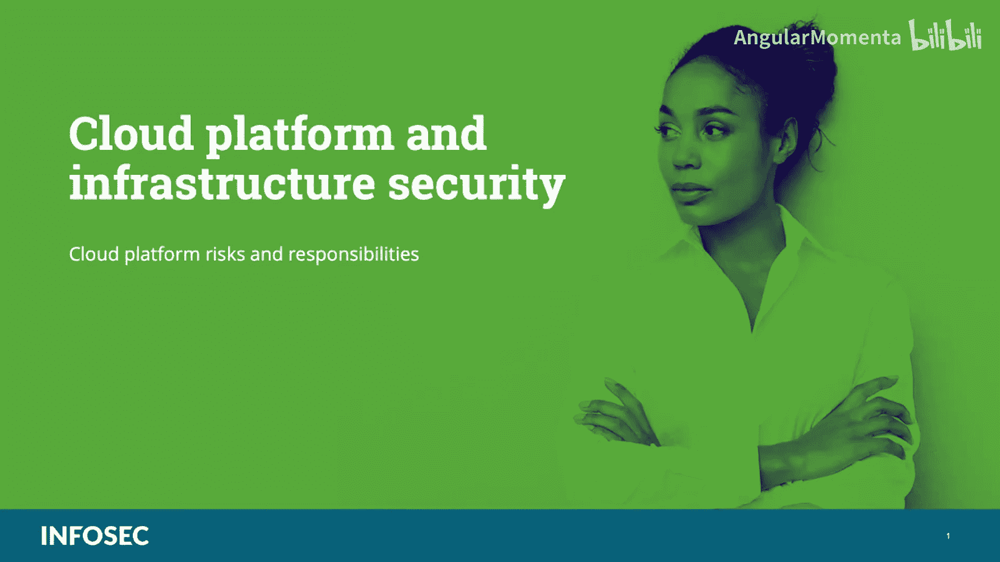
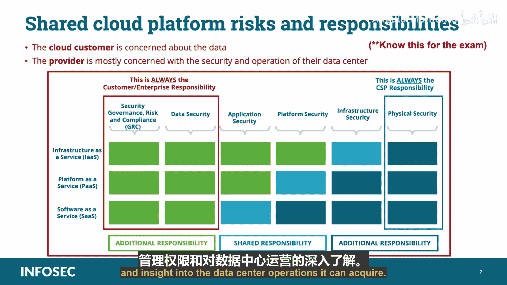

# 【Infosec】认证云安全专家 ｜ Certified Cloud Security Professional (CCSP) p24 04_01_03_cloud-platform-risks-and-responsibilities -BV1TWrHBrEbk_p24-

As part of the cloud platform and infrastructure security domain of the CCSP certification。

 let's look at cloud Plaform and risk responsibilities next Before we dive into this course。

 I want to point out that I will be calling out specific information you must know for the CCSP exam by highlighting it in a different color as depicted by the double asterisk call out as seen on the screen Everything highlighted in that color is relevant for the exam。

You should understand that because the cloud customer and provider will each be processing data that at least in some part。

 belongs to the customer， they will share responsibilities and risks associated with that data processing although risks and responsibilities will be shared between the cloud provider and the customer。

 the ultimate legal liability for unauthorized andicit data disclosures will always always remain with the cloud customer as the data owner you must understand that the customer is ultimately legally liable for data it owns。

 even if the providers failure was the result of the negligence or malice That said。

 the provider and customer still must come to terms regarding their particular responsibilities and obligations under the contract or stipulated in a service level agreement SL to some degree this will be driven by the service model such as infrastructure as a service platform as a service or software as a service and deploy。

😡，Moel such as private cloud， public cloud， community cloud or hybrid cloud。

 which the customer may be purchasing from the cloud service provider。

You need to understand that the cloud provider and the customer are most concerned with two different things。

 The cloud customer is concerned about the data， the production environment on the cloud data center is the customer' lifeblood breaches。

 failures and lack of availability are the things that most affect the customer therefore the customer will be seeking maximum control over their data with all of the administrative power and insight into the data center operations it can acquire the customer will want to impose policies get。

😡。

