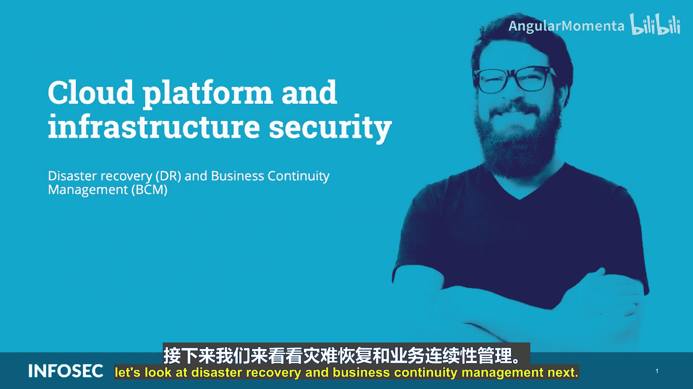
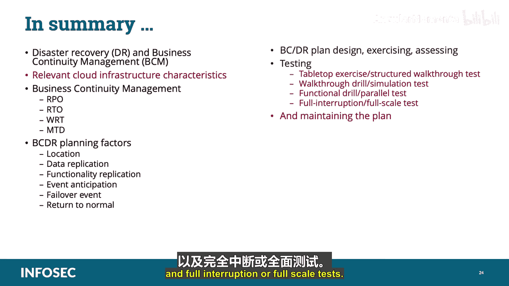

# 【Infosec】认证云安全专家 ｜ Certified Cloud Security Professional (CCSP) p25 04_01_04_disaster-recovery-dr-and-business-continuity-management-bcm -BV1TWrHBrEbk_p25-

As part of the cloud platform and infrastructure security domain of the CCSP certification。

 let's look at disaster recovery and business continuity management next。

Before we dive into this course， I want to point out that I will be calling out specific information。

 you must know for the CCSP exam by highlighting it in a different color。

 as depicted by the double asterisk call out as seen on the screen。

 Everything highlighted in that color is relevant for the exam Business continuity and disaster recovery are often confused or used interchangeably in some organizations。

 You need to make sure to use the correct terminology and highlight the differences between them when discussing these solutions。

Business continuity is the process where risks and threats to the ongoing availability of services。

 business functions and the organization are actively reviewed and managed at set intervals as part of the overall risk management process The goal is to keep the business operating and functioning in the event of a Dis whereas disaster recovery planning is the process where suitable plans and measures are taken to ensure that in the event of a disaster。

 floodstorm to NATto， etc， the business can respond appropriately with the view of recoverying critical and essential operations even somewhat limited to a state of partial or full level of service in as little time as possible the goal is to quickly establish re-establish or recover affected areas or elements of the business following a disaster In traditional noncloud environments BCcDR business continuity disaster recovery is a term used to jointly describe business continuity。

And disaster recovery efforts and usually falls under a BCDR program For the exam。

 you must understand the concepts of business continuity and disaster recovery so let's be clear business continuity is the capability of the organization to continue delivery of products or services at acceptable predefined levels following a disruptive incident business continuity program consists of three main functional areas。

 continuity of operations coP business continuity planning BCP and disaster recovery planning DRP and has four main steps Project scope and planning business impact assessments。

 BA continuity planning and approval implementation and testing Traitionly continuity of operations Plan CoP is used to relocate to an alternate location。

 those activities that sustain organizationwide or facilitywide essential processes during recovery from a major disruption。

Business continuity plan BCP ensures that the critical business functions continue at an alternate location while the organization recovers its ability to function at the primary location In other words。

 the goal is to keep the business operating and functioning in the event of a disruption disaster recovery plan DRP is handling effects of the disruption to resume operations in a timely manner this also addresses the technical controls associated with alternate processing facilities。

 backups and false tolerance In other words， the goal is to quickly establish reestablish or recover affected areas or elements of the business following a disaster in a nutshell continuity of operation gets you to that alternate location so you can continue processing essential functions business continuity to get you up and running at that alternate location and disaster recovery gets everything fixed at the primary location so you can move back to your primary location。

From the alternate location。Nowadays， the business continuity disaster recovery functions are executed using the cloud as opposed to the old warm。

 hot or cold sites， two critical success factors for business continuity when utilizing cloudbased services are understanding your responsibilities versus the cloud provider' responsibilities。

 In other words， understand any interdependencies or third parties such as supply chain risks。

 order of restoration， in other words， priority who or what gets priority in the restoration process。

 appropriate frameworks or certifications held by the facility， services and processes。

 rights to audit or make regular assessments of continuity capabilities。

 communications of any issues or limited services， and if there is a need for backups to be held ons site or offsite or with another cloud provider the other critical success factor is clearly state and ensure the service level agreement。

Which components of the business continuity disaster recovery are covered and to what degree they are covered。

 Think of a rule book and legal contract all rolled into one document。

 That's what you have in terms of a service level agreement in the service level agreement the minimum levels of service availability security controls processes communications support and many other critical business elements will be stated and agreed upon by both party。

 The difference between a contract in a service level agreement is that the service level agreement will have numbers associated with it as opposed to a contract where it stipulates I need a service level help desk。

 the service level agreement will outline the criteria such as a service level help desk that has 24 hours。

7 days a week access and a response time of no more than five minutes the cloud customer should be in agreement with and fully satisfied with all of the details relating to business。

nuity and disaster recovery， including recovery times。

 responsibilities and so on prior to signing any documentation or agreement that signifies acceptance for the terms for service operations cloud infrastructure has a number of characteristics that can be distinct advantages in realizing business continuity disaster recovery depending on a scenario。

 Ra elasticity and on demandmand selfservice for example。

 can give you a flexible infrastructure that can be quickly deployed to execute an actual disaster recovery without hitting any unexpected ceilings broad network connectivity which reduces operational risks。

 cloud providers have resilient infrastructures as well and pay per use can mean that the total business continuity disaster recovery strategy can be a lot cheaper than alternate solutions during normal operations the business continuity disaster recovery solutions is likely to have low cost test runs could also be less expensive。

Still need to do your due diligence and make sure that the requirements are included in your service level agreement。

Business continuity is a holistic management process that identifies potential threats to an organization and the impacts to business operations those threats。

 if realized， might cause， and that provides a framework for building organizational resiliency with the capability of an effective response that safeguards the interests of its key stakeholders。

 reputation， brand and value creating activities。Business continuity disaster recovery protects against the risks of data not being available and the risk that the business processes that it supports are not functional。

 leading to adverse consequences for the organization We do this by realizing three main points recovery point objective。

 recovery time objective and maximum time of disruption。 Let's break these down。

 The recovery point objective helps determine how much information must be recovered and restored or another way of looking at RPpoO is to ask yourself how much data can the company afford to lose。

Recovery time objective is basically the total time from disruption to resumption of processing。

 Think of RTO as the time it takes to recover from the RO to the RTO so we stay under the maximum tolerable downtime also known as the maximum tolerable period of disruption it includes infrastructure facility and workspace restoration hardware software and data restoration testing for functionality and security and catching up on all of the backlog of work that happen when the disruption occurred work recovery time WrRT determines the maximum tolerable amount of time that is needed to verify the system and the data integrity after restoration and finally maximum time of disruption MTD also known as MTPD maximum tolerable period of disruption is the maximum time that the organization can tolerate being down while still maintaining the mission。

Recovery point objective RpoO and recovery time objective RTO should be set for each resource based on the expected loss and the cost of achieving the objectives versus the benefit of achieving the objective。

 to additional terms you should understand are mean between failures and meantime to repair Mean between failures。

 MTBF is the measure of the average time between failures of a specific component or part of the system。

 Meantime to repair MTtTR is the measure of the average time it should take to repair a failed component or part of the system。

 All of these bullets provide relevant information in business continuity disaster recovery planning。

 You want to articulate in your plan。 the important organizational assets， both data and processing。

 the current location of these assets， the networks between the assets and the sites of their processing and actual or potential locations of work。

and business partners in relation to the disaster event when developing your business continuity disaster recovery strategies。

 you need to look at the logical sequence of business continuity disaster recovery components will break these down over the next few screens。

 they are location data replication， functionality replication event anticipation failover events and return to normal。

 as always in risk management is important to take the business requirements into account when developing and evaluating alternatives。

 The alternatives should strike and acceptable balance between mitigation and cost。

 First location It's assumed that the business continuity disaster recovery strategy will address the loss of important assets and replication of those assets across multiple locations。

 The relevant locations to be considered depend on the geographic scale of the calamity anticipated。

 for example， power or network failures might be mitigated in a different zone in the same data center flooding。

Or earthquakeakes will likely require locations that are more remote to where the event might happen and switching to a different cloud provider will also likely impact the sites of operation。

 This is unique to the cloud model in traditional IT solutions。

 you can't really switch your hots site or warm site to an alternate site location without having major costs。

 you need to clearly think through the process of switching and the risks you can use a memo of understanding an Mu along with a service level agreement to regulate and guide the switch if necessary。

 it should be thought out ahead of time and put in place prior to any switching taking place data replication is about maintaining an up-to-date copy of the required data at different locations which could be done on a number of technical levels and with different granularity。

For example， data can be replicated at the block level。

 the file level and the database level Replication can be in bulk on the byte level by file synchronization。

 database marrying or daily copies just to name a few For example。

 byte levelve data replication protects against physical data loss but not against data corruption。

 backup and archive can be used for snapshot functionality。

 which can mitigate risks related to accidental file deletion and database corruption Also in contrast with infrastructure as a service platform as a service and software as a service models usually have data replication built into their services。

 remember that for the exam。Functionality replication is about recreating the processing capacity at different locations。

 depending on the risk to be mitigated and the model selected。

 this could be as simple as selecting an additional deployment zone or involve an extensive rearchiting In software as a service for example。

 the replication of functionality might involve selecting a new provider with a different offering which could have a substantial impact on the users of the offloaded service。

 especially since some applications have extensive connections to other providers and customers acting as data feeds。

 so you need to consider that in your business continuity disaster recovery planning planning preparing and provisioning is all about tooling functionality and processes like adequate monitoring that leads up to the actual disaster recovery failover In any case。

 the sooner anomalies are detected the easier it's going to be to obtain any recovery。

Time objective the failover capacity itself requires some form of load balancer to redirect user service requests to the appropriate services。

This capability can take the technical form of cluster managers。

 load balancer devices or DNS manipulation you need to consider the risks that these components introduce themselves because they might become a single point of failure。

Return to normal is where disaster recovery ends。 The most important part of this closeout is adequately documenting any lessons learned and clean up any resources that are no longer needed。

 including sensitive data。 then update the plan。 This becomes the new baseline for the business continuity disaster recovery process。

There are many similarities between traditional I implementation plans and a business continuity disaster recovery plan。

 In both cases， you need to plan， outline， have a risk management methodology they need to be documented and they need to be tested and re-evalu The objective of the design phase is to establish and evaluate candidate architecture solutions technical alternatives and flesh out procedures and workflows Here you also have some business continuity disaster recovery specific questions that should be addressed in the design phase like how will the business continuity disaster recovery solution be invoked。

 What is the manual or automated procedure for invoking the failover services。

 How will the business use of services be impacted during the failover。

 How will the disaster recovery be tested Finally， what resources will be required to set it up Turn it on and returned to normal。

Onces the plan has been completed and the recovery strategies have been fully implemented。

 it's important to test all parts of the plan to validate that they would work in a real event。

 Testing should include enterprise wide testing strategies that establish expectations for individual business lines。

Testing strategies should include the testing scope and the objective which clearly define which functions。

 systems or processes are going to be tested and what will constitute a successful test。

The scope of tests can be continually expanded to eventually encompass enterprisewide testing。

 as well as testing with vendors and key market participants。 At a minimum。

 the testing scope and objectives should not jeopardized normal business operations gradually increase the complexity。

 level of participation functions and physical locations involved。

 De a variety of management and response proficiencies under simulated crisis conditions progressively involving more resources and participants。

 uncover inadquacies so that testing procedures can be revised and consider deviating from the test script to interject unplanned events like the loss of a key individual or services。

 as well as involve sufficient volumes of all types of transactions to ensure adequate capacity and functionality of the recovery facility is being tested。

Test plans should clearly communicate the predefined test scope and objectives and provide participants with relevant information。

 including a master test schedule that encompasses all test objectives。

 specific descriptions of test objectives and methods。

 roles and responsibilities for all test participants， including support staff。

 designation of test participants， test decision makers and succession plans， test locations。

 and test escalation conditions and test contact information。

A review of the test script should be done prior to testing to identify weaknesses that could lead to unsatisfactory or invalid tests as part of the review process。

 the testing plan should be revised to account for any changes to keep personnel， policies。

 procedures， facilities， equipment， outsourcing relationships。

 vendors or other components that affect a critical business function。

 There are many different types of exercises that can be done。 Some will take minutes。

 others will take hours or days。 The amount of exercise planning needed is entirely dependent on the type of exercise。

 the length of the exercise， and the scope of the exercise the security professionals will plan to conduct the most common types of exercises are called tabletop exercises。

 walkthrough exercises， simulated or actual exercises， and compact exercises。

Tabletop exercises or structured walkthrough tests are uncomplicated and low cost。

 team members meet and discuss each plan element and procedure across several meetings。

 They step through the plans and have some role in interactions actions。

 but it all done within the confines of the conference room。

 They assess effectiveness and limitations or areas for improvements are noted for the test report and postt review。

 It primary objective is to ensure that critical personnel from all areas are familiar with the business continuity plan and that the plan accurately reflects the organization's ability to recover from a disaster。

 It is characterized by attendance of business unit management representatives and employees who play critical roles in the business continuity process。

 Discion about each person's responsibilities are defined by the business continuity plan。

Individual and team training， which includes a walkthrough or step by step procedure outlined in the business continuity plan and clarifications and highlighting of critical plan elements as well as problems noted during testing walkthrough tests or simulation tests also known as functional tests or war games is somewhat more involved than tabletop exercises or structured walkthrough tests because participants choose a specific event scenario and apply the business continuity plan to it。

 so cost complexity planning and coordination are increased Ss typically include a pretend disaster and all teams exercise their training and judgment and simulate their action team communications should also be simulated to emulate realism a fire drill is an example of a common simulation exercise in that it tests the evacuation plan and the roles of the fire warden to ensure proper clearance of the facility walk。

Drills or simulation tests typically require attendance by all operational and support personnel who are responsible for implementing the business continuity plan procedures。

 practice and validation of specific functional response capabilities。

 focus on a demonstration of knowledge and skills as well as team interactions and decisionmaking capabilities。

 role playing with simulated response at alternate locations or facilities to act out critical steps。

 recognize difficulties and resolve problems in a non-threatening environment mobilization of all or some of the crisis management or response teams to practice proper coordination withperforming actual recovery processes。

 remember that for the exam as one of the functions of walkthrough drills or simulation tests and varying degrees of actual as opposed to simulated notification and response mobilization to reinforce the content and logic of the plan。

Functional drills or parallel testing is the first type of test that involves the actual mobilization of personnel to other sites in an attempt to establish communications and perform actual recovery processing as set forth in the business continuity plan This is hiring cost and complexity Para testing doesn't impact operations but may be more difficult to arrange with mutual aid agreements。

 The goal is to determine whether critical systems can be recovered at the alternate processing site and if employees can actually deploy the procedures defined in the business continuity plan。

 It includes a full test of the business continuity plan which involves all employees Des of emergency management capabilities of several groups practicing a series of interactive functions like direction control assessment operations and planning。

 testing medical response and warning procedures actual or simulated response to alter。

locations or facilities using actual communications capabilities。

 remember that for the exam when we're talking about functional drills or parallel testing。

 mobilization of personnel and resources at varied geographical sites。

 including evacuation drills in which employees test the evacuation routes and procedures for personnel accountability。

 remember that as well， and varying degrees of actual as opposed to simulated notification and response mobilization in which parallel processing is performed and transactions are compared to production results。

And finally， full interruption or full scale tests。

 this is the most comprehensive and complex type of test in a full scale test。

 a real life emergency is simulated as closely as possible Comprehen planning should be a prerequisite to this type of test to ensure that business operations are not negatively affected The organization implements all or portions of its business continuity plan by processing data and transactions using backup media at the recovery site。

 it involves enterprise wide participation and interaction of internal and external management response teams with full involvement of external organizations Val of crisis response functions。

 De of knowledge and skills as well as management response and decision making capabilities。

On the scene execution of coordination and decision making roles， actual。

 as opposed to simulated notification， mobilization of resources and communication of decisions。

 activities conducted at actual response locations or facilities。

Actual processing of data using backup media and exercises generally extend over a longer period of time to allow issues to fully evolve as they would in a crisis and allow realistic roleplay of all involved groups After every exercise the security professional conducts an after action report to document items identified and address issues that were uncovered by the exercise action items should be tracked until they have been resolved and were appropriate。

 the plan should be updated， this is very important for you to understand and remember that after any simulation tests or any tests of the business continuity plan。

 the plan needs to be updated and version controlled as the new baseline for the plan。And finally。

 testing and acceptance， what I' need you to remember here is that the business continuity plan as any other security incident response plan is subject to testing at planned intervals or upon significant organizational or environmental changes as discussed previously remember every plan has to be tested reviewed and updated in order to make sure that the plan works and the people know what to do in the event of a crisis In summary。

 during this course we discussed disaster recovery and business continuity management。

 relevant cloud infrastructure characteristics， business continuity management。

 we talked about recovery point objective RO recovery time objective RTO R recovery time WT and maximum time with disruption MTD we discussed business continuity and disaster recovery planning factors such as location。

 data replication functionality replication， event anticipation。

Fil over events and return to normal we also discussed the business continuity plan， design。

 exercising and assessing we talked about testing， tabletop exercises or structured walkthrough tests。

 walkthrough drills or simulation tests， functional drills or parallel testing and full interruption or full scale tests。

 and finally maintaining the plan and updating it。

