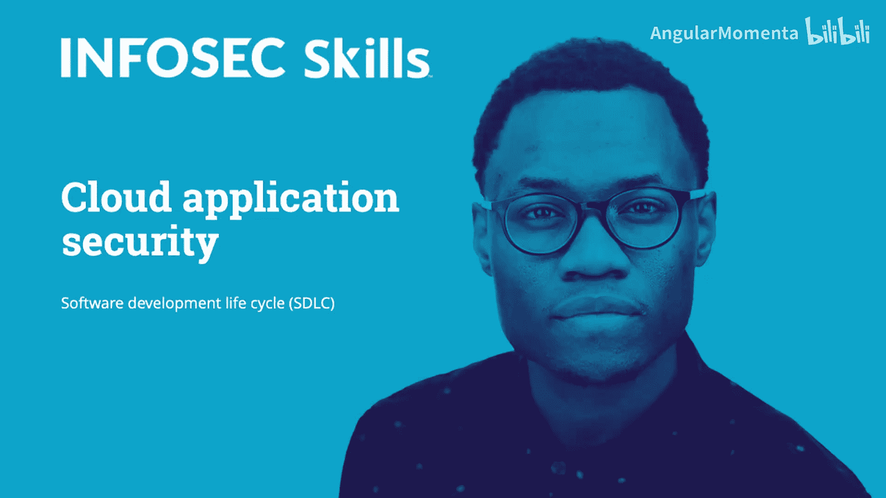
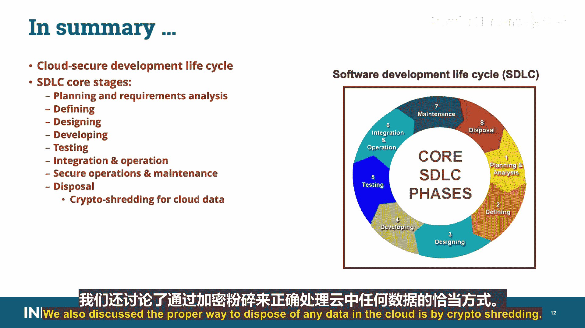

# 【Infosec】认证云安全专家 ｜ Certified Cloud Security Professional (CCSP) p26 05_01_01_software-development-life-cycle-sdlc -BV1TWrHBrEbk_p26-

As part of the cloud application security domain of the CCSP certification。

 let's look at softwareftware development Lifecycle Next。

Before we dive into this course， I want to point out that I will be calling out specific information you must know for the CCSP exam by highlighting it in a different color as depicted by the double asterisk call out as seen on the strain everything highlighted in that color is relevant for the exam。

The intent of a software development lifecycle process is to help produce a product that is cost efficientffic。

 effective and of high quality。 Several software development lifecycle models have been published and most of them contains similar phases here on the screen we show you a couple examples you can see the similarities between them there is a series of fairly intuitive phases and any lifecycle for developing software。

 It is well understood that security issues discovered once an application is deployed are exponentially more expensive to remediate security needs to be built in upfront and not at the end。

 It's usually cheaper to design it into the application than slapping it on at the end to fix a hole which usually costs a lot more for example。

 if you're buying a house based on a model you selected with specific features in design but during the construction the architect decides it would be more efficient to eliminate the basement and just add an additional floor if you were waiting until the house was built to review。

The plans， it'll cost you a lot more money to fix the basement issue。

 whereas early on before they started laying the foundation。

 it could have been addressed and corrected in the same way。

 security is cheaper to be built into an application than trying to bolt it on at the end to fix or correct an issue。

The real purpose of engaging in learning about and working with the cloud secure development lifecycle is so that we have some assurances that the cloud applications we are using are as safe as possible from the onset of vulnerabilities and any other risks that might result in our data being compromised Cloud secure software development lifecycle has the same foundational structures as other traditional development lifecycles。

 although there are some factors when dealing with the cloud that need to be taken into account just like data software has a useful lifecycle based on phases or stages of development and use。

 although the name and number of stages can be debated。

 they generally include at least the core stages listed on the screen， let's break these down。

Planning and requirements analysis is where business and security requirements and standards are being determined。

The main focus here is identifying the project managers and stakeholders。

 determining the requirements both functional and nonfunctional and defining them before the initial design begins。

Identifying security requirements and risks associated with the project is also conducted in the planning stage as well as planning for quality assurance requirements and testing。

In the defining phase， we clearly define and document the product requirements in order to place them in front of the customer and get them approved。

In the definition phase， we are focused on identifying the business needs of the application。

 such as accounting database or customer relationship management。

Regardless of the application's purpose， it is vital that the definition phase flush out all of the aspects of the business needs and relationships to it。

 We try to refrain from choosing any specific tools or technologies at this point。

 The temptation to do so creates a situation where we have a foregone conclusion。

 We're going to use X technology instead of truly considering all possibilities that might best satisfy the business requirements。

 This is also where we refine the security requirements we identified during the requirements gathering and analysis stage。

The system design phase helps in specifying hardware and system requirements and also helps in defining the overall system architecture in the design phase we begin to develop user stories like what the user will want to accomplish and how to go about doing it as well as what the interface will look like and whether it will require the use or development of any APIs application interfaces。

 this is also where we would identify what programming language such as Python visual basic and so on and architecture like RE。

 soap and so on we will use。Once the system design documents are received。

 work is divided into modules， units， or sprints， and the actual development starts。

The development phase is where the code is written taking into account the previously established definitions and design parameters。

 Some testing of the code snippets may occur in this phase to determine whether the code is working as designed prior to integration with other development cycles or sprints。

 however， major testing will occur later in the process After the code is developed it is tested against the established requirements to make sure that the product is actually solving the needs gathered during the planning and requirements analysis phase in the application development testing phase activities such as penetration testing and vulnerability scanning are performed against the application。

 We will use techniques and tools for both static application security testing basically analyzing code offline when the code is not running and dynamic application security testing which is used against applications in their running state we'll discuss this in more detail later in this course during the software security testing module。

Once all the other stages are finished， the application would then enter into what some call the integration and secure operations phase。

 this is after thorough testing has been successfully completed and the application and its environment are deemed secure Most software development lifecycle models include a maintenance phase as their endpoint in our model we call that out separately as the next phase。

 however， understand that integration operations and maintenance may happen in conjunction with each other。

Operation and disposal are included in some models as a way of further subdividing the activities that traditionally take place in the maintenance phase。

 Most web and cloud applications are a bit different than traditional applications in that they can often be updated in place continually and may stay in service for a very long time If anything you may see them no longer supporting certain features but rarely does development stop As long as the vendor and application remain a viable solution they will probably stay patched and up to date as part of the operations and maintenance phase of the software development lifecycl and exception to this is the case where a vendor creates an application that incorporates existing technologies or libraries and the vendor doesn't update the application as newer and safer versions of the technologies are released。

 the software gets older and harder to upgrade because of the significant jump usually encountered with the evolving technology there are some complexities with。

Integrating new applications with existing ones can be a part of the development process however。

 when developers and operational resources don't have open or unrestricted access to supporting components and services integrating can be complicated。

 particularly where the cloud provider manages infrastructure applications and integration platforms like in software as a service models from a security perspective。

 once the application has been implemented using the software development lifecycle principles。

 the application enters a secure operation phase。Proper software configuration management and versioning is essential to application security There are some tools that can be used to make sure that software is configured according to the specified requirements two of these tools are programs called Che and puppet Che is designed for cloud automation on the other hand puppet technology or tool is designed just for simplicity let's break these down Che is a configuration management tool which provides a way to define infrastructure resources as a code the user can manage the infrastructure through code rather than using a manual process the chef can do the following automation tasks applicationplication deployment infrastructure configuration and network configuration management。

Puppet is also a configuration management tool that can be used to configure。

 deploy and manage servers。😡，Puppet can be used to perform the following tasks using the puppet development operations or DevOs tool。

 scaling up and scaling down of machines dynamically。

 defined distinct configurations for each host by continuously checking and confirming the status of required configurations on the host。

 and provide centralized control over all the machines so that if any changes are made in the configuration。

 that can be easily propagated to all related machines。

 secure operations phase calls for activities like dynamic analysis。

 vulnerability assessments and penetration testing as part of the continuous monitoring plan。

 activity monitoring and some OSI layerer 7 firewalls。

 also called web application firewalls since the OSI layerer 7 is the application layer。Just to note。

 the disposal phase is not included in the CCSP common body of knowledge CBK。

 but is worthy of mentioning here once the software has completed its job or has been replaced by a newer or different application it must then be securely disposed of most software companies have a published software lifecycle as partter their customer facing information it includes the lifespan for the application with specifics about things like how long and what kind of security patches will be available to the customer out of date and no longer supported software poses a risk of the enterprise in many ways。

 mostly due to vendors stopping the support or development of patches for any new vulnerabilities discovered beyond the published end of life This is why endof life applications should be disposed of and replaced with whatever has taken over their functionality when an application has run its course and is no longer required we need to dispose of it and the data it generate。

In a secure manner， from a cloud perspective， it's challenging to ensure that data is properly disposed of because you can't physically remove the drives。

So we need to implement crypto shredding， which is the encryption of the data with an encryption engine。

 we then encrypt the encryption keys with a different encryption engine and finally destroy those keys。

 rendering any data initially encrypted unrecoverable In summary。

 in this course we discussed cloud secure development lifecycle software development lifecycle core stages of planning and requirements analysis。

 defining designing， developing， testing， integration and operation and operations and maintenance and finally disposal we also discussed the proper way to dispose of any data in the cloud is by crypto shredding。

