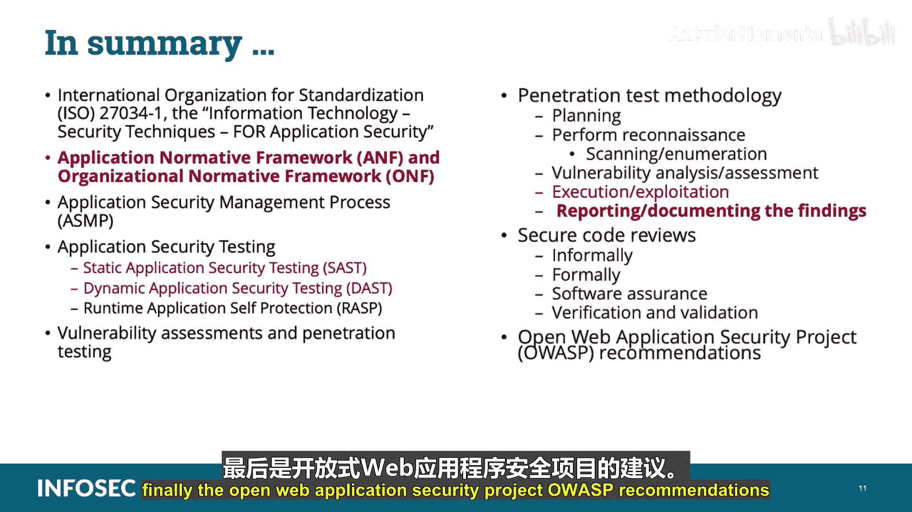

# 【Infosec】认证云安全专家 ｜ Certified Cloud Security Professional (CCSP) p27 05_01_02_software-testing -BV1TWrHBrEbk_p27-

As part of the cloud application security domain of the CCSP certification。

 let's look at software testing next Before we dive into this course。

 I want to point out that I will be calling out specific information you must know for the CCSP exam by highlighting it in a different color as depicted by the double asterisk callout as seen on the screen everything highlighted in that color is relevant for the exam。

The International Organization for Staernization， ISO and International Electal Technical Commission IEC developed and published ISO 270341 information Technology security techniques for application security ISO 27。

034 defines concepts， frameworks and processes to help organizations integrate security within their software development lifecycle remember that for the exam ISO 27034-1 lays out an organizational nominative framework ONF that acts as a framework for all components of application security best practices the organizational nominative frameworkraworkF containers include business context。

 this includes all application security policies， standards and best practices adopted by the organization Reg context which includes all standards laws and regulations that affect application security Tech context which。

Includes required and available technologies that are applicable to application security specifications。

 documents， the organization's IT functional requirements。

 and the solutions that are appropriate to address these requirements。😡，Rolls。

 responsibilities and qualifications document the actors within the organization who are related to IT applications。

Processes related to application security and Aplication Security Control library this contains the approved controls that are required to protect an application based on identified threats。

 the context and the targeted level of trust。The application nominative framework A&F is used in conjunction with the organizational nominative framework ONF and is created for a specific application The application nominative framework maintains the applicable portion of the organizational nominative framework that are needed to enable a specific application to achieve a required level of security or the targeted level of trust。

 the organizational nominative framework ONF to application nominative framework ANF is a one to many relationship where one ONF organizational nominative framework will be used as the basis to create multiple application nominative frameworks ANFs。

IISSL 27，034-1 defines an application security management process ASM to manage and maintain each application nominative framework AF the application security management process is created in five steps specifying the application requirements and environment。

 assessing application security risks， creating and maintaining the application nominative framework。

 provisioning and operating the application and finally auditing the security of the application security testing of web application through the use of testing software is generally broken into two distinct types。

 static testing and dynamic testing First， static application security testing SAT this is generally considered a white box test where an analysis of the application source code。

 B code and binaries is performed by the application test without executing the application code。

In order to determine coding errors and omissions that could be indicative of security vulnerabilities。

 set another way， static application security testing analyzes code offline when the code is not running static application security testing can be used to find crossite scripting errors。

 SQL injection but for overflowed unhandled error conditions as well as potential back doors。

Dynamic application security testing DST is generally considered a black box test where the tool is used to discover individual execution paths in the application being analyzed。

 which means the tool is used against the application in their running state it's important to understand that static application security testing and dynamic application security testing play different roles and that one is not better than the other static and dynamic application tests work together to enhance the reliability of secure applications being created and used by organizations I want you to remember that testing is dynamic by nature。

 and in dynamic testing we're testing the system and observing its behavior in contrast static testing techniques which analyze a system without executing the system under the test。

Runtime application self protection RAsp is generally considered to focus on applications that possess self protection capabilities built into their runtime environments。

 which have full insight into application logic， configuration as well as data and event flows runtime application self protection prevents attacks by selfproect and reconfiguring automatically without human intervention in response to certain conditions such as threats。

 faults and so on。 The primary goal of penetration testing is to simulate an attack on a system or network to evaluate the risk profile of an environment。

 The key to successful penetration testing is clearly defined objectives， scope。

 stated goals agreed upon limitations and acceptable activities In other words。

 well established rules of engagement penetration testing methodology There is different ways of performing a penetration test。

 however。I a basic and logical methodology that has become a best practice for performing it First planning before anything is done。

 you first have to plan as an example identify a target， formulate your attack， your goal。

 your ex strategy and so on Nothing happens without first planning what you're going to be doing after we've planned out our strategy we perform reconnaissance This is searching for any available piece of relevant information on the target to assist you in your planning or executing the test the goal is to gather as much information as possible on the target part of this reconnaissance is scanning and enumeration also known as network or vulnerability discovery This is the process of obtaining information directly from the target systems applications and networks。

The enumeration phase is the point within the penetration test project where the lines between a passive attack and an active attack begins to blur Next we have vulnerability analysis and assessment In this phase we analyze the data to determine potential vulnerabilities that could be exploited and successfully attack the target we're looking for relationships between systems。

 networks and applications that may lead to exposures we can exploit After we've done our vulnerability analysis and assessment we go to the execution and exploitation phase here。

 the tests are typically broken into multiple threads of execution or groups of test scenarios here we're exploiting any vulnerabilities that were found and finally。

 the reporting and documenting of the findings During the test we're collecting and producing information that can be used to draw conclusions and articulate findings The goal here is to clearly present the findings。

Tactctics used the tools employed and produce an analysis of information collected from the test these reports have to be strongly protected because of the sensitivity of the information they contain。

The documentation and analysis reports should include vulnerabilities discovered in the target systems。

 gaps in security measures， intrusion detection and response capabilities。

 observations of log activity and analysis and suggested countermeasures。

 the main difference between vulnerability testing or assessment and penetration testing is during vulnerability testing you're doing all the steps except execution and exploitation and in penetration testing you're doing all the steps including execution and exploitation。

 remember that for the exam you will need to know that。

Conducting a secure code review is another approach to assessing code for appropriate security controls these reviews can be conducted informally or formally。

An informal code review may involve one or more individuals examining sections of the code looking for vulnerabilities。

 where a formal code review may involve the use of trained teams of reviewers that are assigned specific roles as part of the review process as well as the use of a tracking system to report on vulnerabilities found due to the significant difference between running applications in the cloud and traditional infrastructures。

 it's important to address the security of applications using assurance and validation techniques like software assurance and verification and validation。

Software assurance encompasses the development and implementation of methods and processes for ensuring that software functions as intended while mitigating the risks of vulnerabilities。

 malicious code or defects that could bring harm to the end user verification and validation should be performed at each stage of the software development lifecycle and in line with your change management component as part of the process you should verify that requirements are specified and measurable and that test plans and documentation are comprehensive and consistently applied to all modules as well as subsystems and integrated with the final product both concepts can be applied to code development by the enterprise and application interfaces as well as services sourced externally。

Though Open webb application Security Project OOSP has created a testing guide that recommends nine types of active security testing categories。

 we've listed them here for you， this is just for informational purposes identity management testing。

 authentication testing， authorization testing， session management and testing。

 input validation testing， testing for error handling， testing for weak cryptography。

 business logic testing and client side testing these open webb application security project categories。

 play well in a cloud environment as they do in traditional infrastructures， however。

 additional threat models associated with the deployment model you choose such as public versus private or hybrid may introduce new threat vectors that will require analysis。

In summary， during this course， we've discussed International Organization for Standardization ISIL 27。

034-1， the information technology security techniques for application security。

 the application nominative framework， ANF and organizational nominative framework ONF。

 we discussed application security management process ASMP。

 application security testing such as static application security testing。

 dynamic application security testing， and runtime application self-protection。

 we talked about vulnerability assessment and penetration testing。

 and we covered the penetration testing methodologies of planning， performing reconnaissance。

 vulnerability analysis and assessment， execution exploitation and reporting and documenting the findings。

 we also talked about secure code reviews being informally。

 formally software assurance and verification and validation。

 and finally the OpenWeb application security Project OWAS recommendations。

