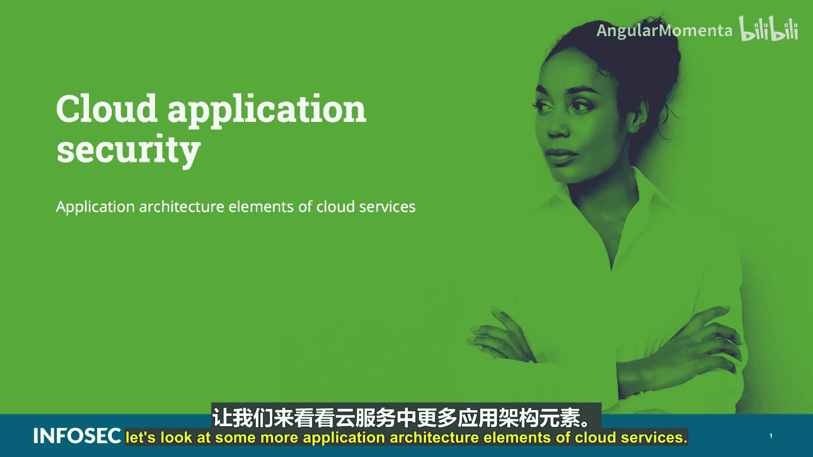
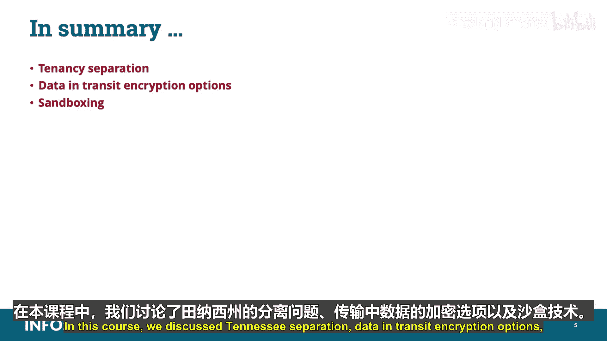

# 【Infosec】认证云安全专家 ｜ Certified Cloud Security Professional (CCSP) p28 05_01_03_application-architecture-elements-of-cloud-services -BV1TWrHBrEbk_p28-

As part of the cloud application security domain of the CCSP certification。

 let's look at some more application architecture elements of cloud services Before we dive into this course。

 I want to point out that I will be calling out specific information you must know for the CCSP exam by highlighting it in a different color as depicted by the double asterisk callout as seen on the screen everything highlighted in that color is relevant for the exam In a legacy enterprise where all infrastructure and resources are owned and controlled by the organization there is no risk of other tenants including the organization's competitors of accessing the organization's data through inadvertent datableed between applications。

 operating systems guest images and users the exact opposite is true of the cloud environment since the cloud uses multitenancy for instance。

 a typical host machine can support numerous virtual tenants based on the amount of CPU Ram and storage it has。

So all of those possibilities exist， therefore， the risk of each inaddvertent data bleed between applications。

 operating systems， guest images and users must be addressed by significant use of countermeasures that ensures access control。

 process isolation and denial of guest or host escaped attempts are addressed。

 usually the implementation of countermeasures will be dependented on some form of remote administration and will most likely require significant negotiation and cooperation with the provider。

One feature that makes cloud-based operations so desirable is the flexibility to use current datas in new and novel ways。

 This capability is offered and enhanced through the deployment of a wide variety of application interfaces。

 many of which can be chosen by the cloud customer and even still more that can be selected by the user on the user's own platform or device in a B your own device environment。

 although the variety of options is enticing it still brings with it some risk。

 since the API is used to provide this capability might be of questionable origin。

 it's in the best interest of the cloud customer to formalize a policy and process for vetting。

 selecting and deploying only those As that can be validated in some fashion a method for determining the trustworthiness of the source and the software itself must be put in place as part of your policy or procedure and incorporated into your change management program。

 in addition to change management onpreise or。Aplications， as they're often called。

 are usually designed to run in a fast local environment where the data is accessed。

 processed and stored locally。Moving these to the cloud is not always practical or even possible problemsms encountered can be as simple as making calls back to the enterprise which slows down an application and is complex as code that will not run effectively on certain cloudbased web platforms because they're designed to function in an on- premiseise environment。

 However， some applications specifically database applications might run even better in the cloud。

 typically cloud storage is faster than older enterprise spinning disks and the data usually has a much smaller distance to travel in order to reach compute and storage components since they're all stored in the same logical unit。

 The problem is that they're not all ready for the cloud oftentimes code must be re-evaluated and altered in order to run effectively in the cloud。

 encryptryion may be needed that had not been used in the past and a host of other issues exist even though some application。

😡，Will eventually run successfully in the cloud， theyre not always immediately ready and may require code or configuration changes in order to work effectively。

When working with cloudbased systems， it's important to remember they are operating within and across trusted and untrusted networks。

 also known as semihostel and hostile environments because of this data held within communications to and between systems and services operating in the cloud should be encrypted here we have a few more examples of data in transit encryption options。

 transport layer security is a protocol that ensures privacy between communicating applications and their users on the internet when a server and client communicate transport layer security ensures that no third parties may eavesdrop or champer with any messages transport layer security is a successor to the secure socket layer SSL secure socket layer is the standard security technology for establishing an encrypted link between a web server and a browser This link ensures that all data passed between the web server and。

Browsers remain private and integral VPN also known as IPSac Gateway is a network that is constructed by using public wires usually the intranet to connect to a private network like a company internal network there are a number of systems that enable you to create networks using as a medium for transporting data remember the need for the use of cryptography and encryption is universal for the provisioning and protection of confidentiality services in the enterprise it's important to be aware of the relevant data security technologies you may need to deploy or work with to ensure the confidentiality integrity and availability of the data in the cloud potential controls and solutions can include encryption for preventing unauthorized data viewing data loss prevention DLPs for auditing and preventing unauthorized data exfiltration file and database access monitor for detecting unauthorized access to data。

storetored in files and databases and obfuscation， anonymization， tokenization and masking。

 which are different alternatives for the protection of data without encryption It's the process of hiding original data with random characters or data technologies and approaches such as tokenization data masking and sandboxing are valuable to augment the implementation of cryptographic solutions sandboxing is a form of software virtualization that lets programs and processes run in their own isolated environment in the realm of cloud computing sandboxing refers to the concept of a protected area being utilized for testing untested or untrusted code in a tightly controlled environment or to better understand if an application is working the way it was intended to work by executing them in observing the file behavior for indications of malicious activity These sandboxes are usually protected areas and memory。

That will not allow processes of any kind to run outside the environment or allow access inside from other applications or processes。

 In other words， a sandbox isolates and utilizes only the intended components while having appropriate separation from the remaining components。

 that is the ability to store personal information in one sandbox with corporate information in another sandbox Many developers today will rent such cloud platforms specifically for testing because the model is based on metered usage。

 pay per use， the developer only has to pay for it as long as they're using it Once the application development has completed。

 they can turn the service down and stop paying for it。

Several vendors have begun to offer cloudbased sandbox environments that can be leveraged by organizations to fully test applications。

 you should also know that since programs running within the sandbox have limited access to your files and systems it can't make any permanent changes that means that whatever happens in the sandbox stays in the sandbox sandboxing is also an alternative to traditional signaturebased malware defense and is seen as a way to spot zeroday malware and stealthy attacks in particular newer browsers implement sandboxing and stronger ActX controls to help mitigate ActX vulnerabilities。

 so if it's a signed certificate it can do whatever it wants if it's not signed it stays in thebox In this course we discussed Tennessee separation data and transit encryption options and sandboxing。

