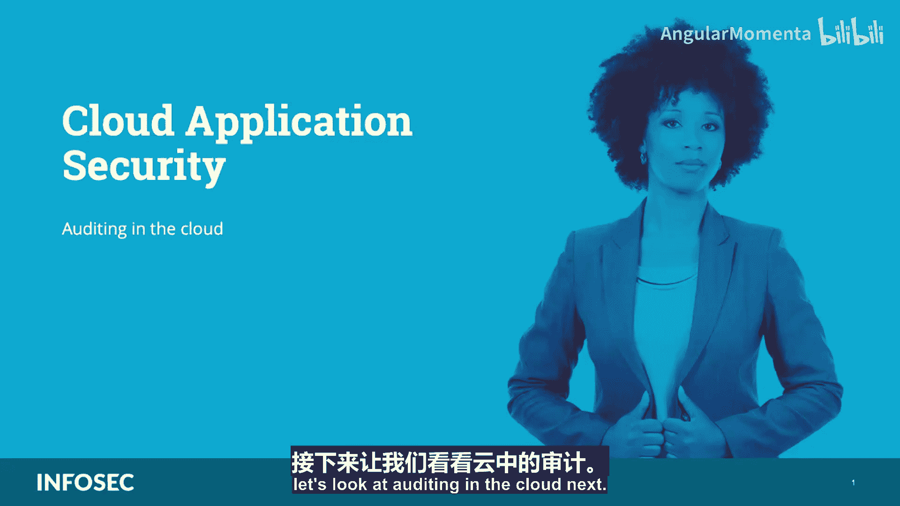
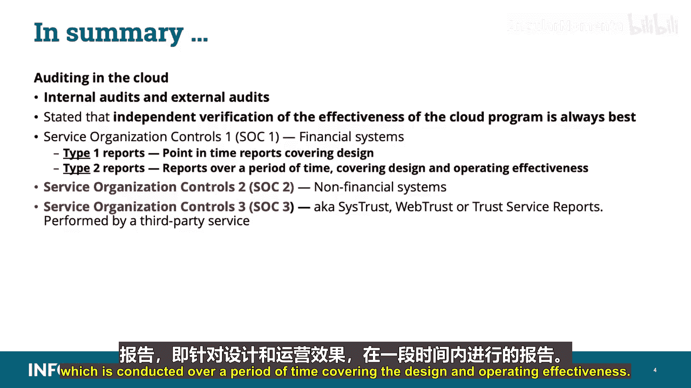

# 【Infosec】认证云安全专家 ｜ Certified Cloud Security Professional (CCSP) p29 05_01_04_auditing-in-the-cloud -BV1TWrHBrEbk_p29-

As part of the cloud application security domain of the CCSP certification。

 let's look at auditing in the cloud next Before we dive into this course。

 I want to point out that I will be calling out specific information you must know for the CCSP exam by highlighting it in a different color as depicted by the double asterisk callout as seen on the screen everything highlighted in that color is relevant for the exam。

Auditing a cloud environment is difficult to say the least the cloud Security Alliance CA has developed the cloud controls matrix CCM。

 which looks to list and categorize the domains and controls along with which elements and components are relevant according to the controls。

 The cloud controls matrix is an invaluable resource when identifying and listing each action and what impacts they may have Also within the spreadsheet。

 a best practice guide is given for each control along with mapping the cloud control matrix against frameworks and standards like ISO 271 NIST 853 or 8171 Cobitt CA trusted cloud initiative。

 NA Framp and a bunch of others。 the cloud controls matrix and appropriate framework should form the foundation for any cloud strategy。

 risk review or CP based assessment as organizations transition services to the cloud there has to be an ongoing assurance from both cloud customers。

And providers that controls are put in place or are in the process of being identified an organization's internal audit acts as a third line of defense after the business I functions and risk management functions The internal audit functions can engage with stakeholders review the current risk framework with a cloud lens。

 assist with highris mitigation strategies and perform a number of cloud audits like organizations current cloud governance program。

 data classification governance and shadow I， which describes information technology systems and solutions built and used inside organizations without explicit organizational approval Cloud providers conduct internal audits as well。

 especially around deployments of new services to obtain feedback during the planned design of cloud controls their customers will need as well as to mitigate risks。

Another potential source of independent verification on internal controls will be audits performed by external auditors。

 and external auditor scope varies greatly from an internal audit in that external audits usually focused on the internal controls over financial reporting In verification of the effectiveness of controls and cloud programs is always the best option the statement on standards for attestation engagements SSAE is a regulation that defines how service organizations report on their compliance using the various service organizations reports known as SoC12 or3。

The statement on standards for attestation version 16 of the regulation was replaced by SSAE18 as of May 1st。

 2017， what I want you to remember is the kind of reports SoC 1，2 or 3， and the types of reports。

 type 1 or2， and how they're used， let's break these down。

Service organizationization Control1 or SOC1 audits focus on description of security mechanisms to assess their suitability and reports on the internal controls over the organization's financial reporting this examination is conducted in accordance with the statement on standards for attestation engagements number 16 SSAE16 now SSAE18。

 which replaces the old statement on Aing standard number 70 SAS 70 the International equivalent to the SOC1 report is the International auditing and As standards Board IAAB issued and approved ISAE3402。

Service organizationization control2， SoOC2 audits pertain to trust services and focuses on implemented security controls in relation to confidentiality。

 integrity， availability， security and Pri， SoC2 reports are for nonfinanal systems。

 and they focus on the implementation of the organization's F controls such as NIST 853， ISIL 27，000。

 Coso， IT etc， in relationship to the confidentiality， integrity and availability。

 security and privacy for the organization， similar to the SoC1 in E of controls。

 the SoC2 reports is an examination that expands the evaluation of controls to the criteria set forth by the American Institute of Certified Public Accountants。

 Trust Princ and is generally a restricted report Service organization control3 SoOC3 also known as System Trust。

 Web trust or service trust reports pertains to trust services。Security availability。

 confidentiality， process， integrity and privacy， but it's done by an independent auditor。

 The difference between a SoC2 and a Soc3 is that the resulting SoC2 report provides very detailed data pertaining to the controls that provide the listed trust services and includes a description of the tests performed by the auditor。

 the results of those tests and the auditor's opinions of the effectiveness of the individual controls and systems。

 which is not for general public use， whereas the Soc 3 report does not contain test information and details on the controls in place。

 but just reports whether the system meets the requirements of the criteria for which the specific trust service has been identified and is intended to be used by the public。

 it also provides a certification seal normally displayed on websites such as ISO 27001 certified。

 There are two types of soC reports typepe 1 reports。

 which are a point in time reports covering the design and a type 2 report， which are。

Period of time reports covering design and operating effectiveness， for example。

 in a SoC1 type1 report， your organization explains and documents the system and the accountant attests that the controls work as of a point in time to management in a SoC1 type2 report the accountant actually tests those controls over a period of time and attests that the controls worked over that period of time to management In summary。

 In this course we discussed auditing in the cloud internal audits and external audits stated that independent verification of the effectiveness of cloud programs is always best we discussed service organization controls SoC1 financial systems SoC2 non-financi systems and SoC3 also known as system trust web trust or service trust reports which is performed by a thirdparty service。

We also talked about the types of reports， type1 report。

 which was a point in time report covering the design and a type 2 report which is conducted over a period of time covering the design and operating effectiveness。

