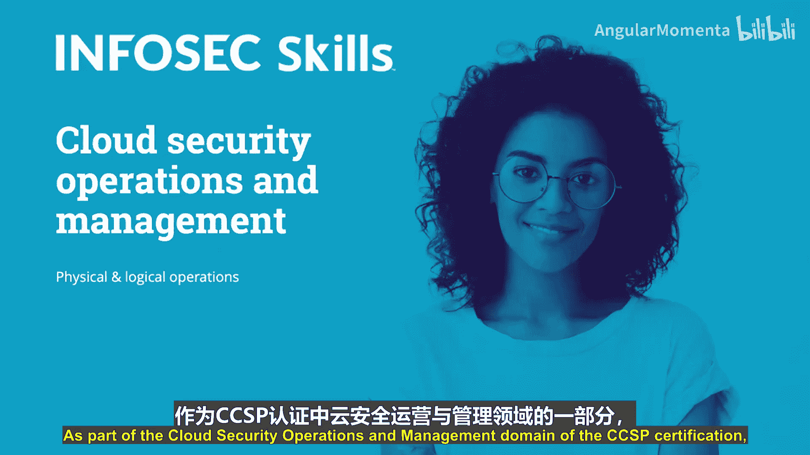
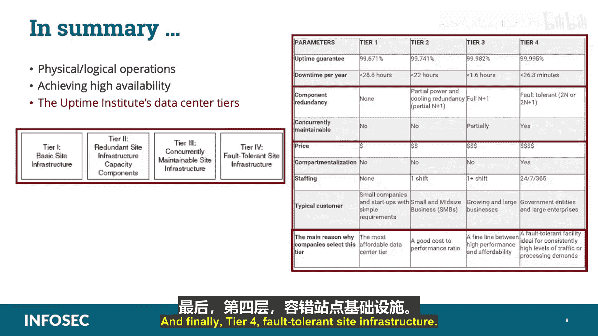

# 【Infosec】认证云安全专家 ｜ Certified Cloud Security Professional (CCSP) p30 06_01_01_physical-and-logical-operations -BV1TWrHBrEbk_p30-

As part of the cloud security operations and management domain of the CCSP certification。

 let's look at physical and logical operations next Before we dive into this course。

 I want to point out that I will be calling out specific information you must know for the CCSP exam by highlighting it in a different color as depicted by the double asterisk callout as seen on the screen Everything highlighted in that color is relevant for the exam The cloud data center has to be robust and resilient to all types of threats from natural disasters to hacking attacks to simple component failures This strength and capacity has to be comprehensive and exhaustive enough to provide close to continuous system operations and data access referred to as uptime for multiple customers with a wide spectrum of service needs Currently the industry standard for uptime and cloud service provisions is 59s which means 99。

999% uptime or better59。

Over the calendar year equates to less than six minutes of downtime per year。

 This expectation is usually formally documented with a service level agreement。

 an SL and is communicated to all users so that they understand the systems availability Keep in mind that uptime and availability are not synonymous For instance。

 a system can be up but not available or have a situation where the customer' availability to connect to the data center may be limited by a failure within the customer' Internet service provider ISP This would be a lack of availability from the customers perspective。

 but not a lack of uptime on the part of the provider。 the data center is up。

 It's just that the customer can't reach it for practical purposes the term uptime and availability are usually meant to communicate the same notion the cloud provider ability to offer services within the parameters specified in the service level agreement without undo and interruption with the implicit understanding that。

Provider is not responsible for the customer's inability to access the data center for reasons outside the provider's purview in order to ensure system availability。

 the focus needs to be on making sure that all required systems are available as stipulated in their service level agreement the traditional way that system availability is measured and documented in an SLA service level agreement is using a measurement matrix like the one outlined on the screen the tiered model may be used by the CCSP the certified cloud security practitioner as a reference for the key design elements and requirements by tier level will discuss this more in a few minutes。

The cloud infrastructure needs to be designed and maintained for continuous uptime。

 This implies that every component is redundant。 This serves two purposes。

 It makes the infrastructure resilient against component failure and it allows individual components to be updated without affecting the cloud infrastructure uptime。

 while designing the data center redundancy has to be considered not only for the I systems and infrastructure。

 but also for all aspects of functionality that support the operations of the data center these include utilities both electrical power。

 receipt and distribution， water communications， connectivity， staff。

 emergency capabilities mostly power generation and fuel for the same egress paths for personnel HfAC and security controls。

 There are many approaches that you can use to achieve highava。

 One example is the use of redundant architectural elements to safeguard data in case of failure like。

Drive mirroring or rate solutions Another example specific to the cloud environments is the use of multiple vendors within the cloud architecture to provide the same services。

 This allows you to build certain systems that need a specified level of availability to be able to switch or fail over to an alternate provider system within the specified time period defined in the service level agreement that is used to define and manage availability windows for the system。

 Currently ISC squared looks to the uptime Institute for standards related to data center redundancy in pursuit of continuous operations。

 The Uptime Institutestit is an advisory organization for matters related to IT services。

 The Uptime Institutesit publishes a standard for data center design and it also certifies data centers for compliance with this standard The Uptime Institutestitute's standard is split into four tiers in ascending durability of the data center Tier1 is a simplistic data。

With little or no redundancy and is labeled basic site infrastructure。

 it lists the minimum requirements for a data center。

 which must include dedicated space for IT systems and uninterruptible power supply system for line conditioning and backup purposes。

 sufficient cooling systems to serve all critical equipment and a power generator for extended electrical outages with at least 12 hours of fuel to run the generator at sufficient load to power the IT systems remember for the exam that 12 hours is the standard fuel requirements for all four tier levels。

Tier1 data centers also have the following features First。

 scheduled maintenance will require systems， including critical systems to be taken offline。

 both planned and unplanned maintenance and response activities may take systems including critical systems offline as well improper personnel activity both inadvertent and malicious will result in downtime and finally annual maintenance is necessary to safely operate the data center and requires full shutdown including critical systems without this maintenance the data center is likely to suffer in increased outage and disruption this type of facility may be appealing to organizations that only need or only use the data center services as a backup for its own enterprise and data perhaps even the organization's own private cloud and it only needs to be available occasionally and very temporarily from this。

Ppect， a tier1 data center might be suitable as a hot site or warm site for the organization with data uploaded on an infrequent basis。

 perhaps weekly or monthly， or it might even serve as a cold site where the data is only uploaded at those times when the organization is experiencing an emergency situation and needs to enact a contingency operation。

 so a tier1 data center might be the least expensive option for an organization that does not require constant uptime and access to resources and data because it's the least functional。

A tier 2 data center is slightly more robust than a tier 1。

 and it is named for its defining characteristics， redundant site infrastructure capacity component。

 It features all the attributes of the tier1 design with the additional elements of critical operations do not have to be interrupted for scheduled replacement and maintenance of any of the redundant components。

 however， there may be downtime for any disconnection of power distribution systems and lines Con to tier1 where improper personnel activity will cause downtime in tier 2 it may result in downtime and unplanned failures of components or systems might result in downtime with the benefits of rudimentary redundancy the tier 2 data center is obviously more suited to cloud operations and is more appealing for that purpose it may still be more affordable than the higher tiered offerings。

 but it is。Now viable as a dependable alternative for continuous use。

 this may be a good option for a small organization looking to operate in the public cloud environment while still maintaining a relatively low overhead。

The tier 3 design is known as the concurrently maintainable site infrastructure as the name indicates the facility features both the redundant capacity components of a tier2 build and the added benefits of multiple distribution paths where only a sole path is needed to serve the critical operations at any given time the characteristics that distinguish tier 3 from the prior levels include dual power supplies for all IT systems critical operations can continue even if any single component or power element is out of service for scheduled maintenance or replacement unplanned loss of components may cause downtime the loss of a single system on the other hand will cause downtime The implemented distinction is that the component is one node in a multi node system while each system will have redundant components not all systems are redundant and finally。

And maintenance to include schedule holistic annual maintenance of the facility will not necessarily result in downtime。

 However， the risk of downtime may be increased during this activity。

 this temporary elevated risk does not make the data center lose its tier 3 rating for the duration obviously。

 a cloud provider offering a tier 3 data center is a viable candidate for organizations looking to migrate to the public cloud。

 Most organizations with regular operational needs might consider a tier3 option。

 Those organizations with specialized needs， perhaps organizations with highly sensitive material such as governmental agencies or entities that utilize a great deal of intellectual property or large scale organizations with absolute constant uptime requirements might instead consider a tier4 option。

 but the tier 3 should serve the purposes for all others。

The fault tolerance site infrastructure is the premium data center offering as the Uptime Institute repeats in the descriptions of this tier。

 each and every element and system of the facility， whether for IT processing， the physical plant。

 power distribution or anything else has integral redundancies such that critical operations can survive both planned and unplanned downtime at the loss of any component or system does this mean a tier4 data center is indestructible with permanent uptime of course not anyone marketing such an offer should be viewed with suspicion however。

 it is the most robust resilient option available in addition to all of the subsequent tier features。

 the tier 4 data center will also include redundancy of both IT and electrical components where the various multiple components are independent and physically separated from each other even after the loss of any facility infrastructure element there will be。

Sufficient power and cooling for critical operations the loss of any single system component or distribution element will not remember that affect critical operations。

 the facility will feature automatic response capabilities for infrastructure control systems such that the critical operations will not be affected by infrastructure failures any single loss event or personnel activity will not cause downtime of critical operations and finally。

 scheduled maintenance can be performed without affecting critical operations however。

 while one set of assets is in the maintenance state。

 the data center may be at increased risk of failure due to an event affecting the alternate assets during this temporary maintenance state。

 the facility does not lose its tier4 rating。 a tier4 data center should be fit to serve any organization considering cloud migration。

 regardless of the sensitivity of their information assets or uptime needs it will likewise be the most。

Expenenssive selection and will probably be limited to those organizations that have the resources to afford it。

In summary， in this course， we discussed physical and logical operations。

 achieving high availability and the Uptime Institute's data center tiers， Tier one。

 basic site infrastructure， Tier 2， redundant site infrastructure capacity components， tier  three。

 concurrently maintain site infrastructure， and finally， Tier4， fault tolerant site infrastructure。

