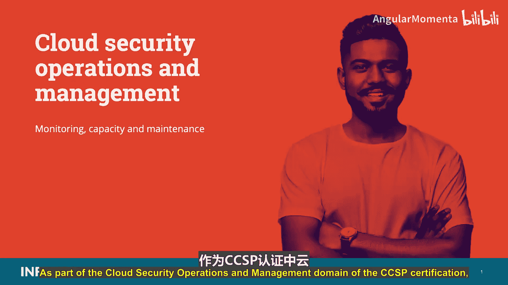
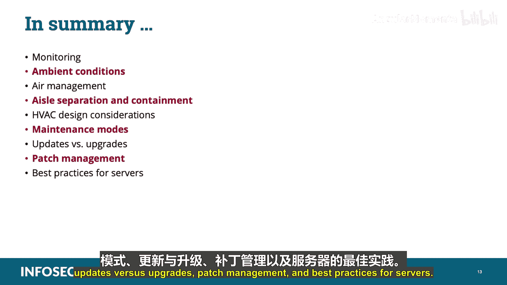

# 【Infosec】认证云安全专家 ｜ Certified Cloud Security Professional (CCSP) p31 06_01_02_monitoring-capacity-and-maintenance -BV1TWrHBrEbk_p31-

As part of the cloud security operations and management domain of the CCSP certification。

 let's look at monitoring capacity and maintenance next Before we dive into this course。

 I want to point out that I will be calling out specific information you must know for the CCSP exam by highlighting it in a different color as depicted by the double asterisk callout as seen on the screen everything highlighted in that color is relevant for the exam It's important for data center operators to know how their hardware software and networks are being utilized and what demand is being placed on all of the relevant resources。

 This information helps data center operators understand how to better balance and allocate all of the resources in order to fulfill customer needs and maintain compliance with service level agreements when we're talking about monitoring we're really looking at software hardware and network components which need to be evaluated in real time so as to understand which systems may be nearing capacity use and so that。

The organization can respond as quickly as possible when problems arise。

 This can and should be done with several of the possible tools at the operator's disposal Opera system logging。

 for example， Most operating systems have basic tools sets for monitoring performance and events the cloud vendor can set the operating system logs to alert administrators when usage approaches a level of capacity utilization or performance degradation that may affect the service level agreements parameter。

 These can include CPU usage， memory usage， disk space。

 virtual or tangible and disk input output timing， which is an indicator of slow writing or reading to and from the disk another area would be hardware monitoring as with the operating system。

 Many vendors include performance monitoring tools in common device builds。

 these can be used to measure such performance indicators as CPU temperature fan speed， voltage。

 consumption and throughput， CPU load and。Clock speed and drive temperatures commercialmer products are also available to collect and supply this data and provide alerts if this functionality is not integral to the devices from the manufacturer and finally network monitoring in addition to the operating system and the devices themselves the various network elements including not only the hardware and the software but also the distribution facets such as cabling and softwared networking control planes Sn need to be monitored the provider should ensure that current capacity meets customer needs and increased customer demands to assure that the flexibility and scalability traits of cloud computing are still provided and that the network is not overburdened or subjected to unacceptable latency As with all log data the performance monitoring information can be fed into a security information and event management Sm security event management or security information management system for centralized analysis。

and review。In addition to hardware and software， it's important to monitor ambient conditions within the data center in particular。

 temperature and humidity are essential data points for optimizing operations and performance so the question is what roles do temperature and humidity play in terms of affecting equipment performance while think of it this way an ambient temperature that's too high may allow equipment to overheat highcap electric components generate a great deal of waste heat and the devices can be sensitive to conditions that exceed their operating parameters whereas an ambient temperature that is too low can be a risk to health and human safety touching bare metal at freezing points can burn or remove skin Moreover。

 people working in such conditions would simply be uncomfortable and unhappy so these conditions can lead to dissatisfaction which in turn leads to security risks an ambient humidity that is too high can promote corrosion on metallic components as well as mold and other organisms and。

And temperature that is too low can enhance the possibility of static discharge。

 which might affect both personnel and equipment， as well as increase the potential for fires。

 It's important to capture a realistic portrayal of the temperatures within the data center perhaps by averaging measurements across several thermostatic devices located throughout the airflow process while there are many specific and detailed recommendations。

 the general American Society for Heating refrigeration and air conditioning also known as aray recommend ranges for a data center which are temperature 64 to 81 Fahrenheit。

 In other words， 18 to 27 Celsius and humidity the dew point of 42 to 59 degrees Fahrenheit or 5。

5 to 15 degrees Celsius relative humidity of 60% you will need to know that for the exam and just keep in mind that on the exam it will show you both temperatures in Fahrenheit and Celsius and will also be rounded up or down。

To the nearest number while these ranges give a general notion of the condition of the ambient environment within a data center guidance from the American Society for Heating refrigeration and air conditioning engineers is a lot more detailed regarding specific ranges based on the type age and location of the equipment These ranges refer to the I equipment intake temperature temperatures can be controlled at several locations in the data center。

 for example， at the server inlet the server exhaust floor tile supply temperature。

 Heating ventilation and air conditioning unit return air temperature and of course。

 computer room airconing unit supply temperature know the recommended operating ranges for temperature and humidity for the exam Air management is a balance between the cooling air supplied to the equipment and the hot air rejected from the equipment effective air management implementation minimizes the bypass of cooling air around rack intakes and recirculation of heat exhaust back into the rack intakes。

Why is this important， Because an air management system can reduce operating costs。

 reduce first cost equipment investment， increase the data center's power density watts by square foot and reduce heat related interruptions or failures When we're talking about cable management。

 persistent cable management is a key component of effective air management instituting a cable mining program for example。

 a program to remove abandoned or inoperable cables as part of an ongoing cable management plan will help optimize the airflow delivery performance of data center cooling systems。

 Hospots can happen because of underfloor or overheated obstructions which often interfere with the distribution of cooling air cable congestions in raised floor pellumms。

 which can sharply reduce the total airflow， as well as degrade the airflow distribution through the perforated floor tiles。

 you should also know that a minimum effective clearance height of 24 inches should be provided for raised floor。

Installs remember that for the exam that the minimum level is 24 inches for raised floors。

 Another important area in airflow is the aisle separation and containment。

 just as the name implies data center equipment is laid out in rows of racks with alternating cold rack air intake side and hot rack heat exhaust side aisles between them strict hot aisle and cold aisle configurations can significantly increase the airside cooling capacity of a data center's cooling system。

 which is what this picture illustrates The main thing to remember here is that separating the hot and cold aisles can significantly increase the airside cooling capacity of the system。

 industry guidance should be followed to provide adequate Hva to protect the server equipment。

 This slide has some basic considerations Id。 Understand that local climate will impact the Hfac design requirements。

 Redundant HfAC systems should be。Of the overall design。

 the HFAC system should provide air management that separates the cool air from the heat exhaust of the servers considerationations should be given to energy efficient systems。

 backup power supplies should be provided to run the HFAC system for the amount of time required for the systems to stay up。

 and finally， the HFAC system should filter contaminants and dust。

Continual uptime requires maintaining the overall environment constantly。

 This also includes maintaining individual components。

 both on a scheduled basis and at unscheduled times as necessary。 In this course。

 we mainly focus on general maintenance matters， updates， upgrades and patch management。

 The operational modes of data centers can be perceived as two categories。

 normal mode and maintenance mode。 realisticistically。

 the data center taken holistically will consistently be in maintenance mode as ongoing maintenance of specific systems and components is necessary for continuous uptime。

 Therefore， a cloud data center can be expected to be considered in constant normal mode with various individual systems and devices continually in maintenance mode to ensure constant operations。

 This is especially true for tier 3 and4 data centers where redundant components。

 lines and systems allow for maintenance to occur simultaneously with uninterrupted。

Ctical operations because of this， let's look at the systems and devices in terms of normal mode and maintenance mode specifically。

Maintenance mode is utilized when updating or configuring different components of the cloud environment when in maintenance mode。

 customer access is blocked and alerts are disabled。

 though logging is still enabled remember that for the exam that when you're in maintenance mode customer access is blocked and alerting is disabled but you still log everything you should enter maintenance mode operate within it and then exit it successfully using the vendorspec guidance and best practices any hosted virtual machine or Vms or data should be migrated prior to entering maintenance mode if it still needs to be available for use while the system undergoes maintenance maintenance mode can apply to both data stores as well as hosts the service level agreement should describe the IT service document the service level targets and specify the responsibilities of the IT service provider and the customer when a system or device is put into maintenance mode the data center operator must ensure。

Certain tasks are successful， for example， prevent all new logins for the same reason as the previous task。

 we don't want customers logging into the affected systems and devices ensure login is continued and begin enhanced logging Ad activities are much more powerful and therefore pose a higher risk than the actions of a common user It's therefore recommended that you log administrator actions at greater rates and levels of detail than that of regular users maintenance mode is an administrative function so the increased logging is necessary before moving the system or device from maintenance mode back to normal operations it's important to test that it has all of the original functionality necessary for the customers purposes that the maintenance was successful and that the proper documentation of all activities is complete and updated。

Industry best practices include ensuring we comply with all vendor guidance regarding specific products。

 In fact， failing to adhere to vendor specifications can be assigned that the operator has failed in providing the necessary due care In other words。

 showing that we're doing the right thing whereas documented adherence to vendor instructions can demonstrate due diligence。

 proving that were doing the right thing。 In addition to configurations prior to deployment also known as change and configuration management discussed more later。

 vendors will issue ongoing maintenance instructions， often in the form of updates or patches。

 this can be both in the form of application packages for software and firmware installs for hardware。

 the update process should be formalized in the operator's governance as should all processes and they should all spawn from a policy。

 it should include the following elements at a minimum， document how。

 when and why the update was initiated if promulgated by the vendor annotate the detail。

Of the communication， date， update， code or number， explanation and justification。

 some of this may be included by reference， such as with a URL to the vendor's page announcing the update instructions。

 move the update through the change management C process。

 All modifications to facilities should be through the change management methodology and documented as such although we'll cover the details on the change management process more later。

 it should be stressed that sandbox testing should be included as part of the change management process before the update is applied at a high level。

 we would first put the system and the device into the maintenance mode。

 then we would apply the updates to the necessary systems and devices annotate the asset inventory to reflect the changes。

 After that， we would verify the update， run tests on the production environment to ensure all necessary systems and devices have received the update if any were missed。

 Re the installation until it is。After that， we would validate the modifications。

 ensuring that the intended results of the updates have taken effect and that the updated systems and devices interact appropriately with the rest of the production environment。

 and finally we return to normal operations， resuming regular business。Upgrades in this context。

 we distinguish updates from upgrades with this purpose。

 Upates are applied to existing systems and components。

 whereas upgrades are the replacement of older elements with new ones。

 The upgrade process should largely mapped to the onef updates。

 including formalization and governance change management methodology testing and so forth。

 Part attention in upgrading needs to be placed on documenting the changes in the acid inventory。

 not only adding the new elements， but annotating the removal and secure disposal of the old ones。

 This， of course， means that the secure disposal is one of the elements of the upgrade process that is not included in updates。

 patches are a variety of updates most commonly associated with software。

 We distinguish them here by their frequency。 So vendors commonly issue patches for both immediate response to a given need。

 such as。Newfound vulnerability and for routine purposes such as fixing。

 adding or enhancing functionality on a regular basis the patch management process must be formalized in much the same manner as updates and upgrades with its inclusion in policies and so forth。

 However patches incur additional risks and challenges the suggestions in considerations listed on a screen should be taken into account when managing patches for a cloud data centers look at timing first when a vendor issues a patch there's a binary risk faced by all those affected if they fail to apply the patch。

 they may be seen as failing and providing due care for those customers utilizing the unpatched product if the patches applied in haste it may adversely affect the production environment harming the customers' ability to operate。

 This is especially true when patches are issued in response to newlyfo vulnerabilities and the vendor was rushed into identifying the flaw find and create a solution。

 publish the fix and issue the patch。In the rush to deal with the problem， even more。

 especially when the vulnerability is well publicized and gains public attention。

 the patch may cause other vulnerabilities or affect other systems by attenuating some interoperability or interface capabilities。

 A data center operator may be tempted to allow others in the field to apply the patch first in order to determine its effect and outcomes based on the experiences of their competitors。

 The risk in that option is that in the meantime， loss or harm might be caused by or occur via the vulnerability the patch was meant to fix and could result in a lawsuit for failing to exercise due diligence。

Implementation， either automated or manual patches can be applied with mechanized tools or by personnel。

 There are two obvious benefits and risks for both methods。

 The operator will have to decide which to use on both a general basis， In other words。

 by policy and for each case， when a patches issued if the circumstances demand。

 Let's look at the risk and benefit for each automated。

 a mechanized approach will allow for much faster delivery to far more targets than a manual approach。

 patch tools might also include a reporting function that annotates which targets have received the patch crossred against the acid inventory and have an alerting function to inform administrators。

 which targets have been missed without a capable human observer。 However。

 the tool might not function thoroughly or properly。

 the patches might be misapplied or the report might be inaccurate or portray an inaccurate picture of completeness with manual。

Trained and experiencedienced personnel may be more trustworthy than the mechanized tool and might understand when anomalous activities occur。

 However， with the vast number of elements that need to be patched in a cloud data center。

 the repetitiveness and boredom of the patch process may lead even a seasoned administrator to miss a number of targets。

 Moreover， the process may be much much slower than the automated option and may not be as thorough。

Now， with dates， as the patches pushed throughout the environment。

 the actual date time stamp may become an important and misleading matter in acquiring and acknowledging receipt。

 This problem can be compounded when patch agents are set to check for patches according to the time specified by the internal clock and different targets have internal clocks set to differing time zones in the case say of a customer whoses geographically dispersed。

 This is escalated in the cloud motif because of the wide use of virtualization all virtualized instances saved as images and not currently initiated during the patch delivery will be receiving the patch only after they are booted up next time。

 This means that the process will endure until all virtual machines have been made live。

 which could represent a significant amount of time after the decision to implement the patch。

 The result is a relatively long delay between the time the operator decides to implement the patch and the time the 100% completion is annotated。

This reflects poorly on the process of the operator， especially in the eyes of regulators in courts。

 perhaps the optimum technique is to combine the benefits of each method using both manual and automated approaches manual oversight is valuable in determining applicability of patches and testing the patches for suitability in the environment while automated tools can be used to propagate patches and ensure uniform application On this screen we have some best practice recommendations to secure host servers within cloud environments First secure build to implement fully follow the specific recommendations of the operating system vendor to securely deploy their operating system Second secure initial configurations this may mean many different things depending on the number of variables like operating system vendor operating environment business requirements。

 Reg requirements risk assessment and risk appetite as well as workloads to be hosted on the system the common list of best practices。

Host hardening by removing all nonessential services and software from the host。

 host patching by installing all of the required patches provided by the vendor whose hardware and software are being used to create the host server host lockdown implement host specific security measures which vary by vendor and secure ongoing configuration maintenance。

 This is achieved through a variety of mechanisms， some vendor specific some not engage in the following type of activities。

 patch management of host guest operating systems and application workloads running on them periodic vulnerability assessments scanning of host guest operating systems and application workloads running on the hosts and periodic penetration testing of host and guest operating systems running on them。

 In summary， In this course we discussed monitoring， ambient conditions， air management。

 aisle separation and containment H factAC design considerations， maintenance modes。

 updates versus upgrades。

tch management and Best practices for servers。