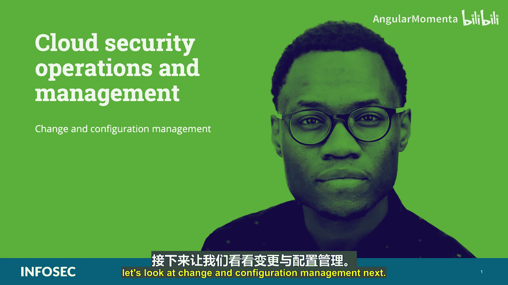
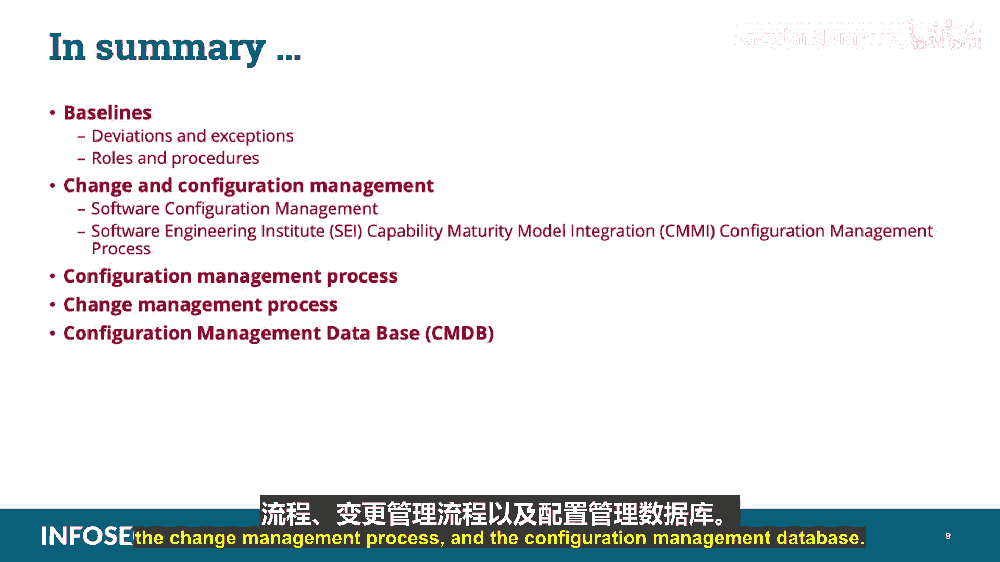

# 【Infosec】认证云安全专家 ｜ Certified Cloud Security Professional (CCSP) p32 06_01_03_change-and-configuration-management -BV1TWrHBrEbk_p32-

As part of the cloud security operations and management domain of the CCSP certification。

 let's look at change and configuration management next。 Before we dive into this course。

 I want to point out that I will be calling out specific information。

 You must know for the CCSP exam by highlighting it in a different color as depicted by the double asterisk call out as seen on the screen。

 Everything highlighted in that color is relevant for the exam。

There's many aspects in process of operations that need to be managed。

 and they often relate to each other。 For example， information security management。

 configuration management， change management， incident management， problem management。

 release and deployment management， service level management， availability management。

 capacity management， business continuity management。

 continual service improvement management and probably a lot more in this course will focus on configuration management and change management。

 data center operators like anyone who owns an IT network need to develop and maintain a realistic concept of what assets they control。

 the state of those assets， as well as detailed information about each。

 which includes an asset inventory the hardware software and media they own as part of this process。

 data center operators need to maintain documented records of configurations for all these elements versioning deviations。

 exceptions and rationale for each， as well as a formal process for determining how when。

W modifications need to be made there are primarily two processes used by the industry to accomplish this effort change management。

 which usually deals with modifications to the network。

 such as acquisition and deployment of new systems and components and the disposal of those taken out of service The other one is configuration management which usually concerns modifications to a known set of parameters regarding each element of the network including what setting each has how the controls are implemented and so forth configuration management aims to maintain information about configuration items required to deliver an I service including their relationships the specific ties to change management and availability management are important the process should include policies and procedures for the development and implementation of new configurations quality evaluation of configuration changes and compliance with established security baseline changing systems including testing and deployment procedures as well as。

The prevention of any unauthorized changes in system configurations without proper change control board CCB approval。

 the purposes of both are so similar in intent and procedure that we can group them together and discuss them as one concept we'll just call it configuration management from this point forward over to the next few screens we will discuss baseline configuration management change management processes and roles。

Configuration management begins with baselinelining。

 which is a way of taking an accurate account of the standard state for change management。

 that's a depiction of the network and systems based on a comprehensive and detailed asset inventory。

For configuration management， it's the standard build for all systems from the settings in the operating system to the setup of each application。

 The baseline is a general purpose map of the network and systems based on the required functionality as well as security security controls should be incorporated in the baseline with a thorough description of each one's purpose dependencies and supporting rationale that is a statement explaining what we hope to accomplish with each control It's absolutely essential to include the controls so that we are fully informed about risk managements as we consider modifications to the environment through the change management process if we're changing the controls set in any way or adding new systems and functionality to the environment we need to know if there will be any consequential increases in risk and therefore if we need to add any compensating controls to manage the new risk levels It's important to continually。

The baselines to determine that all assets are accounted for and to detect anything that differs from the baselines any such deviations。

 intentional or unintentional， authorized or unauthorized must be documented and reviewed these deviations might be the results of the faulty patch management process a roadgue device set up by a particular office or user an intrusion by an external attacker or poor versioning at administrative practices。

It's the duty of those personnel who are assigned change management roles to determine the cause and any necessary follow-up activity the baseline should always be a reflection of the risk appetite of the organization and provide an optimum balance of security and operational functionality if it's going to be used as a template。

 particularly in configuration management will get the most value from it if it applies to the greatest number of covered systems。

 make sure that the baseline is flexible and practical and that the exceptions request process is timely and responsive to the needs of the organization and its users a complicated slow exceptions process will lead to frustrated users and managers which can in turn lead to unauthorized workarounds implemented without permission of the change management authority。

 which brings us to deviations and exceptions， tracking exceptions and deviations is useful for other essential purposes in addition to ensuring regulatory compliance and security controls coverage。

If enough exception requests are being made that ask for the same or similar functionality that deviates from the baseline。

 we may be required to change the baseline。 The baseline is not serving any purposes if we continuously receive requests to modify elements of it。

 Moreover， addressing exception requests takes more time and efforts than modifying the baseline to incorporate new additional security controls to allow for the accepted functionality。

The change and configuration management process， as with all processes should be formalized in the organization's governance This policy supported by standards procedures and processes should include composition of the configuration and change management board。

 the CCMB， the process including scope purpose and affected organizations。

 documentation requirements， instructions for requesting exceptions。

 assignment of change or configuration management tasks such as validation scanning analysis and deviation notifications。

 Pro for addressing deviation upon detection and enforcement measures as well asresponsibilities。

 the change in configuration management board CCMB should be composed of representatives from all stakeholders within the organization recommend representatives include personnel from IT security。

 legal management， the user groups， finance and acquisition as well as HR Any other participants that the organization deems useful can certainly。

Be included in the CCMB the CCMB will be responsible for reviewing change。

 configuration and exception request。 The board will determine if the change will enhance functionality and productivity。

 whether the change is funded， what potential security impacts the change will incur and what additional measures in terms of funding training security controls and staffing might be necessary to make the change successful and reasonable the CCMB should meet often enough that changes and exception requests are not delayed unduly so that users and departments are not frustrated by the process。

 However， it should not meet so often that the time set aside for the CCMB becomes work。

 the personnel involved in the CCMB all have other primary duties and participation in the CCMB will impact their productivity In some cases。

 depending on the organization， the CCMB meets on an ad hoc basis responding only when change and exception request meet a certain threshold This can entail some risk。

Because if the CCMB members only meet on an ad hoc basis。

 they might lose some familiarity with the process Also scheduling a meeting of the CCMB with so many different offices might be awkward if the CCMB is not on a regular prioritized occurrence the configuration management process establishes and maintains the integrity of a product system or item that is being managed through its lifecycle within the organization it refers to a discipline for evaluating。

 coordinating， approving or disapproving and implementing changes in artifacts that are used to construct and maintain hardware or software system obviously the best method of controlling changes is to have a configuration management plan that ensures changes are performed only in the agreed manner any deviations from the plan could change the configuration of the entire system and could essentially void any certification that it's a secure and trusted system at its heart。

Configuration management is intended to eliminate the confusion and error brought about by the existence of different versions of artifacts。

 Change are made to correct errors， provide enhancements or reflect the evolutionary refinements of a product definition without a well informeded change management process  different team members can use different versions of the artifact unintentionally  individuals can create versions without the proper authority and the wrong versions of an artifact can be used inadvertently Another area that's important to understand is software configuration management。

 This involves identifying configuration items for the software project controlling those configuration items and changes to them。

 as well as recording and reporting status and change activity for those configuration items。

 The first step is to identify any changes that are made Control occurs when every change is subject to some type of documentation that must be reviewed and approved by an author。

Rise individual Account is recording and reporting on the configuration of the software or hardware throughout any change procedures Aiting allows for the complete change to be verified。

 especially ensuring that any changes did not affect the security policy or protection mechanisms that are implemented successful change management processes require a welldefined and institutionalized set of policies and standards that clearly defined the set of articles under the jurisdiction of the change management。

 how artifacts are named how artifacts enter and leave the controlled set。

 how an artifact under change management is allowed to change how versions of an artifact are made available and under what conditions each can be used and how change management tools are used to enable and enforce change management the software engineering ins SI capability maturity model CmiI for systems engineering and software engineering list these practices。

As instrumental for change management capabilities within an organization。

 identify the configuration items， components and related work products that will be placed under configuration management。

 establish and maintain a configuration management and change management system for controlling work products。

 create a release baseline for internal use and for delivery to the customer。

 track change requests for configuration items， control changes in the context of configuration items。

 establish and maintain records， describing configuration items and perform configuration audits to maintain the integrity of the configuration baselines。

 remember that configuration management is a process of identifying and documenting hardware components。

 software and associated settings， a well documented environment provides a foundation for sound operations management by ensuring that IT resources are properly deployed and managed the change management structure should be detailed in an organizational policy。

Proures for the operational aspects of the change management process should also be created。

 Remember that a change management process is structured so that you can record the request。

 the impact assessment， approval or disapproval， build and test， notifications， implementation。

 validation and versioning and baseline。The outcome of a system change should be recorded in the appropriate records include any system modifications that might have been made。

 as well as include any lessons that were learned during the deployment process。

 you need to understand that nothing gets changed unless it goes through the configuration and change control board to be formally introduced and approved The objectives of change management is to respond to a customer's changing business requirements while maximizing value and reducing incidents。

 disruptions and rework， respond to business and I requests for change that will align services with business needs。

 ensure that changes are recorded and evaluated， ensure that authorized changes are prioritized。

 planned， tested， implemented， documented and reviewed in a controlled manner。

 ensure that all changes to configuration items are recorded in the configuration management system and finally optimize overall business risk。

It is often correct to minimize business risk， but sometimes it's appropriate to knowingly accept a risk because of the potential benefits。

 A change management process focused on the cloud should include policies and procedures for the development and acquisition of new infrastructure and software。

 quality evaluation of new software and compliance with established security baselines。

 changing systems including testing and deployment procedures。

 they should include adequate oversight of all changes。

 and preventing the unauthorized installation of software and hardware。

 The configuration management database CMdb is where we integrate all assets together。

 hardware software data etc to include integrating service management processes as aicd by IT。

 the infrastructure library and includes inventory， configuration and I asset management。

 the CMdb enables powerful insight into the current and。

ever changing profile of the infrastructure this can be used to determine your cost benefit analysis During this course we discussed what baselines are exceptions and deviations。

 roles and procedures， the change in configuration management。

 software configuration management software engineering Institutestits cMI management process。

 configuration management process， the change management process。

 and the configuration management database。

