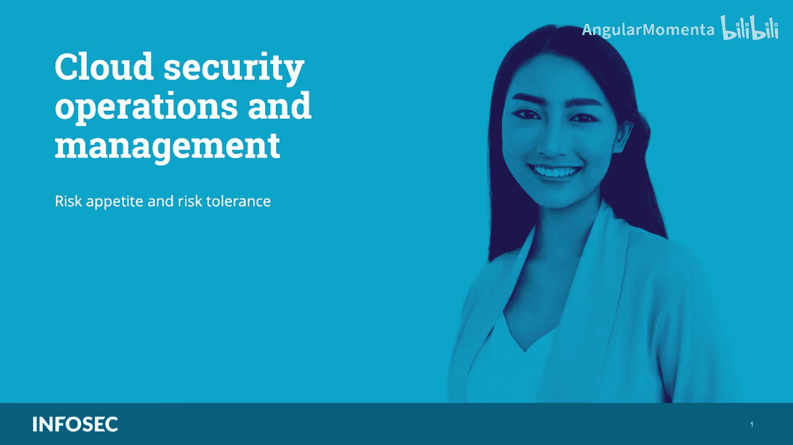
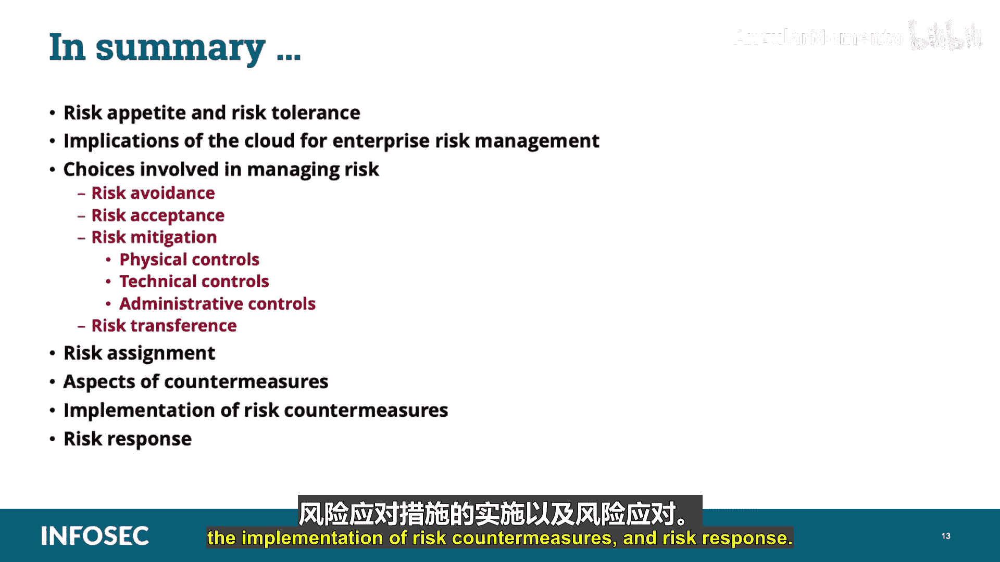

# 【Infosec】认证云安全专家 ｜ Certified Cloud Security Professional (CCSP) p33 06_01_04_risk-appetite-and-risk-tolerance -BV1TWrHBrEbk_p33-

As part of the cloud security operations and management domain of the CCSP certification。

 let's look at risk appetite and risk tolerance next Before we dive into this course。

 I want to point out that I will be calling out specific information you must know for the CCSP exam by highlighting it in a different color as depicted by the double asterisk callout as seen on the screen everything highlighted in that color is relevant for the exam。

First， we need to understand what risk appetite and risk tolerance are。

 There are two aspects of every decision involving risk the potential benefit a decision offers and the opportunity associate with it。

 For example， banks loan money to people based on their credit because if a customer has good credit。

 the opportunity to make a profit from the interest on the loan outweighs the risk of the person defaulting on the loan as the risk of default goes up so does the interest rate until it reaches a point where the risk is so high that the loan cannot be approved every day。

 businesses make decisions about risk they are either willing or not willing to take when engaging in risk tolerance。

 people and businesses consider how far they are willing to go with the risk before the potential risk actually outweighs the opportunity。

 For example， if you have a house with two floors before you go to bed。

 you lock all the doors and windows on the first floor to reduce the probability that someone will enter in the middle of the night。

 then you go upstairs and you may open all the windows on the second floor to get fresh air at night。

Is there a risk that someone will come in through the secondtory window， Sure。

 but the risk of that happening is so low that you're willing to accept it since the benefit of fresh air outweighs the risk of an intruder entering in that second floor window that is an acceptable risk you're willing to take whereas someone with a onestory house may not want to open those windows since it may be easier to enter through those windows on the first floor at night if they want to keep those windows open。

 they may need to put a control in place like bars on the windows so that it will keep the intruders out at night。

 that would be a compensating control。 I there still a risk that someone will cut those bars in order to enter through the window。

 of course， but that is an acceptable level of risk that you are now willing to take working with businesses in the cloud is much the same in that they each have their own particular risk appetite and tolerance based on their individual situations Some may be willing to have data spread across the world whereas others may not Some may be tightly regulated disallowing them from taking certain。

Risks and others may be willing to skimp on security in the belief that it will make them more nimble and agile。

 What's important to remember is that everyone is different and has different tolerances for risk and that tolerance can be changed over time or very quickly depending on circumstances。

 Every organization needs to weigh if the risks associated with migrating to the cloud are outweighed by the benefits they will receive before the organization begins creating its policies。

 we start by identifying the stakeholders。 This ensures that we have the right individuals involved in creating the expression of risk tolerance these can include business unit leaders。

 the board of directors， investors and regulators。 The views。

 perception and choices of these groups will influence the organization's willingness and ability to accept risk but most of these stakeholders will not be directly involved in crafting organizational policy subject matter experts may be called upon to explain specific aspects of the policy expound on particular threats。

tangible benefits and explain how these risks are being addressed by the policy Seor management must understand these draft policies in order to make an informed decision in accepting them and the risk and benefits they entail or modifying the policies as they see fit some of the policies that organizations will need to appropriately reflect the cloud computing model are information security policy Ac use policy。

 data classification policy， network policy and Internet security passwords， anti malware policy。

 software security， disaster recovery and data backup， remote and thirdpart access， segregation。

 incident response planning， personnel security identification and access management legal compliance and encryption and there's probably a number of others ultimately policy acceptance will come down to senior managers signing the policy document and the board acknowledging their approval of the policy once the policy has been formally accepted it must be published and disseminated to everyone who's affected by the policy。

Communications in an enterprise environment is challenging in its own right Cloud computing makes this communications even more complicated because of the things like I administration staff not being local time zone differences between the provider and the customer and the fact that providers could have literally thousands of other customer other things that might complicate communication are dispersed administrative workforce time zone differences。

 I of cloud computing models and concepts， poor understanding of business drivers and poor understanding of the organization's risk appetite There will be times when a cloud provider will be unable to meet the organization's internal policy requirements。

 when that occurs， it's imperative that these deficiencies be taken into account and managed as part of any internal governance process these will ensure that any contract elements or SLs agreed on will not violate the organizational policies or place the organization at undue risk outside its risk tolerance levels the cloud customer in their role。

As data owner is ultimately responsible for ensuring control effectiveness。

 but stored data security and risk management requires a partnership between the customer and the provider in the cloud computing world。

 the cloud computing provider CSP is in charge of the customers data security and privacy from a CSP architecture point of view because they control the backend systems。

 the customer is still ultimately responsible for any data loss as the data owner if it were a traditional on premiseise model。

 the enterprise perimeter security that is the demilitarized zone or the DMZ network segmentation intrusion detection systems and the intrusion prevention systems monitoring tools and all of the associated security policies would control the data that resides and transmits behind the perimeter so the enterprise would be responsible for the security and privacy in that example in addition to being an accountable for any loss before you explore the detailed。

cus of risk management。 You need to be familiar with some of the risk related terms。 First。

 we have key risk indicators。 Ks Ks are the items that first alert you that something is wrong in the financial industry。

 a KI might be the stock market cycling widely over the course of a single day in cloud computing。

 It might be the announcement of a discovery of a new vulnerability that could impact your cloud customers。

 The idea is that you need to identify and closely monitor the things that will most likely alert you to a change in the risk environment。

 risk appetite and tolerance。 risk tolerance and appetite are similar descriptors of how the organization views risk as their appetite or tolerance increases。

 so does their willingness to take on greater and greater risks as it decreases so does the associated willingness to take the risk and risk owners and players。

 These are the individuals in the organization who together determine the organizations overall risk。

Profile and appetite。Part of managing risk includes knowing what you want to do about it。

 An organization always has four choices when faced with risk， risk avoidance， risk acceptance。

 risk mitigation and risk transference。 Let's break these down。 First risk avoidance。

 risks avoidance is determining that the impact or likelihood of a specific risk is too great to be offset by the potential benefits and not performing a certain business function because of that determination。

 Basically， risk avoidance means discontinuing the activity because you don't want to accept its risk。

 risk acceptance is determining that the potential benefits of a business function outweigh the possible risk or impact and the likelihood of performing that business function with no other action。

 Basically， this is an explicit decision to not mitigate instead live with the risk because usually a lower level of impact is expected。

 The tradeoff here is the cost benefit analysis to。

Sport the decision Rik mitigation is putting security controls in place to attenuate the possible impact and or likelihood of a specific risk。

 This is done by applying controls to reduce or mitigate the risk down to an acceptable level risk assignment or transfer also known as risk sharing is paying an external party to accept the financial impact of a given risk。

 basically passing on the risk to another entity like an insurance company。 but remember。

 not all risk can be transferred。 residual risk is the risk remaining after security controls have been put in place as a means of reducing or mitigating the risk。

 This is basically the amount of risk that is left over when appropriate controls are properly applied to lessen or remove the vulnerability。

 To risk is the amount of risk an organization would face if no safeguards were implemented。

 you should know the total risk versus residual risk formulas I listed on the screen here。Basically。

 threat times vulnerability times asset value will equal your total risk。

 the total risk minus the control gaps will equal the residual risk。

 let's break these down further over the next couple strains。First， we have risk avoidance。

 riskk avoidance is not a method of handling risk， but a response to a cost benefit analysis when posed with a specific risk。

 If an organization is faced with a risk where the potential cost far outweigh the likelihood benefits。

 the organization may choose not to engage in the activity that would incur the risk at all。

 This is the only surefire method of eliminating a specific risk don't conduct a risky activity。

 The direct opposite of risk avoidance is risk acceptance in examining the potential benefits and risks of certain activity if the organization determines that the risks are minimal and the reward is substantial。

 the organization might choose to accept the risks involved in the endeavor and press on with the activity without any additional considerations In other words。

 if the risks of the activity is estimated to be within the organization's risk appetite。

 then the organization might choose risk acceptance like the example I gave you。

About opening the windows on the second floor of the house managingaging risk is risk mitigation and this is the option that comprises the daily workloads of most security practitioners risk mitigation is to practice of reducing risk to an acceptable level through the use of controls and countermeasures that is to say that the organization implements controls in order to bring known risk to within that organization's risk appetite。

 there are two important things to note about risk mitigation First it's impossible to remove risk never believe anyone who says that something has zero risk or that a control offers 100% security even with all possible controls placed on a business function there will still remain some level of risk we call this residual risk if the residual risk that remains after the controls have been implemented falls within the organization's risk appetite then the organization might choose to perform that function if the remaining residual risk。

Exceeds the risk appetite of the organization。 The controls are insufficient or the business is just too risky to perform。

 The other important thing to remember is the cost of controls must be less than the potential benefit of the business process or the process is not profitable or worthwhile。

 You should never put a $10 lock on a $5 bicycle。 The organization can and should consider and use different types of controls when choosing to mitigate risk in the security field。

 we usually group controls into three general types physical。

 technical and administrative Let's break these down physical controls are controls that limit physical access to assets or that operate in a manner that reduces the impact of a physical event。

 technical controls are referred to as logical controls They are those controls that enhance some facet of the confidentiality integrity and availability CIA triad usually operating with。

In a system， often in electronic fashion， possible technical controls include encryption mechanisms。

 access control lists to limit user permissions and audit trails and logs of a system activity。

 Ad controls are those processes and activities not necessarily physical or technical that provide some aspect of security。

 combining the types of controls is a good way to provide the organization with some defense in depth。

 also known as layered defense。 That is require any malicious actors to overcome not just the multiple controls。

 but multiple kinds of controls so that more than one skill set would be necessary to be able to access or acquire protected assets。

 The final option is risk transference， which is a way to handle risks associated with an activity without accepting all the risk with risk transference the organization finds someone else to incur the potential risks of an endeavor at a fraction of the potential costs the organization would incur if the risk。

Was realizedized basically when you think of this risk transference。

 think of one word insurance not all risk can be transferred。

 although financial risk is simple to transfer through insurance Real risk may almost never be fully transferred。

 Nu risk management frameworks exist that are designed to assist the enterprise in developing sound risk management practices and management。

 however， for the purposes of the CCSP exam， we will only need to be familiar with ISL 31000 NISist 837 and the European Union Agency for Network and Information Security NA frameworks。

 the question really is， who is assigned and responsible for risk。

 this is a serious question with the intriguing answer of， well。

 it depends ultimately the organization that is senior management or stakeholders own the risk that are present during operations of the company Se management。

 however， may rely on business units or data owners or custodians to assist in。

dentification of risks so that they can be mitigated， transferred or avoided。

 The organization also likely expects that the owners and custodians will minimize or mitigate risks as they work based on policy procedures and regulations present in the environment。

 if the exceptions are not met。 a consequence such as disciplinary action。

 termination or prosecution may result。 One of the most important steps for the organization is to appropriately select countermeasures to apply to risk in the environment。

 Many aspects of countermeasures must be considered to ensure that they are a proper fit to the task for example。

 Ac， In other words， who can be held responsible Aability， how can that be tested， trusted source。

 making sure we have a known source， independence， selfdetermining consistent application。

 cost effectiveness， reliability， independence from other countermeasures so that we have no overlaps ease of use。

 automation， suitability， security， protection of confidentiality。

integrity and availability of assets， ability to be backed out of in an event of an issue。

 create no additional issues during operations and leave no residual data from its function once the risk assessment is completed and there is a list of remediation activities to be undertaken and organization must ensure it has the personnel with appropriate capabilities to implement the remediation activities as well as maintain and support them。

 This may require the organization to provide additional training opportunities to personnel involved in the design。

 deployment， maintenance and support of security mechanisms in the environment In addition it is crucial that the appropriate policies with detailed procedures and standards that correspond to each policy item be created。

 implemented， maintain， monitored and enforced throughout the environment the organization should assign resources that can be accountable to each task and track tasks over time reporting progress to senior management and allowing time for appropriate approvals during。

This process。When the security architect sits down to start pondering how to design the enterprise security architecture。

 they should be thinking about many things， what frameworks should they use as a point of reference。

 what business issues do they need to take into account who are the stakeholders Why are they the only ones addressing this and not that particular area of business。

 how will they be able to integrate this system design into the overall architect and where will the single points of failure be in this architecture。

 the challenge for the architect is to coordinate all those streams of thought and channel them into a process that will let them design a coherent and strong enterprise security architecture。

And finally， risk response， risk response provides consistent organizationwide response to risk in accordance with the organizational risk framework by developing alternate courses of action for responding to risk。

 evaluating the alternative courses of action， determining appropriate courses of action consistent with the organizational risk tolerance。

 and implementing risk responses based on the selected course of action In summary。

 in this course we've discussed risk appetite and risk tolerance。

 implications of the cloud for enterprise risk management。

 the choices involved in risk management which were risk avoidance， risk acceptance， risk mitigation。

 using physical controls technical controls and administrative controls。

 as well as risk transference， we've discussed risk assignment， the aspects of countermeasures。

 the implementation of risk countermeasures， and risk response。

