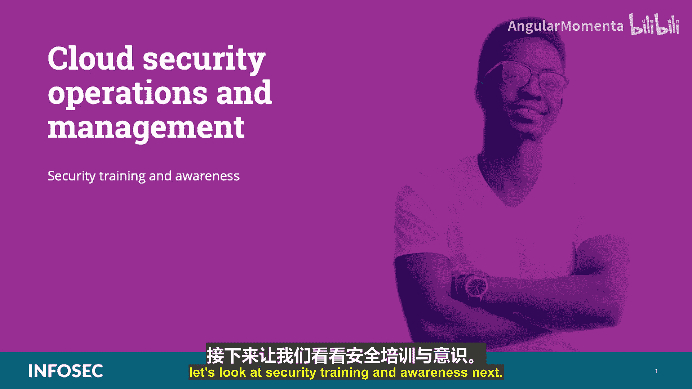
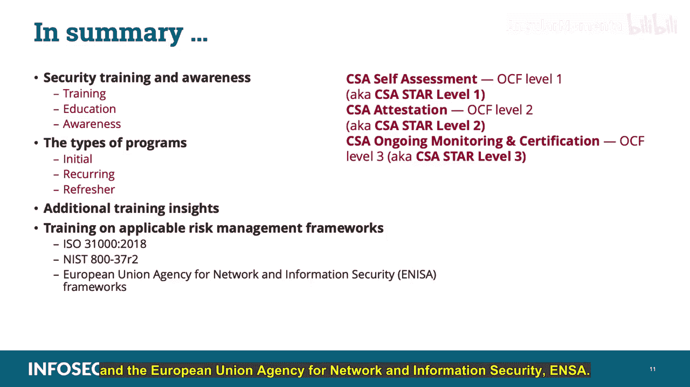

# 【Infosec】认证云安全专家 ｜ Certified Cloud Security Professional (CCSP) p34 06_01_05_security-training-and-awareness -BV1TWrHBrEbk_p34-

As part of the cloud security operations and management domain of the CCSP certification。

 let's look at security training and awareness next， Before we dive into this course。

 I want to point out that I will be calling out specific information you must know for the CCSP exam by highlighting it in a different color as depicted by the double asterisk call out as seen on the screen Everything highlighted in that color is relevant for the exam。

It goes without saying that everyone in the environment is involved in security。

 it's therefore important that everyone receives some amount of security training and awareness。

Even if their area specialty does not involve implementing security controls or practices。

 all personnel must at least know how to perform their job functions in a secure manner。

In a cloud data center facility， this effort will be at least somewhat easier than other environments。

 insofar as almost everyone already employed in this field will have some technical skills and training。

 which heavily implies that they have already been exposed to a great deal of information about secure I practices。

 This does not， however， preclude the requirement for formal internal training in accordance with local policy and associated regulations。

 It's also absolutely essential to present and document formal training and relevant awareness programs in order to demonstrate due diligence。

There is no industry standard definition for the term training。

 education and awareness for our purposes， I'll provide you with the CCSP standard explanation for each of these elements First training。

 this is the formal presentation of material often delivered by internal subject matter experts it addresses and explains matters of the organization's policies。

 content mandated by regulations and industry best practices for the organization's field Next we have education this is the formal presentation of material in an academic setting often for credit towards a degree or a certification and finally we have awareness this is the additional informal。

 often voluntary presentation of material for the purposes of reminding people and raising attention among the staff with this perspective in mind we're going to discuss security training。

 education and awareness security training programs are often split into three delivery categories initial recurring and refresher training。

Over the next few screens， we'll examine each of these in turn。

Initial training is delivered to personnel when they first enter the employee of the organization。

 often thorough and comprehensive。 This should be mandatory for all personnel。

 regardless of their position or role。 The content should be broad enough to address the security policies and procedures All staff will be expected to understand and comply with。

But it should have sufficient specificity so that everyone knows how to perform basic security functions the topics that might be covered in initial training could include password policy。

 including how passwords are issued what form passwords will take duration until expiration how to request password resets and stressing the need for keeping password secret。

 also physical security， including access to facility what to do if staff encounters personnel inside a facility they don't recognize and emergency egress it should also include the use of security credentials or tokens as well as how to report security concerns such as anomalous behavior。

 lost credentials and so forth this should include means to contact security personnel the acceptable use policy also known as the rules of the road in detail including enforcement mechanisms should also be included in this initial training of course all personnel must sign the acceptable use policy。

Before having access to organizational facilities and assets。

 the initial training session will be the first opportunity all employees get to meet representatives from a security office。

 This is a very good reason why security team members should be the ones presenting the material instead of trainers from other departments such as HR。

 There are many ways to deliver this content in a manner that may be more acceptable and appreciated by the attendees The trainers should explain the reason for security measures Everyone likes to be treated as a professional and understand the rationale behind the rules Security can even be an interesting topic and attendees will feel more informed if they are taught some of the causes and methods of breaches and attacks the trainers should demonstrate extreme openness to questions and concerns involve participants in conversations instead of reading a prepared list of rules to them let them solicit your expertise to resolve any lack of understanding they might have or to learn more about a specific subject。

The trainer should also use as many real-world examples and andotes as possible。

 People are fascinated by crime and wrongdoing。 use this to your advantage and share stories of the types of malicious activities that are the cause for the policies you're discussing additional points of thought to make your training successful if funding allows handout premiums also known as Choskes give up pens no pads drinking mugs。

 water bottles， any other kind of trinket you can think of with the contact information for the security office printed on it。

 serve food if you want personnel to think fondly of your conference， feed them。

 This does wonders for the staff morale and team building Recur training is for continuous updating of security knowledge that builds on the fundamentals taught in the initial training session this should be done on a regular basis on a schedule according to the needs of the organization regulatory environment or industry fluctuations At the very least each employee should receive。

training on an annual basis material comprising recurring sessions should include any updates and modifications to security practices and procedures within the organization。

 changes to regulations and policies， and the introduction of any new elements in the infrastructure Re training can also be blended with awareness efforts and used to compound the beneficial relationship fostered in the initial training sessions。

 and finally， document document， document all recurring training sessions。

 including annotating content and the names of all participants。

 This is incredibly important for demonstrating due diligence if the matter should come up and also in order to meet compliance requirements during an audit Refer training sessions are offered to those personnel who have demonstrated a need for additional lessons This might include those personnel who have had an extended absence from the workplace for instance。

 a month or so or even missed a recurring training session。

 This might also be offered to those personnel。have failed some element of security practices。

 such as those who have created a breach inadvertently installed malware or named in an audit for not knowing or demonstrating proper security practices it's important to remember that you're trying to foster an amable relationship between operations and security so these sessions should not be punitive in nature or recriminatory。

 keep in mind until tell your audience that a security failure is not arievous shortcoming but an opportunity to learn how to improve as in all training matters。

 document every refresher training session to include the subject matter and the participants for audit purposes and also for compliance purposes。

All training can be offered as live presentations or online courseware。

 There aren benefits and drawbacks to both methods。 Let's first look at live training。

 having the participants interact with the subject matter expert can be extremely valuable。

 both because attendees can better understand the material and because they'll be a lot more likely to recall the information if it is presented in a manner they appreciate and comprehend。

 Tra and documenting live sessions poses some difficulty， though。

 as it often requires some form of taking attendance。

 which gets complicated as the employee population scales up or down。

 The other one would be online courseware Compbased training is an incredibly powerful tool that can streamline a lot of hassle of scheduling live class sessions。

 It allows every employee to access the material when it's convenient for them from the comfort of their own workplace or depending on delivery methods even from home and take the course at their own pace。

 However， these traits can also make online。Training prone to external distractions and many employees just see it as a chore to be endured instead of paying attention to the content。

 they just mash buttons until it's over and then they can get back to whatever they were doing before。

 however online courseware tools usually offer excellent tracking functionality and provide granular documentation capabilities even with larger user groups。

Another fundamental aspect of security training is policy。

 If the organization is truly in favor of making security a priority。

 then this should be reflected in their organizational governance Se management needs to support the training program and demonstrate involvement by actively participating in live sessions when possible they should also include and formalize a reward program for employees that provide security insight by say reporting security issues they discover with adequate funding don't take punitive measures against personnel who inadvertently cause a security problem。

 D enforcement should only be used in the case of malicious or criminal behavior。

Because there are numerous risk management frameworks that can be designed to assist the enterprise in developing a sound risk management practice。

 organizations should conduct some formal training relevant to the framework they adhere to for the purposes of the CCSP exam。

 we will only be discussing ISIL 31，000 NIST 837 and the European Union Agency for Network and Information Security NSSA。

ISO 31，000 last updated in 2018 is an international standard that focuses on designing。

 implementing and reviewing risk management processes and practices the standard explains that proper implementation of a risk management process can be used to create and protect value。

 integrate organizational procedures， be part of a decision making process。

 explicitly address uncertainty， be a systematic， structured and timely risk management program。

 ensure the risk management program is based on the best available information be tailored to the organization's business requirements and actual risks take human and cultural factors into account。

 ensure the risk management program is transparent and inclusive。

 create a risk management program that is dynamic， iterative and responsive to change。

 and finally facilitate continual improvements and enhancement of the organization。

The National Institute of Standards of Technologies。

 NIST Special Public 837 is the guide for implementing the risk management framework RMF。

 This particular risk management framework is a methodology for handling all organizational risks in a holistic。

 comprehensive and continual manner this RMF supersedes the old certification and accreditation model of recurring inspections that have specific durations widely used in the military intelligence and federal communities this RMF relies heavily on the use of automated solutions。

 risk analysis and assessments and implementing controls based on those assessments with continuous monitoring and improvement NISistT special publication 837 is a guide organizations can use to implement the RMF although NISist standards are developed for use by the federal government they have begun to be accepted in many circles as best practices For instance。

 companies in the United States may use NIST models and publications in developing not。

Only their information security programs， but also their risk management programs and practices NIS publications and standards have a dual benefit of being widely acknowledged as expert and sensible。

 but also free of charge。 All NIS documents are in the public domain。

It takes little effort to adopt and adapt the NISist materials from their intended use in the federal governance space into a private sector or nonprofit endeavor。

 Keep in mind that these documents are not acceptable in international markets as are the Iso IEC standards。

 Therefore， if you conduct business outside of the United States。

 you may want to investigate the other standards in more detail。

 Some overseas companies will not even do business with US companies unless they subscribe and are certified under ISO standards。

 You can think of the European Union agency for network and information security。 Ena。

 as the European counterpart and Nist。 It is a standard and model developed in Europe while it is international in nature within the confines of Europe。

 It is not as globally accepted in the way that IO standards are。

 EnA is responsible for producing cloud computing benefits。

 risks and recommendations for information security。 It identifies 35 types of risks。

 organizations should。but goes further by identifying the top8 security risk based on likelihood and impact。

 which are loss of governance Lockin isolation failureure compliance Ri management interface failure data protection malicious Inr and insecure or incomplete data deletion According to NSSA。

 the cloud certification schemes list CCSL provides an overview of different existing certification schemes that might be relevant for cloud computing customers CCSL also shows the main characteristics of each certification scheme For example。

 the CCSL answers questions like which are the underlying standards who issues the certifications is the CP cloud service provider audited If so。

 who audits it the schemes that make up the CCSL are the certified cloud service TUV Rinland。

 the Cloud security Alliance CA。Selfassesment also known as a star level1， the CSA attestation。

 also known as the star level 2 and the CSA ongoing monitoring and certification。

 which is known as star level 3 Additionally it lists the UCud selfasses the UCud star audit certification ISL 27001。

 the Pay card Industry Data security Standard PC DSS the LEET security ratingatings guide。

 the AicCPA SoC1 SoC2 and SoC3 reports According to EnSA。

 the cloud certification Ss Me frameworkra CCSM is an extension of the CCSL that provides a neutral highlevel mapping from theCustom network and information security requirements to security objectives in existing cloud certification schemes。

 this facilitates the use of existing certification schemes during procurement In summary during this course。

We've discussed security training and awareness such as training， education and awareness。

 the types of programs initial recurring and refresher， additional training insights。

 we talked about training on applicable Risk Management Frameworks， ISL 31，000 NIST 837。

 and the European Union Agency for Network and Information security NSSA。

