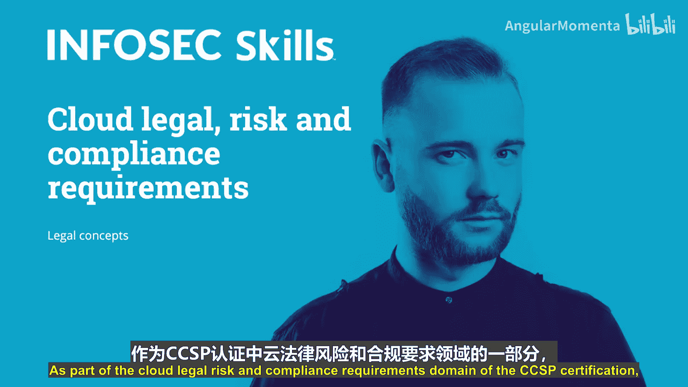
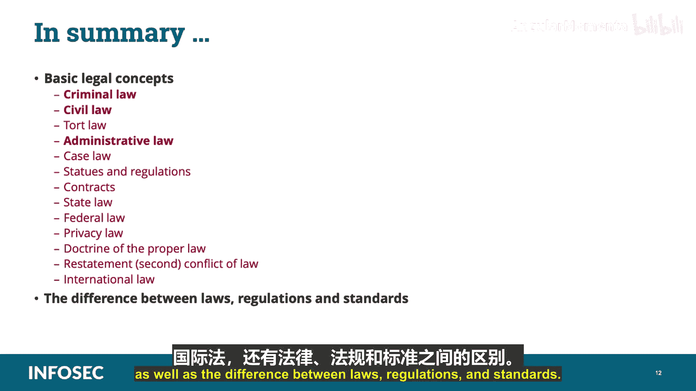

# 【Infosec】认证云安全专家 ｜ Certified Cloud Security Professional (CCSP) p35 07_01_01_legal-concepts -BV1TWrHBrEbk_p35-

As part of the cloud legalal risk and compliance requirements domain of the CCSP certification。

 let's look at legal concepts next Before we dive into this course。

 I want to point out that I will be calling out specific information you must know for the CCSP exam by highlighting it in a different color as depicted by the double asterisk callout as seen on the strain everything highlighted in that color is relevant for the exam Let's begin our discussion with some basic legal concepts that can be applied both in the United States and internationally as the global nature of technology continues to evolve and essentially simplify and enable conveniences once thought impossible the challenging complexity of meeting these legislation。

 regulations and laws become greater all the time ensuring adherence。

 compliance or conformity with these can be challenging within traditional on- premiseise environments or even on thirdpart and hosted environments Add cloud computing and the complexity increases significantly The terms we are discussing in this course。

Formed the foundation of knowledge that allows us to operate cloud activities across international borders with some remnants of consistency and fairness。

 These principles are what allow us to provide infrastructure as a service。

 platform as a service and software as a service across international boundaries and it's important for you as a CCSP certified cloud security practitioner to understand them。

 First you need to understand that there are three general bodies of laws in the United States criminal law。

 civil law and administrative law。 We're also going to examine the concepts of case law。

 statutes and regulations， the concepts of doctrine of proper law and restatement second conflict of law。

 which are common concepts used around the world。 we will cover intellectual property and legal protections available for owners of this type of asset in another module in this course just to understand that they too fall under basic legal concepts。

 we will be discussing each of these terms listed on the screen next。

Let's start with criminal law Cri law involves all legal matters where the government is in conflict with any person group or organization that violates statutes it is a body of rule and statutes that defines conduct that is prohibited by the government and is set out to protect the safety and well-being of the public besides defining prohibited conduct criminal law defines punishment when the law is breached crimes are categorized based on their seriousness with the categories carrying maximum punishments a statute which is legislative by lawmakers is a formal written enactment of legislative authority that governs a state city or country typically statutes command or prohibits something or declare a policy statutes are laws made by legislative bodies and distinguished from common law which is decided by courts and regulations issued by government agencies one example is traffic laws which when broken result in court appearances and fines other more obvious。

A robbery， theft and murder， criminal law includes the federal court system and various state courts under criminal law。

 punishment can include monetary fines， imprisonment and even death enforcement of criminal law is called prosecution only the government can conduct law enforcement activities and prosecution case law is the collected body of decisions written by courts and similar tribunals or judiciaries in the course of deciding past cases in which the judiciary analyze the law to resolve ambiguities and fills gaps to set principled rules for deciding those past cases regulations are put in place to reduce exposure and to ultimately protect entities and individuals from a number of risks。

 they also force providers and processors alike to take certain responsibilities and actions。

 The reason for regulations include but are not limited to take two care。 apply adequate protections。

 protect customers and consumers ensuresure appropriate mechanism。and controls are implemented。

 reduce likelihood of malformed or fractured practices。

 establish a baseline level of controls and processes。

 create a repeatable and measurable approach to regulated data and systems。

 continue to align with statutory bodies， and fulfill professional conduct requirements as well as provide transparency among customers。

 partners and related industries。Civil law is the body of laws。

 statutes and so on that deal with personal and community-based laws such as marriage and divorce as opposed to criminal law。

 it is a set of rules that govern private citizens and their disputes as opposed to criminal law。

 the parties involved in civil law matters are strictly private entities including individuals。

 groups and organizations， typical examples of civil law cases are disputes in the United States over property boundaries。

 mineral rights and marital divorce civil cases are called lawsuits or litigation。

 punitive measures for civil cases can include restitution of monetary damages or requirements to perform actions usually in response to a breach of contract case which will address later in disse but not imprisonment or death we've already discussed case law and statutes。

 but you see how they overlay or support civil laws a contract is an agreement between parties to engage in some specified activity usually for mutual benefit。

The contract between the cloud customer and the cloud provider is a perfect example In that contract。

 the cloud customer agrees to give the cloud provider money and in exchange。

 the cloud provider agrees to give the cloud customer some services。

 the contract often includes a finite duration for which the contract is in effect a list of parties involved。

 the means for dispute resolution and the jurisdictions laws under which the contract will be subject。

 a physical place or government such as the state of Wisconsin or the city of Milwaukee in the state of Wisconsin in the United States Diss arise from failure to perform according to the activity specified in the contract which is called a breach in the event of a breach。

 a party to the contract can sue the other in order to get court orderedder relief in the form of money or other consideration such as property or the court forcing the breaching party to perform the activities that both parties agreed to in the first place contract law applies。

To contractual items the CCSP candidate should be familiar with， such as service level agreements。

 Slas， privacyle agreements， Ps， operational level agreements， Os。

 as well as the payment card industry data security standard PCS contract a CCSP should be prepared to deal with exposures to these types of contracts in a cloud environment and with cloud customers Furthermore。

 it's important to understand the distinctions regarding consequences and ramifications for violations of such contracts。

 contract disputes are generally handled in civil court and involve reparative restitution in the event of a loss suffered by one party or the other such as in the case of a provider failing to adequately meet the service levels in a cloud agreement state law typically refers to the law of each US state。

 the 50 states in total each treated separately with their own state constitution。

 state governments and state courts state laws。A those that we typically think of on a day to day basis。

 speed limits， state tax laws， the criminal code and so on are all examples of laws enacted by a state legislature as opposed to those enacted at a national or federal level you need to understand that the United States is divided into 50 member entities that are referred to as states outside of the United States。

 Most other countries use the word state as a synonym for countries and their member entities are known as countries。

 jurisdictions， zones or a variety of other terms It's important to keep this distinction in mind regarding the meaning of the word state when dealing with multiple nations。

 especially when taken the CCSP exam Federal law unlike state law whose jurisdiction stops set the state line federal law governs the entire countries examples are those against kidnapping and bank robbery。

 federal laws often supersede state laws。icularly regarding the nature of Interstate commerce。

 for instance， while many states have laws outlining how electronic medical records should be handled。

 federal legislation is usually more comprehensive and therefore followed。

 but in some cases such as California， the state law may in fact be more stringent。

 in which case it is going to be followed。 the general rule is that the most stringent of the laws applies to any situation unless there are other compelling reasons such as strict jurisdiction。

 generally the issues of jurisdiction and subsequent prosecution are worked out in advance between law enforcement and court jurisdictional bodies。

 and finally， an enforceable governmental request is a request or order that is capable of being performed on the basis of the government's order。

Tort law refers to the body of rights， obligations and remedies that set out reliefs for persons who have been harmed as a result of wrongful acts by others。

 Tort law and case precedes is what guides the courts in the handling of these civil cases whereby relief of some sort is sought。

 Tort law basically serves for objectives。 It seeks to compensate victims for injuries suffered by the culpable actions or inact of others。

 It seeks to shift the cost of such injuries to the person or persons who are legally responsible for inflicting them。

 It seeks to discourage injurious or careless and risky behavior in the future。 And finally。

 it seeks to vindicate legal rights and interests that have been compromised。

 diminished or emasculated。 The other body of law that affects most people is administrative law。

 Laws not created by legislature， but by executive decisions and functions。

 Many federal agencies can create monitor and enforce their own。

Administrative laws these agencies have their own lawmaking departments， law enforcement personnel。

 courts and judges that belong exclusively to those specific agencies。 for instance。

 federal tax law is administered by the IRS internal revenue service which creates those laws investigates and enforces them with IRS agents and decides the outcomes and cases tried by lawyers and adjudicated by judges both in the employee of the IRS and you see that they are sometimes supported by case law or regulations。

 which we've already discussed here we're going to look at restatement second conflict of laws a restatement is a collection of developments in the common law for example。

 a judgemade law， not legislation that informs judges and the legal world of updates in the area in the United States the existence of many states with their own legal rules can really complicate things conflicts of laws is that part of the law of each state which determines what effect is given。

To the fact that the case may have a significant relationship to more than one state。

 the restatement's second conflict of laws is the basis for deciding which laws are most appropriate when there are conflicting laws in the different states。

 The doctrine of proper laws is when a conflict of laws occurs。

 This determines in which jurisdiction disputes will be heard based on contractual language professing an express selection or a clear intention through a choice of law clause。

 If there isn't an express selection stipulated， implied selections may be used to infer the intention and meaning of the parties from the nature of the contract and the circumstances involved。

 The doctrine of proper laws applied in the choice of law stage of the lawsuit involving the conflict of laws and finally we have privacy laws privacy can be defined as the right of an individual to determine when how and to what extent he or she will release。

information privacy law also typically includes language indicating that personal information must be destroyed when its retention is no longer required。

 we've already discussed several privacy related laws such as the European Union general data protection regulation GDPR。

 the organization for Economic Cooper and Development OECD the payment card industry data security standard PCSS and the health insurance Portability and accountability Act sovereign countries also have their own laws applicable to their own jurisdictions。

 the jurisdiction is the land and the people belonging to that country the effects of a country's laws does not however cease at its borders。

 if a citizen from another country or even one of the country's citizens operating outside of that country break that country's law they can still be subject to prosecution and punishment by that country for instance。

 a hacker that uses the Internet to attack a target in another country could be subject to that country's computer security laws。

 The hacker might be extradited forc。Apprehended it in their own country and transported to the country where the law was broken to face trial。

 International law determines how to settle disputes and manage relationships between countries。

 It's made up of international conventions， whether the general or particular establishing rules expressly recognized by the contesting states。

 International customs as evidence of general practice accepted as law。

 the general principle of law recognized by civilized nations and judicial decisions and the teachings of the most highly qualified publicists of the various nations as subsidiary means for the determination of rules of law。

 So what's the difference between all of these laws， regulations standards and frameworks。

 Let's break these down。 Law are legal rules that are created by government entities such as a Congress or parliament。

 Regulations are rules that are created by either other departments of government or external entities empowered by government failure to。

Properly follow laws and regulations can result in putitive procedures that can include fines and imprisonment。

 Standards are created by other nongovernmental organizations that provide frameworks and guidelines for businesses to follow。

 Moreover， regulators， agents of the government body or entity tasked by the Government to enforce regulator can find fault in an organization that fails to provide。

 do care for its customers， if that organization does not adopt the best practices and standards recognized within the organization's industry。

 This can create some ambiguity， because the Government does not always dictate which standards are acceptable。

 So there may be some risk in an organization's choice of the wrong standard。

Regardless of whether you're dealing with laws， regulations or standards。

 Everyone expects a reasonable degree of transparency。 In other words。

 making things clear for all types of regulators and interested parties。

 at least to the degree that is。ected and possible a framework is often a layered structure indicating what kind of programs can or should be built on and how they would interrelate to support the information security strategy and the mission。

 Control frameworks are established by organizations to support the policies。

 procedure standards and guidelines of the organization。

 organizationsization implement a control framework as part of their governance program to ensure security and privacy requirements are being met。

 There's a lot of different frameworks available， but they all have some common elements。

 They are consistent measurable， standardized comprehensive and modular。

 Let's look at consistent first。 they all must be consistent in how information and privacy is approached and applied。

 The government programs must provide a way to determine progress and also set goals。

 This is the measurable aspect。 when we're talking about standardized。

 They should rely on standardization。 So results from one organization or part of an organization can be。

ed in a meaningful way to another comprehensiverehen it should at least cover the minimum legal and regulatory requirements of an organization and be extensible to accommodate additional organizational specific requirements and finally modular only the controls or requirements needing modification are reviewed and then updated one example of a control framework is the United States National Institute of Standard and technology NISist special publication 853 which is a control framework made up of controls The framework includes the ability to scope and tailor controls to an organization's specific mission or requirements。

 Another framework is ISO 270012013 This has been designed to cover organizations of all countries and all sizes this standard contains controls just like 853 and it's very similar to the NIST special publication 8171 protecting controlled unclassified information in nonfederal system。

And organizations there are a number of other frameworks， for example。

 process frameworks which include IT formerly the information technology infrastructure library。

 IT is a de facto standard of best practices for I service management you also have the capability maturity model In cmi organizational development for process improvement developed by Carnegie Mellon University as well as six Sigma。

 which is a business management strategy that can be used to carry out process improvement it's a set of techniques and tools for process improvement there are a number of control frameworks as well which include Coso the international control integrated framework。

 which is a set of internal corporate controls to help reduce the risk of financial fraud developed by the Committee of sponsoring organizations of the Treadway Commission Another control framework is COviID a business framework to allow for IT Enterprise management and governance that was developed by the Information。

ss auditudit and control association Asaka in addition to process and control frameworks。

 we also have architectural frameworks which include Zachman。

 which is a framework or a model for the development of enterprise architectures developed by John Zachman as well as toG。

 the open group architecture framework which is a model and methodology for the development of enterprise architectures developed by the Open Group another architecture framework is SAabSA this is a model of methodology developed by Sherwood applied business security architecture and it is a development of information security enterprise architecture which is very similar to Zachman and ISO 42010 The last one I'd like to cover is a security program development framework even though we've already talked about this one a little bit the ISO 27000 information security management System series It's a series of information security management systems and standards accepted internationally as a standard on how to develop and maintain and information security management。

The series consists of several publications like ISL 27000， which is the overview and vocabulary。

 the ISO 27001， which is the requirements standards ISO 270002 the codeta practice standard ISO 27003。

 the implementation guidance， ISO 27005 risk management ISO 27006 which is the audit and certification standards and there are many many more they provide best practice recommendations on information security management risk and controls within the context of the overall information security management system you should know that the CCSP exam does not cover specific laws like FISma or Saring Oxley but it does cover the security control model frameworks like ISO 27000 series standards。

 COVID and CoSO because they are international standards。In summary。

 during this course we have discussed basic legal concepts such as criminal law， civil law， tort law。

 administrative law， case law， statutes and regulations， contracts， state laws， federal law。

 privacy law， doctrine of proper law， restatement， second conflict of laws， and international law。

 as well as the difference between laws， regulations， and standards。

