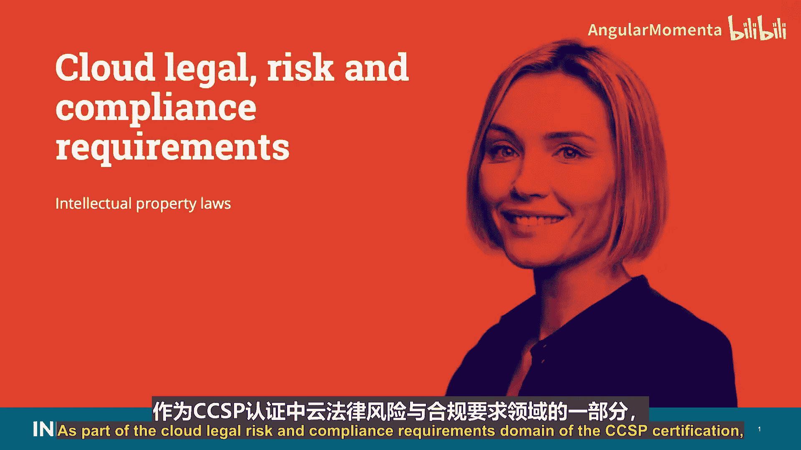
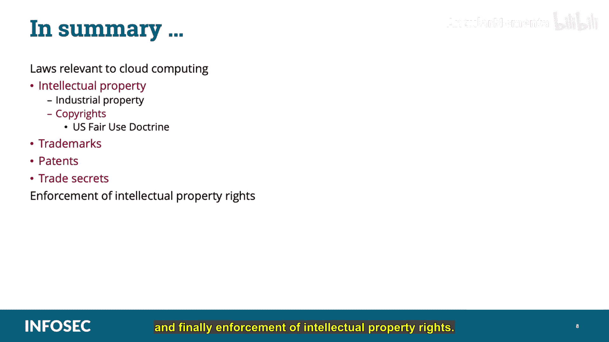

# 【Infosec】认证云安全专家 ｜ Certified Cloud Security Professional (CCSP) p36 07_01_02_intellectual-property-laws -BV1TWrHBrEbk_p36-

As part of the cloud legalal risk and compliance requirements domain of the CCSP certification。

 let's look at intellectual property laws next Before we dive into this course。

 I want to point out that I will be calling out specific information you must know for the CCSP exam by highlighting it in a different color as depicted by the double asterisk callout as seen on the screen everything highlighted in that color is relevant for the exam Globally there are many laws。

 regulations and other legal requirements for organizations and entities to protect the security and privacy of digital and other information assets。

 Intel property like copyrights trademarks， patents and trade secrets is a term describing intangible assets that are the property of the mind like words。

 literature， logos， symbols or other artistic creations to include literary works also known as an idea Intel property laws don't necessarily look at who is right or wrong。

 but rather how a company or individual can protect。

What it rightfully owns from unauthorized duplication or use and what it can do if the laws are violated in the United States。

 courts recognize intellectual property rights， and there are a great many ways to protect these assets such as copyrights trademarks。

 patents and trade secrets， the world intellectual property organization Wpo defines intellectual property as creation of the human mind that has some commercial value。

 intellectual property is divided into two categories。

 industrial property also known as business property， which includes patents inventions， trademarks。

 service marks， blueprints trade secrets， industrial designs and so on。

 and the other one is copyright， which includes literary and artistic works。

 performances either live or recorded， the author's rights， software photographs。

 sculptures and those kinds of items will cover these in more detail over the next few strains copyright and privacy laws。

 specifically copyright infringement， which occurs when copyrighted material。

Is made available or shared with others by a party who is not the legal owner of the information。

 In other words， copyright protects an original expression of an idea。

 It grants exclusive rights to the creator of the original work。

 allowing creators to be credited for their work and profit from their work。

 as well as control their work by permitting others to use and adopt the work with permission in the United States copyrights lasts for a period of 70 to 125 years after the death of the original creator Depend on the nature of how the intellectual property was created。

 So sometimes it's difficult to identify who should be getting the royalties or credit if you want to use the copyrighted material in the United States。

 the fair use doctrine permits some copy and distribution with limitations of copyrighted material without having to first acquire permission from the copyright holder。

 Fair use is one of the limitations to copyright intended to balance the interests of copyright holders with the public interest in a wider distribution。

And use of creative works by allowing as a defense to copyright infringement claims certain limited uses that might otherwise be considered infringement。

 Exles of fair use in the United States Copy law includes commentary， search engines， Criticism。

 parity， news reporting， research， scholarshipships。

 as well as the use of copyright material by academic organizations。 Next will cover trademarks。

 Trades protect the unique identity of goods or services。 It could be a word as symbol color。

 sound shape in those kinds of things。 Trademark is basically brand protection for intellectual property used to immediately identify a brand。

 This usually includes logos or short audio tunes。 Think of the three notes。

 NBC Chime uses or the roles Royce Emblelylin， the U symbol。 the Coca- Colla bottle。

 The golden arches from McDonald's or the KFC bucket。 Those are all examples of trademarks。

 Trades last for as long as the property they。is still being used commercially。

 This means they can sometimes be considered perpetual。 The other one listed here is trade secrets。

 The courts acknowledge the ownership of private business materials such as clientless processes。

 Res and so forth as trade secrets。 Many companies have intellectual property that is absolutely critical to their business。

 that's the secret sauce， for example， and significant damage would result if they were disclosed to competitors or the public perhaps the most glamorized trade secret in the popular culture is the formula for Coca Colla or the KFC secret recipe。

 In property retains trade secret protection for as long as the business continues efforts to use it in commercial enterprises and maintains efforts to prevent its disclosure。

 For example， using nondisclosure agreements and Ds。 In this regard。

 it can be viewed as a perpetual ownership right。 trade secrets or。

Under the Economic espionage Act of 1996 for the United States to preserve trade secretet status。

 you must implement adequate controls within your organization to ensure that only authorized personnel with a need to know the secret have access to them You must also ensure that anyone who does not have this type of access is bound by a nondisclosure agreement that prohibits them from sharing the information with others and provides penalties for violating the agreement under the E espionage Act stealing trade secrets to benefit of foreign government may be fined up to 500000 and imprisonment for up to 15 years。

 stealing trade secrets under any other circumstance may be fined up to $250000 and imprisonment for up to 10 years。

 the national information Infstructure Protection Act inacted October 1996 was title I of the E espionage Act of 1996 was an amendment to the Comp fraud and abuse Act basically implement。

Palties for anyone who knowingly accesses a computer without authorization and obtains information that has been determined to require protection against unauthorized disclosure。

 such as trade secrets。Patents are granted to the discovery of a novel。

 useful and non-obvious invention。 In other words， it must be a unique invention。

 Patents protect formulas， processes， Pat， inventions and plants。 Yes。

 you can patent plants listed on a screen are some examples of things that might be patented。

 such as the formula for a new pharmaceutical drug， the smelting process for a new metallic alloy。

 a fabric or textile pattern， a new spice that can grow in the soil spliced together from cuttings of other vegetative growths or even a better mousetrap。

 A patent grants exclusive rights to the practice of an invention for a period of up to 20 years in the US by the US patent and trade office。

 and worldwide by the world intellectual property organization Wipo。

 Pats are the strongest type of intellectual property protection。

 owning a patent for a specific intellectual asset prevents anyone else from using that asset without the owner's permission。

Untilill it expires， once the patent expires， anyone can copy or practice it。And finally。

 let's cover the enforcement of intellectual property rights while the courts and the government acknowledge ownership of property rights。

 it is often up to the owners to enforce these rights， for instance。

 if a company owns a patent on say a drug formula and someone else infringes on that patent by producing and selling a drug with the same formula。

 it's up to the aggrieved party the original patent owner to bring a civil suit against a Copycat Trade secrets are covered under the E espionage Act of 1996 which I've already discussed。

 the digital Millennium Copyright Act DMCA is an amendment to the US Copy law that implements two 1996 treaties of the World Intel Pro Organization it criminalizes production and dissemination of Technology devices or services intended to circumvent measures that control access to copyrighted works commonly known as digital rights management or DRM set another way it makes it a crime to circumvent。

Antipiracy measures and outlaws the manufacture sale and distribution of codecracking devices used to illegally copy software or other materials we've previously covered digital rights management so just to recap it digital rights management is defined as a broad range of technologies that grant control and protection to content providers over their own digital media from the contents point of view there are three key components to its lifecycle content creation distribution and upkeep and then finally content use。

In summary， in this course we've covered laws relevant to cloud computing such as intellectual property。

 which is broken down into industrial property and copyrights。

 we've talked about the US Fair use doctrine， trademarks， patents， trade secrets。

 and finally enforcement of intellectual property rights。

