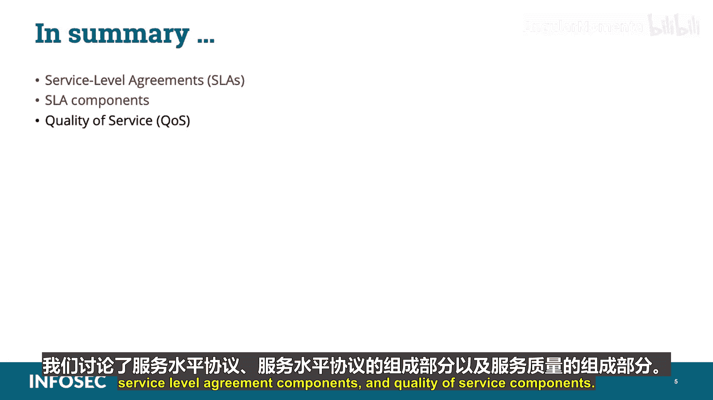

# 【Infosec】认证云安全专家 ｜ Certified Cloud Security Professional (CCSP) p37 07_01_03_service-level-agreement-slas -BV1TWrHBrEbk_p37-

As part of the cloud legal risk and compliance requirements domain of the CCSP certification。

 let's look at service level agreements next。 Before we dive into this course。

 I want to point out that I will be calling out specific information you must know for the CCSP exam by highlighting it in a different color as depicted by the double asterisk call out as seen on the screen Everything highlighted in that color is relevant for the exam a service level agreement SL is simply a document describing the level of service expected by a customer from a supplier。

 it lays out the metrics by which that service is going to be measured。

 and if any of the agreed upon levels are not achieved similar to a contract signed between a customer and a cloud provider。

 the service level agreement should capture requirements related to compliance best practices and general operational activities to satisfy each of these So how can we tell if something belongs in a contract oral service level agreement。

 the easiest way is if it has metric。

or numbers associated with it it belongs in a service level agreement otherwise it belongs in a contract within a service level agreement。

 the content and topics listed on the screen should at a minimum be covered let's start with availability such as 99。

99% of service and data uptime performance that would be the expected response time versus maximum response time security or privacy of data such as encrypting all stored and transmitted data login and reporting for example audit trails of all access and the ability to report on key requirements or indicators disaster recovery expectations。

 for example， worstcase recovery commitment， recovery time objectives。

 maximum period of tolerable disruption these are the things we talked about during RTO RPpoO and MTD location of the data for example。

 ability to meet requirements or consistent with local legislation data form。and structure。

 for example， will the data be retrievable from the provider in a readable and intelligent format portability of data that would be the ability to move the data to a different provider or multiple providers identification and problem resolution for example。

 will there be a helpline call center or ticketing system change management process this would be changes like updates or new services。

 Dis mediation process will there be an escalation process and consequences and finally exit strategy with expectations on the provider to ensure a smooth transition。

The service level agreement should include components in two areas。

 services and management service elements， which include specifics of services provided like responsibilities。

 having a clear definition and understanding of who will do what and what is included so there is no room for doubt conditions of service availability standards like time windows for each level of service。

 for example， prime time and non-prime time may have different service levels escalation procedures and cost or service tradeoffs and will regulatory requirements be met under the service level agreement。

 the other component is management the management elements should include definitions of measurements。

 standards and methods， reporting processes， content and frequency。

 a dispute resolution process and indemnification clause protecting the customer from thirdpart litigation resulting from service level breaches and mechanisms for updating the agreement as required when reviewing the。

level agreement you should be looking at an assessment of risk environments such as services。

 vendors and ecosystems， risk profiles of the service level agreement and the company providing the services the risk appetite。

 what level of risk is acceptable to the organization risk mitigation which mitigation techniques or controls can reduce the risk and different risk frameworks what framework Nist8 153。

 ISL 27000， Coso Saaba， etc are to be used to assess the ongoing effectiveness along with how the provider will manage this risk on the screen we show you some examples of service level agreement components which you should be familiar with uptime guarantees service level agreement penalties service level agreement penalty exclusions such as limitations on when downtime calculations start some cloud providers require that the application is down for a period of time for example5 to 15 minutes before any counting towards service levelve agreement。

Beg another area under service level agreement penalty exclusions would be scheduled downtime。

 Several cloud providers claim that if they give you warning and an interruption in service does not count as an unplanned downtime but rather as a scheduled downtime and therefore is not counted when calculating penalties。

 In some cases， the warning can be as little as8 hours。 Another component is suspension of service。

 some cloud contracts state that if payment is more than 30 days overdue。

 including any disputed payments， the provider can't suspend the service provider liability。

 most cloud contracts restrict any liability apart from infringement claims related to intellectual property to a maximum of the value of the fees over the past 12 months。

 data protection requirements most cloud contracts make the customer ultimately responsible for security data protections and compliance with local laws。

 remember that in the cloud computing environment， the customer or。

Enterprise is always going to be responsible for any governance risk compliance and data security recommendations the service level agreement should include provisions for immediate notification of any security or privacy breaches as soon as the provider is aware these examples highlight the dangers of not paying sufficient focus and due diligence when engaging with a cloud provider around service level agreements。

On the screen， we have some of the quality of service indicators that form key components for metrics and appropriate monitoring requirements。

 which should be included in a service level agreement。 First， we have availability。

 which measures the uptime availability of relevant services over a specified period as an overall percentage。

 outage duration captures and measures the loss of service time for each instance of an outage。

 For example， July 1，2019920 AM start 1050 restored would equal one hour of loss of service or outage。

 Meantime between failures captures the indicative or expected time between consecutive or recurring service failures。

 For example，1。25 hours out of 365 days capacity metrics measures and reports on the capacity capabilities and the ability to meet requirements。

 performanceance metrics looks to utilize an actively identify area。

Facts and reasons for bottlenecks or degradation of performance。

 typically performance is measured and expressed as requests and connections per minute Re percentage metrics list the success rate for responses and based on agreed criteria。

 for example， 99% success rate in transactions completed to the database storage device capacity metrics list metrics and characteristics related to storage device capacity typically provided in gigabs server capacity metrics list the characteristics of server capacity based and influence by the central processing units。

 CPUs frequency in gigerz Ram virtual storage and other storage volumes In startup time metrics indicates or reports on the length of time required to initialize a new instance calculated from the time of request by the user or the resources and typically measured in seconds and。

Response time metrics reports on the time required to perform the requested operation or task typically measured based on the number of request and response times in milliseconds completion time metrics provides the time required to complete the initiated or requested task typically measured by the total number of request as averaged in seconds Meantime to switchover metrics provides the expected time to switch over from a service failure to a replicated failureover instance This is typically measured in minutes and captured from commencement to completion Meantime system recovery metrics highlights the expected time for a complete recovery in the event of or following a service failure or outage This is typically measured in minutes。

 hours and days scalability component metrics。 This is typically used to analyze customer use behavior and patterns that can allow for the auto scaling。

And auto shrinking of servers storage scalability metrics This indicates the storage device capacity available in the event and where increased workloads and storage requirements are necessary and finally server scalability metrics which indicates the available server capacity that can be utilized or called upon where changes in increased workloads are required the service level agreement or contract agreement must be established whether investigations of cloudbased assets are permitted or if during an investigation prior notification and acceptance will be required。

In summary， during this course， we have discussed service level agreements。

 service level agreement components， and quality of service components。

