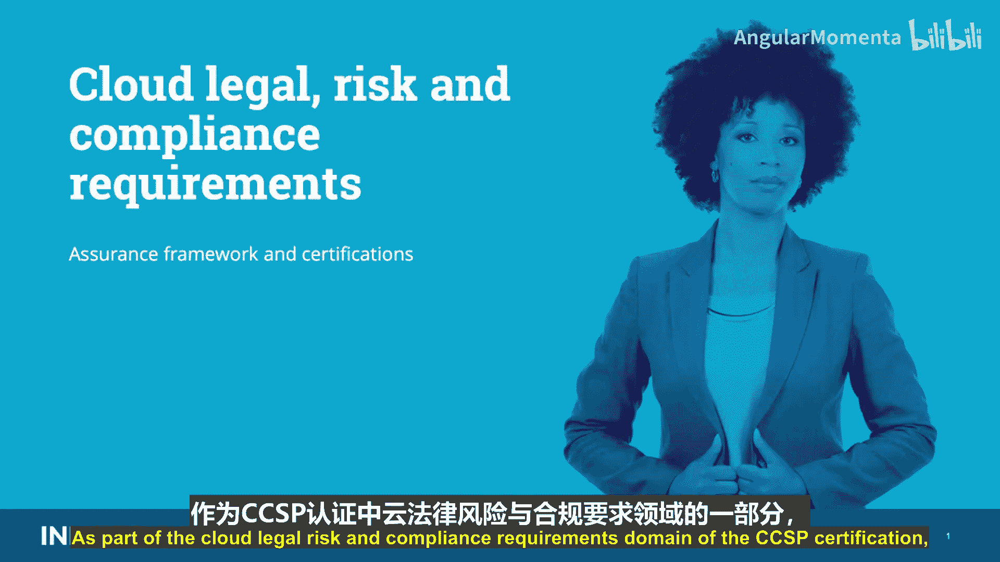
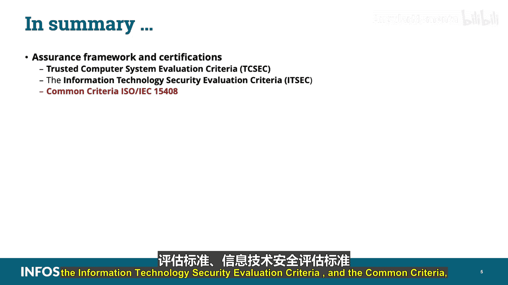

# 【Infosec】认证云安全专家 ｜ Certified Cloud Security Professional (CCSP) p38 07_01_04_assurance-framework-and-certifications -BV1TWrHBrEbk_p38-

As part of the cloud legal risk and compliance requirements domain of the CCSP certification。

 let's look at assurance frameworks and certification next Before we dive into this course。

 I want to point out that I will be calling out specific information you must know for the CCSP exam by highlighting it in a different color as depicted by the double asterisk callout as seen on the screen Everything highlighted in that color is relevant for the exam The evaluation criteria listed on the screen。

 trusted computer security evaluation criteria Tcsec information technology security evaluation criteria Isec and the common criteria also known as IO IEC 15408 provide a shared mechanism to allow certified thirdpart evaluation labs to evaluate vendor products against a set of security requirements and publish their findings The objective is to determine how well a system measures up to a preferred level of security in the real world and then make a decision whether to proceed with it。

Use in the enterprise The Rainbow series is a form of evaluation criteria created by the US Department of Defense。

 For example， the trusted computer system evaluation criteria TCsec is also known as the orange book from DoD It is a confidentiality model with ratings of D at the lowest and a1 at the highest。

 The red book which is the trusted network interpretation of Tsec is a confidentiality and integrity model。

 and then you have the greenbook， which is the password management guidelines will focus on the orange book also known as the trusted computer system evaluation criteria TCsec originally the focus was on confidentiality and functionality of single systems The goal was to direct designers on what was wanted from products guide evaluators in performing assessments and assist acquirers in selecting trusted products。

 It also provided rated classes of security based on E policy unique identification access control labels audit data and。

C was used by the U Department of Defense as a standard that sets the basic standards for the implementation of security protections in computing systems。

 primarily intended to help the Department of Defense find products that met those basic standards It was strongly focused on enforcing confidentiality with no focus on other aspects of security such as integrity or availability It has now been superseded by the common criteria IO 15408。

 which we'll discuss in a few minutes TCSec uses a rating scale of D at minimal protection and A1 at the highest。

Here we have ITS， which is the Information technology security evaluation criteria This is European and origin and internationally adopted。

 it uses the target of evaluation TE as the product and the security targets which is the stated capability of the product the information technology security evaluation criteria is a structured set of criteria for E computer security within products and systems the ITSec was first published in May 1990 and France。

 Germany， the Netherlands and the United Kingdom based on existing work in their respective countries following extensive international Review version 1。

2 was subsequently published in June of 1991 by the Commission of the European Committees for Op use within E and certification schemes however the ITS has been largely replaced by the common criteria which provides similarly defined evaluation levels and implements the target of evaluation concept and the security target document。

Contrast to TCsec security requirements are not as prescribed in ITSec instead the consumer or the vendor has the ability to define a set of requirements from a menu of possible requirements into a security target and the vendors develop products the target evaluation and have them evaluated against that target the main point here is that evaluations are separate and their checking for effectiveness in other words assurance and functionality Also it evaluates vulnerabilities。

 set in another way， the ability to withstand attacks with ITs the vendor claims to be evaluated against security policies。

 security andforcing functions mechanisms and their strengths as well as target evaluation level of functionality and effectiveness so ITsec uses the target evaluation which is the product and a security target which is the stated capability of the product the target evaluation is basically any IT product or system and its associated guidance document。

That is subject to an evaluation， the IT S ratings are E1 through E6 as shown on the screen。

And finally， the common criteria， so just to recap due to its primary focus on confidentiality。

 TCsec was found to be too rigid for most non-defense organizations ITs on the other hand was found to be not rigid enough so common criteria takes a very similar approach to ITS by providing a flexible set of functional and assurance requirements It's focused on standardizing the general approach to product evaluation and providing mutual recognition of such evaluations all over the world the publication of common criteria is known as Io IEC 15408 which looks at both assurance and functional requirements This was the first international standard for product evaluation criteria and is commonly used today because it allows more flexibility for the vendor or the consumer to define at a greater granularity level how secure they need the system to be the goal of common。

Criteria certification is to ensure customers that the products they are buying have been evaluated and that the vendor's claims have been verified by a vendor neutral thirdpart common criteria looks at certifying a product only and does not include administrative or business processes。

 although it views these as beneficial there are dangers of relying only on technology for robust and effective security common criteria introduces protection profiles as the common set of functional and assurance requirements。

So just to recap here， the target of evaluation， the TE is the product or system that is the subject of the evaluation。

 Security targets are the vendor's documented security features of the target of evaluation and the protection profile is the documented security requirements for a class of security devices and finally we have evaluation assurance levels EAL1 through EAL7。

 I will tell you that you will need to know what these are。

 I've highlighted them so you can see on the screen EL 7 is formally verified design and tested EL1 is functionality tested。

 you need to know what the definitions of each one of those levels are because you'll see questions on the exam that specifically call out the definition and you'll need to map it to the appropriate level such as EL 12。

3 or all the way through 7 the evaluation assurance levels or EAL is a measure of the confidentiality integrity and availability that is assigned by the。

it does not address the administration efforts after implementation evaluationval assurance level EAL is a set of assurance requirements representing a point on the common criteria predefined assurance scale from one to7 which ranges from informal expressed and natural language to formal expressed in a restricted syntax language with defined semantics based on well establishedablish mathematical concepts。

 Again， EL 1 is the lowest informal assurance requirements and EAL 7 is the highest most extensively validated claim of assurance remember that the common criteria greatly aids in the development of products and systems that have I security functions for informational purposes I've placed the chart that shows the system and subsystem product certifications for common criteria you see the target evaluation which feeds the process the security problem definition the security objective。

For the target evaluation and the security functional requirements， as well as conformance claims。

 evaluation assurance levels of EAL1 through EAL 7。

 and finally the security assurance requirements In summary。

 in this course we have discussed assurance framework and certifications。

 the trusted Computer System evaluation criteria， TCS。

 the information technology security evaluation criteria ITS。

 and the common criteria also known as ISO IEC15408。

