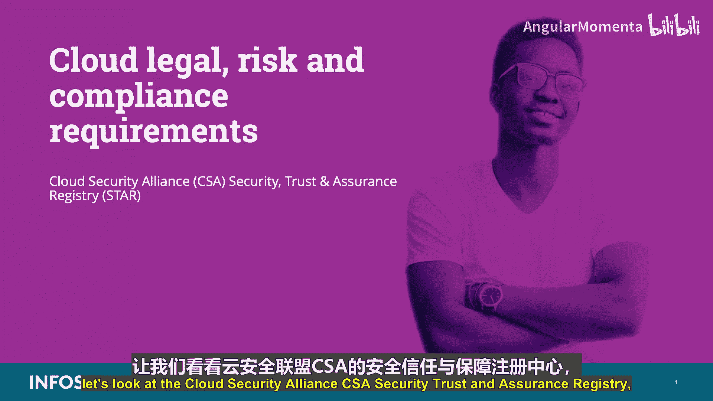
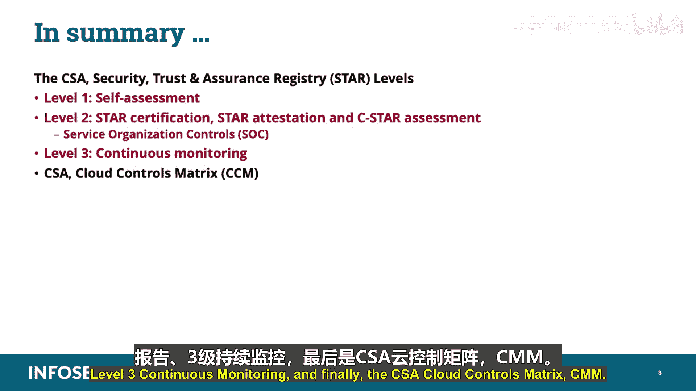

# 【Infosec】认证云安全专家 ｜ Certified Cloud Security Professional (CCSP) p39 07_01_05_cloud-security-alliance-csa-security-trust-and-assurance-registry-star -BV1TWrHBrEbk_p39-

As part of the cloud Legal risk and complianceance requirements domain of the CCSP certification。

 let's look at the Cloud Security Alliance CSA Security Trust and Assurance Reggiistry known as ST Next。

Before we dive into this course， I want to point out that I will be calling out specific information you must know for the CCSP exam by highlighting it in a different color as depicted by the double asterisk call out as seen on the screen everything highlighted in that color is relevant for the exam。

Given the distinct lack of cloudspecific security standards and frameworks and the growing requirement for such standards and frameworks to be adopted by the cloud service providers。

 the cloud Security Alliance CSA launched the star initiative which is the security trust and assurance registry the CSA security trust and Ass Reggiisttry was created as the first step in displaying Transpar and As for cloudbased environments It's a free publicly accessible registry where cloud service providers can publish their CSA related assessments and users of cloud services can go to assess the security of the Cloud service providers ST consists of three levels of assurance aligned with the control objectives in the CSA Cloud Controls matrixtri CCM the CSA Cloud Controls matrixtri covers fundamental security principles across 14 domains with 133 controls to help cloudCustom assess the overall security risk of a cloud service。

Levels look to address the various demands and requirements based on the levels of assurance。

 let's discuss these over the next couple screens。Level1 of the star is the selfassesment This requires the release and publication of due diligence selfassess against the CSA consensusens assessmentsment Iative CAI Que or the cloud Control matrixtrix CMM a selfassessment may be sufficient for some but others may require a thirdpart verification or continuous assessments and independent verification found in star levelss 2 and 3 Level 2 of the star is the certification star attestation and C star As This requires the release and publication of available results of an assessment carried out by an independent thirdpart based based on the CSA CCM。

 the ISIL 27，0002013 or even the American Institute of Certified Public Acants service organizationization controls SoOC2 We've already discussed the service Orization Controls SoC reports SoC 12 and 3。

But just to recap， what I want you to remember is the kind of reports SoC12 and 3 and the types of reports。

 type1 and2 and how they're used remember service organization controls1 SoC1 Report is a financial report it reports on the internal controls over the entities's Financial Report This is an examination conducted in accordance with the statement on standards and attestation engagement number 18 SSAE18 formerly known as the SSAE16 which replaces the old statement on Aing standards number 70 the SS 70 the International equivalent to the SC1 is the international auditing and Asur Standards Board which is the IAAB which is issued and approved by the IAE3402 the service organization controls2 reports on nonfinancial systems and it focuses on the implementation of the organization's framework controls such as Nstate。

53， ISL 27，000， Coso ITtel， etc in relations to the confidentiality integrity and availability。

 security and privacy of a system it's very similar to the SoC1 in the evaluation of controls the SoC2 report is an examination that expands the evaluation of controls to the criteria set forth by the American Institute of Cified public accountants trust services principles and is generally a restricted report because of the level of detail within it the service organization controls3 or SoC3 also known as a system trust Web trust or trust service report is performed by a thirdpart service it's similar to the SoC2 the major difference between the SoC2 and a SoC3 report is that SoC3 reports are general use with very limited detail and provide a certification seal normally displayed on a website such as ISO 27000 certified in addition to the service organization controls there are。

Two types of Sock reports type1 report， which is a point in time report covering design and a type 2 report。

 which is a period of time report covering design and operating effectiveness。And finally。

 the third star level， which is continuous monitoring。

 the continuous monitoring program requirements are still under development by CSA， however。

 this requires the release and publication of results related to security properties monitoring based on the cloud trust protocols TCP Here we have the cloud security alliance CSA cloud controls matrix。

 which is the CCM the CSA Cloud controls matrix is specifically designed to provide fundamental security principles to guide cloud vendors and to assist prospective cloud customers in assessing the overall security risk of a cloud provider the CSA CCM provides a control framework that gives detailed understandings of security concepts and principles that are aligned to the CSA guidance。

 the foundation of the cloud security alliance control matrix rests on its customization relationship to other industry accepted security standards。

 regulations and control frameworks such as ISL 270。One and2 AsA， COVID PCI DSSS。

 NISistT Jericho Forum and the North American Electronic Reliability Cooper Critical Infrastructure Protection and will augment or provide internal control direction for organization control reports attestations provided by the cloud providers on the screen I have provided you an example of the CMM template In summary during this course we have discussed the CSA security trust and Ass Reggistry。

 the star levels， level1 selfassessment levell2 star certification star attestation and Cstar assessments。

 which includes the service Or controls SoC2 reports。

 level3 continuous monitoring and finally the CSA cloud controls matrixtri CM。

