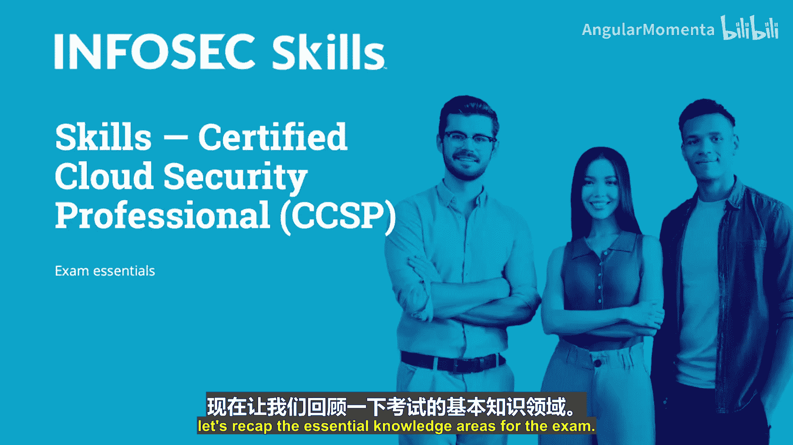
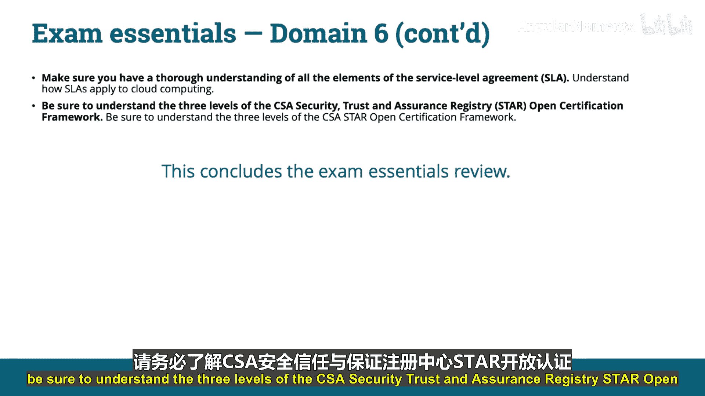

# 【Infosec】认证云安全专家 ｜ Certified Cloud Security Professional (CCSP) p40 08_01_01_exam-essentials -BV1TWrHBrEbk_p40-

Now that we've covered the essential information for the six domains。

 let's recap the essential knowledge areas for the exam。

For domain number one， understand business requirements。

 always bear in mind that all management decisions are driven by business needs。

 including security and risk decisions， security and risk should always be considered before these decisions are made and may not take precedence over the business and operational requirements of the organization。

You should understand the cloud vernaculars and definitions。

 make sure you have a clear understanding of the definitions introduced in this course。

 a great deal of the CCSP exam focuses on the terms and definitions we described。

Be able to describe the cloud service models。 It is vitally important that you understand the differences between the three cloud service models。

 IAA，PA and SAA and the different features associated with them understand cloud deployment models。

 It is also as important for you to understand the features for each of the four cloud deployment models。

 public cloud， private cloud， community cloud and hybrid cloud as well as their differences。

 Be familiar with the cloud computing roles and the associated responsibilities。

 make sure you know and understand the different roles and responsibilities of each role know how to determine business requirements。

 understand the function and purpose of the business impact analysis and how it enables organizations to ascertain the inventory value and criticality of the organizational assets。

Be familiar with the boundaries of each of the cloud service models know which models assign typical controls and dependencies to the parties involved in the cloud service relationships。

 realize that there is a significant amount of room to negotiate contractual definitions of the responsibilities and rights of both the cloud provider and the cloud customer for all of the service models。

 and finally understand how cloud architectures and design support sensitive data security。

 be familiar with how hardening devices， encryption and defense and depth enhances the protection of data in the cloud。

 know where to find the frameworks， models and guidelines for security cloud design。

For domain number two， know the different forms of data analytics。

 be familiar with the descriptions of data mining， real-time analytics and agile business intelligence。

 Understand the various roles， rights and responsibilities related to data ownership know who the data owner is controller processor and custodian Under the rights and responsibilities associated with each Under the purpose and method of data categorization and classification。

 know why and how data owners assign categories and classifications to specific data sets under their control be familiar with data discovery methods know how and when data is labeled and by whom also be aware of the content-based discovery and the use of metadata in discovery efforts Also know the data lifecycle。

 know all of the phases of the data lifecycle in order but remember they do not have to be performed in that order Just remember them in order for the exam and realize that in。

LiIt does not have to be performed in a specific order be familiar with the various intellectual property protections。

 Know the protections for copyright， trademark， patent and trade secrets and finally know what should be included in policies for data retention。

 audit and disposal understand essential aspects like terms of retention and disposal。

 retention formats， how regulations dictate these things and how every policy needs to include details for maintenance。

 review and enforcement for domain number3 understand the risk and security controls associated with each phase of the cloud data lifecycle every phase has its own attendant risk and those risks are usually associated with a particular set or type of security control。

Understand the various cloud data storage architectures。

 be able to tell the difference between file storage， block storage。

 databases and content distribution networks。 understand how and why encryption is implemented in the cloud know the essential elements of key management in particular know that encryption keys are not to be stored alongside the data they are used to encrypt know about emerging technologies known as homomorphic encryption and how it might be used in the future to process encrypted data without having to decrypt it first。

 remember that be familiar with the practices of obscuring data。

 know the different techniques of data masking， hiding。

 anonymization and tokenization be familiar with the SEM technology Under the purposes of seem implementation and the challenges associated with using these solutions。

 Under the importance of egress monitoring， be familiar with the goals of the data loss prevention solutions and how they。

mentAnd what challenges a cloud customer might face trying to implement a DLP within the cloud data center Know how responsibilities are shared between the customer and the provider。

 This is really important for you to remember Under the notional chart I provided for you in the course with the levels of responsibility for each party which depends on the amount of service being provided the customer is always responsible for data and the GRC governance risk and compliance and the cP cloud service provider is always responsible for the physical security you must know which are sharedresponsibilities as well and that depends on a type of service and finally understand the business continuity and disaster recovery in the cloud be aware of the similarities to BDR plans and activities in the legacy environment but pay particular attention to the increased complexity of arrangements necessary between cloud customers and and the significant importance of the contracts in。

Guard。Know the cloud provider' responsibilities for providing secure physical。

 logical and networking elements in the data center。

 Understand how the provider will use secure processes。

 methods and controls to provide the customer with a trusted environment in which to conduct business Understand which party will most likely have which specific security responsibilities in each of the cloud service models。

 Know what the provider and the customer each are tasked with in infrastructure as a service platform as a service and software as a service configurations。

 Understand which responsibilities the cloud customer and the cloud provider are likely to share。

 know the operating system and application baselinelining and management responsibilities are likely to be shared as are identity and access management to some degree know the different types of audit reports most likely to be used for cloud data centers。

 Under the difference between a SoC12 and three report and the type1 and2 know which is preferred。

For detailed analysis and which the cloud customer is most likely to have access to understand the difference between ANF and ONF ONF stands for the network of socalled containers for the subcompent of application security best practices。

 catalog and leverage by an organization it is composed of ANFs ANF stands for any subset of the ONF organization surrounding a specific business application to reach the targeted level of trust remember there is one ONF to many ANFs。

Be able to articulate the components of the stride model。

 the stride threat model stands for the sixth categories， spoofing， tampering， repudiation。

 information disclosure， denial of service and elevation of privileges and don't forget about dread which is made up of damage potential。

 reproducibility， exploitability， affected users and discoverability be able to describe the stages of the SDLC be sure to understand the stages in the SDLC model。

 the SDLC consists of the following stages defining designing developing testing。

 secure operations and disposal understand identity and access management and how it fits into the cloud environment。

 identity and access management plays a critical role in managing users with the advent of rolebased access。

 understand the importance of this and federated identities， and finally， comprehend the specific。

Of cloud application architecture， not all applications are designed to run in the cloud。

 be sure to understand the differences in architecture when designing or attempting to move applications to the cloud for domain number5 understand how redundancy is implemented in the design of the cloud data center be sure to remember that all infrastructure systems and components require redundancy including utilities which are power。

 water and conductivity， processing capabilities， data storage personnel and emergency and contingency services。

 including paths of egress， power light and fuel also need redundancy Know the four tiers of data center redundancies published by the uptime Institute Under the escalation in sophistication of design from Tier1 to tier 4 and the basic differences between each know the significant aspects of training and awareness understand how training impacts the risks of the organization and know which elements。

supportup training efforts， specifically senior management endorsement。

 adequate funding and applicability to job tasks understand the difference between static application security testing。

 Sas and dynamic application security testing D know which is white box testing which is black box testing which involves review a source code and which is performed in runtime In other words。

 while running the applications。 understand system and component monitoring make sure you are familiar with the importance and purposes of monitoring aspects of all infrastructure。

 hardware software and media in data centers， including temperature。

 humidity and event logging have a thorough understanding of maintenance strategies and procedures these strategies and procedures include maintenance mode versus normal operations the process for conducting updates and upgrades and the risk and benefits of manual versus automated patch management know the purpose and general methods of change management Under the。

Composition of the change management board and how it functions and finally。

 understand all aspects of business continuity and disaster recovery strategy， planning and testing。

 focus on the BCDR strategy， planning and testing， especially as it pertains to a cloud data center know about the backup power considerations and methods for testing BCDR plans efficiency。

For domain number six， have a fundamental understanding of the relevant ISO and IEC standards such as ISO 27001 ISO standards are not laws。

 but are derived from experts all over the world who have come together to develop standards from which to operate many countries and coalitions such as the EU based many of their policies on ISOrelated standards。

 have a clear understanding of issues surrounding and relating to edicovery。

 This includes forensics evidence chain of custody and the challenges facing forensics collection in the cloud environment。

 attempting edicovery in a cloud environment can be very challenging due to such things as geographical and geopolitical dispersions understand audit process。

 understand the basic audit concepts such as internal versus external audits as well as the differences and importance of independence in conducting audits。

 less reliable internal audits assist internal operations whereas external audits being more independent。

Fare out more thoroughly sensitive issues that might cause risk to the organization Be familiar with the basic definitions of personally identifiable information。

 Be familiar with contractual versus regulated country specific regulations and those differences Also understand the difference between sensitive and non-sensitive PII using direct and indirect identifiers In addition。

 be aware that even though PII may be nonsensitive when combined with other non-sensitive information it can become sensitive。

 ensure that you have a good grasp of the models， frameworks and standards discussed in this course This includes ISO standards N standards and NSSA standards be familiar with data management roles。

 make sure you understand the various data roles and activities and responsibilities of each make sure you have a thorough understanding of all the elements of the service level agreement understand how service level agreements apply to cloud computing and finally be sure to understand the three levels of the CSA。

Security， trust and As Reggiisttry star open certification Fra。

