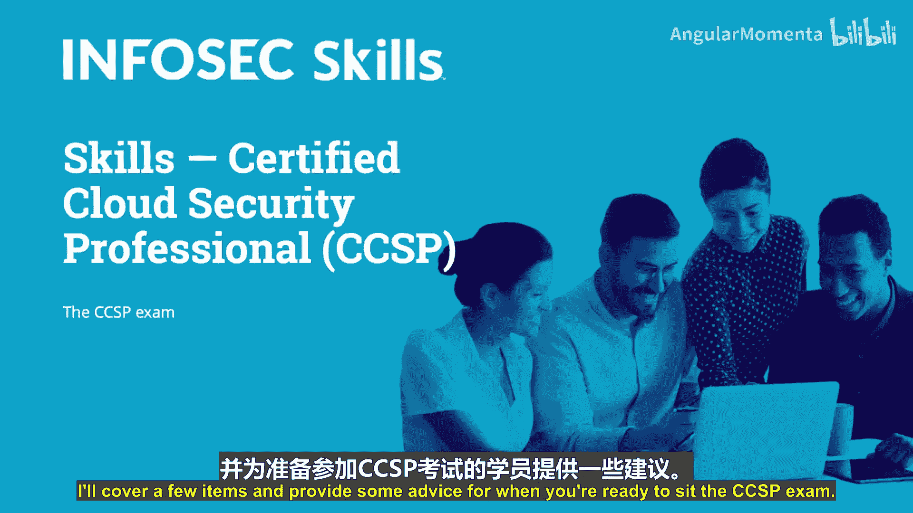
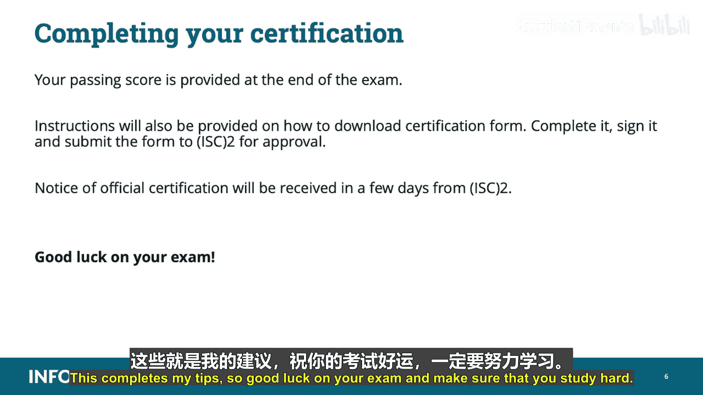

# 【Infosec】认证云安全专家 ｜ Certified Cloud Security Professional (CCSP) p41 08_01_02_the-ccsp-exam -BV1TWrHBrEbk_p41-

In this course， I'll cover a few items and provide some advice for when you're ready to sit the CCSP exam you can take the CCSP exam whether you meet the requirements listed on a screen or not。

 it's just you will not be able to get your certification until you do meet the requirements until then you can be awarded in associateccSP for theccSP certification you will need five years fulltime paid work experience or four years experience with a recent csAccSk certified cloud Security knowledgege certification if you have a CsSP certification that will substitute for the entireccSsp experience requirement In addition to meeting the requirements。

 you will also need to adhere and agree to the ISE squared code of ethics found at www。isE2。

org/ ethicics。

You should become familiar with the six CCSP domains。 I've listed them here on the screen for you。

 I've added a possible breakdown of questions by domain to help you study based on the exam weights most of the questions are standard multiple choice with four answer options with a single correct answer some questions may be based on a provided scenario or a situation which you'll have to read if you get long scenario questions。

 make sure you look for the question it is asking first and then read the scenario I can't stress this enough read the question and then read the question make sure you understand what it is asking look for those key words if the question is asking which of the following is not a requirement versus which of the following are a requirement check and see if the question is asking you to select two of the following versus one of the following There will be a minimum of 125 multiple choice questions 25 are unscored。

ItAnd they're mixed in so you don't know which one are unscored。

 so you have to answer all125 questions。 Currently you have four hours to take the exam。

 basically two minutes per question。 after August 1 you will have three hours to take the test It's important to understand that the content that you have looked at and studied is going to stay pretty much the same the only thing is that there may be a shift of some of the content to other domains and rearrangement of some of that information within the domains themselves everything else pretty much stays the same on the exam is just a time limit is condensed scores will be issued at the end of the exam。

 remember to answer every question， you do not get credit for unanswered questions when registering for the exam at Pearson view。

 make sure that you provide the name shown on the I that you will be present if your name is Robert。

 but you go by Bob you will need to register as Robert because if you register as Bob you will be turned away at the exam if the I you provide shows Robert。

Arrive early you can bring something to drink and eat， but it must stay in the locker they provide。

 You can access these lockers during your break。 If you take a break， the clock will not stop。

 be careful。 You only have so much time to complete the entire exam on this slide I've listed some preparation tips。

 Compte the practice exams that you've been provided Research each practice question you get wrong。

 You may have to look it up or do some homework。 work promptly and don't waste time。

 keep an eye on the remaining time during your exam。

 Try to reduce or eliminate answer options before guessing Pay attention to the question format one more time I state this Pay attention to the question format。

 Use the provided dry erase board for notes read the questions and think ask yourself I this question looking for a procedure or policy or a regulation。

 Is this asking what's best for the company or what's best for security。

 What position am I in or what position am I supposed to be in in this particular role。

And the key words， remember the best answer isn't always the most secure one。

 Always remember the perspective that you're in when you're answering these questions。

 The other thing is， remember the fact that the customer and enterprise are used interchangeably。

 they mean the same thing。 If it doesn't state that then it is the cloud service provider for most questions you will be in the customer or enterprise frame of view。

 completingleting your certification。 Once you've passed your test。

 your passing score is going to be provided at the end of the exam。

 instructions will also be provided on how to download the certification form， complete。

 sign and submit the form to ISE squared for approval。

 Notice of the official certification will be received in a few days from ISE squared。

 This completes my tips。 So good luck on your exam and make sure that you study hard。

