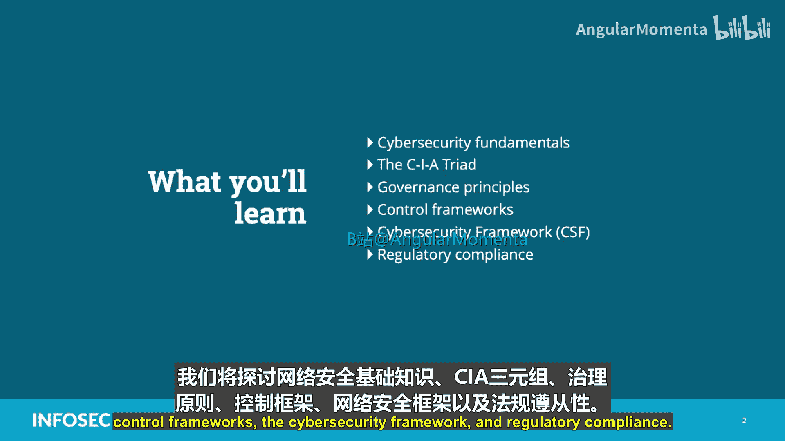
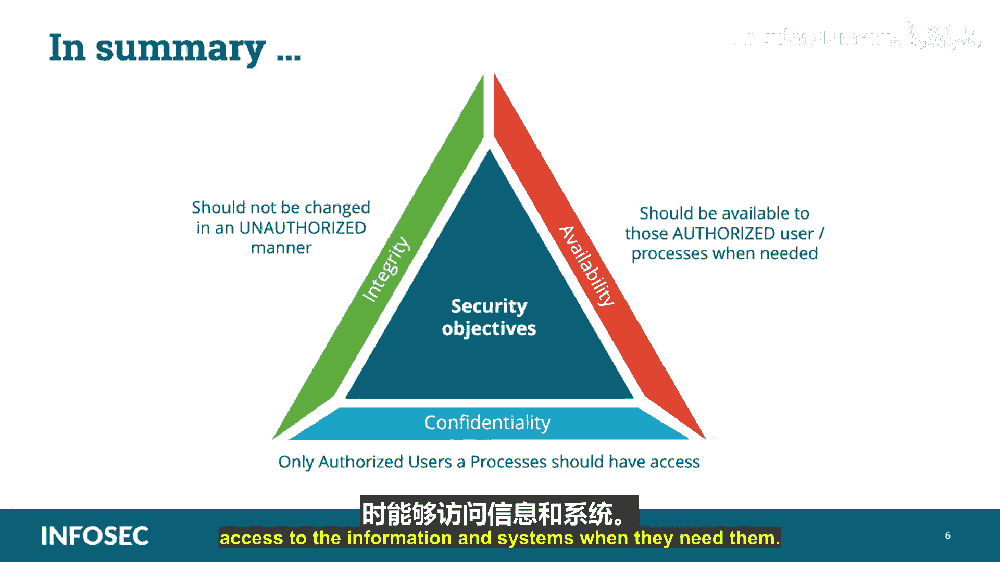

# 【Infosec】认证云安全专家 ｜ Certified Cloud Security Professional (CCSP) p02 01_01_02_cia-triad -BV1TWrHBrEbk_p2-

Cybersecurity Bass， a component of the Cified Cloud Security Professional CCSP Learning Pa。

In this course， we'll address cybersecurity fundamentals， the CIA Triad， governance principles。

 control frameworks， the cybersecurity framework， and regulatory compliance。

Okay， let's get started with cybersecurity basics First of all。

 information security management aligns information security with the organizational requirements for confidentiality。

 integrity and availability this is referred to as the CIA Triad in some publications it may be listed as AIC availabilityva integrity and confidentiality but it's the same thing。

It balances risk with security investments and return。

 provides oversight mechanisms for managing risks within the acceptable level for that organization。

It measures effectiveness of information security performance and sets policies， procedures。

 standards， baselines， and guidelines。Security programs have several small and large objectives。

 but they are based on simple principles。 the fact that assets require protection and that protection is based on requirements of confidentiality integrity and availability。

 Security is insured through security governance， which is comprised of management practices and management oversight。

 and is demonstrated through compliance that could be legal or regulatory compliance consists of adherence to applicable legal and regulatory requirements。

 applicable policy standards procedures and guidelines and personal security policies。

 as well as asset protections， which form the baseline for security。

 unintended disclosure and unauthorized modifications or destruction of an asset can affect security。

You should know that cybersecurity is defined as the protection of information assets by addressing threats to information process。

 stored and transported by interneted information systems。

It's also defined as measures taken to protect the integrity of networks。

 programs and data against unauthorized access， damage or attacks。Information security。

 which is designed to maintain the confidentiality integrity and availability of data is a subset of cybersecurity Cysecurity can be an important and amplifying component of an organization's overall risk management process and just like financial and reputational risks。

 cybersecurity risks affect a company's bottom line when looking at the business drivers。

 you should also understand the differences between cybersecurity and information security information security deals with information regardless of its format。

 for example， paper documents， digital and intellectual property， verbal or visual files。

 any communications regardless of media， cybersecurity is concerned with protecting the confidentiality integrity and availability of digital assets which can include networks's hardware or software。

 information that is process stored or transported by a networked information system。

Confindentciity is the property that information is not disclosed to system entities like users。

 processes or devices， unless they have been authorized to access that information。

 it also includes preserving authorized restrictions on information access and disclosure。

 including means for protecting personal privacy and proprietary information。

This is enforced using the principles of least privileges。

 which means that people are given just the access that they need to do their job and nothing more it's based on the principles of need to know as well In is the property whereby an entity has not been modified in an unauthorized manner。

 basically guarding against improper information modification or destruction and includes ensuring information。

 non-reudiation and authenticity In other words， making sure that information is processed correctly and not modified by unauthorized persons and protecting information as it transits the network。

😡，Availability is the property of being accessible and usable upon demand by an authorized entity。

 according to NIST， the National Institute of Standards and Technology is ensuring timely and reliable access to and use of information by authorized users set another way it's ensuring that systems are up and running so that authorized persons and functions can use them when they need to the level of security required to accomplish this principle differs per company because each has its own unique combination of business and security goals and requirements Also vulnerabilities and risks are evaluated based on their threats against one or more of the CIA Triad components。

 said another way， all security control mechanisms and safeguards are implemented to provide one or more of these principles。

 and all risks， threats and vulnerabilities are measured for the potential capability to compromise one or all of the CIA principles。

The three opposites of the CIA goals are known as DD or dadA Disclosure is the opposite of confidentiality。

 keeping in mind that confidentiality is ensuring that only those authorized users get to see the information。

 Disclo becomes the opposite of that Alation is the opposite of integrity。

 integrity ensures that the information has not been modified in an unauthorized way。

 and alteration is basically modifying the information in any way。

 Dision is the opposite of availability， Availability ensures that the applications are up and available when they need to be used。

 and if they're destroyed， they then become unavailable。

 so that becomes the opposite of availability。 So how do we ensure confidentiality。

 integrity and availability。 Conity can be achieved using encryptryion， for example。

 integrityte can be achieved by check sums， hashes， digital signatures or even separation of duties。

 and availability can be。Achveed by implementing backups， remote sites。

 clustering or different redundant array of independent disks known as raid levels Okay， in summary。

 confidentiality is all about making sure that only those authorized users and processes have access to the systems and information integrity makes sure that the systems or information is not changed in an unauthorized manner by either an authorized or unauthorized individual and availability is all about making sure that those authorized users and processes can have access to the information and systems when they need them。

