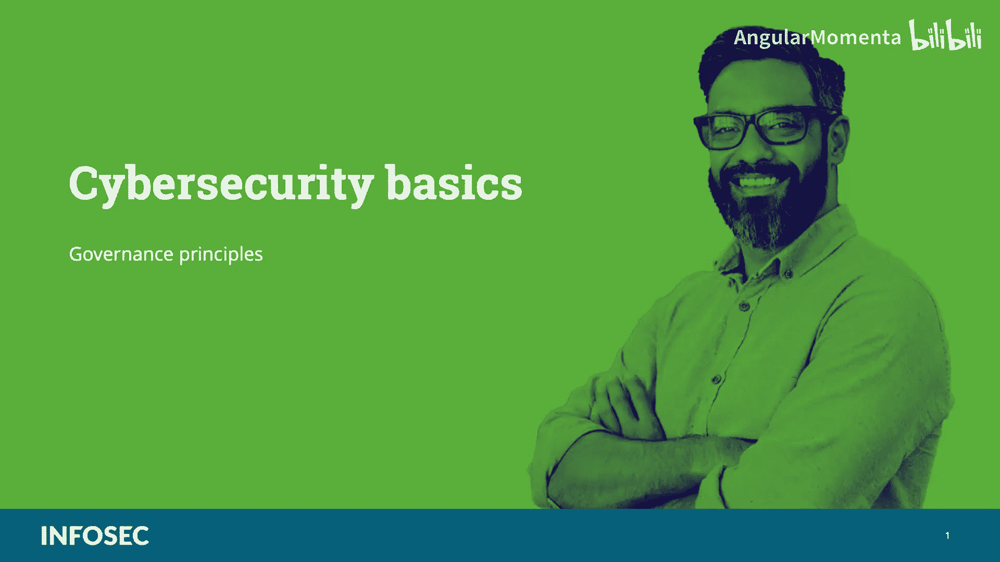
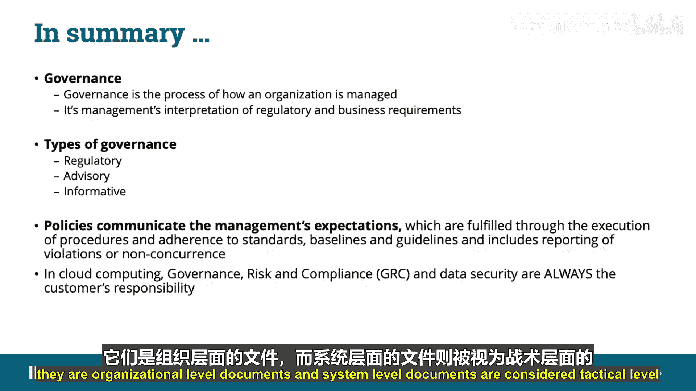

# 【Infosec】认证云安全专家 ｜ Certified Cloud Security Professional (CCSP) p03 01_01_03_governance-principles -BV1TWrHBrEbk_p3-

Okay， so security policies communicate the management's expectations for protecting the organizational CIA。

 confidentiality， integrity and availability， which is fulfilled through the execution of procedures and adherence to standards。

 baselines and guidelines。Once the policy documents have been created， we need to ensure compliance。

 Also， a policy needs to be technology and solution independent。

It must outline the goals and mission but not tie the organization to a specific way to accomplish them Procedure standards guidelines and baseline are components that support the implementation of a security policy and compliance。

 set another way policy establishes the strategic plans and the lower elements provide the tactical support remember policies communicate management's expectations which are fulfilled through the execution of procedures and adherence to standards。

 baseline and guidelines and include reporting of violations。

 example data breaches and those kinds of things once the policy documents have been created you need to ensure compliance Pro standards guidelines and baseline are the components that support the implementation of the security policy and compliance they are the foundation of comprehensive effective information security programs。

They identify processes for violation， adjudication， internal disciplinary action。

 external sanctions， criminal， civil， and regulatory requirements。

 and establish a formal process for creating， approving， reviewing， updating。

 and distributing policies。Many organizations place the documents on their intranets or in a shared file folder to facilitate their accessibility we're talking about policy standards。

 processes， procedures and supporting documents you see on the slide that I provided you here it shows that policies define the direction in which the organization should go This is management's interpretation of a regulatory requirement or business goal or function that they need to adhere to standards set the level that the organization has to adhere to the organization has to agree what the acceptable level is if it has no standard。

 it has no quality because there's no consistency at that point so the standards establish the consistency for the organization set another way it establishes the criteria of the policy process is the system of inputs and outputs to actually reach a desired goal they support the standard。

Procedures are the steps of who does， what， when， where， and how they support the process。

The supporting documents such as guides， handbooks， plans， manuals， templates， checklists， forms。

 job aids， and all of those further supports the process or the procedure and can be detailed steps。

Policies generally fall into one of the following categories regulatory。

This type of policy ensures that the organization is following standards set by specific industry regulations like the Health information Portability Act HIPAA。

 the Graham Leach Bailey Act， the GLBA， Saaranes Oxley， Sox， PCI， DSS。

 which is a payment card industry， data security standard， those types of things。

 it's usually very detailed and specific to a type of industry， it's used in financial institutions。

 healthcare facilities， public utilities and other government regulated industries。

Advisory policies are policies that strongly advise employees as to which types of behavior and activities should and should not take place within the organization。

 it also outlines possible ramifications if an employee does not comply with the established behavior and activities for example。

 this type of policy can be used to describe how to handle medical or financial information like personally identifiable information PII or personal health information PI some organizations outline acceptable use agreements as part of their compliance policy。

 informative policies are policies that inform employees of certain topics。

 it's not an enforceable policy， but rather one that teaches employees about specific issues relevant to the company it could explain how the company interacts with partners。

 the company's goals and missions or general reporting structures for certain situations。

Think of governance as the process of how an organization is managed。

 this includes all of the aspects of how decisions are made for the organization and can and usually does include the policies。

 roles and procedures the organization uses to make those decisions so we can think of governance。

 risk management and compliance as the approach for analyzing risk and managing mitigation to align it with business and compliance objectives。

Set another way， governanceover is all about having processes in place to support the compliance of cybersecurity activities with applicable privacy laws。

 regulations and constitutional requirements you have internal and external governance internal governance is the process of how an organization is managed。

 set another way it promotes alignment with the organization's vision and mission。

 it clarifies who in the organization has the authority to make decisions。

 determine accountability for actions and responsibility for outcomes and addresses how expected performances will be evaluated external governance would include contracts。

 service level agreements， memorandums of understanding MoOs， memorands of agreements。

 Mos and applies to your vendors， contractors and suppliers and its enforced through audits。

 onsite assessments， implementation of policies and procedures or thirdpart assessments remember that。

Polic， procedures and processes are used to manage and monitor the organization's regulatory， legal。

 risk， environmental and operational requirements。And inform management of cybersecurity risks governance risk and compliance known as GRC will always be the enterprise。

 also known as the customer's responsibility， regardless of the type of service being purchased from the cloud service provider We'll cover this in more detail later in the course。

 but it's important to understand this now as we discuss governance in cloud computing。

 governance becomes an ongoing process of defining actions。

 assigning responsibilities and verifying performance。

GRC governance risk and compliance and data security for that matter is always the customer's responsibility Information and data governance types may vary depending on the organization Some examples are information classification policies。

 information management policies， location and jurisdictional policies。

 authorizations or custodianship In summary， governance is the process of how an organization is managed。

 In other words， its management's interpretation of regulatory and business requirements the types of governance we discussed where regulatory advisory and informative regulatory are policies which ensure that organization is following standards set by specific industry regulations like HIPAA GLB Sox。

 FISma or PCDSS Advy are policies which strongly advise employees as to which type of behavior and activities should and should not take place within the organization and informative are policies。

Inform employees of certain topics or issues relevant to the company。And finally。

 remember that high level policies are considered strategic level documents， in other words。

 they are organizational level documents and system level documents are considered tactical level documents。

