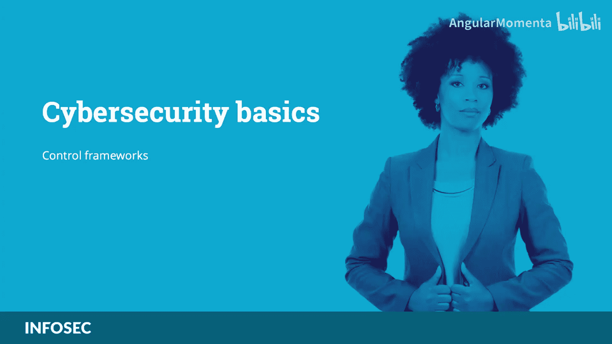
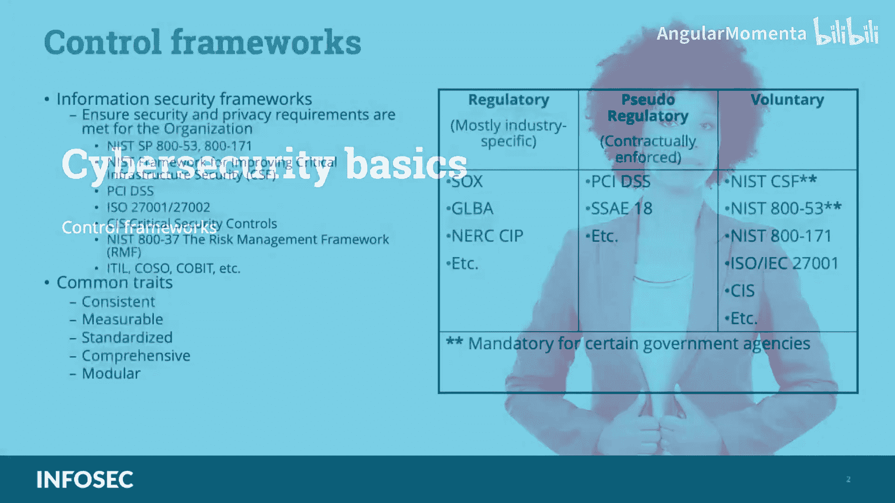
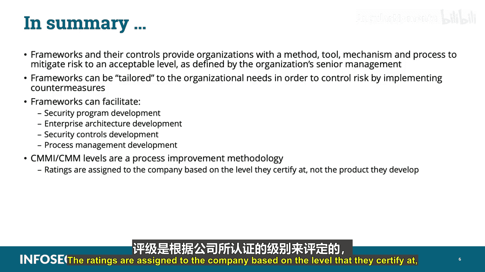

# 【Infosec】认证云安全专家 ｜ Certified Cloud Security Professional (CCSP) p04 01_01_04_control-frameworks -BV1TWrHBrEbk_p4-

As part of cybersecurity basics， let's now talk about frameworks an information security framework is a series of documented processes that are used to define policies and procedures around the implementation and ongoing management of information security controls in an enterprise environment organizations implement a framework based on security controls as part of their governance program to ensure security and privacy requirements are met。

There are many approaches and frameworks that can be used to address risk in an organization。

 for example， NIST 853， 80171， the CSF， PCI DSSS， ISIL 27，000 series， CIS， NIST 837。

 the risk management frameworks and a few others， but they all have some common elements。

 they must be consistent， measurable， standardized， comprehensive and modular。

 when we're talking about consistent， they must be consistent in how information security and privacy is approached and applied。

Measurable in this term， the governance program must provide a way to determine progress and set goals when we talk about standardized。

 we mean that they should rely on standardization so results from one organization or part of an organization can be compared in a meaningful way to other parts of that organization。

😡，Comprehensive， what what we mean here is that they have to cover the minimum legal and regulatory requirements of an organization and be extensible to accommodate additional organization specific requirements when we say modular we're talking about only the controls or requirements needing modification are reviewed and an updated for that organization。

One example of a control framework is the United States National Institute of Standards and Technologies NISist Special Public 853853 is a control framework made up of 385 possible controls within 19 control families。

 The framework includess the ability to scope and tailor controls to an organization's specific mission and requirements。

 there's also 8171， which is used by contractors dealing with the government and handling controlled on classifiedified information and 837 which is the risk management framework and we'll talk more about these in just a few minutes。

 The International Or for Standardization 27001 is an international control framework designed to cover organization of all countries and all sizes It's a series of information security management systems and standards containing 114 controls in 14 groups and is the best known standard for providing requirements for an information security management system The Center for Internet Security CIS。

And criticalical security controls CSC are a recommended set of actions for cyber defenseense that provide specific and actionable ways to stop most pervasive and dangerous attacks it's comprised of 20 criticalical security controls and its principal benefit is that the controls prioritize and focus a smaller number of actions with high payoff results There are several other frameworks an organization may use as well like IT information technology Informationstructure library。

 which looks at change control and service management Coso。

 the Committee of sponsoring organizations which is very similar to ISO 27001 and COVID control objectives for information and related technology which was created by AsA。

 the information systems audit and control association for IT management and governance all these frameworks provide security controls which are methods。

 tools， mechanisms and processes used in risk mitigation you place safeguards in the form of controls before the risk is realized。

Using one of these frameworks， remember， a security control framework is a notional construct outlining the organization's approach to security。

 including a list of specific security processes， procedures and solutions used by the organization After you have selected a framework you then deploy countermeasures to reduce the risk in information security。

 risk is the likelihood that a threat source will exploit one or more vulnerabilities or the potential to create significant impacts or consequences that affect the organization's assets NISistT special publication 830。

 the guide for conducting risk assessments defines vulnerabilities as an inherent weakness in an information system。

 security procedure， internal control or implementation that could be exploited by a threat source。

A threat source is any person， event or environmental factor that could affect or harm a protected asset。

A protected asset may include a network or its components， files and data， financial assets。

 or even personnel or organizational reputation。A vulnerability is a weakness in an asset or the absence of or weakness in safeguards or countermeasures。

 In other words， a vulnerability is a weakness that can be exploited by a threat。

 It's the hole through which a threat gains access to a protected asset using a sheep farmer analogy。

 a wolf， for example， would be a threat to the farmers' assets， the sheep。

 If the pen that they were in surrounded by a fence has a hole。

 The hole in the fence is a weakness in the countermeasure。

 the farmer employed to protect his assets。 That whole allows the threat In this case。

 the wolf to take advantage of a vulnerability， the hole and harm the assets In this case， the sheep。

 countermeasures are what we put in place to reduce a threat's ability to exploit an exposure or that can lessen the impact to the organization when a threat is able to exploit that vulnerability。

 All security controls have an impact on operation。

Control selection must entail a cost benefit analysis and be tailored to the organization We look at the cost benefit analysis cost should be less than the value of the assets or try to reduce the attack benefit in other words countermeasures should increase the cost of the attack making it unattractive countermeasures could be used to solve a real problem like a vulnerability an issue or reduce a threat。

Security controls and countermeasures should support and enable business tasks and functions by using a defense and depth methodology to maximize our security benefits。

Let's look at a couple of these frameworks and what they provide Generalally accepted information security principles or GAISP is a successor project to the General accepted systems security principles or the GASP it draws on established security guidance and standards to create comprehensive objective guidance for information security professionals。

 organizations， governments and users， the goal of the GAISP is to collect information security principles that have been proven in practice and accepted by practitioners and to document those principles in a single repository。

Basically， it incorporates the consensus at a particular time as to the principles， standards。

 conventions， and mechanisms that the information security practitioners should employ that information processing products should provide and that information owners and organizational governance should acknowledge to ensure the security of information and information systems。

ISL 27，000 is a series of information management systems and standards， for example。

 ISIL 27000 is the overview and vocabulary 27001 is the requirements 27002 is the code of practice 27003 implementation guidance 27005 is risk management 27006 audit and certification and there's a lot more of these documents in the series The series provides best practice recommendations on information security management risks and controls within the context of an overall information security management system organizations can use the standards as the basis for developing security standards and security management practices ISIL 27。

002 contains over 100 detailed information security controls。

Coso focuses on ensuring valid financial reporting It supports Saarrb's Oley's section 404 compliance It's relevant to public companies and their auditors。

 the Securities and Exchange Commission and other regulators Coso identifies five areas of internal controls necessary to meet the financial Report and Disc objectives they are control environments。

 risk assessment， control Act， information and communications and monitoring some organizations working towards Saarrb's Oxley's Section 404 compliance have adopted the KoSso internal control model framework COVID focuses on I management and governance and much like PC DSsS and ISO 27002 It's focused on compliance with the standards that include prevention detectionte and reaction to Security incidents PC DSsS was developed by the Pay card Industry data Security standards Council to enhance payment。

Card data securityIt's targeted towards merchants and service providers but is mandated for systems involved in handling in organizations payment card services it's not a law it's a selfreulated approach at a high level view a framework that deals with security program development is the IO 27。

000 series It's the international standards on how to develop and maintain an information security management system which was developed by IO and IEC。

Frameworks that deal with enterprise architecture development are Zachmen。

 which is a model for the development of enterprise architectures。

 the Open group architecture framework Toegaff， this is a model of methodology for the development of enterprise architectures developed by the Open group。

The US Department of Defense Architecture framework DoDF。

 which ensures interoperability of systems to meet military mission goals British Ministry of Defense Arch framework MoDF is used mainly in military support missions developed by the British Ministry of Defense The Sherwood applied business security architecture SAMa is a development of information security enterprise architecture。

 which is similar to Zachman Zachman and SAMA allow for the communication and collaboration of all entities in the development of the architecture。

 while not specific to security architectures， it does provide a logical structure for integrating the various perspectives such as the plan design and building aspects of the architecture frameworks that deal with the security controls development are COVID。

 which is a business framework to allow for I enterprise management and governance that was developed by the Information Systems A and Control Association。

Asaka NISist 853， which is a set of controls to protect US federal systems developed by the National Institute of Standards and Technology Committee of sponsoronsing organizations of the Treadway Commission Coso。

 is an internal control， integrated framework to help reduce the risk of financial fraud。

 and finally， frameworks that deal with process management Development R the information Technology Infrastructure Library IT。

 which is the de facto standard for best practices for I service management and service improvement。

 Six Sigma， which is a business management strategy that can be used to carry out process improvement。

 it's a set of techniques and tools for process improvement。

The capability maturity model integration CMI sometimes referred to as CMM。

 is an organizational development for process improvement methodology developed by Carnegie Mellon University CMI focuses on quality management processes and has five maturity levels that contain several key practices within each maturity level The five CMMI levels are initial。

 repeatable， defined， managed and optimizing。It's important to note here that the CMMI ratings are assigned to the company based on the level that they certify at。

 not the product that that company is developing。When we see a company that has a CMI rating of one。

 an initial process， that means that they have a starting point for their products。

 They don't have a documented process， just a starting point for the development of their products。

 companies that receive a CMI rating of two。 that means that they have a repeatable process also In other words。

 they have an initial starting point， and they have a repeatable process that is at least documented sufficiently so that it can be repeated。

 In other words， the same steps may be attempted in the development of their products。

A company that receives a CMMI level3 rating is a company that has an initial starting point。

 they have it documented enough so that they can repeat it and they have a defined process。

 in other words， it is confirmed as a standard business process for that organization。

Companies that receive a CMMI level 4 rating means that they have an initial process。

 it's repeatable， it's defined， and it's managed。The process is quantitatively managed in accordance with agreed upon metrics。

And finally， companies that receive a CMMI rating of five。

 that means that they have an initial repeatable， defined and managed process。

 including the optimization process management includes deliberate process optimization or improvements。

 Basically this is a framework for evaluating and improving development processes。

 it assumes the quality of development process which directly impacts the quality of the product itself。

In summary， frameworks and their controls provide organizations a method， tool。

 mechanism and process to mitigate risk to an acceptable level as defined by the organization's senior management frameworkraworks can be tailored to the organizational needs to control risk by implementing countermeasures frameworkworks can facilitate security program development。

 enterprise architecture development， security controls development and process management development。

 and finally CMMI also known as CMM levels are a process improvement methodology。

 the ratings are assigned to the company based on the level that they certify at not the products that the company develops。

