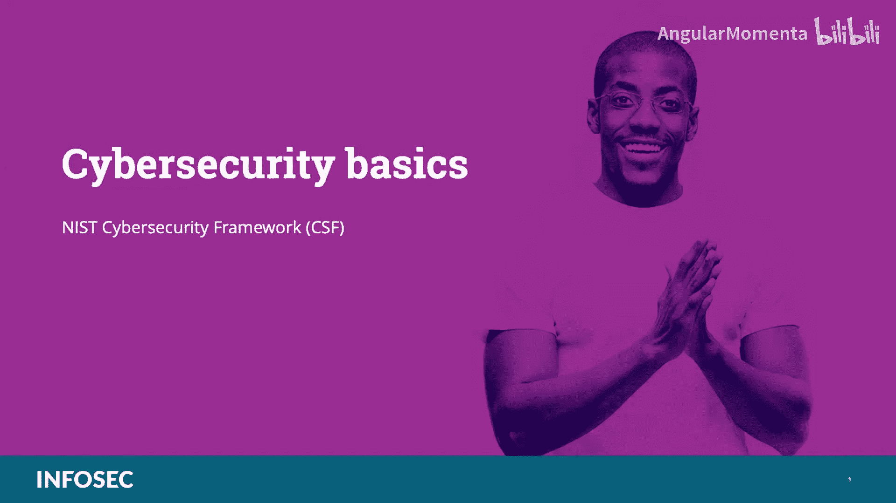
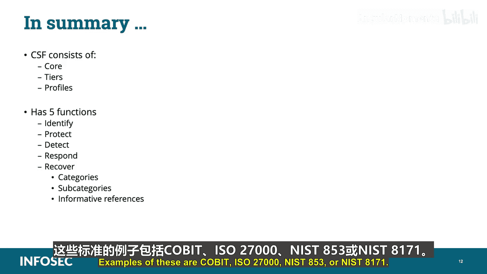

# 【Infosec】认证云安全专家 ｜ Certified Cloud Security Professional (CCSP) p05 01_01_05_nist-cyber-security-framework -BV1TWrHBrEbk_p5-

As part of cybersecurity basics， let's now talk about the National Institute of Standards and Technologies's NIST cyberbersecurity Framework。

 CSF。

In 2013， President Obama signed executive Order 13636， improving critical infrastructure security。

 it directed NIST to work with other industry stakeholders to develop a voluntary framework based on existing standards。

 guidelines and practices for reducing cybersecurity risks to critical infrastructure。

Executive Order 13636 directs the executiveive branch to develop a technology neutral voluntary cybersecurity framework。

 promote and incentivifies the adoption of cybersecurity practices， increase the volume。

 timeliness and quality of cyber threatat information sharing。

 incorporate strong privacy and civil liberties protections into every initiative to secure our critical infrastructure and explore the use of existing regulations to promote cybersecurity。

 the NIST cybersecurity framework provides a policy framework of computer security guidance for how private sector organizations in the United States can assess and improve their ability to prevent。

 detect and respond to cyber attacks。It provides a high level taxonomy of cybersecurity outcomes and methodologies too assess and manage those outcomes is being used by a wide range of businesses and organizations and helps shift organizations to be proactive about cyber risk management。

 The CSF provides a common taxonomy for organizations to describe their current cybersecurity posture。

 Describe their target state for cybersecurity Ident and Priitized Opportunities for improvement within the context of the continuous and repeatable process。

 assessssess Pro towards the target state that they've established and communicate amongst internal and external stakeholders about cybersecurity Ris。

 On May 11，2017， a Presidential executiveive order。

 Executive Order 13800 entitled Strenging the cybersecurity of Federal Networks and critical Instructure was signed by President Trump It was issued to improve the nation's cybersecurity posture and Cap。

In the face of intensifying cybersecurity threats to its digital and physical security。

 Executive order 13800 initiates actions on forefronts。

 It secures the federal networks that operate on behalf of the American people。

 It encourages collaboration with industries to protect critical infrastructure that maintains the American way of life。

 It strengthens the deterrence posture of the United States and builds international coalitions。

 and it places much needed focus on building a stronger cybersecurity workforce。

 which is critical for the nation's longterm ability to strengthen its cyberprotection and capabilities。

 Execut order 13800 consists of three sections， Section 1， cybersecurity of federal networks。

 Section 2， cybersecurity of critical infrastructure and Section 3， cybersecurity for the nation。

 Section 1 of the executive order subsection C further subsection I states that effective。

Each agency head shall use the framework for improving critical infrastructure developed by the National Institute of Standard and Technology or any successor document to manage the agency's cybersecurity risks this changes thanks it's no longer voluntary for federal organizations or federal agencies to use the CSF it must implement a framework in accordance with executive order 13800。

Around April 2018， the CSF was updated to refine， clarify and enhance version 1。

0 the key changes were to the categories and Subcategory section in NIST CSF 1。

1 there is one new category in the identify function area。

 10 new subcategories in the identify protect and Respon function areas and 26 subcategories reworded from the old version 1。

0 it's important to note that all of the items that were in version 1。0 are now also in version 1。

1 so it's still compatible with the old version。The cybersecurity framework consists of three main components。

 the framework core， the framework implementation tiers， and the framework profiles。

 we're going to cover these over the next couple slides。The Frame core is comprised of four elements。

 functions， categories， subcategories， and informative references。

Functions provide a high level strategic view of the life cycle of an organization's management of cybersecurity there are five functions known as IPDRR they are identify。

 protect， detect， respond and recover the questions that we're asking here when we're looking at these functional areas is what processes and assets need to be protected。

What safeguards are available， what techniques can identify incidents。

 what techniques can contain impacts of those incidents。

 and what techniques can restore the capabilities when an incident has happened。

Each function is divided into categories， subcategories and informative references categoriesgories are cybersecurity outcomes that are closely tied to a programmatic need and particular activity like asset management under the identify function Subcategories are specific outcomes of technical and or management activities that support achievements of each category this will always be a dash something。

 for example， RC。p1 or ID AM1 and will always identify the function， for example。

 ID for identify and then the category AM for asset management and then the dash12 and so on In references are specific crosssector standards guidelines and effective practices that illustrate a method to achieve the outcomes associated with each sub。

ryAnd it's tied to a security framework like NISistT 853， ISIL 27，001， COVID， IT， etc。

Framework implementation tiers provide context on how an organization views cybersecurity risks and the processes in place to manage that risk。

 the tiers describe the degree to which an organization's cybersecurity risk management practices exhibit the characteristics in the framework like risk and threat awareness。

 repeatable and adaptive。The tiers categorize an organization's practices over a range from partial to adaptive partial is Tier 1。

 risk informed， Tier 2， risk informed and repeatable Tier 3 all the way to adaptive tier 4。

 Each tier demonstrates an increasing degree of rigor and sophistication for risk management and integration with the overall organizational needs。

 For example， a tier 1 category is required for Tier 2 as well。

 This means an organization striving for tier 3 should consider practices listed under Tier 1。

2 and 3 headings。 The organization decides which tier matches its risk management needs and capabilities。

 progression to higher tiers is encouraged when the change and cost effectively reduce the cybersecurity risks。

Tears are associated with the overall robustness of an organization's risk management processes and are not tied to functions。

 categories or subcategories。Each tier addresses a risk management process。

 integrated risk management programs and external participation。

The risk management process is about the organization adapting its cybersecurity practices based on previous and current cybersecurity activities。

 including lessons learned and predictive indicators。Depending on the tier。

 it would be something like tier1 partial risk management process means that the organizational cybersecurity risk management practices are not formalized and risk is managed in an ad hoc and sometimes reactive manner。

 prioritization of cybersecurity risk activities may not be directly informed by organizational risk objectives。

 the threat environment or business or mission requirements。

If it were a Tier2 risk informed risk management process。

 the risk management practices would be approved by management but may not be established as organizational wide policy。

 prioritization of cybersecurity activities and protection needs is directly informed by organizational risk objectives。

 the threat environment or business or mission requirements。

If it were a Tier3 repeatable risk management process。

 the organization's risk management practices are formally approved and expressed as policy organizational cybersecurity practices are regularly updated based on the application of risk management processes to changes in business or mission requirements and a changing threat and technology landscape。

 and finally， if it were a tier four adaptive risk management process。

 the organization adapts its cybersecurity practices based on previous and current cybersecurity activities including lessons learned and predictive indicators。

 through a process of continuous improvements incorporating advanced cybersecurity technologies and practices。

 the organization actively adapts to changing threats and technology landscapes and response in a timely and effective matter to evolving sophisticated threats。

The framework profiles align the functions， categories。

 and subcategories with the organization's business requirements， risk tolerance and resources。

They enable the organization to establish a roadmap for reducing cybersecurity risks that are aligned with organizational and sector goals considering legal and regulatory requirements and industry best practices。

An organization may choose to have multiple profiles aligned with particular components depending on the complexity of the organization and the technical environment the profile support business or mission requirements and aid in communicating risk within and between organizations or business units。

They can also be used to describe the current state or desired target state of specific cybersecurity activities。

The current profile indicates the cybersecurity outcomes that are currently being achieved。

The target profiles indicate the outcomes needed to achieve the desired cybersecurity risk management goals comparison of profiles。

 for example， the current profile and the target profile may reveal gaps to be addressed to meet cybersecurity risk management objectives。

An action plan to address the gaps to fulfill a given category or subcategory can contribute to the organization's cybersecurity roadmap。

Here you see three categories for the recovery functional area， recovery planning。

 improvements and communications， you'll notice that they all lead out with the RC and then a period and then RP for recovery planning IM for improvements and then CO for communications。

In the CSF， every one of the functional areas categories subcategories will always have the letters indicating the function。

 the category and the subcategory， RC period RP is recover recovery planning。

 and then you would have the subcategory in there as a dashash1 or dashash2 or dash3 Each category has an associated subcategory and informative reference。

Subcategories are the deepest level of abstraction in the core。

 there are 97 subcategories which are outcome driven statements that provide consideration for creating or improving a cybersecurity program。

The subcategories shown here are five from the business environment category under the function of identity。

The other column is the informative reference， these informative references or frameworks are broad references that are more technical than the CSF。

The CSF is designed to be coupled with a framework like 853 COVID or ISOL 27，000。

 which provide more comprehensive and technical guidance for the implementation of controls。

This is a closer look at the informative references of the CSF。

 these informative references are the frameworks which are mapped to the CSF。

 the one that is missing here is the NIST 800171 In summary。

 there is no hierarchy of functions and the framework does not intend for the functions to operate as a checklist Rather organizations must address the functions concurrently and continuously。

The functions are further subdivided into categories and subcategories。 The frameworks。

 categories and subcategories are not exclusive。 organizations may develop their own。

Categories are the groups of cybersecurity anticipated end results tied to the organization's needs and particular activities for a given function。

 for example， identity management， authentication and access control is a category under the function of protect subcategories further divide a given category into specific activities that support the desired achievement in each category。

 for example， identities are proof and bound to credentials is a subcategory of access control。

And finally， informative references are the security standards。

 guidelines and practices that show a methodology to achieve the outcomes associated with each subcategory assembled during the process of developing the framework examples of these are COVID ISIO 27。

000， NIST 853 or NIST 80171。

