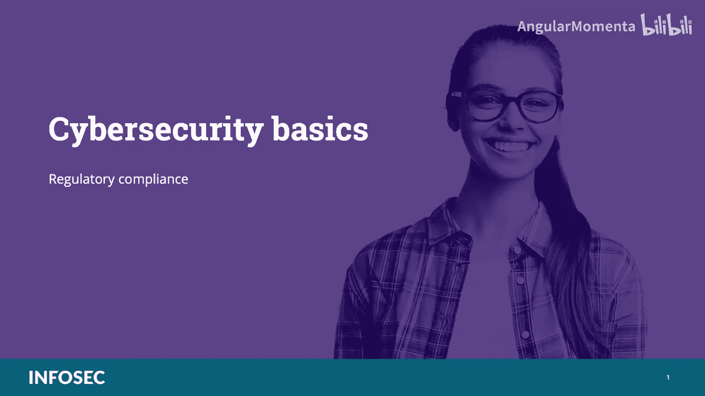
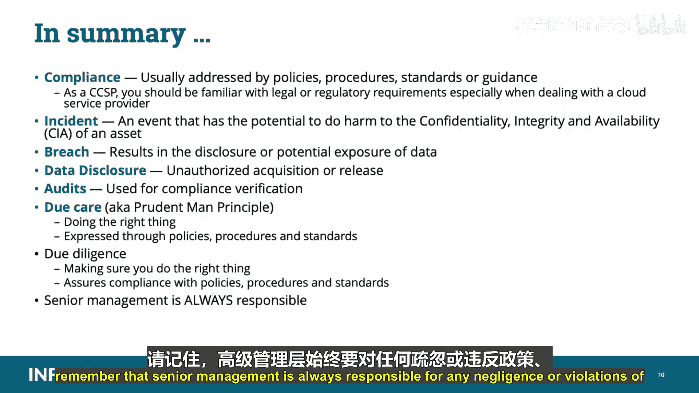

# 【Infosec】认证云安全专家 ｜ Certified Cloud Security Professional (CCSP) p06 01_01_06_regulatory-compliance -BV1TWrHBrEbk_p6-

As part of cybersecurity basics， let's not talk about regulatory compliance。

As a certified cloud security professional， CCSP， you may be responsible for ensuring that your organization's cloud infrastructure is compliant with any regulatory standards or laws applicable to your deployment。

You need to understand all of the requirements and expectations for your compliance。

 which vary based on several factors like geography。

 business type and services offered to ensure that the enterprise is able to prove compliance when asked to do so during an audit。

 compliance with legal or regulatory requirements are usually addressed by policies， procedures。

 standards or guidelines。When working with cybersecurity， especially in cloud security。

 you should be familiar with these terms。International law governs relationships between countries。

 in some publications you'll see this referred to as states。

 but don't confuse this with the US states internationally these countries are sometimes referred to as states。

 so for the CCSP exam if the termstate is used， think of it as countries。

International law is made up of international conventions， customs。

 general principles of law and judicial decisions。International conventions。

 whether general or particular， establish rules expressly recognized by consenting states。

 International custom as evidence of a general practice are accepted as law。

 The general principles of law are recognized by civilized nations。

Judicial decisions and the teachings of the most highly qualified publicists of the various nations are the subsidiary means for the determination of rules of law。

An enforceable governmental request is a request or order that is capable of being performed on the basis of the government's order。

 US state law typically refers to the law of each US state and are treated separately with their own state constitutions。

 state governments and state courts， copyright and privacy laws specifically copyright。

 infringement which occurs when a copyright materials made available or shared with others by a party who is not the legal owner of the information。

 protects an original expression of an idea It grants exclusive rights to the creator of the original works。

Intellectual property rights describes creations of the mind like words， literature， logos， symbols。

 or other artistic creations and literary works， copyright。

 trademarks and patent protection all exist in order to protect a person's or company's intellectual entitlements。

Intellectual property is divided into two categories。

 industrial property also known as business property， which includes patents， inventions， trademarks。

 servicemarks， blueprints， trade secrets， industrial designs and those kinds of things and copyright。

 which includes literary and artistic works， performances， live and recorded， authors rights。

 software， photographs， sculptures and that kind of stuff。

 Trades protect the unique identity of goods or services， for example， words。

 slogans or logos which can identify accompany its products or its services。

 basically brand protection that secret sauce， the Ros Royce Emblem， the UPS symbol。

 the Coca- Colla bottle， and even the KFC Kentucky Fed Chicken bucket Trade secrets are covered under the Economic Espionage Act of 1996 to preserve trade secretcret status you must implement adequate controls within your organization to ensure。

That only authorized personnel with they need to know the secrets have access to them。

 you must also ensure that anyone who does not have this type of access is bound by a nondisclosure agreement。

 an N that prohibits them from sharing the information with others and provides penalties for violating the agreement。

 Pats are intellectual property rights of inventors。 They are granted to a discoverer for novel。

 useful and nonobvious inventions。 In other words， it must be a useful， unique invention。

Privacy laws define the rights of an individual to determine when， how。

 and to what extent they will release personal information。

Privacy laws typically include language indicating that personnel information must be destroyed when its retention is no longer required。

 Criminal law is a body of rules and statutes that defines conduct that is prohibited by the government and is set out to protect the safety and wellbeing of the public Cris are categorized based on their seriousness with the categories carrying maximum punishments。

 Cri law is typically statutory cases are initiated by government prosecutors and the defendant is found guilty or not guilty。

 and the last one on my list here is civil or tort law。 This is a body of rights。

 obligations and remedies that sets out reliefs for persons suffering harm as a result of the wrongful acts of others。

 Tort laws serve for objectives It seeks to compensate victims for injuries suffered by the culpable actions or inactions of others。

It seeks to shift the cost of such injuries to the person or persons who are legally responsible for inflicting them。

 It seeks to discourage injurious， careless or risky behavior in the future。

 and it seeks to vindicate the legal rights and interests that have been compromised or diminished。

 Civil or tort law generally is derived from common law or case law。

 Cas are initiated by private parties， and the defendant is found liable or not liable for the damages。

When we're talking about legislative and regulatory compliance。

 what we're looking at is assurance that risk is being managed appropriately， for example。

 legal and regulatory compliance would include the implementation of organizationwide Information Security controls using some kind of a framework like NIST 153 or ISIL27。

000 in order to meet FISA requirements， the federal Information Security Management Act or other regulatory requirements like Sve's Oxley or Graham Leach Bay Act。

Privacy compliance includes privacy laws and principles。

 breach notification laws like the EU US Pri Shield， the Old Safe harboror。

 the European Union's General Data Protection Regulation， GDPR。

 or the Orization for Economic Cooper and Development OECD。

On this screen we have listed some examples of US privacy laws。

 as well as a few other international privacy laws for the CCSP exam。

 you will not be required to recall all the country specific laws。

 but you will need to know some of the ones that are recognized internationally。

 like the European Union general data protection regulation GDPR。

 which applies to organizations that are not based in the EU GDPR has some of the same basic elements of the old safefe harbor law like needing to provide notice。

 providing a choice to participate in the collection or not notice of onward transference providing security for the collected information。

 maintaining data integrity， access to correct errors in the information that was collected。

 and enforcement of all of these requirements。This is very similar to OECD。

 which has a collection limitation principle， data quality principle。

 purpose specification principle， use limitation principle， security safeguard principle。

 openness principle  individual participation principle and accountability principle GDPR specifically requires consent to collect information a 24 hour data breach notification requirement  individuals will have the right to access their own data。

 the right to be forgotten the data portability provision privacy by design and requires a centralized data protection officer GDPR basically protects individuals data in all policy areas including law enforcement It carries provisions that require businesses to protect the personal data and privacy of EU citizens for transactions that occur within EU member states the GDPR also regulates the exportation。

Data outside the EU and noncomp could cost the company dearly。

The others listed here are just informative， but remember。

 you must always become familiar with the privacy laws of the host country you are working in in order to ensure compliance。

 these are three important terms you should understand incident， breach and data disclosure。

An incident is an event that has a potential to do harm to the confidentiality。

 integrity and availability of an asset。A breach results in the disclosure or potential exposure of data。

And data disclosure is an unauthorized acquisition of personal information maintained in a computerized form by a person that compromises the security。

 confidentiality or integrity of the personal information for example。

 someone walking through an office observes an employee logging into a system with their credentials or they pick up a USB drive marked sensitive from someone's desk。

 that is an incident， then that person uses the login information to access the company's system or opens the unencrypted USB drive that's the breach。

Finally， that person retrieves and posts the information all over the internet that becomes the disclosure with data breach notification laws。

 some organizations are required to report on an incident that meets certain conditions， for example。

 US civilian government agencies are required to report any breach of personally identifiable information to the US computer emergencyency readiness team within one hour of discovery。

Many laws and regulations require an organization to regularly complete audits to show compliance。

 said in another way， show your're practicing due care and due diligence， I'll cover that next。

 for example， the payment card industry data security standard PCI DSSS requires that organizations perform web application vulnerability scans at least annually or install dedicated web application firewalls to add additional layers of protection against web vulnerabilities。

 We validate this using audits and scans As a CCSP。

 you should understand how to approach the various legal and regulatory challenges unique to cloud environments。

To achieve and maintain compliance， it's important to understand the audit process utilized within a cloud environment。

 including auditing controls， assurance issues， and specific reporting attributes， in other words。

 the process inputs and expected outputs or results。

Two key terms that you should understand is do care and due diligence do care is a legal concept pertaining to the duty owed by a provider to a customer do care also known as the prudent man principle means doing the right thing it's expressed through policies。

 procedures and standards what you want to demonstrate is that you're taking responsibility for protecting information resources and the activities of your personnel on those resources。

 basically using common sense if you're exercising due care then an injured party can't claim negligence。

For example， we deploy a virus scanner that shows that we're protecting our systems against malicious attacks from viruses。

 We would deploy encryption in order to protect data at rest or in transit This shows due care due diligence are actions taken by a vendor to demonstrate or provide due care here what you're doing is making sure that you're doing the right thing due diligence assures compliance with policies procedures and standards you can do this using detection。

 checking and auditing methods。 For example， not practicing due diligence would be something like never updating those patches on that virus scanner that you deployed leading to an infection in your system The gap between due care and due diligence that's where you end up with negligence。

If a company does not practice due care and due diligence。

 managers can be held liable for negligence and held accountable for both assets and financial losses。

 The bottom line is that senior management is ultimately responsible It is the responsibility for the policy development team to educate senior management sufficiently so that they understand the risks。

 liabilities and exposures that remain even after security measures prescribed in the policy are deployed。

 developing and implementing a security policy is evidence of due care and due diligence on the part of senior management。

 but does not relieve them of responsibility。 Each company will have different legal responsibilities。

 All we want to point out here is the different possible requirements like legally recognized obligations。

 Proximate causation violations of any laws， violations of due care， violations of privacy in law。

 a proximate cause is an event sufficiently related to an injury that courts dean。

Even to be the cause of the injury。 Proimate cause is a key principle of insurance and is concerned with how the loss or damage actually occurred。

Each company will have different requirements when it comes to their due care and due diligence responsibilities。

And negligence can cost the company a lot。 For example。

 any breach of the general data protection regulation GDPR or failure to meet GDPR compliance could lead to severe fines。

 We've seen a number of large companies fined for violating GDPR recently。 For example。

 Google has been fined almost 57 million for violating GDPR。 Facebook was fined 1。

2 million for privacy violations of GDPR。 British Airways was fined for privacy violations under GDPR。

 Equifax was fined millions for GDPR violations of breach notification。

 and there are many more examples of this for violating GDPR。

 These are just some examples of how negligence can actually cost a company a lot。 In summary。

 Comp with legal or regulatory requirements are usually addressed by policies。

 procedure standards or guidelines。 As a CCSP， you should be familiar with the legal or regulatory requirements。

 especially when dealing with a cloud service provider。

Incident is an event that has a potential to do harm to this CIA confidentiality integrity availability of an asset。

 a breach results in the disclosure or potential exposure of data。

 data disclosure is the unauthorized acquisition or release of that data。

We said that audits are used for the verification of compliance and we talked about due care and due diligence。

 remember that due care also known as the prudent man principle。

 is doing the right thing and it's usually expressed through policies。

 procedures and standards and due diligence is making sure that we're doing the right thing and that assures the compliance with those policies。

 procedures and standards and lastly， remember that senior management is always responsible for any negligence or violations of policies。

 procedures and standards。

