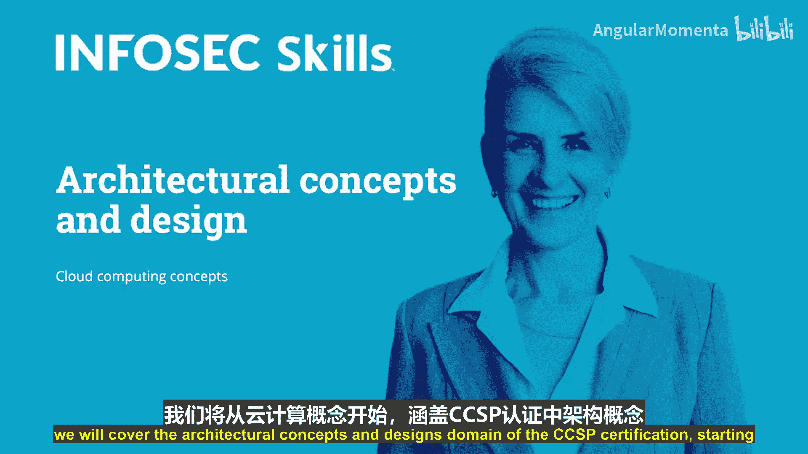
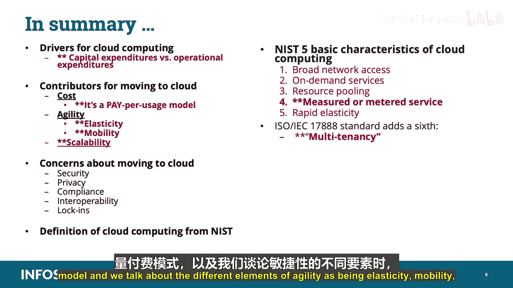

# 【Infosec】认证云安全专家 ｜ Certified Cloud Security Professional (CCSP) p07 02_01_01_cloud-computing-concepts -BV1TWrHBrEbk_p7-

In this learning path， we will cover the architectural concepts and designs domain of the CCSP certification starting with cloud computing concepts Before we dive into this learning path。

 I want to point out that I will be calling out specific terms and information you must know for the CCSP exam by placing a double asterisk in front of it and highlighting in a different color as seen on this screen so what are some of the drivers for moving to cloud computing Well。

 there's a number of drivers that can move a company to consider cloud computing it could be the cost associated with the ownership of their current IT infrastructure solutions or the projected cost to continue maintaining it。

You must understand the difference between capital expenditures known as Capex and operational expenditures or opX organizations are becoming more concerned over capital expenditures。

 for example， buildings computer equipment or hard assets and operational expenditures like utilities or building maintenance。

 especially in organizations with more than 5000 employees。

 moving to the cloud becomes attractive to organizations because use of a cloud platform service helps them lower capital expenditures。

 for example， by not needing to renew equipment leases or purchase new equipment to replace outdated systems。

 and in some ways， operational expenditures too， for example。

 not requiring to power up a data center。Subscription based cloud computing services like infrastructure as a service。

 IAAS platform as a service， PAAS or software as a service SAAS is an easy option and requires little to no physical maintenance costs。

The pay per usage model allows an organization to pay only for the resources they need with basically no investment in the physical resources available in the cloud。

 There is no infrastructure maintenance or upgrade costs either。

Why choose a platform that's complex to implement， expensive to expand and slow when reaching its performance limits。

 Agility is all about elasticity and mobility。 Eity is a major benefit to cloud computing because the environment transparently manages a user's resource utilization based on dynamically changing needs。

You also have mobility because users have the ability to access data and applications from around the globe。

 which facilitates collaboration and innovation。 Use are starting to see the cloud as a way to work simultaneously or collaboratively on common data and information。

 Scalability is being able to grow when a legacy platform hits its cap。

 things like uptime are affected。 on demand scalability allows the customer to dictate the volume of resource usage。

 giving users access to a large number of resources that scale based on demand and virtualization。

 Each user has a single view of the available resources to them regardless of what is actually on the servers。

 This is what makes the cloud valuable to businesses。

 It could also be driven by the desire to reduce it complexity for example。

 users can use the cloud to test ideas and concepts before making major investments and technology。

 This reduces their。However， it's not all rainbows and unicorns。

 Cloud computing has some inhibitors as well。 There are still a lot of companies that fear the cloud for one reason or another security。

 which seems to be an overwhelming concern among businesses。

You also have privacy concerns in the cloud。 This tension comes into play as companies strive to find a middle ground between personalization and anonymity。

 There is also the concern of compliance with regulatory requirements and the value of integrated cloud solutions or interopbability is still not grasped by some would be purchasers of cloud services and probably the most prevalent of the concerns is lockins this feeds the fears of customers using on- premisemise products versus cloud solutions to reduce their risks organizations can use one of many approaches and frameworks。

 for example， COVID Coso， the enterprise risk management integrated framework or the NIS risk management frameworks 853 or 8171 you must remember that there is a tradeoff between security and operations typically the more secure things are the less efficient they become which is why business security needs are driven by the。

business functions or requirements and security supports those functions or requirements。

 not drive them。Cloud computing or cloud means different things to many people For the sake of discussion。

 Cloud computingut has been formally defined by the National Institute of Science and Technologies's NISist as cloud computing is a model for enabling ubiquitous。

 convenient onded network access to a shared pool of configurable computing resources for example。

 networks， servers， storage applications and services that can be rapidly provisioned and released with minimalable management effort or service provider interaction。

 You must know this definition for the exam and be able to recall it。

 The two key terms that I pointed out here are on demand and rapidly provision。

 Those are two elements that you must understand out of this definition。

 Think of cloud computing like your electric company or power grid。

 It's always on and available to everyone who's connected to the grid。 or in this analogy， the cloud。

 It's a pay as you go。In other words， you pay for what you use， the more you use， the more you pay。

 the same concept can be applied to cloud computing。For the exam。

 it's important that you understand these five basic Nist characteristics of cloud computing。

 First we have broad network access， which are standard mechanisms that promote use of heterogeneous。

 In other words， mixed thin or thick client platforms like mobile phones， laptops。

 tablets or workstations。 In other words， it means there should never be a network bandwidth bottleneck。

This is generally accomplished using technologies like advanced routing techniques， load balancers。

 multi siteite hosting and other technologies。Next， we have on-demand services。

 which is provisioning computing capabilities like server time and network storage as needed without requiring human interaction This means you should be able to scale your computing or storage needs without a lot of intervention from the cloud service provider basically real time provisioning the cloud by its nature is always on and always accessible offering users widespread access to resources。

 data and other assets Think of convenience， access what you want when you need it from any location。

Next we have resource pooling， this lies at the heart of all that is good about cloud computing。

 more often than not， traditional non-cloud systems may see utilization rates for their resources between 80 to 90% for a few hours a week and rates at an average of 10 to 20% for the remainder。

What the cloud does is group or pool resources for use across the user landscape or multiple clients。

 which can then be scaled and adjusted to the user or the client's needs based on their workload or resource requirements Cloud providers typically have large numbers of resources available from hundreds to thousands of servers。

 network devices， applications and other stuff， which can accommodate large volumes of customers and can prioritize and facilitate appropriate resources or resourcing for each client。

In other words， resources are pooled to serve multiple customers using a multitenant model。

 basically the cloud service provider is sharing out their cloud resource investment across its clients so the resources don't go underutilized Next we have measured or metered services This is a concept you must understand for the exam。

Cloud computingut offers a unique and important component that traditional IT departments have struggled to provide resource usage can be measured。

 controlled， reported and alerted on， which results in multiple benefits and overall transparency between the provider and the client。

In the same way， you may have a metered electricity service or mobile phone that you top up with credits。

 these services allow you to control and be aware of costs。Essentially。

 you pay for what you use and have the ability to get an itemized bill or breakdown of usage。

 What I want you to remember here is that measured or meered service automatically controls and optimizes resource use by leveraging a metering capability。

 for example， storage， processing and bandwidth it means you get charged for what you use and nothing more。

 the more you consume the more you get bill。And the last NISist characteristic is rapid elasticity。

 This allows organizations to obtain additional resources like storage or compute power as needed or workload requires This is more often transparent to the organization with more resources added as necessary in a seamless manner think back to my utilities example if you need more water or electricity you simply open the faucets or turn on more lights without having to contact the utilities and arrange for more water or power it just happens when needed。

As cloud services utilize the pay per use concept， you pay for what you use。

 this is of particular benefit to seasonal or event type businesses utilizing cloud services think of a provider like Tetmaster selling hundreds and thousands of tickets for a major sporting event or a concert leading up to the ticket release date little to no compute resources are probably needed。

 however， once the tickets go on sale， they may need to accommodate 100。

000 users in a space of 30 to 40 minutes this is where rapid elasticity and cloud computing can really be beneficial compared with traditional IT deployments。

 which would have to invest heavily using Capital Exps to have the ability to support that particular demand the ISO IEC which stands for International Orization for Standardization and the International Electrotechnical Commission。

 standard 17888 which is the information technology Cloud Computing overview。

Cabulary includes those five NISistT characteristics and adds a sixth multitenancy。

 which isolates physical or virtual resources in a way that multiple tenants and their data are isolated from each other and inaccessible to each other。

 basically different users within a cloud share the same applicationss and physical hardware to run their virtual machines or VMs the multitenant nature of a cloud deployment requires a logical design that partitions and segregates client and customer data failures to do so can result in an unauthorized access viewing or modification of tenant data remember the definitive elements of cloud computing according to NISistT include broad network access onde services。

 resource pooling， meter services， rapid elasticity and IO 17888 adds multitenancy。In summary。

 we've discussed drivers for cloud computing， the difference between capital expenditure and operational expenditures。

 contributors for moving to the cloud， concerns about moving to the cloud。

 we provided the definition for cloud computing according to NIST and pointed out the importance of being able to recognize it and understand it for the exam。

 and finally we discussed the five basic NIS characteristics of cloud computing。

 broad network access on demand services， resource pooling， Me meters services and rapid elasticity。

 and the inclusion of the additional ISO IEC 17888， which was multitenancy。

I also pointed out the fact that you need to understand what it means when we sayPa per usage model and we talk about the different elements of agility as being elasticity。

 mobility， scalability， and virtualization。

