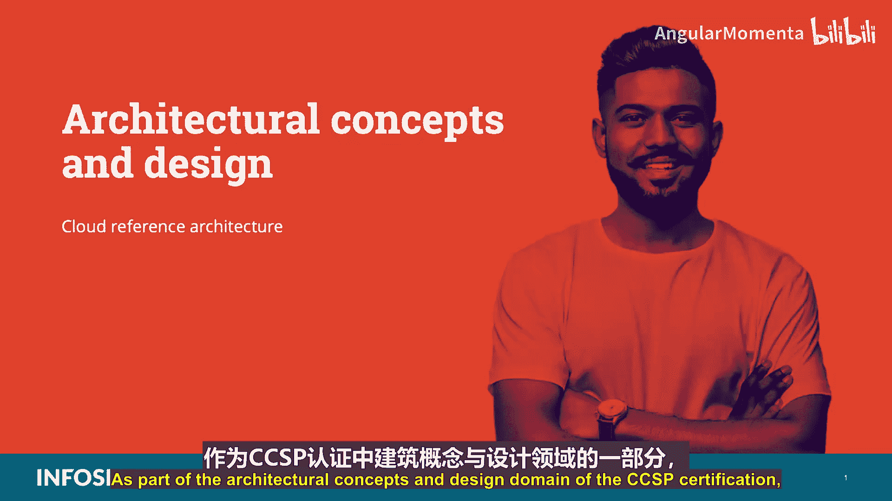
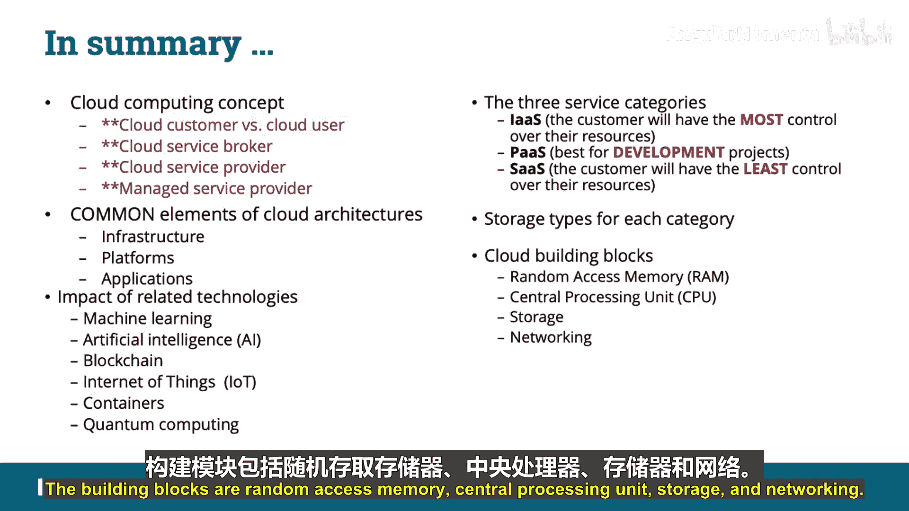

# 【Infosec】认证云安全专家 ｜ Certified Cloud Security Professional (CCSP) p08 02_01_02_cloud-reference-architecture -BV1TWrHBrEbk_p8-

As part of the architectural concepts and design domain of the CCSP certification。

 let's look at the cloud reference architecture Before we dive into this learning path。

 I want to point out that I will be calling out specific terms and information you must know for the CCSP certification exam by placing a double asterisk in front of it and highlighting it in a different color as seen on this screen First。

 the term cloud computing originates from network diagrams where the internet is typically depicted as a cloud。

You see here on this slide various endpoints， laptops， phones， tablets， desktop servers。

 which could be used to access cloud services based on the model selected。

 such as software as a service SAAS platform as a service PAAS or infrastructure as a service IAAS。

 which we will discuss further in a few minutes。For the exam。

 you will need to know these terms I've listed here。

A cloud customer is anyone who is purchasing a cloud service which could be an individual or a company whereas a cloud user is someone using cloud services it could be an employee of a company who is a cloud customer or just a private individual for example。

 let us use a fictitious company and we'll call it John's company or just J Company J Company purchases software as a service from AWS a cloud service provider In this case J company is the cloud customer all of the employees of J Company are considered cloud users because they're using the cloud services their employer J company the cloud customer has purchased for their usage。

The term cloud service broker or CSB is typically a third party entity or company that looks to extend or enhance value to multiple customers of cloud based services through relationships with multiple cloud service providers。

It acts as a liaison between cloud service customers and cloud service providers selecting the best provider for each customer based on their needs and monitoring the services you will need to know the difference between a cloud service provider CSP and a managed service provider MSP for the exam the main difference is in the control exerted over the data and process and by whom which we'll discuss next。

Before we do that， I need you to understand that NIST identifies three service models which we'll cover over the next few screens that represent different types of cloud services available。

Infrastructure as a service， IAAS， platform as a service， PAAS and software as a service SAAS。

We see a bunch of labels like networking as a service， compliance as a service and data as a service。

 but they're mostly marketing techniques， the only service models you will need to know for the exam are IAAS。

 PAAS and SAAS we will discuss these in detail in a few minutes。A cloud service provider， CSP。

 also known as a cloud provider， is a company that provides cloud based platform， infrastructure。

 application， storage services or software solutions via a public network。

 usually the internet to other organizations and or individuals for a fee。

Otherwise known to clients as something as a service like infrastructure as a service platform as a service or software as a service In a nutshell。

 it's the vendor offering the cloud services like Google Cloud， Amazon Web services。

 Raspace Salesforce and so on。 the service provider dictates both the technology and the operational procedures being made available to the cloud customer。

 it's really important that you understand that in this particular service model。

 cloud service provider， they dictate both the technology and the operational procedures being made available to the cloud customer。

 which means that the CSP is offering something or all of the components of the cloud computing through a software as a service infrastructure as a service or platform as a service model。

Remember， the cloud provider is a service provider that offers customer storage or software solutions available via a public network。

 usually the internet， the cloud provider dictates both the technology and the operational procedures involved。

With a managed service provider MSP， the customer dictates the technology and operating procedures According to the Man service providerder Alliance。

 MSPs typically have some form of network operations center services， some form of help desk。

 remote monitoring and management of all or most of the objects for the customer proactive maintenance of objects under management for the customer and delivery of those solutions with some form of predictable billing model。

 where the customer knows with great accuracy what the regular IT management expenses will be。

Remember， a managed service provider is an IT service where the customer dictates both the technology and operational procedures and an external party executes administration and operational support according to a contract。

NISistT identifies three service models which we'll cover over the next few screens that represent different types of cloud services available。

 IAS， infrastructure as a service， PAAS， platform as a service， and SAAS software as a service。

Remember， despite all of the other something as a services you may come across for the CCSP certification exam。

 the only service models you will need to know are IAS， PAAS， and SAAS。

So let's start with infrastructure as a service IAAS this is the most basic of cloud service offerings IAAS allows the customer to install all software。

 including operating systems on hardware housed and connected by the cloud vendor in this model。

 the customer will have the most control over their resources important for you to understand and remember that in IAAS this is where the customer will have the most control over their resources。

With IAAS， the capability provided is provisioning processing， storage。

 networks and other fundamental computing resources where the customer is able to deploy and run arbitrary software which can include operating systems and applications。

 so instead of having to purchase hardware outright。

 customers can purchase IAAS based on consumption， and like the other models。

 the customer doesn't manage or control the underlying cloud infrastructure， but in IAS。

 they do have control over operating systems， storage and deployed applications。

 and possibly limited control of selected networking components like a host firewall。

IAAS has a number of key benefits for organizations which include。

 but are not limited to the ones listed here on the screen。

 but you must be able to recall these for the exam。 First。

 usage is metered and priced based on the units used or the instances consumed。

 This can also be billed back to specific departments or functions。

The ability to scale up and down infrastructure services based on actual usage。

 this is particularly useful and beneficial when there are significant spikes and dips within the usage curve for the infrastructure。

Reduced cost of ownership， there is no need to buy assets for everyday use。

 no loss of asset value over time and reduced cost of maintenance and support。

 and especially remember this one， reduced energy and cooling cost along with green IT environment。

 which affects the optimum use of IT resources and systems， said another way。

 it helps reduce the organization's carbon footprint。

What I need you to understand and remember here is that IAAS allows you to control the operating system。

 storage and applications， but not the management of the underlying cloud infrastructure。

 in other words， IAAS users are responsible for managing applications， data， runtime。

 middleware and operating systems， the cloud service providers still manage virtualization， servers。

 hard drive storage and networking。And finally， you must remember that IAAS uses two storage types。

 volume storage and object storage volumee storage is a virtual hard drive that can be attached to a virtual machine instance and be used to host data within a file system。

Volumes attached to IAAS instances behave just like a physical drive or an array does。

Examples include VMware， VMFS， Amazon EBS， Raspace RA。

 and OpensStax Snder Object storage is similar to a file share accessed via an application interface API or web interfaceface。

 Examples include Amazon S3 and Raspace Cloud files。

Infrastructure as a service storage types and APIs with volume storage。

 the customers allocated a storage space within the cloud。

 This storage space is represented as an attached drive to the user's virtual machine from the customer's perspective the virtual drive performs very much in the same manner as would a physical drive attached to a tangible device actual location of memory addresses are transparent to the user file storage。

 which is also known as file level storage or filebased storage here the data is stored and displayed just as with a file structure in the legacy environment as files and folders with all of the same hierarchies and naming functions block storage here whereas the file storage has a hierarchy of folders and files B storage is a blank volume that the customer or the user can put anything into block storage might allow more flexibility and higher performances but it requires a greater amount of administration and might entail install。

Of an operating system or other application to store。

 sort and retrieve the data with object storage this is just like it sounds data is stored as objects。

 not files or blocks objects conclude not only the actual production content but metadata describing the content and object and a unique address identifier for locating that specific object across the entire storage space remember。

 it's a unique address identifier in order to locate that specific object across the entire storage space。

These objects are accessible through application programming interfaces， APIs。

 and potentially through a web user's interface。Object storage systems provide representational state transfer rest APIs that allow a programmer to work with containers and objects there are four main types of APIs you need to know for the exam open APIs also known as public APIs there are no restrictions to access these types of APIs because they are publicly available partner APIs here a developer needs specific rights or licenses in order to access this type of API because they are not available to the public。

Internal APIs， also known as private APIs， only internal systems expose this type of API。

 these are usually designed for internal use within a company。

 the company uses this type of API among the different internal teams to be able to improve its products and services。

And then we have composite APIs， this type of API combines different types of data and services。

 it's a sequence of tasks that runs sequentially as a result of the execution and are not at the request of the task It main uses are to speed up the process of execution and improve the performance of the listeners in the web interfaces。

APpis can be broken into multiple formats。 Some of these are representational state transfer。

 which we just discussed is a software architecture style consisting of guidelines and best practices for creating scalable web services rest is not a protocol like other web services Instead it is a set of architectural principles The rest services need to have certain characteristics including simple interfaces which are resources identified easily within the request and manipulation of those resources using the interface XmlRPC This is a protocol that uses a specific Xml extensible markup language format to transfer data compared to So。

 which is the simple object access protocol that uses a proprietary Xml format It is also older than soap XmlRPC uses minimum bandwidth and is much simpler than soap Then we have JSON RRPC JavaScriptscript object notation This is a protocol similar to。

MlRPC， but instead of using XMl format to transfer the data。

 it uses JsonNs modern applications are increasingly built using containers。

 which are microservices packaged with their dependencies and configurations Kubernetes or K is an open source software for deploy and managing containers at scale it is a rest API and is declarative in nature as applications grow to span multiple containers deployed across multiple servers operating them becomes more complex to manage this complexity K provides an open source API that controls how and where those containers will run Kubernetes also uses JSson ja open notation based on APIs in order to manage its pods services its deployment or replica sets Amazon Google IBM Microsoft oracle。

 Red Hat Vm etc all offer Kubernetesbased platforms or infrastructure as a service that。

y Kubernetes and the last one is simple object access protocol So This is a protocol specification for exchanging structured information in the implementation of web services in computer networks This is a protocol that uses XML as its format to transfer data You also need to know the differences between soap and rest and JSsonN and XmL remember that soap has a strict set of rules and advanced security to follow it is driven by function and requires more bandwidth where rest has more loose guidelines to follow allowing developers to make recommendations easily it is driven by data it requires minimum bandwidth。

Now JSON and XML， JSON supports only text and numbers， focuses mainly on data and has lower security。

 and XML supports various types of data， for example， text numbers， images， graphics， charts， etc。

 and focuses mainly on documents， it also has more security than JSON。Platform as a service， PAAS。

 also known as Cloud Plaform Services， basically contains everything included in the infrastructure as a service model with the addition here of an operating system。

 the cloud vendor offers a selection of operating systems so that the customer can use any or all of the available choices。

It is used by customers to deploy onto the cloud infrastructure。

 customer created or acquired applications that are created using programming languages。

 library services and tools supported by the cloud service provider the customer does not manage or control the underlying cloud infrastructure。

 including network servers operating systems or storage。

But has control over the deployed application and possibly the configuration settings for the application hosting environment。

What you need to remember here is that it's used for application and other development while providing cloud components to software what developers gain with platform as a service is a framework they can build on to develop and customize applications platform as a service makes the development testing and deployment of applications。

 quick， simple and cost effective without risk of damaging production capabilities and determine the viability of the software across a range of operating system platforms。

😡，With this technology， enterprise operations or thirdparty providers can manage operating systems。

 virtualization， servers， storage， networking and the PA software itself， developers however。

 manage the applications the vendor will be responsible for patching。

 administering and updating the operating systems as necessary again。

 the customer doesn't manage or control the underlying cloud infrastructure but has control over the deployed applications the data and possibly configuration settings for the applications hosting environment some examples of PAS include hosting providers that offer not only infrastructure but systems already loaded with a hardened operating system like Windows Ser or Linux。

For the exam， you must also remember that platform as a service utilizes two data storage types。

 structured and unstructured。Structured is information with a high degree of organization like in a relational database。

 which is seamless and readily searchable by simple。

 straightforward search engine algorithms or other search operations。

Unstructured is information that does not reside in a traditional role column database unstructured data files often include text and multimedia content。

 for example， email messages， word processing documents， videos， photos， audio files， presentations。

 web pages， and other types of business documents， even though these sort of files may have internal structures they are still considered unstructured because the data they contain does not fit neatly into a database for the exam you should be able to recognize the key platform as a service characteristics and benefits listed here。

Operating systems can be changed and upgraded frequently。

 including associated features and system services。

GloGloly distributed development teams are able to work together on software development projects within the same environment。

😡，Services are available and can be obtained from diverse sources that cross national and international boundaries and upfront and recurring or ongoing costs can be reduced by utilizing a single vendor instead of maintaining multiple hardware facilities and environments。

And finally， software as a service also known as cloud application Services。

 this includes everything listed in the previous two models。

 infrastructure as a service and platform as a service with the addition of service provider software programs。

With software as a service， the customer doesn't manage or control the underlying cloud infrastructure。

 network servers， operating systems， storage or even individual application capabilities with the possible exception of limited userspec application configuration settings it uses the web to deliver applications that are managed by a third-party vendor and whose interface is accessed on the client' side many software as a service applications can run directly from the web browser without any downloads although some require small plugins the cloud vendor becomes responsible for administering。

 patching and updating this software as well all of this is completely transparent to the end user who only sees the applications they have purchased。

😡，You must remember that in this model the customer will have the least control over their resources the cloud customer is basically only involved in uploading and processing data in the environment hosted by the provider the applications are accessible from various client devices through either a thin client interface like a web browser or a program interface for the exam you must also know that software as a service utilizes two main data storage types information storage and management and content or file storage。

Information storage and management。 This is data that is entered into the system via the web interface and stored within the software as a service application。

 usually a back end database。 This data storage utilizes databases。

 which in turn are installed on objects or volume storage。

 and the other storage type is content or file storage。

 file based content is stored within the application。

 There are many software as a service key characteristics and benefits， But for the exam。

 you should be able to recognize these listed here。

Ease of use and limited administration automatic updates and patch management the user is always running the latest version and most up to date deployment of the software release as well as any relevant security updates no manual patching is required standardization and compatibility all users have the same version of the software release and global accessibility。

And the last thing I want to discuss are the building blocks of cloud computing。

 which are composed of random access memory RA， the central processing unit， the CPU。

 storage and networking infrastructure as a service has the most fundamental building blocks of any cloud service。

 the processing， storage and network infrastructure on which all cloud applications are built。

In a typical infrastructure as a service scenario， the service provider delivers the server。

 storage and networking hardware and its virtualization。

 and then it's up to the customer to implement the operating system middleware and applications required you may see a question on the exam which asks which of the following are considered to be the building blocks of cloud computing you will need to be able to recall that the building blocks of cloud computing are random access memory。

 central processing unit storage and networking。Over the next couple slides。

 we'll look at some related technologies First， let's talk about machine learning Ma learning。

 data analytics and cloud computing are used by companies to better understand their target audience。

 automate some of their production， create better products according to market demand。

 manipulate realtime data， analyze it and make future predictions。

 its you to create an interactive dashboard that displays data from different dimensions in one place。

 in order to report， analyze， and in return， it can increase profitability of a company which may give them an edge over their competitors。

The machine learning cloud computing combo has the potential to strengthen the level of interconductivity further。

 however， these technologies can generate huge volumes of data。

 The movement to cloud technology comes into play as the massive volume of data would be stored in that type of an environment however。

 for a long time in the past companies needed to invest a lot of money in machine learning to make it profitable due to the expense and required infrastructure。

 programmers familiar with machine learning， as well as the data analytics not to mention that there was a very little data available to feed these machine learning algorithms。

 while this is not that big of a deal for larger multinational corporations。

 it was difficult for small and mid-sized companies。

 but the popularity and advancement of cloud services like AWS Microsoft， Azure。

 Google Cloud and IBM have made everything much easier Now companies can access machine learning algorithms and technologies from a third-part vendor make a few changes according to their custom requirements。

And start getting the benefits with a much smaller initial investment This is why cloud computing is so important in machine learning This is the solution for many smaller and midsized companies that don't want to build tests and implement their own machine learning algorithms from scratch these companies can focus on their core business and obtain value addition from machine learning without needing to become experts AWS for example provides various products for machine learning like Amazon SageMaker which is used to create and train machine learning models Amazon augmented AI used to implement a human review of the machine learning models Amazon forecast which is used for machine learning to increase the forecast accuracy Amazon Translate which uses machine learning and natural language processing for language translations there is also Amazon personalization which creates personal recommendations in machine learning systems you have AWS deep learning which is used for deep learning solutions and Amazon Poly which is used to convert text into lifelike speech。

Microsoft Azure also offers products for machine learning like Microsoft's Azure's cognitive service This provides smart cognitive services for applications。

 you also have Microsoft Azure's Azure Databricks， which provides Apache sparkbased analytics。

 the bot service which provides smart and intelligent bot service that can be scaled you have your cognitive search which is a machine learningbased service for mobile and web applications as well as Microsoft Azure machine learning。

 which is used to create and deploy machine learning models on the cloud IBM is no stranger to this space either IBM Cloud provides several products for machine learning like IBM's Watson Studio。

 this is used to build machine learning and artificial intelligence models as well as preparing and analyzing data you have the Watson speech to textex。

 which is a speech recognition system for converting speech and audio into written text。

 the Watson text to speech this is a speech creation system for converting text into natural sounding audio there's also Watson Natural language understanding。

Which is a processing for analyzing and classifying text。 You have the visual recognition。

 which uses machine learning to search visual images and classify them。

 as well as the IBM Watson assistantsant， which is used for creating and managing virtual assistance。

Another related technology is artificial intelligence or AI The term artificial intelligence means machinebased systems that can for a given set of human definedfined objectives。

 make predictions， recommendations or decisions influencing real or virtual environments In the simplest term it refers to a system or machine that mimics human intelligence to perform tasks and can iteratively improve themselves based on information they collect Artific intelligence makes it possible from machines to learn from experience adjust new inputs and perform humanlike tasks Most AI examples that you hear about today are from chess playing computers to self-driving cars using these technologies。

 computers can be trained to accomplish specific tasks by processing large amounts of data and recognize patterns in that data Art intelligence manifests in a number of forms a few examples are chatbots which use AI to understand customer problems faster and provide more efficient。

Intellig assistance using AI to parse critical information from large freetex data sets to improve scheduling or recommendation engines。

 which can provide automated recommendations for TV shows based on user viewing habits。

 AI is much more about the process and the capability of superpowered thinking and data analysis than it is about any particular format or function powered by various forms of machine learning that can recognize patterns and data to enable predictions AI can add value to a business by providing a more comprehensive understanding of the abundance of data available to them。

 as well as relying on predictions to automate excessively complex or mundane tasks。 For example。

 Netflix uses machine learning to provide a level of personalization that help the company grow its customer base by more than 25% and continues to grow based on customer inputs using transactional and demographic data to predict。

How much certain customers will spend over the course of their relationships with a business or customer lifetime。

 businesses can also improve in that manner， they could also be used for optimizing pricing based on customer behavior and preferences or even using image recognitions to analyze X-ray images for signs of cancer。

A blockchain is a growing list of records called blocks they are linked together using cryptography Each block contains a cryptographic hash of the previous block a timest and transaction data generally represented as a binary hash tree blockchain has many uses from managing logistics to voter registration mobile payments border control to store passenger data in the Netherlands and in healthcare to store records it's not just for bit anymore for example。

 transactions A BC and D are hashed and the timestamp on the hash proves that the transaction data existed when the block was published in order to get its hash then blocks A and B are hashed together and C and D are hashed together into a route of A B and C as the blocks each contain information about the previous blocks they form a chain with each additional block reinforcing the one before it here blocks A B and C And D are further hashed into a block containing the previous has。

Versions into a new block of A B C and D This is why blockchains are resistant to modification of their data because once recorded。

 the data in any given block cannot be altered retroactively without altering all subsequent blocks in that chain。

When we discuss the Internet of things， this has made up a small dedicated use devices that are typically designed to a smaller than usual form factor like desktop computers。

 mini towers， mobile phones that are smaller than the average smartphone or compact fiber optic systems that incorporate more connections pieces on smaller plugs or connections or embedded hardware with a limited functionality operating system they may interface with the physical world and tend to be pervasively deployed where they exist。

 they are also connected to general purpose networks with the protection applied to the general purpose computing system and their full range of functions and external accessibility may be unclear to the owner or user some vulnerabilities that exist with these internet of things are limited vendor support for updates。

 for example vendors may provide a limited support lifecycle for individual pieces and little concern provided for security updates there may also be little to no onboard security capability the devices have limited integrated security。

and rarely have any mechanism to allow external monitoring of those security functions if they exist at all。

 Poor code management due to rapid deployment cycles is another concern because vendors code may be suspect and hacked together from various sources to meet aggressive product release schedules and finally it may contain limited or weak security implementation on standard protocols for example Bluetooth or wfi while the devices are often capable of using standard protocols the security features may be disabled or degraded in favor of interoperability and ease of use So how do we mitigate some of these issues In effect。

 most Iot devices are small embedded systems controllers and should be treated like an embedded system or industrial control system and Is as appropriate we should isolate on private networks with controlled access。

 we should select products for security features and upability inherently insecure products are not procured and finally product security and penetration testing should be。

Formed as well as disabling any unneeded functions。When we look at containerization。

 picture the shipping industry， which uses physical containers to isolate different cargo。

 for example， to transport in ships or trains， software development technology uses containers as well containers or standard packages of software which bundles an application code together with related configuration files and libraries and with the dependencies required for the application to run。

 This allows developers to deploy application seamlessly across environments。

Containers provide a lightweight immutable infrastructure as opposed to amable infrastructure for application packaging and development。

 an application or service， its dependencies and its configuration are all packaged together as a container image。

 The containerized application can be tested as a unit and deployed as a container image instance to the host operating system。

 This is why containers enable developers to deploy applications across environments with little or no modifications。

 So what's the difference between mutable and immutable infrastructures。

 Muable simply means changeable or customizable。 In other words。

 something that can be changed if and when needed。 It allows you to do necessary changes and updates on a regular basis。

 It's possible to log into the server update the configurations and other details in amable infrastructure。

 but there won't be consistency in mutable infrastructures。

 Why because each server might have different configurations in settings。 It's hard to maintain the。

In configurations between various servers while using amable infrastructure So what are the benefits of using a mutable infrastructure the infrastructure is a total customizable infrastructure so it can accurately fit the needs of all of the applications running on the server。

 there's no need to establish a whole new server to fix a problem the it staff will be aware of every server so it's easier to find the problem。

 It's also possible to implement the updates faster in each server separately immutable is the opposite of mutable Imutable infrastructure is something that cannot be changed or modified once established。

 the purposes behind this infrastructure is to build the components to match the particular specifics。

 There is no room for modifications in the future。 if there are some changes that need to be done in the server then a whole new infrastructure will need to be installed based on the updated requirements and the previous infrastructure becomes obsolete and then will be out of server。

 So what are the benefits of。mutable infrastructure It provides a compatible environment to the servers。

 Quality assurance testing is much more consistent from development to test to production。

 There is no room for configuration drift， as long as the server is running。

 the I staff knows the accurate state of that server This will avoid any unexpected shocks。

 It's simple to resolve an issue here。 You only need to delete the instance which is causing the error。

 which could mean less support calls。 It also improves security incident resolution。

 because in an immutable infrastructure takes the best advantage of the cloud infrastructure。

 This is why legitimate Devops run on immutable infrastructures。

 Some of the popular mutable infrastructure tools are terraform， Docker。

 spinnacker and Kubernetes or K Nowadays， the majority of organizations tend to implement Devops as a practice and immutable infrastructure makes it affordable and easy to create new servers using modern Devops processes with Devop。

We can address security issues in development rather than in production to better safeguard the application and reduce the number of deployments that are delayed or stopped due to failed policy checks it also provides agility when developers build and package their applications into containers and provide them to the IT staff to run on a standardized platform it reduces the overall effort to deploy applications and can streamline the whole development and testing cycle Portability is another thing that it provides containers provide a standardized format for packaging and holding all of the components necessary to run the desired application This solves a typical problem of will it work on my machine and allows for portability between operating system platforms and between clouds and finally rapid scalability since containers do not have typical virtual machine overheads including separate operating instances many more containers can be supported on the same infrastructure lightweight。

Nature of containers means that they can be started and stopped quickly。

 unlocking rapid scale up and scale down scenarios， but remember。

 if updates or improvements are needed in an immutable infrastructure。

 you need to replace the whole server with the included changes and remove the old one。

Quantum computing is a rapidly emerging technology that harnesses the laws of quantum mechanics to solve problems too complex for classic computers。

 realistically， any computational problem that can be solved by a classic computer can also be solved by a quantum computer and vice versa at least in principle given enough time In other words。

 quantum computers obey the nature of computable functions。

 this means that while quantum computers provide no additional advantages over classic computers in terms of computability。

 quantum algorithms for certain problems have significantly lower time complexityities than corresponding known classic algorithms。

 notably quantum computers are believed to be able to quickly solve certain problems that no classic computer could solve in any feasible amount of time。

 a feat known as quantum supremacy， the study of computational complexity of problems with respect to quantum computers is also known as quantum complexity theory a quantum computer isn't a supercomputer that can do。

Everything faster one of the goals of quantum computing research is to study which problems can be solved by quantum computers faster than classic computers and how large the speedup time can be Quant computers do exceptionally well in problems that require calculations of many possible different combinations by tapping into a quantum phenomena like superpositioning and entanglement these machines handle information in fundamentally different ways to classic computers like smartphones。

 laptops or even today's most powerful supercomps and are better suited to tackle certain types of problems。

 especially those involving a daunting number of variables and potential outcomes like simulations or optimization questions。

In summary， we discussed cloud computing concepts， and I stated that you will need to know these terms for the CCSP exam。

 Cloud customer versus cloud user， cloud service broker， cloud service provider。

 and managed service provider。You should understand the common elements of cloud architecture。

 infrastructure， platform and applications， and the three service categories of infrastructure as a service where the customer will have the most control over their resources。

 platform as a service， which is best for development projects and software as a service where the customer will have the least control over their resources。

I stated that you should be able to recognize the key benefits of each category。

 infrastructure as a service， platform as a service and software as a service and the storage types for each one of those service or categories infrastructure as a service has volume storage and object storage platform as a service has structured and unstructured storage and finally software as a service has information storage and management and content or file storage。

I also introduced the impact of related technologies like machine learning， artificial intelligence。

 blockchain， Internet of things， containers and quantum computing you should be aware of these technologies for the exam finally we discussed the cloud building blocks and I stated that you must be able to recall them the building blocks are random access memory。

 central processing unit， storage and networking。

