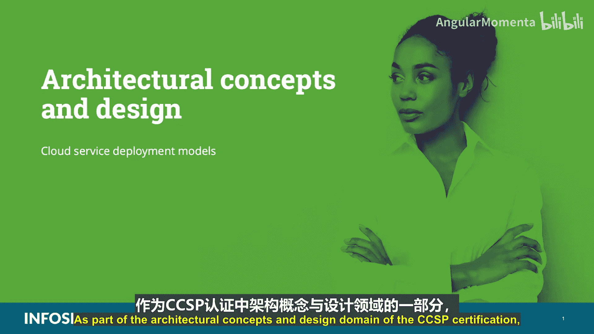
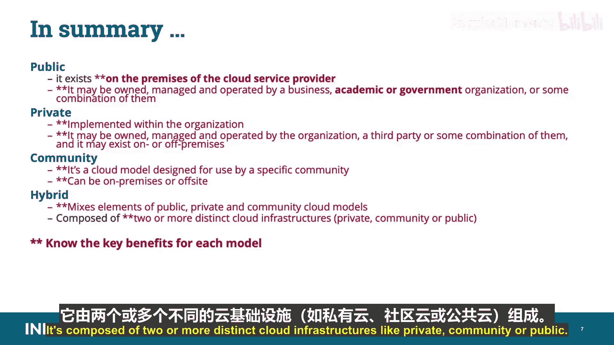

# 【Infosec】认证云安全专家 ｜ Certified Cloud Security Professional (CCSP) p09 02_01_03_cloud-service-deployment-models -BV1TWrHBrEbk_p9-

As part of the architectural concepts and design domain of the CCSP certification。

 let's look at the cloud service deployment models。

Before we dive into this learning path， I want to point out that I will be calling out specific information that you must know for the CCSP exam by placing a double asterisk in front of it and highlighting it in a different color as seen on this screen in this particular screen。

 you must know all these terms， hybrid cloud， private cloud， community cloud and public cloud。

 which we'll be discussing next。Now that we've discussed and provided an understanding and appreciation of the cloud service types。

 information as a service， IAS， PAS， platform as a service， and software as a service SAAS。

 you will learn how these services are merged into the relevant deployment models。

The National Institute of Standards and Technology。

 NIST and International Organization for Standardization。

 ISO both describe these four deployment models， public cloud， private cloud。

 community cloud and hybrid cloud， which we'll cover over the next few screens。

 the selection of a cloud deployment model will depend on any number of factors and may be heavily influenced by your organization's risk appetite。

 cost， compliance and regulatory requirements and legal obligation along with other internal business decisions and strategies。

Next slide。Let's start with the public cloud， a public cloud is what we typically think of when we're discussing cloud providers。

 the infrastructure， hardware software facilities and staff is provided， sold。

 lease or rented for open use by the general public。It may be owned。

 managed and operated by a business， academic or government organization or some combination of them。

 you need to remember that for the exam， it may be owned。

 managed and operated by a business academic or government organization or some combination of them。

 and it exists on the premises of the cloud provider In other words。

 it's an infrastructure deployed for use by anyone， for example。

 the general public who buys leases or rents it， Given the increasing demand for public cloud services。

 many providers are now offering and remodeling their services as public cloud offerings。😡。

For the exam， you should be able to recognize the definition and the key benefits of a public cloud model it is easy and inexpensive to set up because the provider covers hardware。

 application and bandwidth costs。It is streamlined and easy to provision resources。

 it is scalable to meet customer needs， and there is no wasted resources because it is a pay as you consume model。

And finally， on the screen， you'll see some examples of public cloud vendors。

 You will not need to recall any of those particular vendors for the exam。 Again。

 you will not need to recall those vendors for the exam。

A private cloud is a cloud computing platform that is implemented within the organization。

 a private cloud is designed to offer the same features and benefits of a public cloud system。

 but removes a number of objections to that model by providing more control over the enterprise or its customer data。

 improve reliability， it lessens worries about security。

 and issues connected to regulatory compliance or contractual agreements。In this model。

 the cloud infrastructure is provisioned for exclusive use by a single organization comprising multiple customers。

 in other words， business units， it may be owned， managed and operated by the organization。

 a third party or some combination of them， and it may exist on or off premise。

 you must remember that for the exam again this is a model where the cloud infrastructure is provisioned for exclusive use by a single organization comprising of multiple customers。

 and it may be owned， managed and operated by the organization。

 a third party or some combination of them， and it may exist on or off premise said another way。

 private clouds are owned and operated by independent organizations for the exclusive use of their customers and users Think of a private cloud like。

itional legacy IT environment with connections made via the web and with remote access capabilities。

If your organization hosts a web server and allows access via remote services。

That can be considered a private cloud instance。 Exles of private clouds include things like what we call intranets。

 These often host shared internal applications， storage and compute resources。

One example is an internally hosted SharePoint site。

Don't get public cloud and private cloud confused， remember a public cloud is owned by a specific company and is offered to anyone who contracts its provided services and a private cloud is owned by a specific organization but is only available to users authorized by that organization for the exam you should be able to recognize the definition and the key benefits of a private cloud。

It has increased control over data， underlying systems and applications。

It provides ownership and retention of governance control。

 and there is better assurance over data location and the removal of multiple jurisdiction。

 legal and compliance requirements。A community cloud is a cloud model designed for use by a specific community。

The community cloud infrastructure is provisioned for exclusive use by a specific community of customers from organizations that have shared concerns like a mission security requirements。

 a policy and compliance considerations it may be owned。

 managed and operated by one or more of the organizations in the community a third party or some combination of them。

 and it may exist on or off premise。 remember that for the exam。

 Community clouds can be on premise or off premise and should give the benefits of a public cloud deployment while providing heightened levels of privacy security and regulatory compliance。

 In other words， it is an infrastructure and processing owned and operated by similar groups distinct pieces might be owned or controlled by individuals or different organizations but they come together in some fashion to perform joint tasks and functions gaming communities。

 for example might。Considerd a community cloud an example of a gaming community would be the PlayStation network。

 which involves many different entities coming together to engage in online gaming Sony hosts the identity and access management tasks for the network。

 a particular game company might host a set of servers that run digital rights management DRM functions and processing for a specific game and individual users conduct some of their own processing and storage locally on their own PlayStation machines。

For the exam， you should be able to recognize the definition and key benefit listed here for a community cloud model as a combination of public cloud model advantages with higher levels of privacy。

 security and regulatory compliance。 And finally， the hybrid cloud model。

 This model mixes elements of public， private and community cloud models。

The hybrid cloud infrastructure is a composition of two or more distinct cloud infrastructures like private community or public that remain unique entities。

 but are bound together by standardized or proprietary technology that enables data and application portability set a different way。

 The infrastructure is a combination of two or more of the other cloud infrastructures and is reliant on technology that enables data and applications Portability。

 An example of a hybrid cloud environment might include a hosted internal cloud like a SharePo site with a portion carved out for external partners who need to access a shared service to them。

 it would appear as an internal cloud。 Therefore， it would be operating as a hybrid for the exam。

 you should be able to recognize the definition and key benefits listed on this screen。

 You retain ownership and over。ite of critical task and processes related to technology。

 you can reuse previous investments in technology within the organization。

 you can control the most critical business components and systems。

 and finally it can act as a cost effective means of fulfilling noncritical business functions。

 utilizing public cloud components。In summary， the deployment models are public。

 which exists on premise of the cloud service provider， it may be owned。

 managed and operated by a business academic or government organization or some combination of them you have your private cloud model which is implemented within the organization and it may be owned。

 managed and operated by the organization， a thirdpart or some combination of them and it may exist on or off premise。

 the community model is a model designed for use by a specific community and it can exist on premise or off premise。

 and finally the hybrid model， which mixes elements of public。

 private and community cloud models it's composed of two or more distinct cloud infrastructures like private community or public。

