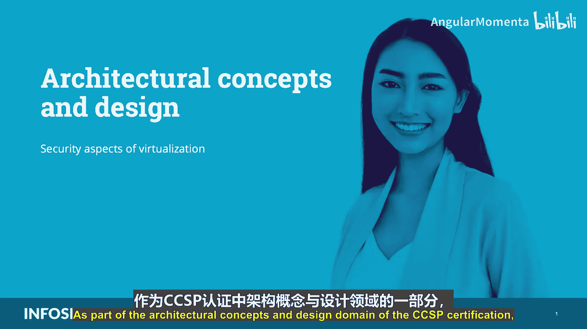
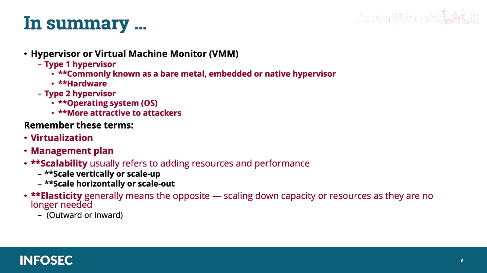

# 【Infosec】认证云安全专家 ｜ Certified Cloud Security Professional (CCSP) p10 02_01_04_security-aspects-of-virtualization -BV1TWrHBrEbk_p10-

As part of the architectural concepts and design domain of the CCSP certification。

 let's look at the security aspects of virtualization。

Before we dive into this learning path， I want to point out that I'll be calling out specific information you must know for the CCSP exam by placing a double asterisk in front of it and highlighting it in a different color as seen on this screen。

First of all， the term hypervisor is a variant of supervisorvisor。

 a traditional term of the operating system kernel or the OS kernel。

 the hypervisor is a supervisor of the supervisor with the hyper used as a stronger variant of super。

The role of the hypervisor is simple to allow multiple operating systems or Os to share a single hardware host with each OS appearing to have its host processing。

 memory and resources all to itself。In other words。

 the hypervisor is like a private cloud that manages the virtual machines and the programs that enable multiple operating systems to share the same hardware。

Remember， the hypervisor or virtual machine monitor VMM is a computer software。

 firmware or hardware that creates and runs virtual machines It presents a portion of the physical resources to a guest machine or to a guest system and the guest system sees those resources as its own independent physical machines for the exam you will need to know all of the information that is depicted in this picture on the strain。

Yeah。To conceptualize a hypervisor， think of a management council and effectively。

 this is what the hypervisor does， intelligently controlling the host processing and resources。

 prioritizing and allocating what is needed to each operating system while ensuring that there is no crashes and the neighbors don't upset each other。

 said another way， the hypervisor acts as the abstraction layer that provides the management functions for required hardware resources among the virtual machines。

The computer where the hypervisor runs one or more virtual machines is called a host machine。

Each of the virtual machines is called a guest machine， you will need to know that for the exam。

Remember the terms elasticity and virtualization， elasticity in cloud infrastructure involves enabling the hypervisor to create virtual machines or containers with the resources to meet realtime demand to use a simile。

 a film actor may increase or reduce their body weight to meet differing needs of the film industry based on the role that they're playing at the time。

Think of virtualization as creating more logical IT resources， virtual systems。

 within one physical system， this is done by using the hypervisor for managing the virtual system resources。

The hypervisor presents the guest operating systems with a virtual operating platform and manages the execution of those guest operating systems。

Multiple instances of the variety of operating systems may share the virtualized hardware resources。

 for example， Linux Windows and Mac OS instances can all run on a single physical X86 machine this contrasts with operating system level virtualization where all instances usually called containers must share a single kernel。

 though the guest operating systems can differ in user space like different Linux distributions with a same kernel it's like a private cloud that manages the virtual machines。

 basically the program that enables multiple operating systems to share the same hardware。

Each operating system could use all of the hardware， processor。

 and memory if no other operating system is on it， that's the maximum hardware available to one operating system in the cloud。

😡，The hypervisor is what controls and allocates what portion of the hardware resources each operating system should get in order for everyone to get what they need and not disrupt each other。

From a security perspective， we look to see which of the hypervisors will provide a more robust security posture and which will be more targeted by attackers type1 hypervisors significantly reduce the attack surface over type 2 hypervisors。

With a Type1 hypervisor， the vendor controls the relevant software that comprises and forms the hypervisor packages。

 including the virtualization functions and operating systems functions like devices。

 drivers and input output stacks。With the vendors controlling the software packages。

 they can reduce the likelihood of malicious software being introduced into the Hyvisor Foundation and introducing or exposing the hypervisor layer。

The limited access and strong controls over the embedded operating system greatly increases the reliability and robustness of the typeype1 hypervisors。

Anytime technology， hardware and software standardization can be used effectively。

 it can significantly reduce the risk landscape and increase the security posture The Ty1 hypervisor is commonly known as a bare metal embedded or native hypervisor you need to remember that for the exam It works directly on the hardware of the host and can monitor operating systems that run above the hypervisor and it is small as its main task is sharing and managing hardware resources between different guest operating systems on this screen you see some examples of typey1 hypervisors that is just for information purposes only you do not need to remember those for the exam。

Type 2 hypervisors being operating system based makes them more attractive to attackers。

 given that there are far more vulnerabilities associated with operating systems as well as other applications that reside within the operating system layer。

😡，A lack of standardization on the operating system and other layers could also open up additional opportunities and exposures that could make the hypervisor susceptible to attacks and compromises。

Type 2 hypervisors run on the host operating system that provide virtualization services like input output device support and memory management。

 it is installed on top of the host operating system and supports other guest operating systems running above it as virtual machines and is completely dependent on the host operating systems for its operations。

On this screen， you'll see some examples of type 2 hypervisors that is only for information purposes and you will not need to remember those for the exam。

Risks and challenges of using a typeype2 architecture include security flaws in the hypervisor can lead to malicious software targeting individual virtual machines。

 running on it or other components in the infrastructure。

 a flawed hypervisor can also facilitate intra virtual machine attacks。

 like a virtual machine hopping， when isolation between virtual machines is not perfect。

 one tenant's virtual machine can potentially peek into the data of another tenant's virtual machine。

Network traffic between virtual machines is not necessarily visible to physical network security controls。

 which means additional security controls may be necessary and resource availability for virtual machines can be flawed individual virtual machines can be starved of resources because in a virtual environment one virtual server's idle time is another server's production time。

Virtual machines and other disk images are simply files residing somewhere this means that。

 for example， a stopped virtual machine is potentially accessible on a file system by third parties if no controls are applied。

What you need to remember here for the exam is Ty1 hypervisors are hardwarebased bare metal。

 typey1 attacks are restricted to the hypervisor and the machine that it resides on so you have to have physical access to the machine to be able to attack it a T typepe 2 hypervisor is operating system based。

 so any flaw in the operating system could potentially lead to an attack attackers prefer typey2 hypervisors because of the large surface area。

 they can attack the hypervisor itself the underlying operating system and the machine directly associated with that hypervisor because of the operating systems。

So now that we understand the concept of hypervisors and its functions， let's look at virtualization。

 scalability and elasticity。 Viualization is the foundational technology that underlies and makes cloud computing possible。

 Virualization is based on the use of powerful host computers to provide a shared resource pool that can be managed to maximize the number of guest operating systems running on each host。

 Think of virtualization as creating more logical I resources called virtual systems within one physical systems。

 It most commonly uses the hypervisor for managing the resources for every virtual system。

The hypervisor is software that virtualizes the hardware resources。

 the key drivers and business cases for utilizing virtualization include sharing underlying resources to enable a more efficient and agile use of hardware and easier management through reduced personnel resourcing and maintenance。

When we're discussing virtualization system controls。

 we're talking about the virtualization components which include compute， storage and network。

 all governed by the management plane， which I will cover on the next screen。

The virtualization components compute storage and network implement controls that isolate tenants to enforce the confidentiality。

 integrity and availability known as the CIA Triad。

 the virtualization layer is also a potential residence for other controls like traffic analysis。

 data loss prevention systems and virus scanning， policy based resource allocation over tenants is also a function of the virtualization system components。

 we also implement capacity monitoring of all relevant physical and virtual resources including network disk memory and CPUUs central processing unit。

When controls implemented by virtualization components are not strong enough。

 trust zones can be used to segregate the physical infrastructure and address confidentiality risks。

 as well as control availability and capacity risks。

 a trust zone can be defined as a network segment， where data flows relatively freely。

 whereas data flowing in and out of the trust zone is subject to stronger restrictions。

 Some examples of trust zones include demilitarized zones， DMZs。

 site specific zones like segmentation according to department or function。

And application to find zones like the three tiers of a web application。

 which are the presentation layer， also known as the global user interface or GuUI。

 the business logic layer， also known as the middle tier or backend layer， and the data access layer。

 which is the physical storage layer for data Also procedures for snapshoting live images should be incorporated into the incident response procedures to facilitate forensics the virtualization infrastructure should also enable that tenants to implement appropriate security controls like traffic isolation by using specific security group and transmission encryption。

Guest security， This could be out of scope of the infrastructure as a service provider。

 but it certainly is in scope of the infrastructure as a service customer file and volume encryption and finally control of image providence。

 image creation， distribution， storage use， retirement and destruction。

 The key functionality of the management plane is to create start and stop virtual machine instances and provision them with the proper virtual resources such as CPUus。

 memory， permanent storage and network connectivity。 when the hypervisor supports it。

 the management plane also controls live migration of virtual machine instances。 Therefore。

 the management plane can manage all of these resources across the entire farm of equipment。

The management plane software typically runs on its own set of servers and has dedicated connectivity to the physical machines under management。

 the management plane can be used in each of the physical logical and networking areas of a data center as well for various tasks such as physical applying and detecting and enforcement of hardware-based line configurations。

 logical scheduling tasks， optimizing resource allocations。

 maintaining and updating software and virtualized hardware and networking。

 all network management and administration tasks， except of course direct physical procedures such as connecting cables to the boxes and those things。

Because the management plane is the most powerful tool in the entire cloud infrastructure。

 it also integrates authentication， access control。

 and logging and monitoring of resources that are being used。

The management plane is used by the most trusted and privileged users， in other words。

 those with elevated or admin accounts who install and remove hardware， system software。

 firmware and other administrative functions。The management plane is also the pathway for individual tenants who have limited and controlled access to the cloud's resources The management plane's primary interface is the application programming interface API both toward the resources managed as well as toward the users and a graphical user interface GuI or webage is typically built on top of those APIs。

 an application programming interface API is a set of subroutine definitions。

 communication protocols and tools for building software。

 a graphical user interface GuUI is a type of interface that allows the users to interact with a device through a graphical icon and visual indicator such as a secondary notation as opposed to textbased interfaces。

 type command labels or text navigation。These APIs allow automation of controlled tasks。

 examples include scripting and orchestrating the setup of complex application architectures。

 populating the configuration management database， allocating resources over physical assets。

 and provisioning the rotation of user access credentials。

You need to understand that the management Plan controls the entire infrastructure。

 it's a primary resource to protect because parts of it will be exposed to the customers regardless of their network location。

 these components need to be hardened according to the vendor's hardening standard and security guides。

 including malware detection and patch management。We need to enable logging for all of the relevant actions happening there like machine image changes。

 configuration changes or management access the management playing components are among the highest risk components with respect to software vulnerabilities as these vulnerabilities can also impact tenant isolation for example。

 a hypervisor flaw might allow a guest operating system to break out and access other tenants information or even take over the hypervisor itself you need to consider isolating the management network with respect to other networks storage tenants and those kinds of things because there is a possibility that this has to be a separate physical network in order to meet regulatory compliance requirements with virtualization there is the ability to run multiple operating systems or guests and their associated applications on a single host。

The guest is an isolated software instance that is capable of running side by side with other guests on the host。

 taking advantage of the resources's abstraction capability provided by the hypervisor to dynamically utilize resources from the host as needed。

This is the premise of cloud migration， the ability to have elasticity scalability and simplicity often used interchangeably scalability and elasticity are not quite the same when you're looking at cloud computing they both refer to an environment's adaptability to be able to expand and contract as required for example。

 as workload volumes increase this requires allocating and adding resources This is scalability scalability usually refers to adding resources and performance and detaching and reallocating resources as the demand goes down is usually attributed to elasticity elasticity generally means scaling down capacity or resources as they are no longer needed scalability is often discussed at the application layer highlighting capabilities of the system network or process to handle a growing amount of work or。

Potential to be enlarged in order to accommodate that growth。

There are two types of scalability the first option is scale vertically or scale up this type of scalability can work with any application to a limited degree in an elastic environment。

 scaling up would be accomplished by moving the application to a bigger virtual machine or by resizing the virtual machine。

 basically increasing the ability of an individual virtual machine or server。

The second option is scale horizontally or scale out by provisioning more instances of the application tiers on additional virtual machines and then dividing the load between them。

To use a simile， scaling up is an individual increasing their power to meet the increasing demand and scaling out is building a team to meet the increasing demand。

Electasticity and cloud infrastructures involves enabling the hypervisor to create virtual machines or containers with the resources to meet realtime demand。

 like the example I gave you earlier of a film actor who increases or reduces their body weight to meet differing needs of the film they are starring in with rapidly elasticity。

 capabilities can be elastically provisioned and released in some cases automatically to scale rapidly outward and inward matching the demand。

 to the consumer the capability available for provisioning often appears to be unlimited and can be appropriated in any quantity at any time。

 In other words， rapid elasticity allows the user to obtain additional resources， storage。

 compute power and other functions as the user's need or workload requires This is more often transparent to the user with more resources added as necessary。

Semlessly and deprovisioned as the workload decreases transparently to the user。

Simplicity in this context means putting things in terms that are easy to understand。

 I want to buy a sausage， how you make it， I don't want to know with cloud services。

 it's the same thing， I want to buy a service and use it。

 I don't want a bunch of back and forth with the cloud service provider to get my service。

 keeping things simple as the premise of simplicity。😡，In summary。

 we have discussed the hypervisor also known as the virtual machine monitor BMN I want you to remember that the hypervisor or virtual machine monitor is a computer software firmware or hardware that creates and runs virtual machines it presents a portion of the physical resources to a guest system and the guest system sees those resources as its own independent physical machine。

 there are two types of hypervisor Type1 hypervisor commonly known as a bare metal embedded or native hypervisor works on the hardware and has a reduced attack surface the type2 hypervisor is an operating systembased hypervisor and has a larger attack surface which makes it a more attractive target for attackers remember these terms virtualization the primary drivers for virtualization are sharing resources to allow for efficient and agile utilization。

Of hardware and simplified management and a reduction of maintenance。

The virtualization components include compute， storage and network all governed by the management plane。

 the key functionality of the management plane is to create。

 start and stop virtual machine instances and provision them with the proper virtual resources such as CPU。

 memory， permanent storage and network connectivity。

Scalability usually refers to adding resources and performance。

Electasticity generally means the opposite scaling down capacity or resources as they are no longer needed。

 Scalability has two types you need to know， Sc vertically or scale up and scale horizontally or scale out。

And finally， rapid elasticity， remember， elasticity sometimes is referred to as scalability。

 but they are different with rapid elasticity， you are scaling outward or inward。

