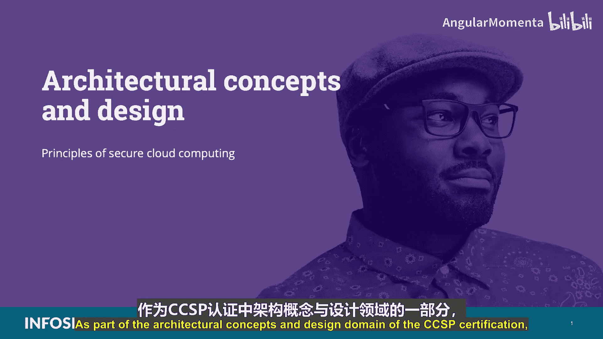
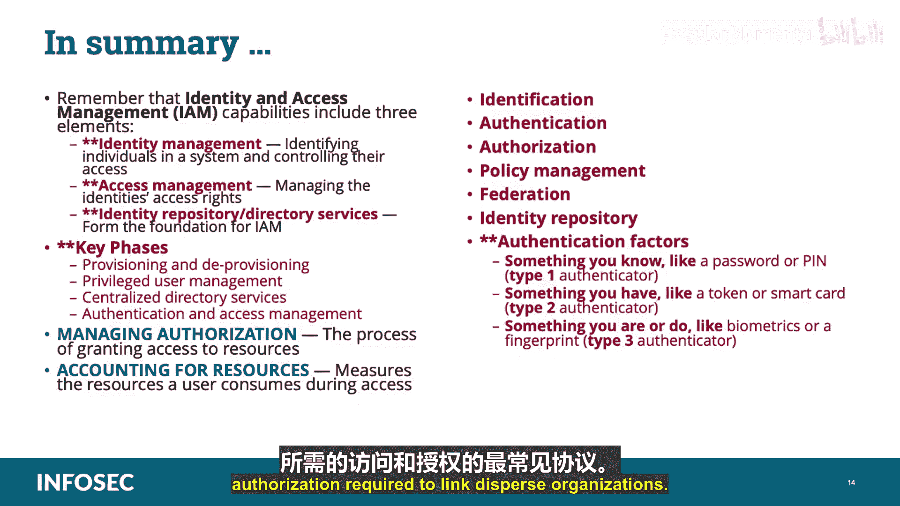

# 【Infosec】认证云安全专家 ｜ Certified Cloud Security Professional (CCSP) p11 02_01_05_principles-of-secure-cloud-computing -BV1TWrHBrEbk_p11-

As part of the architectural concepts and design domain of the CCSP certification。

 let's look at the principles of secure cloud computing。

Before we dive into this learning path， I want to point out that I will be calling out specific information you must know for the CCSP exam by placing a double asterisk in front of it and highlighting it in a different color as seen on this strain。

Identity and access management plays a critical role in managing users based on their assigned role role based access for the exam。

 you need to understand the importance of identity and access management and how federated identities fit in。

 which we'll cover in a few minutes。Identity and access management is about people， processes。

 and procedures used to create， manage， and eventually remove access to enterprise resources by ensuring that the identity is verified and then granted the correct level of access based on the protected resources classification and categorization。

You will need to remember that identity and access management capabilities include three elements。

 identity management， access management， and identity repositories or directory services。

 whether you are dealing with system administrators， in other words。

 privileged users or plain users of cloud services。

 the creation and management of identities is key in maintaining secure operations。

Over the next few screens， I'll cover the key phases that form the basis and foundation for identity and access management in the enterprise。

 which are provisioning， deprovisioning， privilege user management， centralized directory services。

 and authentication and access management。Identity management deals with identifying individuals in a system and controlling their access to resources within that system by associating their user rights and restrictions with the established identity that they provide In other words。

 identity management is the entire process of registering。

 provisioning and deprovisioning identities for all relevant entities and their attributes as well as auditing that information。

Access management includes managing the identities access rights， in other words。

 access management deals with managing an individual's access to resources and is based on the answers to who are you and what do you have access to access management is where the real risk decisions are made it's more important to control access rights than it's to control the number of identities。

Managing authorization is dealing with the what can you do aspect of identity and access management Authorization is the process of granting access to resources This can be based on identityentities。

 attributes of identities like roles and contextual information like location or time of day Authorization is enforced near the relevant resource at the policy enforcement point in a federated identity model。

 This is typically at the relaying party。Accounting measures the resources a user consumes during access。

 This can include the amount of system time or the amount of data a user has sent and or received during a session。

 Account is carried out by logging session statistics and usage information and is used for authorization control billing。

 trends analysis resource utilization and capacity planning activities。

 You must remember these terms listed here for the exam I。

 This is where each subject is issued a unique identity assertions something that serves as an identity like a unique user I Aation Ientifies the individual and ensures that they are who they claim to be It establishes identity by asking the question of who are you and how do I know I can trust you Aation is a function of the identity provider This is done through the factors like passwords key generation or。

iometricMfactor authentication is often advised for high risk roles like administrators or anyone with a privileged function。

Authorization evaluates what do you have access to after authentication occurs policy management establishes the security and access policies based on business needs and degree of acceptable risk Feration is an assertion of organizations that come together to exchange information as appropriate about their users and resources in order to enable collaboration and transactions and finally。

 identity repository includes the directory services for the administration of user account attributes provisionvising is the first phase of identity management where each subject is issued a unique identification assertion。

 something that serves as identification like a unique user ID and a password for use in authenticating the identity assertion The objective is to bind a user to the appropriate controls based on the unique user ID provide accountability with a protected audit trail。

And the ability to trace all activities to those individuals in the public cloud world。

 identity providers use OpenI and OOF as standard protocols to manage the question of who are you OpenI allows users to be authenticated by cooperating sites also known as relaying parties or simply RP using a thirdparty service。

 eliminating the need for webmasters to provide their own ad hoc login systems and allowing users to log into multiple unrelated websites without having to have a separate identity and password for each。

😡，OOF is an open standard for access delegation commonly used as a way for internet users to grant websites or applications access to their information on other websites。

 but without giving them the password， this mechanism is used by Amazon， Google， Facebook。

 Microsoft and Twitter to permit the users to share information about their accounts with thirdpart applications or websites users create accounts by selecting an open ID identity provider also known as a relaying party and then use those accounts to sign into any websites that accept openI authentication in a corporate environment。

 corporate identity repositories could be used Microsoft's active directory is a dominant example relevantvan standard protocols in the corporate world are security assertion markup language also known as SamL and WS Federation which I'll cover in a few minutes。

The authentication part is the process of verifying the identities of the users。

 the combination of identity and information only known by or only in the possession of the user acts to verify that the user is who they say they are。

 This establishes trust between the user and the systems for the allocation of privileges Identity and access management typically looks to utilize multifactor authentication。

 which is a minimum of two preferably three or more factors of authentication for the exam。

 you will need to know the different types of authentication。

Type1 authenticator is something you know like a password or a pin that is considered a type1 authenticator a type2 authenticator is something you have like a token or a smart card that is a type2 authenticator and a type 3 authenticator is something you are or do like biometrics or a fingerprint that is a type 3 authenticator。

Multifactor authentication， also known as twofactor authentication or strong authentication adds an extra level of protection in verifying the legitimacy of a transaction to be a multifactor system users must be able to provide at least two out of the three requirements a one- time password also falls under the banner of multifactor authentication a one- time password it an automatically generated numeric or alphanumeric string of characters that authenticates the users for a single transaction or session it is never repeated the use of a one- time password is strongly encouraged during provisioning and communicating the first time login password for users Some additional factors or procedures for provisioning R step up authentication which is an additional factor or procedure that validates a user's identity normally prompted by high。

Risk transactions or violations according to policy rules。

Methods that are commonly used are challenge questions out of ban authentication， in other words。

 a call or an SMS text message is sent to the end user for verification。With stepup authentication。

 applications that allow access to different types of resources can require users to authenticate with stronger authentication mechanisms to access sensitive resources。

 for example， Ross's internet requires users to authenticate with their username and password to access customer data。

With dynamic based authentication， questions are presented， which are unique to the end user。

Any entity that has an identity in cloud computing， for example， users， devices， codes。

 organizations， and agents， basically anything that needs to be trusted has an identity identities can have identifiers like email addresses。

 IP addresses or public keys， the distinguishing characteristics of an identity in cloud computing is that it can be federated across multiple collaborating parties。

Authorization is the final step in the process once a user has been identified and properly authenticated。

 the resources that user is allowed to access based on their permissions are defined and monitored。

Authorization is the process of defining the specific resources a user needs and determining the type of access or permission to those resources the user may have。

This is where we implement lease privileges， separation of duties and need to know principles in access control you want to give access to what they need to do their job and nothing more and limit access to data。

 assets and resources that are not necessary to fulfill the job or role they are in in a self-service identity management configuration。

 the cloud customer is in charge of provisioning each user's identity or identity assertion。

The Entitlement or Access rights process starts with business and security requirements and translates these into a set of rules。

An example could be a human resources employee who is allowed。

 read or write access to records in the HR database only when working on a trusted device with a trusted connection。

This rule represents a risk decision， it's a balance between enabling users to be productive while at the same time reducing abuse potential these rules are translated into authorization decisions examples of access decisions include questions like can a device be allowed to receive an IP address on a local network can a web server communicate with particular database server can a user access a certain application。

 a function within the application or data within that application can an application access data from another application access rights might be very detailed and can be enforced with different technologies at various points known as policy enforcement points or PEPs or controlled at the policy decision point the PDP these policies are then communicated via standard protocols。

This table shows how access control decisions in an application are based on a number of identifiers and attributes。

You can see the identity source and attributes on the left side in the first column。

 the entitlement rules are represented by the column headers along the top of the table for the rest of the columns。

The access result entry listed under each column represents the outcome of the enablement process for that entitlement rule。

 ultimately it's a combination of where are the users presenting from as well as what are they using to identify themselves that drives the outcome of what access they will be authorized to have。

So now that you've created the identity， in other words， provisioned the identity。

 authenticated the user and authorize them to access cloud resources。

 you need to manage the access access management is the part of the process that deals with controlling access to resources once they have been granted access management is what tries to identify who a user is and what they are allowed to access each time they attempt to access a resource based on their credentials and characteristics of their identity。

 think of a bank where only certain employees can access the mainafe or a hospital environment where only certain employees can access the hospital pharmacy。

This is accomplished through a combination of authentication。

 which we already said establishes the identity by asking who you are and determining whether you are a legitimate user。

 for example， verifying the user's ID and the password。😡，Authorization。

 which evaluates what they have access to after you've been authenticated and policy management serves as the enforcement arm of authentication and authorization and is established based on business needs and senior management decisions。

Federation is an association of organizations that facilitates the exchange of information as appropriate about the user and access to the resources。

 allowing them to share resources across different organizations， and finally identity repositories。

 which is the directory service for the administration of user accounts and their associated attributes。

 think of it as an active directory on steroids。Besides the identity repository。

 other core facets of identity and access management include federated identity management。

 federation standards， federation identity providers， the various types of single sign on。

 multifactor authentication and supplemental security devices。

 centralized directory services form the foundation for identity and access management and security both in an enterprise environment and within a cloud deployment。

 a directory service stores， processes and facilitates a structured repository of information stored。

 coupled with unique identifiers and locations。The most widely used directory services are lightweight Directory Access Procol LDAP and X500 Standard。

 Microsoft Active Directory， Noel edirecty， and metadata Replication and synchronization。

Diirectctory services allow the administrator to customize user roles and identities。

All of this becomes even more important when we deal with federation。

 as there must be a consistent means of accessing these identities and their associated attributes in order to work across unrelated systems。

 the primary protocol in relation to the primary protocol in relation to centralized directory services is lightweight directory access protocol LDAP。

 built and focused on the X500 standard。AlDP works as an application protocol for querying and modifying items in directory service providers like Active Directory Active Directory is a database based system that offers authentication directory。

 policy and other services to a network essentially LDP acts as the communication protocol to interact with active directory。

AlDAP is based on a hierarchical tree structure， It stores information about our principles。

 the users， the servers， to clients， the printers， similar to domain name system trees and UniX file structures with a directory records distinguished name read from the individual entries back through the tree up to the top level。

 you'll find it implemented in X500 directory information services like Microsoft's Active directory Apache directory server。

 Oracle Internet directory， Sun Javava System directory server and a whole bunch of others it also supports security standards like transport layer security TlS and adapts the directory to work over the TCPI model also known as the DOD or DARPA model。

 which is very similar to the seven layer OSi model but with fewerer layers。

In layer 4 of the TCPIP model， the application process layer。

 this covers everything specific to a session or application in other words。

 everything related to the data payload in terms of the OSI model it maps the layer 5 through7。

Layer3 of the TCPIP model， the transport layer， also known as the host to host layer。

 includes everything required to move data between applications it corresponds to TCP and UDP in terms of the OSI model it maps to layer4。

Layer2 of the TCPIP model known as the internet layer or the internetnet workinging layer includes everything that is required to move data between networks it corresponds to the I protocol but also to internet control message protocol ICMP and internet group management protocol IGMP In terms of the OSI model。

 it maps to layer 3 and finally layer1 of the TCPIP the link layer also known as the network access layer or network interface layer provides physical communications and routing within a network it corresponds to everything required to implement an ethernet it's sometimes described as two layer。

 a physical layer and a link layer in terms of the OSI model it maps to layers1 and2。And finally。

 deprovisioning or removal of a user account is the final step in the identity and access management process The account is disabled when the user no longer requires access to the cloudbased services and resources。

 this is not just limited to a user leaving the organization but may also be due to a user changing roles。

 functions or departments， deprovisioning is a risk mitigation technique to reduce the risk of authorization or privileged treat。

 in other words， getting more accesses or privileges than they need to do their job。

 remember the principles of lease privileges， giving only access to what they need to do their job and nothing more。

Privillge accounts need to be monitored closely because of the risk and impact they present if compromised。

 these are accounts that are used to provision accounts。

 elevate privileges and eventually decommission accounts。

You should be using privileged identity management features for managing the administrators of directories we want to be able to track usage。

 authentication successes and failures， authorization times and dates。

 log successful and failed events enforce password management and ensure our logs contain sufficient levels of auditing and reporting related to privileged user accounts。

 we implement segregation of duties for privileged accounts as a risk mitigation and risk reduction technique to limit their ability to affect major changes within the system if the privileged accounts are hosted locally rather than in the cloud the identity and access management service will require conductivity to the local lightweight directory access protocol servers in addition to any applications and services that it manages access for。

Within cloud environments， directory services are heavily dependent on and utilized as the go to trusted source by the Ident and access management framework as a security repository of identity and access information that's why we need to have high trust and confidence in the accuracy and integrity of the directory services。

This is also where a cloud access security broker fits in。

 The cloud access security broker is a third party entity offering independent identity and access management services to cloud service providers and cloud customers often as an intermediary。

 This can take the form of a variety of services， including single sign on certificate management and cryptographic key escrow。

 This is a term you will need to know for the exam， and we'll cover it again later in the course。

 and finally， let's cover federated identity management federation also known as federated identity is where identity and authorization settings are collected from multiple identity management systems。

 enabling different systems to define user capabilities and access。

Identity and authorization are shared responsibilities across multiple authoritative services。

 Federation is much like that of Kbros within an active directory domain。

 where user logs on once to a domain controller is ultimately granted in access token and uses that token to gain access to systems that they have authorization for Federated identity management provides the policies。

 processes and mechanisms that manage identity and trusted access to systems across organizations。

 OOF 2。0 and SamL are two of the most common protocols that support the access and authorization required to link disperse organizations。

OOF authorization services is widely used for authorization services in web and mobile applications。

 according to request for comments RFC 6749， the OOth 2。

0 authorization framework enables a thirdpart application to obtain limited access to an HTTP service either on behalf of the resource owner by orchestrating an approval interaction between the resource owner and the HTTP service or by allowing the thirdpart application to obtain access on its own behalf。

Security Astion Markup languagegu SamL 2。0 is used for exchanging authentication and authorization data between security domains and enables web based authentication and authorization scenarios。

 including single sign on。Other standards in the federation space are WS federation and Open ID Connect Federated identity means linking a person's electronic identity and attributes stored across multiple distinct identity management systems It's like using your Facebook identity to access monster co they have an agreement in place to accept the fact that you already authenticated yourself as part of creating that account so in order to swap data between federated parties like Facebook and LinkedIn。

 we use an XmLbased protocol like Samel in a federated environment。

 you're going to have identity providers and service providers also known as relaying parties For example。

 let's say you want to create a LinkedIn account using your Facebook account as the identity provider the principal or the user creates an account。

 for example in LinkedIn which becomes the service provider also known as the relaying party in this case。

At the identification and certification stage of the account creation。

 a verification request is sent to the identity provider in this case Facebook since you already have an established account with them the identity provider Facebook in this case holds all of the identities and generates a token for the known user you then sends a sample request back to the service provider or relaying party in this case。

 LinkedIn LinkedIn as a service provider or relaying party then consumes the token from the identity provider and no further verification is needed your account is verified Feerated single signon is typically used for facilitating intraorganizational and intrasecur domain access to resources leveraging federated identity management single signon should not be confused with reduced signon reduced signon generally operates through some form of credential synchronization and has security concerns where single signon eliminates user。

namees and other sensitive data from traversing the network as the foundation of federation relies on the existence of an identity provider reduced signon has no place in the federated identity system In summary。

 we discussed identity and access management and stated that you needed to remember the three elements identity management。

 access management and identity repositories or directory services Also the key phases which were provisioning and deprivisioning privileged user management。

 centralized directory services and authentication and access management we discussed identity management。

 as identity individuals in a system and controlling their access access management。

 managing the identityities and access rights， managing authorizations the process of granting access to the resources and accounting for resources which measures the resources a user consumes during access you need to remember these terms that are listed here for the。

ExamIdentification is where each subject is issued a unique identity assertation Authation identifies the individual and ensures that they are who they claim to be authorization evaluates what do you have access to after the authentication occurs policy management establishes the security and access policies based on business needs and degree of acceptable risk Federation is the assertion of organizations that come together to exchange information as appropriate about their users and resources in order to enable collaboration and transactions and finally。

 identity repository， which includes the directory services for the administration of user accounts for the exam you will definitely need to know the three factors of authentication something you know like a password or a pin and that is a type1 authenticator。

 something you have like a token or a smart card that is a type2 authenticator and something you are or do like biometric。

or a fingerprint， which is a type3 authenticator。 We also discuss centralized directory services which form the foundation of identity and access management and that the most widely used directory services were LDap and X500 standards。

 Finally I mentioned the cloud access security broker as the independent identity and access management services to cloud service providers and also cloud customers。

 The very last thing that we talked about was federation Feerated identity management provides the policies。

 processes and mechanisms that manage identities and trusted access to systems across organizations and remember that OOth and SamL are the most common protocols that support access and authorization required to link disperse organizations。

