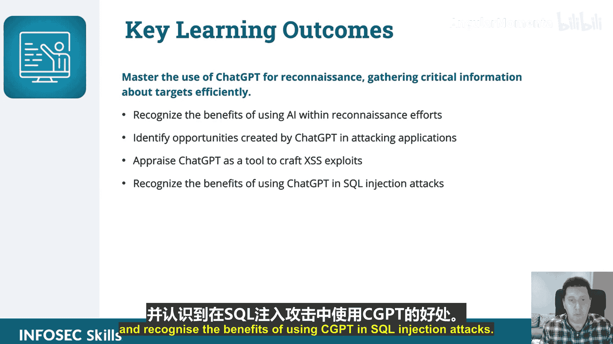

# 006：课程概述

在本课程中，我们将深入探索如何利用ChatGPT（本课程中简称为CGPT）进行攻击性网络安全实践。课程重点聚焦于应用安全领域，旨在帮助网络安全专业人士通过使用CGPT来提升其攻击性应用安全技能。

## 课程简介

本课程将涵盖CGPT在Web应用漏洞侦察与利用方面的实际应用。通过学习，你将能够掌握如何高效地利用CGPT进行信息收集，并理解其在攻击应用过程中创造的机会。

## 核心学习目标

完成本课程后，你将达成以下目标：

*   **掌握侦察技能**：你将能够运用CGPT高效地收集关于目标的**关键信息**。
*   **认识AI优势**：你将能够识别在侦察工作中使用**人工智能（AI）** 所带来的益处。
*   **识别攻击机会**：你将能够辨别CGPT在攻击应用程序过程中所创造的**潜在机会**。
*   **评估利用工具**：你将能够把CGPT评估为一种**工具**，用于精心构造**跨站脚本（XSS）** 攻击利用代码。
*   **理解SQL注入应用**：你将能够认识到在**SQL注入**攻击中使用CGPT的**好处**。

---

上一节我们介绍了课程的整体框架和学习目标，现在让我们正式开始课程内容的学习。