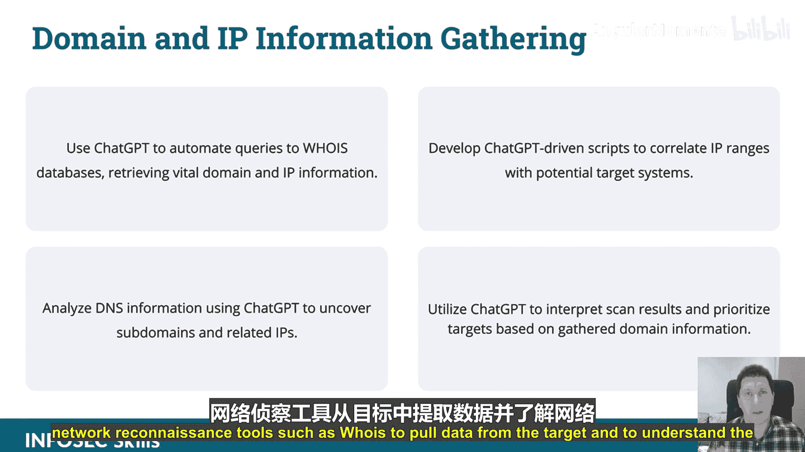

# 007：使用ChatGPT进行侦察技术 🕵️


在本节中，我们将学习如何利用ChatGPT在攻击性安全的侦察阶段提升效率。侦察是渗透测试的第一步，旨在收集目标信息。ChatGPT擅长处理和分析大量文本数据，并能生成自然语言输出，这使其成为侦察阶段的得力助手。

上一节我们介绍了攻击性安全的整体框架，本节中我们来看看如何具体应用ChatGPT进行信息收集。


## 侦察概述

在侦察阶段，你可以利用ChatGPT来显著提升效率并节省大量时间。它还能帮助你实现自定义脚本，并与数据进行动态交互。

## 域名与IP信息收集

在常规的侦察阶段，你会使用诸如`whois`之类的网络侦察工具来从目标获取数据，并了解其网络结构。

以下是使用ChatGPT辅助进行域名与IP信息收集的核心思路：

*   **自动化查询**：你可以指示ChatGPT生成脚本，自动调用`whois`、`nslookup`、`dig`等命令，并解析其返回的文本结果。
*   **数据整合与分析**：ChatGPT可以帮助你整理从不同工具获取的零散信息，生成结构化的报告，或根据已有数据推断潜在的攻击路径。
*   **生成自然语言报告**：将原始的命令行输出交给ChatGPT，它可以将其转化为更易读、更专业的书面报告。

例如，你可以向ChatGPT提供一段`whois`查询结果，并要求它提取关键信息，如注册商、注册人、名称服务器和创建日期。其处理过程可以抽象为以下伪代码逻辑：

```python
# 伪代码示例：使用ChatGPT解析whois数据
raw_whois_data = execute_command("whois example.com")
parsed_info = chatgpt_analyze("提取以下whois信息中的注册商、名称服务器和过期日期：" + raw_whois_data)
print(parsed_info)
```

通过这种方式，你可以将繁琐的文本解析工作交给AI，从而专注于更高层次的战术决策。



本节课中我们一起学习了如何将ChatGPT应用于攻击性安全的侦察阶段，特别是域名与IP信息收集。利用其强大的文本处理能力，我们可以自动化信息提取、整合数据并生成报告，从而让侦察工作更高效、更智能。