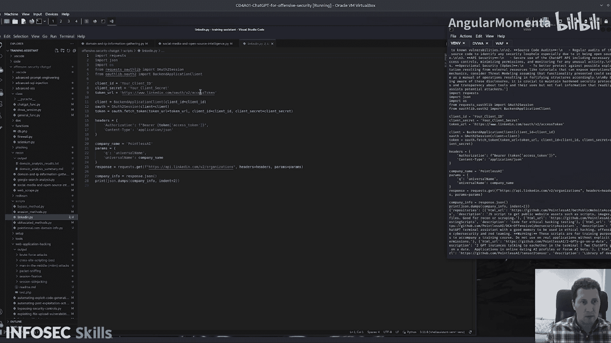

# 008：社交媒体与开源情报


在本节课程中，我们将学习如何利用脚本进行社交媒体情报收集与开源情报分析。具体内容包括：模拟获取社交媒体帖子、与GitHub API交互以获取目标数据，并对这些数据进行安全分析。

## 脚本初始化与变量设置

首先，我们需要为脚本设置一些基础变量。以下是一个模拟的社交媒体帖子数组。在实际应用中，您需要通过API调用（例如Facebook、Twitter、LinkedIn的API）来获取真实数据并填充此数组。

```python
simulated_posts = [
    "Just deployed our new production server at 192.168.1.100! #TechUpdate",
    "Working from the coffee shop today, using the public WiFi.",
    "Our team is celebrating the launch of v2.0! Code is on GitHub: github.com/example/project"
]
```

## 生成LinkedIn API交互脚本

接下来，我们将利用大语言模型生成一个能够查询LinkedIn API的脚本。这有助于自动化从LinkedIn平台收集信息的流程。

```python
# 提示词示例：生成一个Python脚本，使用LinkedIn API v2获取指定公司的公开帖子。
linkedin_script_prompt = "Generate a Python script to fetch public posts from a company page using the LinkedIn API v2."
```

## 社交媒体帖子分析

上一节我们设置了数据并生成了采集脚本，本节中我们来看看如何分析收集到的社交媒体帖子。



以下是分析社交媒体帖子并提取潜在安全漏洞信息的函数示例。通过分析大量帖子，您可能获得有价值的、可付诸行动的情报。

```python
def analyze_social_media_posts(posts):
    security_insights = []
    for post in posts:
        # 分析逻辑示例：检测是否泄露了内部IP地址
        if "192.168" in post or "10." in post:
            security_insights.append(f"Potential internal IP leak: {post}")
        # 分析逻辑示例：检测是否提及不安全的网络行为
        if "public WiFi" in post.lower():
            security_insights.append(f"Use of public WiFi mentioned: {post}")
    return security_insights
```

## 查询并处理GitHub数据

现在，我们将目标转向代码仓库。通过查询目标的GitHub API，我们可以获取其公开仓库信息。

我们定义一个函数来获取GitHub数据。该函数向GitHub API发起请求，获取指定用户或组织的仓库列表。

```python
import requests

def get_github_data(username):
    url = f"https://api.github.com/users/{username}/repos"
    response = requests.get(url)
    if response.status_code == 200:
        return response.json()  # 返回JSON格式的原始数据
    else:
        return None
```

## 分析GitHub仓库数据

在获取了GitHub的原始数据后，我们需要对其进行分析，以评估公司的技术活跃度、关注领域及潜在的安全风险。

以下函数对公司的公开仓库进行分析，并生成评估报告。这可以为您的进一步侦察工作提供可操作的洞察。

```python
def analyze_github_repositories(repo_data):
    analysis_report = []
    if repo_data:
        for repo in repo_data:
            report_entry = {
                "name": repo.get('name'),
                "url": repo.get('html_url'),
                "description": repo.get('description'),
                "topics": repo.get('topics', []),
                "language": repo.get('language')
            }
            # 简单的分析逻辑：检查仓库是否涉及敏感主题
            sensitive_keywords = ['password', 'key', 'secret', 'admin']
            desc = (repo.get('description') or '').lower()
            if any(keyword in desc for keyword in sensitive_keywords):
                report_entry['security_note'] = "Repository description may indicate sensitive information."
            analysis_report.append(report_entry)
    return analysis_report
```

## 数据处理方法的比较与混合策略

在处理如GitHub API返回的JSON这类结构化数据时，有多种方法。我们将比较几种方法的优劣。

**1. 直接输出原始JSON**：数据完整性最高，但可读性差，难以直接解读。
```python
print(repo_data)  # 输出庞大的JSON对象
```

**2. 完全依赖大语言模型分析**：将JSON数据发送给大语言模型，请求其以文本形式返回分析结果。这种方法灵活、动态，但可能因模型幻觉影响数据完整性。
```python
# 伪代码：将 repo_data 发送给大语言模型并请求文本分析报告
analysis_text = chatgpt_analyze(f"Analyze this GitHub repo data: {repo_data}")
```

**3. 使用代码手动解析**：使用Python循环等代码结构精确提取所需字段。完整性高，但代码针对性强，不够灵活。
```python
for repo in repo_data:
    print(f"Repo: {repo['name']}, URL: {repo['html_url']}")
```

**4. 混合方法（推荐）**：结合代码的精确性和大语言模型的概括能力。例如，用代码循环遍历每个仓库，然后将单个仓库的信息发送给大语言模型进行摘要分析。这在一定程度上平衡了完整性与灵活性。
```python
for repo in repo_data:
    # 用代码精确提取核心字段
    repo_summary = {
        "name": repo.get('name'),
        "primary_language": repo.get('language')
    }
    # 将摘要发送给大语言模型进行深入分析
    insight = chatgpt_analyze(f"Provide a security insight for this repo summary: {repo_summary}")
    print(insight)
```

**5. 使用`jq`等专用工具**：在命令行环境中，`jq`是处理JSON的强大工具，适合进行快速的数据过滤和转换。
```bash
# 示例：使用jq从JSON中提取仓库名和URL
echo "$repo_data" | jq '.[] | {name: .name, url: .html_url}'
```

## 课程总结

本节课中我们一起学习了如何构建一个用于攻击性安全侦察的脚本。我们涵盖了从模拟社交媒体数据、生成API交互脚本，到实际调用GitHub API并分析其返回数据的完整流程。关键点在于，我们比较了多种处理JSON数据的方法，并提出了结合传统编程与大语言模型能力的混合策略，以在数据完整性和分析灵活性之间取得平衡。这些技能能帮助您更高效地从公开信息中搜集情报，为安全评估提供支持。