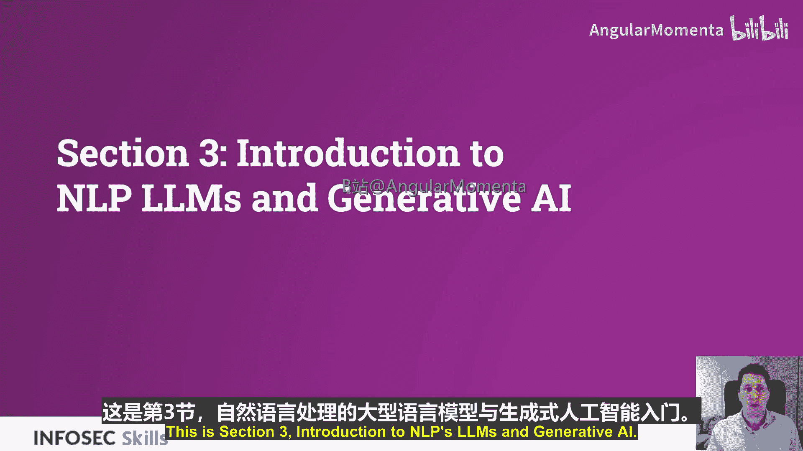
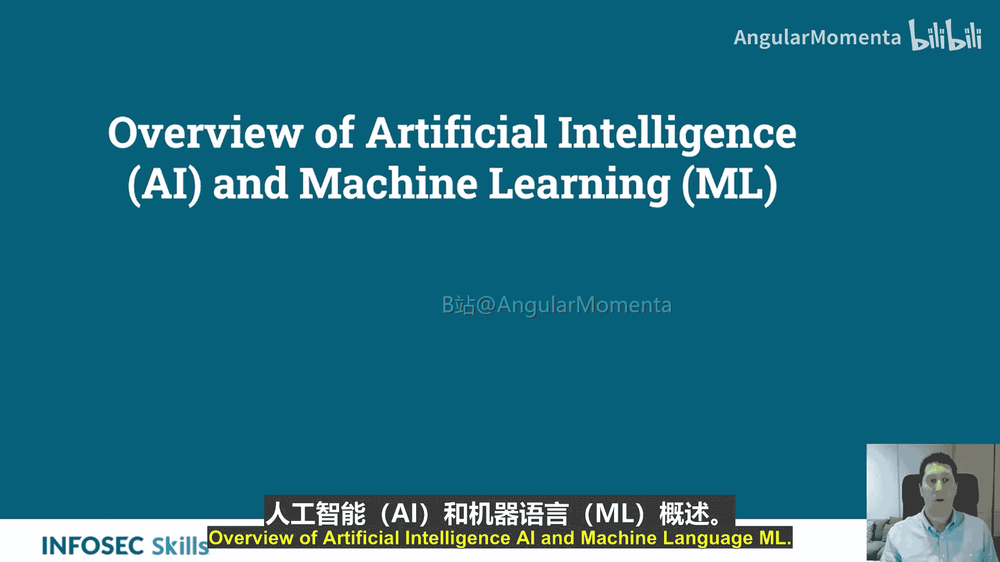
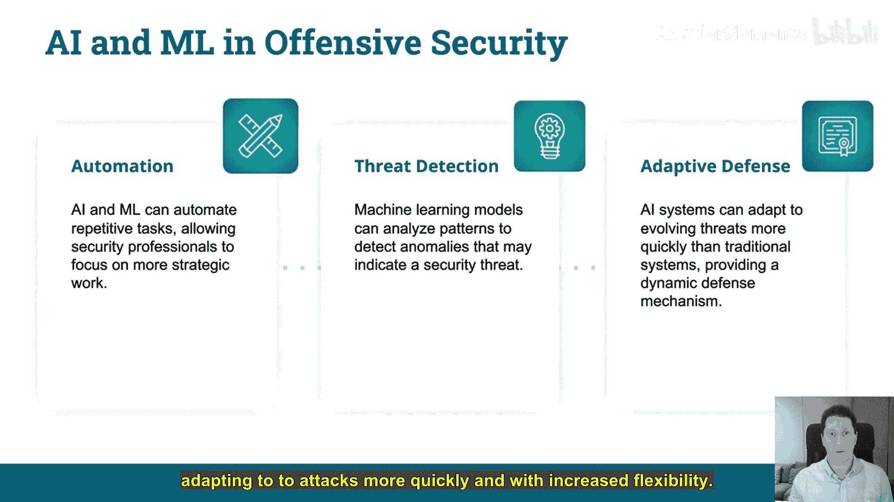
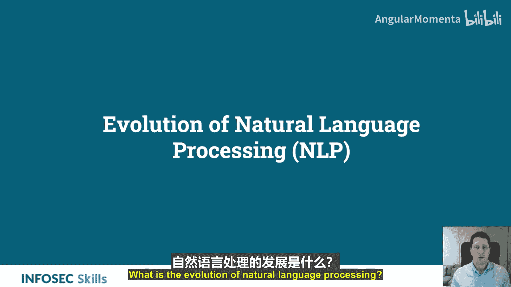
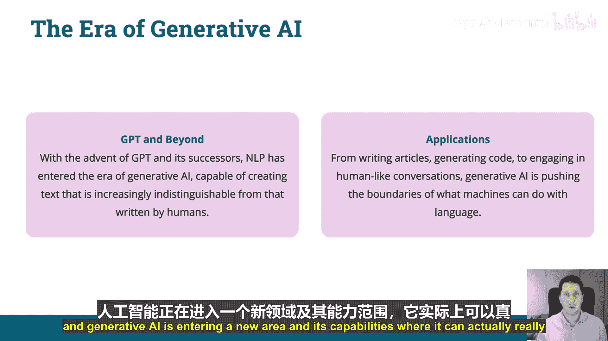
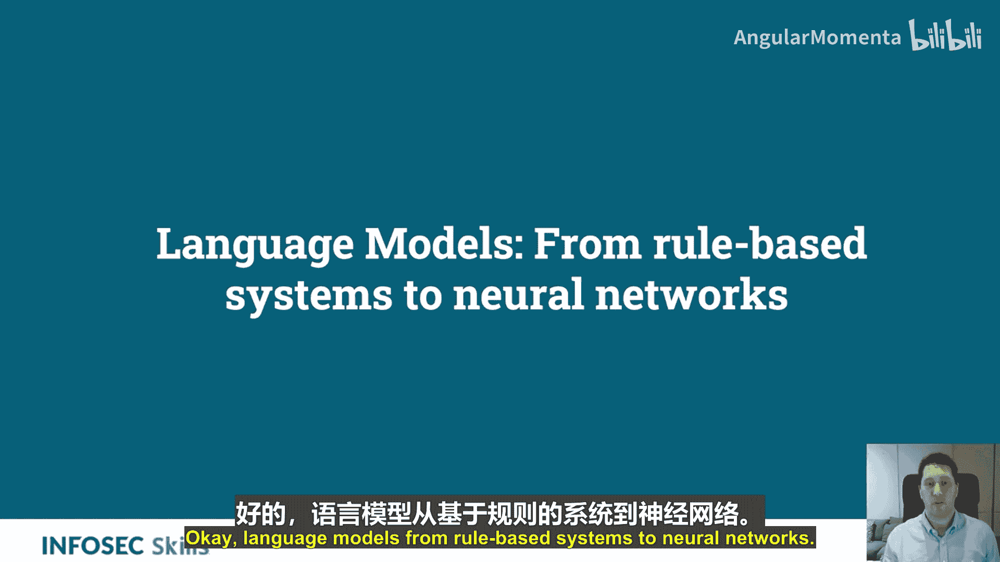
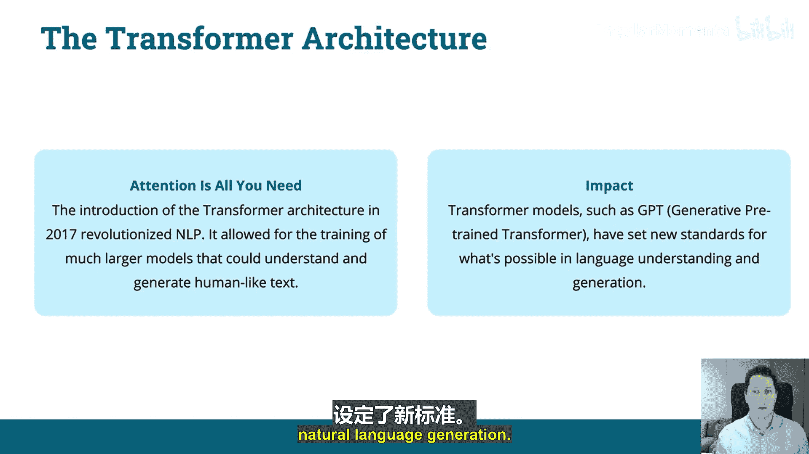
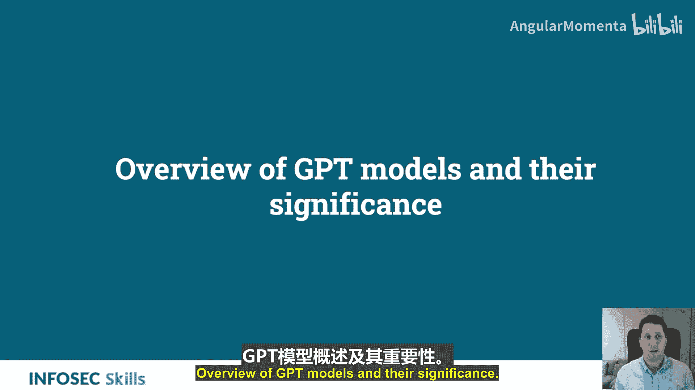
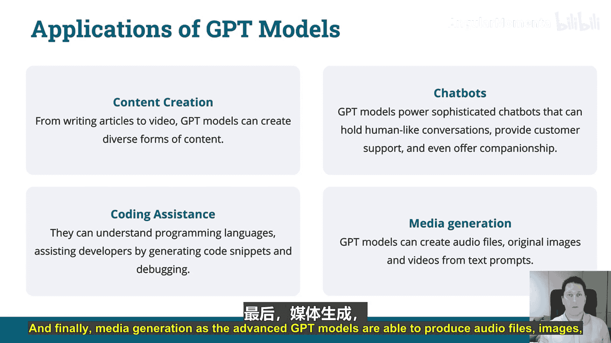

# 信息安全：攻击性安全中的ChatGPT：3.1.1.3：NLP、LLM与生成式AI入门 🧠

在本节课程中，我们将学习人工智能、机器学习和自然语言处理的基础知识，并了解像ChatGPT这样的大型语言模型是如何演变而来的。我们将探讨这些技术在攻击性安全领域的潜在应用。

---

## 人工智能与机器学习概述 🤖

首先，我们从宏观层面审视人工智能。人工智能专注于创建能够执行通常需要人类智能才能完成任务的系统。

请看下图，你可以看到人工智能位于顶层，其下是机器学习。因此，机器学习是人工智能的一个子集，是人工智能领域内的一个研究方向。

机器学习赋予计算机无需明确编程即可学习的能力。深度学习与神经网络是机器学习的一个子集。神经网络是大型数学方程，为学习从A到B或从输入到输出的映射提供了一种有效的技术，即接收输入、进行处理并提供输出。

深度学习是一种人工神经网络，允许多个输入导向一个输出。从深度学习衍生出监督学习、半监督学习和无监督学习。这些是训练模型的方法，我们稍后会进一步探讨。例如，监督学习是为模型提供带标签的数据，而半监督和无监督学习则让模型自行发现模式。

ChatGPT是这些技术的产物。GPT模型经过训练，而ChatGPT是GPT-3.5的一个产品。

接下来，我们更深入地探讨人工智能与机器学习之间的关系。人工智能是机器对人类智能的模拟。机器学习是人工智能的一个子集，是一种通过识别模式和理解数据，无需人工干预来教导计算机从数据中学习的方法。

人工智能和机器学习如何协同工作？这里涉及神经网络的概念。在ChatGPT中，利用了神经网络等人工智能技术来处理信息、进行对话。机器学习算法通过让模型接触海量文本数据，在训练ChatGPT中扮演核心角色，使模型能够学习模式、语言结构和语义关系。机器学习作为一种神经网络，帮助GPT模型能够处理这些数据。在本课程中，我们将了解这是如何实现的。

以下是不同类型的机器学习方法简介：
*   **监督学习**：计算机通过示例学习，数据被标记。
*   **无监督学习**：计算机从未标记的数据中学习模式和关系。
*   **强化学习**：模型根据其行为获得奖励或惩罚。

**人工智能与机器学习在攻击性网络安全中的应用**。这些自动化技术有哪些用例？像ChatGPT这样的模型可以自动化你的网络安全工作流程，提高效率，让你能专注于更具战略性的工作。它们可用于威胁检测、分析模式和趋势、检测异常、以及更快速、更灵活地适应攻击。

---

## 自然语言处理的演进历程 📈

上一节我们介绍了人工智能的基础，本节我们来看看自然语言处理的发展历史。

自然语言处理的历史始于1950年，当时使用简单算法，第一个用例是尝试用机器翻译语言。1954年著名的“乔治城实验”就是一个例子，他们使用自然语言处理翻译了60个俄语句子。这很重要，因为这是首次证明这个概念可行，并吸引了政府资助。

在20世纪80年代到90年代，统计方法和数据科学兴起，焦点从基于规则的方法转向统计方法。这使得通过利用更大的数据集和更强大的计算机，能够进行更灵活、更准确的语言处理。

从2010年开始，深度学习革命到来，深度学习模型的引入改变了自然语言处理。这些模型现在能够理解和生成类人文本。2017年有一个突破，谷歌工程师发表了一篇名为《注意力就是你所需要的一切》的白皮书，引入了Transformer架构的概念，这导致了像GPT这样的更先进模型的诞生。

进入生成式人工智能时代。随着GPT及其后续模型的出现，自然语言处理进入了一个新时代，能够生成非常接近人类行为的文本。这有多个应用，正如你在ChatGPT中看到的：撰写文章、生成代码、进行人类对话。生成式人工智能正进入一个能够真正模仿人类语言和言语能力的新阶段。

---

## 语言模型：从规则系统到神经网络 🧬

我们了解了自然语言处理的演进，现在聚焦于其核心——语言模型本身。

大型语言模型是一种预测单词序列可能性的模型，它是自然语言处理的支柱。早期模型依赖于手工制定的规则，而神经网络则依赖于深度神经层，这些层能够在向量之间建立连接。

神经网络的兴起是一个突破。采用神经网络能够学习数据中更深层的模式，从而催生了更准确、更具上下文感知能力的语言模型。这里的关键概念是，神经网络允许机器从示例中学习，而不是遵循明确编程的规则。

Transformer架构，如前所述，源自2017年的白皮书《注意力就是你所需要的一切》。Transformer架构的引入彻底改变了自然语言处理，使得训练能够理解和生成类人文本的更大模型成为可能。其影响是，像GPT这样的Transformer模型为自然语言生成的可能性设定了新标准。

---

## GPT模型概述及其重要性 🚀

在了解了语言模型的演变后，本节我们具体看看GPT模型系列。

生成式预训练Transformer是由OpenAI设计的一系列人工智能模型。这些模型能够根据接收到的输入理解和生成类人文本。GPT版本1到4普及了基于大型语言模型的应用，为可能实现的功能设定了标准。

让我们看看OpenAI发布GPT的时间线，以便你了解背景。GPT-3是ChatGPT出现的基础。
*   **GPT-1**：在2017年无监督学习取得突破后，OpenAI于2018年发布了GPT-1，展示了Transformer在语言理解方面的潜力，并将白皮书的理论付诸实际应用。
*   **GPT-2**：于2019年发布，使用了显著更大的数据集，能生成更具上下文相关性的文本。
*   **GPT-3**：于2020年发布，这是当前免费的3.5版本模型。它拥有1750亿个参数，展示了生成类人文本的卓越能力，这也是近年来它广受欢迎的原因。
*   **GPT-4**：包含了更多伦理考量，更注重数据和人机协作，使其达到可用于商业的生产就绪状态。GPT-4在GPT-3的基础上有所进步：GPT-3主要专注于文本生成，而GPT-4还具备文本转语音、语音转文本、图像转文本、文本转图像、声音和视频生成的能力。
*   **GPT-5**：预计于2025年发布，参数规模将显著增加，并具备更多功能，在伦理方面也必然会有更多考量。

**GPT模型如何工作？** 它们从海量数据集中学习，一旦训练完成，就能够根据输入生成内容：处理输入并产生输出，并且能以非常逼真的方式做到这一点。

**GPT模型有哪些应用？**
*   **内容创作**：撰写文章、视频脚本等多种内容。
*   **编码辅助**：协助编写脚本、修复代码、从零开始编写代码，以及将代码从一种语言转换为另一种语言。
*   **聊天机器人**：像ChatGPT这样的文本生成模型非常擅长以自然的方式与人类互动，因此天生适合在客服等领域进行人类对话。
*   **媒体生成**：随着模型的发展，它们能够生成音频文件、图像和视频。

---

在本节课中，我们一起学习了人工智能、机器学习和自然语言处理的基础知识，回顾了从规则系统到神经网络，再到Transformer和GPT模型的语言处理技术演进历程。我们了解了GPT模型的工作原理及其在内容创作、编码和对话等领域的广泛应用，并探讨了这些强大工具在自动化安全任务和增强威胁检测等攻击性安全领域的潜在价值。理解这些基础是有效利用像ChatGPT这样的AI工具进行安全工作的第一步。