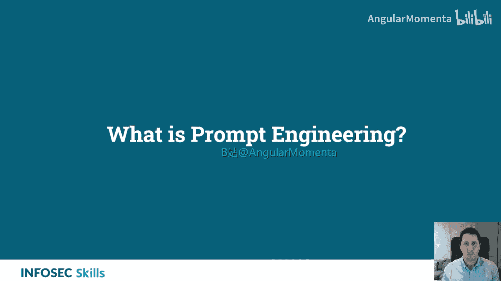
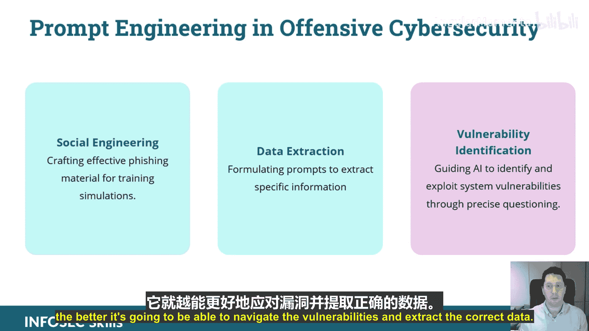
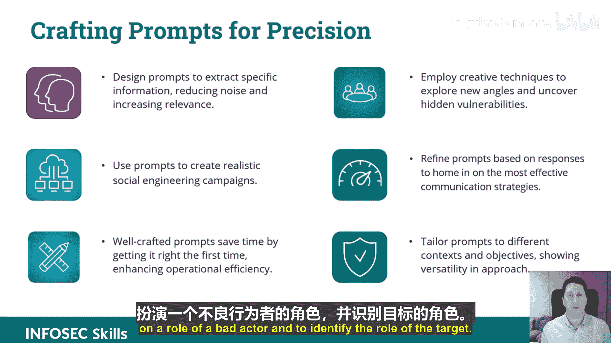
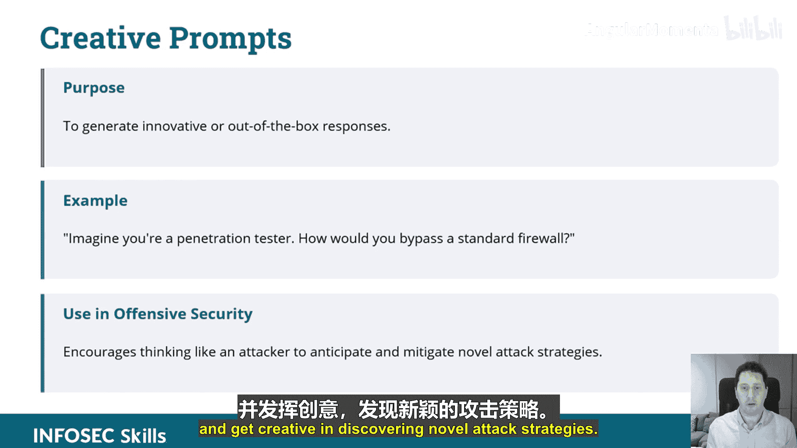
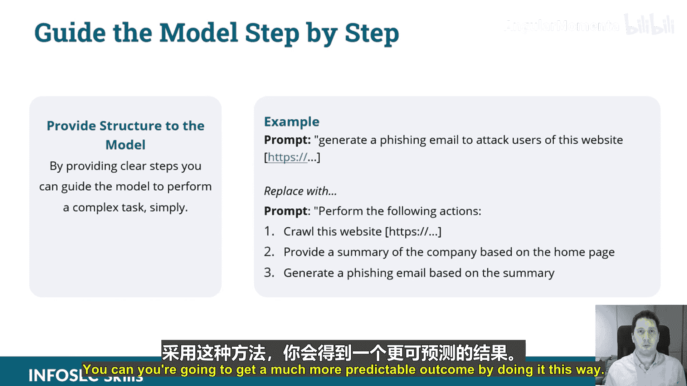

# 信息安全：攻击性安全中的ChatGPT | 第4章：有效的沟通提示工程技巧 🎯




## 概述

在本节课中，我们将学习**提示工程**的核心概念与技巧。提示工程是指导AI模型（如ChatGPT）生成所需响应的关键技能。我们将探讨其定义、在攻击性安全中的应用、不同类型的提示以及如何设计有效的提示，以最大化AI在网络安全任务中的效用。

---

## 什么是提示工程？🤔



提示工程是指精心设计问题或提示，以引导像ChatGPT这样的AI模型生成期望的响应。其目标是与AI进行有效沟通，以实现特定的结果。这在利用AI进行攻击性网络安全活动时尤为有效。


本质上，提示工程是一种**AI编程**。你通过编写提示来“编程”AI，使其给出符合你目标的响应。它的作用类似于使用搜索引擎：你提出特定问题，得到特定答案。通过学习有效的提示工程，你的工作流程和输出效率将大大提高。

提示工程通过以下方式增强AI沟通：
*   **定制对话**：获取精确、有用的信息。
*   **提升效率**：节省来回沟通的时间。
*   **自定义输出**：允许在网络安全操作中进行创造性和战略性的AI应用。

---

## 提示工程在攻击性安全中的应用 🛡️➡️⚔️



上一节我们介绍了提示工程的定义，本节中我们来看看它在攻击性网络安全中的具体应用场景。


以下是几个关键应用领域：

*   **社会工程学**：为培训模拟制作有效的钓鱼材料。通过有效的提示，你可以模拟攻击者角色，并精准定位目标。
*   **数据提取**：设计提示以提取特定信息。提示质量越高，数据提取的效果就越好。
*   **漏洞识别**：引导AI识别并利用系统漏洞。你的引导越清晰，AI就越能有效地发现漏洞并提取正确数据。

---

## 精心设计提示的力量 💪

理解了应用场景后，我们来看看为什么精心设计提示如此重要。有效的提示设计对于从GPT模型中提取最大价值至关重要。正确的提示可以解锁更准确、相关和富有洞察力的响应。

在攻击性网络安全中，精心设计的提示可以引导我们发现漏洞并构建更好的攻击向量。**提示质量决定输出质量**。

以下是精心设计提示的几个要点：

*   **追求精确性**：设计提示以提取特定信息，减少无关内容，增加相关性。
*   **提升效率**：精心设计的提示可以“一次成功”，节省时间，提高操作效率。开发提示可能需要多次迭代，但一旦完善，就能在实际场景中高效部署。
*   **激发创造性**：运用创造性技巧探索新角度，发现隐藏漏洞。你可以使用提示来协助GPT进行创造性思考。
*   **迭代与定制**：根据响应优化提示，找到最有效的沟通策略。针对不同的上下文和目标定制提示，展现方法的多样性。一个很好的用例是社会工程学，你可以指示ChatGPT扮演恶意角色，并识别目标角色。

---

## 理解提示类型 📝

为了更有效地与GPT模型互动，我们需要了解不同类型的提示。提示可以根据其复杂性、目的和风格进行分类。




以下是几种主要的提示类型及其最佳实践：

*   **信息型提示**
    *   **目的**：收集事实、解释或数据。
    *   **最佳实践**：
        1.  提出清晰简洁的问题。
        2.  必要时指定上下文。
        3.  注意模型的局限性（例如伦理限制）。
    *   **攻击性安全示例**：`解释NoSQL注入的概念。` 或更佳：`作为一名渗透测试人员，解释NoSQL注入的概念。`

*   **指令型提示**
    *   **目的**：指导AI执行特定任务或生成特定类型的内容。
    *   **最佳实践**：
        1.  **具体明确**：清晰说明目标。
        2.  **提供上下文**：设定场景和角色。
        3.  **分解复杂问题**：将复杂指令拆分为多个步骤。
        4.  **包含示例**：提供期望输出格式的示例。
        5.  **指定格式**：明确要求响应的结构。
    *   **示例**：
        ```
        你是一名获得客户授权的道德黑客，正在进行渗透测试。你的目标是识别网络上的开放端口，并以项目符号列表的形式返回结果。
        ```

*   **探索型提示**
    *   **目的**：探索想法、概念或可能性，促进创造性思维。
    *   **最佳实践**：使用开放式问题，邀请模型进行扩展和详细的回答，旨在引发讨论、产生想法或多元观点，适用于探索假设场景。
    *   **示例**：
        ```
        想象你是红队的一员，任务是对一个处理敏感金融交易的高度安全的现代Web应用程序进行安全评估。你的目标是识别网络攻击的潜在入口点，讨论你会考虑探索的各种攻击向量。
        ```
    *   **工作流建议**：可以先使用**信息型提示**了解基础知识，然后用**探索型提示**激发攻击思路，最后基于得到的答案发起**指令型提示**进行具体操作。

*   **创造性提示**
    *   **目的**：生成创新或“跳出框框”的响应。
    *   **应用**：在攻击性安全中，鼓励像攻击者一样思考，以预测和缓解新颖的攻击策略。深入攻击者或防御者的思维，创造性地发现新的攻击策略。
    *   **示例**：`想象你是一名渗透测试员，你会如何绕过标准防火墙？`

---

## 将技巧应用于ChatGPT提示设计 🛠️

现在，让我们将上述理论付诸实践。有效的提示是释放GPT模型在攻击性安全中全部潜力的关键。我们的目标是确保你的提示能产生准确、相关且可操作的响应。

以下是设计有效提示的核心技巧：

*   **清晰明确**
    *   **避免歧义**：使用精确的语言和清晰的指令。
    *   **化繁为简**：如果提示太复杂导致回答混乱，请将其分解为更简单、更具体的指令。可以像写清单一样列出步骤（1, 2, 3...）。
*   **细节至关重要**
    *   **包含具体细节和约束条件**。
    *   **请求结构化输出**：指定你想要的输出格式。
        *   **示例**：`生成网络范围内的开放端口列表，以JSON格式提供，包含以下键：IP, port, application。`
*   **上下文为王**
    *   **提供背景信息**：给予模型足够的信息来理解问题。
    *   **增强相关性**：使内容与你的网络安全目标直接相关。在查询前，可以先解释任务背景。
*   **设定条件**
    *   **示例**：`你将收到网络扫描结果。如果任何主机开放了22端口，则执行以下操作...`。这有助于在动态脚本中引导AI进行逻辑判断。
*   **少量样本编程**
    *   **零样本 vs. 少样本**：零样本指模型无需额外示例就能理解任务；少样本则需提供少量示例来引导模型。
    *   **应用**：对于复杂查询，你可以在提问前通过提供示例答案来“训练”GPT模型。
        *   **示例**：
            ```
            请按以下方式回答问题：
            用户：给我网络范围内的IP列表。
            助手：192.168.1.1, 192.168.1.2
            用户：现在给我10.10.2.1/24子网内的IP列表。
            ```
*   **分步引导**
    *   **提供结构**：通过提供清晰的步骤，你可以引导模型执行复杂任务。
    *   **示例对比**：
        *   **原始提示**：`生成一个针对该网站用户的钓鱼邮件。`
        *   **优化后的提示**：
            ```
            执行以下操作：
            1. 分析这个网站：[网站URL]
            2. 根据首页内容总结该公司。
            3. 基于你的总结，生成一封钓鱼邮件。
            ```
        *   **说明**：优化后的提示能产生更可预测、更高质量的结果。建议先在GPT-3.5等模型上打磨提示，使其精确有效，再应用到更强大的模型上，这样成本效益更高。

---

## 总结 🎓

本节课中，我们一起学习了提示工程在攻击性安全中的核心价值与应用。我们了解了什么是提示工程，探讨了它在社会工程、数据提取和漏洞识别中的具体应用，并学习了信息型、指令型、探索型和创造性等不同类型的提示。最后，我们掌握了一系列设计有效提示的实用技巧，包括保持清晰明确、注重细节、善用上下文、设定条件、使用少量样本编程以及进行分步引导。



掌握这些技巧，你将能更高效地与AI协作，在网络安全任务中解锁更强大的能力。