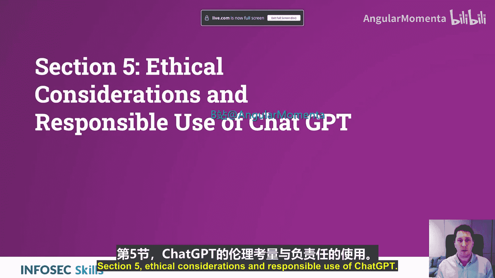
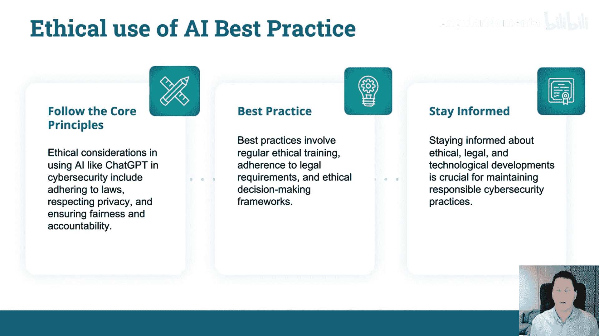

# 信息安全：ChatGPT用于攻击性安全：5：ChatGPT的局限性与伦理考量

在本节课中，我们将探讨在攻击性安全领域使用ChatGPT时面临的伦理考量和局限性。我们将了解如何负责任地使用人工智能，确保其力量被用于保护而非伤害，并遵守相关的法律与道德准则。

上一节我们介绍了ChatGPT在网络安全中的应用，本节中我们来看看其使用过程中必须注意的伦理边界。

## 人工智能使用的伦理标准

在网络安全领域使用人工智能，如ChatGPT，可以增强威胁识别、分析和应对措施。但这需要伦理监督。伦理准则确保人工智能的力量被用于保护，而非伤害，同时维护用户信任并遵守法律。

网络安全中创新与伦理的平衡，涉及尊重用户隐私、数据完整性以及获取同意。

## 伦理框架与核心原则

在道德黑客和网络安全实践中，核心的伦理原则包括：**不造成伤害、公平、隐私和知情同意**。

*   **道德黑客的目标**：旨在改善安全性，而非利用漏洞进行恶意目的。
*   **负责任的人工智能使用**：涉及应用这些原则，以防止不道德的数据操纵和隐私侵犯。这要求将道德黑客和网络安全实践的原则，应用于攻击性安全中ChatGPT的使用。

## 隐私问题与概述

像ChatGPT这样的工具，如果没有严格的数据保护措施，可能会对数据隐私构成风险。

*   **注意事项**：请谨慎对待你输入模型、用于查询或寻求代码帮助的数据。确保你已制定有效的政策与程序指南。
*   **关键隐私保护措施**：包括数据匿名化和严格的访问控制。这不仅针对AI，通用隐私法律如**GDPR（通用数据保护条例）** 和**CCPA（加州消费者隐私法案）** 也要求严格的数据安全和用户同意实践。

## 偏见与歧视

这一点更具体地针对ChatGPT。包括ChatGPT在内的人工智能系统，可能会从其训练数据中继承偏见，从而影响网络安全决策。

*   **警惕偏见**：如果你的模型被编程植入了偏见，或者你全盘使用了带有偏见的数据，你得到的结果可能就是有偏见的。使用这些数据会使你成为偏见链条的一部分。
*   **缓解偏见的努力**：包括使用多样化的数据集和定期进行偏见审计。在人工智能驱动的网络安全实践中确保公平性，需要持续的评估和调整。

## 问责制与透明度

*   **问责制**：网络安全中人工智能驱动的决策必须是可追溯和可解释的，以确保问责。
*   **透明度**：关于人工智能在安全实践中的使用透明度，有助于建立信任并符合伦理和法律要求。文档记录和审查流程对于人工智能辅助的网络安全行动中的问责制至关重要。这不仅体现在你如何构建模型，也体现在你如何使用它们。

## 法律考量

以下是需要了解的关键法律：

*   **GDPR（通用数据保护条例）**：用于数据保护。
*   **《计算机欺诈和滥用法案》**
*   **《网络安全信息共享法案》**

这些法律规范了道德黑客活动以及网络安全工具的使用。

## ChatGPT在攻击性安全中的负责任使用

以下是负责任使用的指导原则：

*   **仅针对授权目标**进行测试。
*   **对发现的结果保持机密性**。
*   **报告漏洞以便修复**。

**核心原则**：ChatGPT可以被合乎道德地使用，但务必**始终获得授权和同意**。伦理考量要求避免使用恶意软件，并尊重隐私规范。

## 人工智能伦理使用的最佳实践

在网络安全中使用ChatGPT的伦理考量包括：遵守法律、尊重隐私、确保公平和问责。

最佳实践包括：

*   进行定期的伦理培训。
*   遵守法律要求。
*   采用伦理决策框架。
*   **保持信息更新**，了解最新的发展动态。

---

本节课中，我们一起学习了在攻击性安全领域使用ChatGPT时需遵循的伦理准则、面临的隐私与偏见挑战，以及确保负责任使用的法律框架和最佳实践。牢记这些原则，是确保技术向善、安全加固而非破坏的关键。