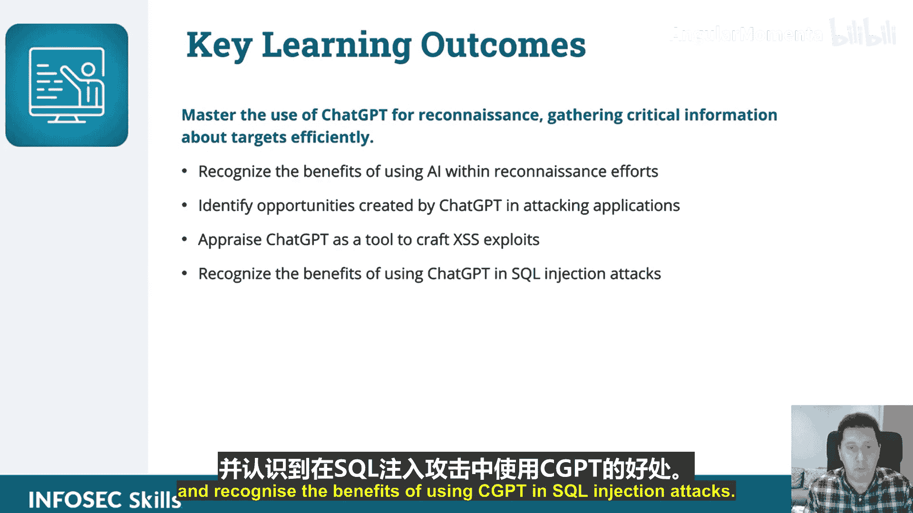

# 【Infosec】用于攻击性安全的ChatGPT ｜ ChatGPT for Offensive Security p06 02_01_01_offensive-application-security-using-chatgpt [BV1jPrHBsEv1_p6]

Hello， welcome to this course。 Adv of application security using chat G P， T。

This section1 course overview。

As a course In， this course provides an in depth exploration of offensive cybersecurity techniques using chat GBT。

 which are referred to as CGPT throughout this course。

This course focuses on offensive application security using CGPT。

This course covers practical applications of CGPT on reiscence and exploitation of web application vulnerabilities。

 and is designed for cyberseity professionals aiming to enhance their offensive application security skills through the use of CGPT。

Key learning outcomes from this course， you will master the use of CGPT for reconnaissance at gathering critical information about targets efficiently。

You will recognise the benefits of using II within Reconnaissance efforts。

 identify opportunities created by CGPT in attacking applications。

Appraise CGPT as a tool to craft XS exploits cross site scripting and recognise the benefits of using CGPT in SQL injection attacks。

Okay， so let's get started。

