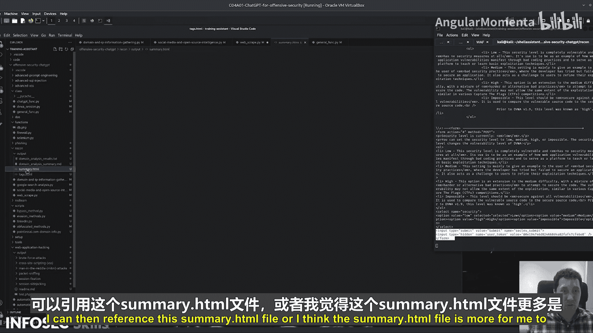

# 【Infosec】用于攻击性安全的ChatGPT ｜ ChatGPT for Offensive Security p09 02_01_04_webscrape [BV1jPrHBsEv1_p9]

This final recon script I want to show you is called Webcrpe。And it does。

 it does what it says it scrapes， it scrapes websites and then organizes the organizes the。

The returned H L by the tags that are provided。So define Jerry tag names so these are the tag names that we want to return。

 we can definitely cut this down a bit so when I call the when I get the HTML tag is going to return everything in inner or HTML and that so that's too big the head tags should be sufficient to bring in the head information title Me。

 they're going to be within within the head tag。And then everything that we want from the body。

 all of these tags can be relevant， I think。Allright， calling this， calling this function。

 generate payload andm passing in。A D Vol web application session。嗯。I'm requesting this page here。

 security。phP， I'm logged in and I'm requesting a security。php page。

 let's just take a quick look at that。P page。Is this one， Maybe that's PhP info。嗯。Oh。

 stepping in directly。Security of PhP。okay， DvW security， Yes。

 so's this page that it's pulling in so it's going to get the get the HTML and then saw these I sorry on it。

I've got additional function here course I don't think I've ever ever really progressed on this but so how am I going to use chat ET within this within this script so for every for every tag。

That we get from this H。 I want to do some analysis on it。 So working on the。

So working with the following code， site do text， output， all the tags， all the tag HTML。

 so only for the specific tags that' doing it for head H1 H2H3， so include all inner names。

 IDs and classes include or in a text though we are processing this HTML file using judgeGptT。

And then I'm saving the information to this file。😔，Output summary。Oh， I might be。醉了1试，再把了那身。😔。

I've got a feeling I changed that it's too right and this should be a pen。😔。

So if you don't want to write it too far， we won to append it too far。This is the。T。

 this is clear this。嗯。Maybe we can tell this Helper。可。あ wasです。T us。Output。

Ts it's just going to print the the tag output here so you can see the first thing it's bringing in is the header information。

And tennisnis。E then the script is the looping through。

All of these different tags and it's going to print out the the information that it's obtained about them so H1 H2 H3 and we can select what information is being returned here so the the way chat chat ET is being used here is there's。

sortting this information rather than using something like beautiful soup， which is very rigid。

 we're instead using Chat EBT to process its data dynamically。对。And then afterwards。

 analyzingly the content， so working with the following HTML code your task is to summarize this information in natural language。

 let's have a look at the summary file。So for each， for each area。

 HRGPT has then summarizemard the information that this。Aair that this returns。

Which is going to be useful in your later reconnaissance efforts。我扑菜。😔，All right。

 so we're almost done with the script， it's it' got to print out he， her script and form in HTML。😔。

Yeah。As what we've done here is pulled the HTML， we're processing the tanks for each tag using chat UT to process that data and print it out to a file and then using chat UT to summarizemar the information for the purpose of reconnaissance。

Yeah。So we can now look in the summary file。😔，And see that's all nicely laid out here。

 All you can do is a further step。 you can then take this summary file and sumise the summary。

To provide you with an even more succinct DelPA， but this is wealth of information about the target。

And in real world you would you maybe would crawl a number of pages to add to gather this information and em all together。

 It was going to provide you with very actionable insights。

 the most important thing for me would be this this form information as so getting these form fields。

 I can then reference this summary to HTML Tl file or。

I think the summary HTML file is more for me to reference so yeah that's very useful information for me to reference the tags file is going to be useful information for the code to reference so I can say so I can say okay。

Process this file。嗯。That's failed to attend but just I can process this file and I can find the air。

I can find the。Are they filled names。And you see in my uses see in my air further recall。

