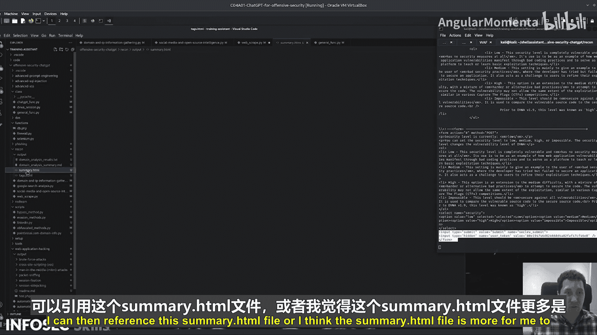

# 信息安全：ChatGPT用于攻击性安全 p09 02_01_04_网页抓取


## 概述
在本节课中，我们将学习一个名为“Webscrape”的最终侦察脚本。该脚本的功能如其名所示：抓取网站，并根据我们提供的HTML标签来组织返回的内容。我们将看到如何利用ChatGPT动态处理抓取到的数据，而不是依赖像Beautiful Soup这样较为固定的解析库，从而为后续的侦察工作生成结构化的、可操作的信息。

## 脚本功能与标签定义
上一节我们介绍了脚本的基本概念。本节中，我们来看看脚本的具体工作方式。首先，脚本需要定义我们想要从网页中提取的HTML标签名称。初始列表可能包含过多标签，我们可以对其进行精简。

例如，获取整个`<html>`标签的`innerHTML`内容会过于庞大。通常，获取`<head>`标签的信息（如页面标题、元数据）就足够了。对于`<body>`部分，我们可以选择性地提取相关标签，如`<h1>`, `<h2>`, `<h3>`, `<form>`等。

以下是脚本中定义的关键标签示例：
```python
target_tags = [‘head‘, ‘h1‘, ‘h2‘, ‘h3‘, ‘form‘]
```

## 调用脚本与数据抓取
定义好标签后，我们调用脚本函数，并向其传递目标Web应用程序的会话信息。例如，我们请求一个名为 `security.php` 的页面。这个页面可能是目标应用中的一个安全相关功能页。

脚本会获取该页面的完整HTML代码，然后根据我们定义的标签列表进行筛选和提取。

## 利用ChatGPT处理数据
获取到原始HTML标签内容后，我们并不直接使用传统解析库进行硬编码分析。相反，我们引入ChatGPT来动态处理这些数据。

其核心思路是：**对于每一个抓取到的标签内容，我们都将其发送给ChatGPT进行分析和总结。**

具体流程如下：
1.  脚本遍历每一个目标标签（如head, h1, h2等）。
2.  对于每个标签，提取其`innerHTML`、`id`、`class`等属性以及文本内容。
3.  将这些信息构造为提示词，发送给ChatGPT。提示词模板可能类似于：
    > “你正在处理以下HTML代码片段。你的任务是以自然语言总结其中的信息，重点关注可能对安全侦察有用的内容，如表单字段、链接、脚本或关键文本。”

4.  ChatGPT返回对该标签内容的总结性描述。
5.  脚本将所有标签的总结输出到一个文件中（例如 `summary.txt`）。

这种方法比传统解析更灵活，因为ChatGPT能够理解上下文，并以更接近人类分析师的方式提取和表述信息。

## 输出结果与应用
处理完成后，我们可以查看生成的总结文件。该文件将目标页面的结构信息以清晰、可读的自然语言形式呈现出来。

例如，对于`<form>`标签的总结，可能会明确指出表单包含的输入字段名称（如 `username`, `password`）、提交方法（POST/GET）和动作目标（action URL），这些是渗透测试中构造请求的关键信息。

在实战中，你可以将此脚本用于爬取目标网站的多个页面，并将所有总结汇总，从而获得关于目标应用结构和潜在攻击面的全面视图。

生成的总结文件本身已经很有用。你还可以进行进一步处理：**将这个总结文件再次输入给ChatGPT，要求它生成一个更精炼、更高层次的报告摘要。**



## 总结
本节课中，我们一起学习了“Webscrape”侦察脚本。我们了解了它如何通过定义目标HTML标签来抓取网页内容。最重要的是，我们掌握了如何利用ChatGPT动态处理抓取到的原始HTML数据，将其转化为易于理解和分析的自然语言总结。这种将AI融入侦察流程的方法，能够为我们提供更深入、更灵活的目标情报，为后续的安全评估工作奠定坚实的基础。