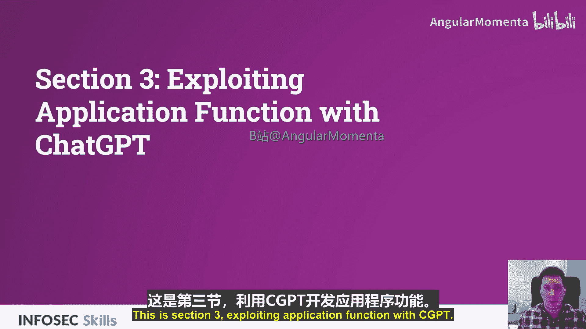
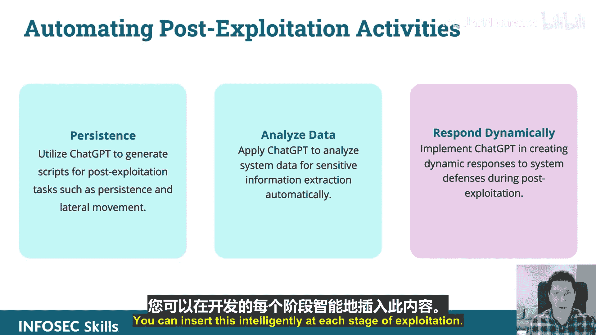
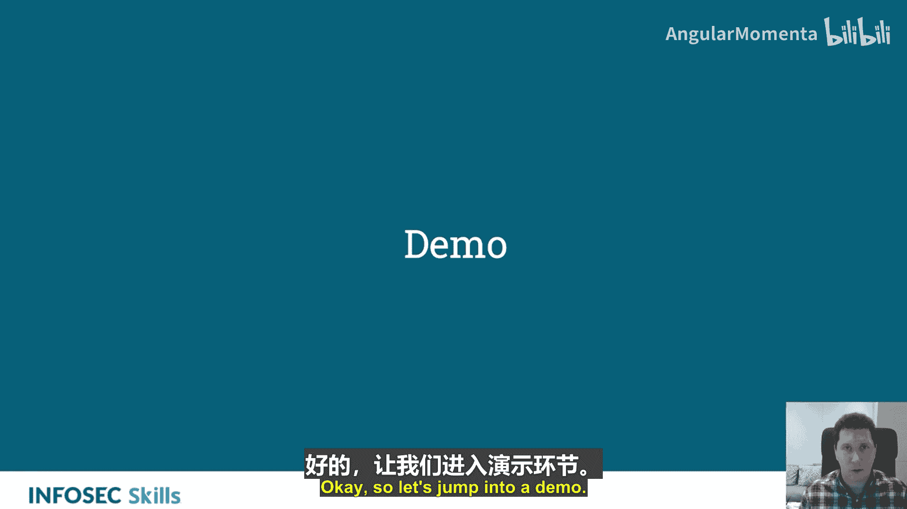

# 【Infosec】用于攻击性安全的ChatGPT ｜ ChatGPT for Offensive Security p10 02_01_05_exploiting-application-function-with-chatgpt [BV1jPrHBsEv1_p10]

Openive application security using CGPT。This is section 3。

 exploititing application function with CGPT。

Here as an overview， application function， exploitation。

 going to understand the role of CGPT in identifying and exploiting application function for offensive security。

Going to apply CGPT to analyze documentation， vulnerabilities and potential misuse cases。

 and going to use CGPT to generate payloads that exploit specific application function。All right。

 we're going go cover。 we're going to go go in some demos。

 but just want to cover a little bit of theory first。 fuzzing， fuzzing with CGPT as。

If you've done fuzzing before， you'll know that's a very effective way to identify vulnerabilities within web application。

 particularly SQO injection vulnerabilities。But how can you use CGPT in this process and you can integrate it into the process to generate Fuzz vectors now you have existing Fuzz libraries this so where does this fail？

Well， developing contextually aware funds factorss， instead of justing a whole bunch at。

 you can use CGPT to create intelligent funds vectors based on your recon。

You can use CGPT to analyze fuzzing results and identify successful exploitation attempts。

 inserting that into your scripts to dynamically interpret those results。

 or end when you get your result back， then using it to using CGPT to summarizemar it。

Applying CGPT to automate categorization and prioritize the vulnerability discovered through fuzzing。

 you can create CGPT powered scripts that organize these results based on priority。

And you can also develop a CGPT assisted approach to enhancing traditional fu tools with AI capabilities it's unlikely that you will use CGPT exclusively you will more likely use a traditional fuing tool and it integrate CGPT with them。

Bypassing security controls， so you can use LCCGPT to identify and strategize the bypassing of security controls such as WF and rate limiting。

 an area that I've found where it's particularly effective is in analyzingly air content security policies and producing air producing scripts or payloads that can bypass them。

You can apply it to generatingload payloads that bypass these protections and also also develop evasion techniques。

And to to bypass traditional firewalls， for example。

 you if you send a payload to a web application and it's blocked by a firewall。

 can you can perform a whole number of actions you can see GPptT to convert that into different formats to obsator and to deliver it in multiple different formats not just。

Going， not just saying， okay， this has been blocked。 Let's try a different one。

 by actually creating a script， a very simple script， which which can prompt okay if if you。

 if the result。If the result is not what you expected。

 then convert it into another format and try again in a loop and you can see the power of that。Okay。

 yeah。Session， hijacking and token manipulation。How can CGPT be used to enhance this develop strategies using CGPT to identify so strategizing you can say okay based on my recon what is the best strategy to do this。

 you can generate scripts which can also be generated dynamically。

 generate a script to hijack this session token， doesn't work， try a different one， doesn't work。

 try a different one， keep going， and then eventually you'll come up with a script which will provide you with with an effective result。

Applying applying its analytical capabilities to predict the impact of session attacks。

Maybe next stage saying， okay， so' got now I've got this this session token。

 what's the next stage let's implement this？By exploiting file upload vulnerabilities I using CGPT to identify common file upload vulnerabilities。

 generate exploit strategies I would。Analyze the HTML code of the form。

I would then pass the N toCGPT。Generate a payload。And then analyze that data to exploit it。

Automating post exploitation activities of persistence。

Developing persistent scripts developing analytic data scripts and responding dynamically。

 you can insert this intelligently at each stage of exploitation。

Okay， let's jump into a demo。

