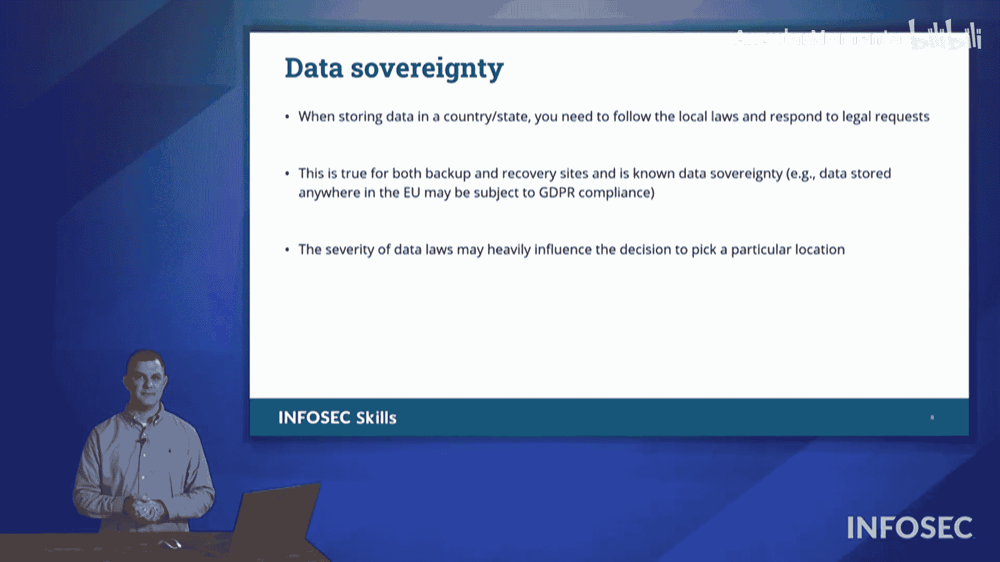

# 【Infosec】CompTIA安全 701认证 ｜ CompTIA Security+ 701 p02 01_01_02_vocabulary -BV1LRr5BTEow_p2-

As we get through the content on the security Plus。

 there are a number of terms that we're going to see and these terms come up time and again as we go through the content。

 keep an eye out for where these appear later in the course。

So the first thing we're going to talk about is the C triad often you'll see it stacked like a triangle where you have confidentiality integrity and availability these topics come up time and again throughout cybersecurity in fact we're going to see this when we dive into looking at how do we calculate the impact of a particular vulnerability。

So in the CIA Triad， we have confidentiality。This is basically just keeping secret things secret。

 you don't want some third party having access to the content and so you encrypt it or you keep that secret we use encryption to protect confidentiality and we're going to see this more later on。

We also have integrity integrity is making sure that the data does not change whether or not you wanted it to be changed。

You're protecting it from unauthorized changes or accidental changes。

 you're on the lookout for if that information has changed， that is protecting the integrity of data。

And then the third part of the CIA triad is availability。

 availability on the CIA Triad is all about making sure that the data is there when you need it or the service is available when you need it。

 the information and the service is available to you whenever you're ready for it。

This is the CIA Triad， and it largely undermines a lot of what we do in cybersecurity。In fact。

 whenever you go to the news and you read about some new cyber attack that comes out。

 check out and see that theres been a failure of at least one of these three topics。

 sometimes it's two could be all three， but keep a lookout for it every cybersecurity incident。

Is a failure of at least one side of the CIA triad。

The next topic we're looking at is AA A and this one I like the Joe ground say that the eye in AAA is silent。

Whenever we look at。AAA you've got I for identification that's where you state your identity I'm saying this is who I am to the computer you're nothing more than a username or you could be a user number or something along those lines。

 but that is your identity。Then getting into the AAA。

 we have authentication authentication is where you prove your identity and we're going to talk more about proving your identity through multifactor authentication。

 but generally traditionally historically we've done authentication through the use of passwords。

 pin numbers， etc。Once you've been authenticated， you've proven your identity。

 then you get into doing authorization authorization is gaining access to those things that you would normally have access to。

 so this could be the files and folders that you've got access to or whatever computer you're logging into that is the role of authentication。

The third A in AA is accounting accounting is making sure that。

Those users that need accounts have accounts， but were also tracking who did what and when or who attempted to authenticate on a system this is all done through accounting and essentially it's just logging the activity on this system This is the third A and AAA AA is also a very important aspect of cybersecurity。

Our next topic is looking at the three states of data。Data can exist in our network。

 on our computers， within our organization， in one of three states。Data and transit。

Data at rest and data in use。Data and transit， that's pretty easy to wrap your head around that's going through a network or through some distance。

 that's data in transit。Data at rest， this is where we store our information。

 how do we keep our data safe when it's being stored if it's on the computer or on a file server somewhere。

How do we keep that information safe and secure？We generally encrypt that。

The third one that we see on here is data in use for a long time I struggled with how do I keep data in use safe。

 what does it mean to have data in use？And my go to example for this is。

Formula E racing not too long ago， had somewhat of a scandal where one of the race cars in formula E racing was found to be sniffing the network traffic of the other cars that were by it。

reading the information coming off of the tires specifically。

 where the rubber me Roaded and racing and the information was coming off of the other cars。

 the competition's cars， that information was being hoovered up by the team that was found to have this issue。

 and then they were then collecting that information so they knew the tactics and strategy of the other teams。

They were fine by Formula E for unssman like competition， but in data and use。

It's kind of on the other teams too， you look you're generating all this information coming off of your car。

 you should be protecting that too， so even if that data is being as that data is being generated。

 make sure you're encrypting that information as well。

 keep your data safe and all three states of data。Our next term that we're going to see come up in a number of different topics here is non repudiation this is a term that a long time for a long time I was like。

You never hear this term outside of computing。I was listening to the radio one day and in the news they were talking about some diplomats and they were using the word nonreudiation。

 I almost had to pull the car over in tears so I was like finally I hear nonreudiation being used in a context other than in cybersecurity。

Non repudiation is。Someone sending information to another person and the recipient knowing the source of that original information。

 I know it came from this person， I know it came from this host or this computer。

I know this information came from them and that other group cannot deny having ever sented it。

Think about if you were to send a contract over a computer。Someone might receive that contract。

Act on that contract thinking I'm going to get paid for this work and then when they come back to get paid for the work they' performed the sender going I didn't send that。

 that wasn't from me。Well， no， I have the contract here， yeah， that wasn't from me。

Nonreudiation would have protected that activity， that nonreudiation would have been like。

 okay what it says it came from you and I know it came from you， you were the one that signed this。

 I know this is from you。That recipient has non repudiation on that data。

 that data cannot deny having been sent。And then the next term we're going to be looking at is gap analysis。

We'll see this one where we start looking at different vulnerabilities and how organizations protect themselves。

With gap analysis we're looking at what are we doing and what should we be doing and looking at where do the gaps exist as I'm collecting information about our organization we're looking at and performing gap analysis。

 do we have any gaps in our security posture， are there things we can be doing that we're not doing that's performing a gap analysis？

And then one of the other things that I want to talk about as we get started with this content is the difference between vulnerabilities。

 threats and risks。With vulnerabilities， threats and risks sometimes。

In casual conversation people will use these terms interchangeably， but with vulnerabilities。

 threats and risks there's actually a distinction to be made between them so a vulnerability at its essence is just a weakness in either a system or some process that an organization has there's a weakness at some inherent point that could cause a problem。

Think about how your computer， for example， needs electricity to operate well。

 that's a vulnerability there are problems that could happen if you did not have electricity with your computer。

The next topic is a threat what is a threat well a threat is some vulnerability that could be acted upon by either a threat actor or through natural causes。

 so it can be either natural or manmade this is the concept of a threat it's an actualized vulnerability or some vulnerability that could come to pass through the actions of either mother nature or some threat actor。

And then thirdly， we have risks and a risk is basically a threat。

That is measured with either the impact or I should say measured impact and the probability of that risk coming to pass。

So how would this particular threat impact us？How likely is it that it's going to happen to us whenever you start to measure that that's whenever you have risk。

 so even though in conversation we might use these terms interchangeably。

 they do carry particular meanings specific meanings with them。

Data sovereignty is our last topic on here and data sovereignty is one of these terms that。

It really encapsulates how a lot of organizations will structure their security apparatus。

What are we required to do and how do we focus on protecting that information？

Whenever we're talking about the data of users， those users have data sovereignty。

 it doesn't matter where that data gets collected from。

The rights of the individual about whom that data refers is protected generally we're going to see this under GDPR the general data protection regulation out of the European Union。

 but data sovereignty says，Look， even if you're collecting information about European Union citizens and you're in a non EU country。

Our laws still protect that data， that data is sovereign to that citizen and belongs under the jurisdiction of their host parent country。

 so data sovereignty is about protecting information doesn't matter where that data exists。

 the rights of that data user or about the data subject still applies。

So these are just a collection of different terms that we will see used throughout the rest of the course。

 these are our cybersecurity vocabulary topics to be aware of。

