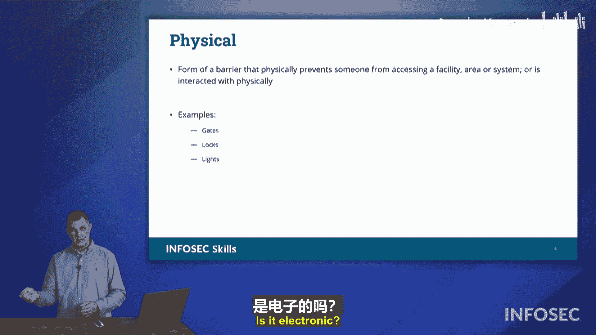

# 【Infosec】CompTIA安全 701认证 ｜ CompTIA Security+ 701 p03 01_01_03_security-controls-categories -BV1LRr5BTEow_p3-

In this section， we're going to look at security control categories。And then types。

In these categories， we've got a number of different ways that we can secure an organization against various vulnerabilities。

I want to point out on the exam you will not be asked to distinguish between is this a category or a type you're not going to have to figure that out it is helpful to know and be familiar with these terms that you see listed under categories and then later under types but you're not going to have to rattle off this list so don't worry about committing these to memories so much as being able to recognize it's more important that you understand the concept behind these rather than。

You know， run through some rote memorized list of these topics。

I will highlight though I have put up here that we have a departure from the objectives the objectives has a listing of the categories in a different order I've put them into this order so that you have technical operational managerial and physical an easy way to remember this if you really want to memorize them is it's kind of like the security of these as stoptomp security is technical operational managerial and physical so it's a little thing that it might help you memorize those but again you don't have to memorize these on the exam nor do you have to distinguish between categories and types。

So let's dive into categories first， the first one we're looking at here is technical。

So we have in society。People talk about technology， oh that's a technical question。

 that's a technical topic， I work in technology， do you work in technology？

It would not make sense if someone said you know you go to a dinner party and you're like what so what do you do Oh I work for you know papermate pens Oh what do you do at papermate I work in technology Oh cool what kind of service do you use Oh I don't know I don't do any of that I actually work on the ballpoint pen design。

You'd be like that's kind of weird like yes， a pin is technology。

 but it's not technology in our as our normal context， most people when they talk about technology。

 they they mean or the implied is。Something electronic。

Typically something that is in an information system， some sort of computer。

And so I want you to just take that understanding that kind of euphemism of technology means electronic and just think of it whenever you're looking at these forms of categories。

 so a technical control is going to be any of those types of computing systems that provide security and so some examples we're going to talk about through the rest of our content is the intrusion detection system antivirus firewalls。

 any of these kind of computing systems and how they protect the overall organization。

 these are different forms of technical controls。The next form of control that we have is the operational control。

The operational control。This one is how we operate as an organization structurally。

How do we operate and so most often you're going to see this referred to in the exam as the people。

That that make up our security operation， so the individual roles that we've got。

 the chief information security officer， the facility security officer。

The data processor or the data custodian， these are different operational controls based on the role that these individuals are at the organization。

The next one to look at is managerial。Manaageial and the way to know about managerial。

 this is the kinds of controls that we come up with in how we operate， how our managers。

Oversee security at our organization。Now， a managerial security control is going to be in the form of。

 and this is the way to remember it for the exam。A manager decided to do this。

There's no technological reason why we have to do it。There's no。You know。

 physical reason we have to do it this way。If you have a security badge， for example。

 and you have to recertify that every 12 months。It's not that your security badge goes moldy and was going to fall apart or it doesn't require us to do that this technology will be fine for us to use this for 10 years at a time。

But a manager has decided， you know what， I think after 12 months。

 I'm going to have my people recertify their badges， just in case someone's made a copy of it。

 someone's lost theirs， we don't want that badge being used by an unauthorized user。

And so a manager decides every 12 months we're going to do this。

 or every three months you're going to change a password or every six months or nine months or 12 months。

Someone decides how often to do that this is a manager yourial control and the way to identify this is。

Primarily around the word choice， someone decides a manager。Decides to do something。

Perhaps the easiest of all of them to identify is the physical security control this is going to be something physical。

 the thing that actually stops you from going through and doing the thing， a security gate。

 a locked door。Lights that light up so that you can see what is going on。

 these are all forms of physical security controls that we will see throughout the course。

 physical security control is probably easiest ones to identify because it's a physical asset。

Let me also highlight here a question that we often get is。With a physical security control。

 what about like a badge reader that keeps the door locked？Is it electronic， well。

 okay so it's a technical control， but it's keep that door locked so it's a physical security control。

 which is it？

Take comfort in knowing this the security plus exam is not going to have you split hairs over topics like this。

 they're not going to say is this a category or a type is this physical or is it technical and then they give you something that can be argued to be either one Instead it's it's going to be something's like a slam dunk is's going to be like a security gate you be like okay that's a physical security control these are some of the things to be looking for on the exam they're not going to have you split hairs physical security controls are going to be pretty much a slam dunk if they give you that sort of a question on the exam So these are some security control categories and now we're going to dive into security types。

