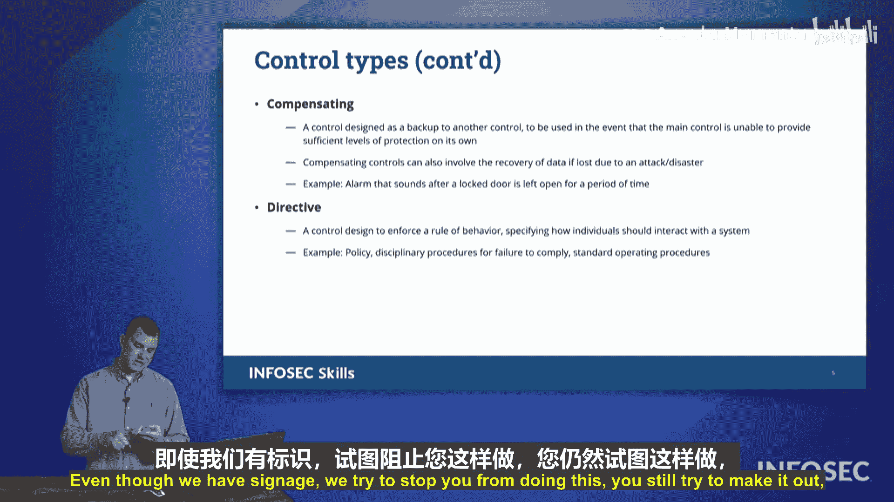

# 【Infosec】CompTIA安全 701认证 ｜ CompTIA Security+ 701 p04 01_01_04_security-controls-types -BV1LRr5BTEow_p4-

Now let's dive into some security control types to protect our organization from various vulnerabilities。

In this section， we will be going over deterrent， preventative， detectiveive， corrective。

 compensating and directive。And I know I'm saying directive a little funny。

 but that is in order to distinguish it from the other security control types。

So the first security control type to talk about is the deterrent this is as form of security control that we have that would make。

An evil doer， a baty somebody from doing something that we don't want them to do。

 I want you to think twice before carrying out this action I'm going to deter you I'm going to make you think twice so this can be something in the form of signage or a banner。

 you know no parking here。Well， there's a sign that says no parking。

But it's not going to stop you it's just going to tell you I don't want you doing this action。

 you could still of course park there， sorry for the consequences， but you can still park there。

 it's just a sign， it's just something telling you this is the desired behavior and this is what I want you to do or not do that's a deterrent from doing something I don't want you to do。

If I actually have a control that is physically stopping you from doing something。

 that's going to be a preventative control preventative controls。

Are what bar you from actually carrying out that action？Even if I haven't warned you about it。

 I don't want you doing this thing。You lock your house when you leave each day， right？

You may not have a sign that says no trespassing。It's implied。

 I don't want you coming into my house and to prevent you from entering my house when I'm not there。

 I lock the door。You can also see preventative controls in a number of different ways。

 we've got preventative controls in the form of fencing and we've got preventative controls in the form of logins on our computers。

 I don't want just anyone getting on the computer， I'm going to set up preventative controls。

 you must have a login in order to get into this system that is a preventative control。

Next is we have detective controls， these are the controls that allow us to go back。

 see what has transpired plate detective。And see who did what， when did they do it？

And how did they do it the detective controls allows us to detect if something has gone wrong I really want you to think about this in the terms of it allows you to play detective that's going to really help you in any sort of scenario you might see on the security plus exam。

Next is the corrective control。Look I told you I didn't want to do the thing。

 I tried to stop you from doing the thing， you did it anyways。

 and now how do I correct direct for that， how do I put things back the way they were that is a corrective control most often in a computer or cyber context we see this in the form of backups it allows us to correct the damage that has been done。

An attacker was able to slip some ransomware onto our network and encrypted all of our data。

 we didn't really want that to occur， and so we use a corrective control to restore that information and put it back in its original state。

The next group that we have here is compensating controls and with a compensating control。

 we realize that or recognize that there are shortcomings to some of our other security control that we've got so let's say I don't want people logging into my system that comes with a certain level of risk。

And so I utilize usernames， passwords， and I try to stop that from occurring。

But you know what right there in that little section， in that little gap。

There's the risk that my users， even though I allow them to put in。

 choose whatever password you want。People are still going to come up with some really weak passwords。

 some really lame passwords。Those passwords can be guessed or stolen。

 there's a lot of different ways an attacker can get that password so we have this little gap of coverage in the terms of level of risk that we have and the amount of control that we provide。

How do we span that gap？Well， in the case of。Unauthorized access and then using a login that extra level of control can come in the form of multifactor authentication that compensates for that weakness where our users might use a weak password or they may have their passwords stolen by an attacker multifactor authentication says okay great you stole one of our users' passwords good for you。

But now you have to get these other forms of authentication in order to steal their login credentials。

 that is a form of compensating controls it compensates for the weakness of a given control type。

The last one we see here is a directive control and a directive control says this is why you should follow our policies。

 so I want you to do this and I'm going to require all of our users here at our organization to follow these guidelines or to do this thing。

 not do this other thing that is all done as a way to direct the behaviors of our people。

Let me throw it back， I'm going to reverse back through our slide deck here。

 and I want you to look at these in another light。When you go to a retail store。

 if I go to some of these big box retail stores， there are certain items that。Can be shoplifted。

And these retailers don't want shoppers walking out with their merchandise without paying for it。

And so they will have signs up and it'll will alert that you know you're being watched。

 we've got cameras watching you and there's going to be you no shoplifting is kind of the implied there are deterrets like we've got employees that walk around the store。

 they deter people from shoplifting， we also have preventative controls。

Some of the smaller high ticket items， I know like some certain earbuds that are high dollar。

 they may be put on a security rack that it cannot be removed。

 that product cannot be removed from that that's a preventative control。

 it physically stops you from stealing that thing or it's inside of a security cage。

The detective controls all around the store， we have security cameras watching。

 observing what's going on。Correcttive controls if you we don't want you shoplifting。

 we tell you so we put it on a secure we put it inside a secure cage and yet you still take it and as you're going to the front checkout you're trying to run out the door we might have a security security guard there or a loss prevention officer that might try to stop you from exiting the building and they're going to get that merchandise and try and put it back on the shelf that's a form of corrective control。

And then the directive control tells our employees we're going train our employees on how to stop shoplifting compensating controls。

 even though we have signage， we try to stop you from doing this。

 you still try to make it out we still have ways of monitoring what sort of activities you've got and compensating for the weaknesses so stores have these like entry gates when when you first go into the store that entry gates only open one way that stops people from grabbing stuff and just casually walking back out the entrance with whatever merchandise that it tries to compensate for that weakness and force you to go through one of our cashiers which might say hey can I help you can I help you with whatever purchases you've got I see you have merchand in your hand and you haven't paid or checking receipts on the way out that also ensures that people are not shoplifting so these are forms of security controls we see somewhat in daily life and yet they're also appear here on the security plus exam in a cyber context so a number of different security controls that we've got and we will continue on with the rest of our content。

