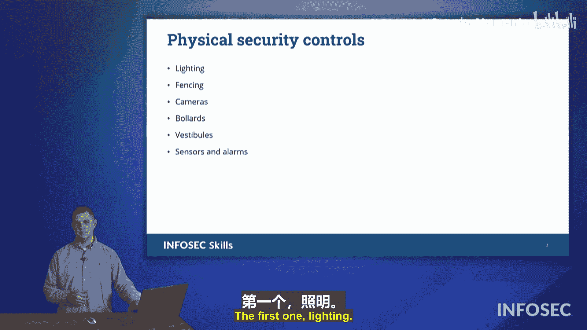

# 【Infosec】CompTIA安全 701认证 ｜ CompTIA Security+ 701 p05 01_01_05_physical-security-controls -BV1LRr5BTEow_p5-

Physical security is an important topic when protecting organizations。

 there are a number of different ways to keep an organization safe。

If we're not protecting the physical side of things。

 that is to say if attackers have access to our systems directly。

 that's definitely going to be a problem， so we're going to look through a few different security controls that we can help protect an organization physically。

This is the list of topics put forth on the Comptia security plus objectives。

 and so we're going to be running through lighting fencing。Cameras， ballllards。

Vestibles and sensors and alarms。The first one。

Lighting a lot of people don't think about lighting is a physical security troll。

 it is because a lot of bad actors don't want their deeds being seen or viewed by anyone， you know。

 a lot of crime happens in the shadows。And so lighting can help keep a place safe。

Think about it if you had the choice to go down a dark alley or a lit alley， which would you choose？

Lighting provides safety and security we kind of inherently know this。

 so lighting is a form of physical security。It also allows us to see what's going on through the use of cameras。

 security guards can see what's going on， etcter。Another form of physical security controls that we see is fencing。

Fncing comes in a lot of shapes and sizes。Here on the left we've got access to we've got an image of a Hesco barrier these are rapidly deployed barriers made of earthwork they go up pretty quickly a lot of people say they're made of chicken wire and it's more like kind of a cattle pin it's very thick heavy gauge wire。

And then it has like a waxy cardboard insert in there， and with an earth mover。

 you can fill up one or two of these things pretty quickly。

I think around the world the US military has erected a bunch of these around the world。

 I don't know how often we remove them， they're usually really really quick what's interesting about the Hascoberry though they're cheap。

 they are effective， they are effective at stopping small arms fire and they can rapidly surround a defensive position providing a defensive perimeter for our military forces。

Hesco barriers are one type of fencing。In the center， we've got the fencing around Buckingham Palace。

So。The Royal Crown， the British Crown， realizes that people are going to come from around the world。

To London to see Buckingham Palace， they recognize that this is going to be in a lot of pictures and so their fence。

 it's going to be a little more aesthetically pleasing right than just a bunch of Hesco barriers around。

This fence is effective， it stops intruders from crossing over a perimeter and then they also recognize as like this going mean people's pictures。

 let's make a little bit more， you know， a little bit more pizz to it and so they have these the Florida Lee and the royal sceptre finished with some gold leaf surrounding the top of their fence。

Gives it a nice look， it's very functional， it prevents intrusion， but also looks nice。

But this is still a functional security fence。The third option we have here is the little white picket fence is is this going to stop any intruder if they really want it。

 no， you'll you'll just kind of just step over the fence if that's something'll it might stop like a teacup Chihuahua or something。

 but it's not going to stop in a determined adversary。But it is still effective in communicating。

 This is mine， and that is yours or your' I do not want you crossing this threshold fencing can be a projection of。

This is mine， I don't want you crossing here， no trespassing， and it can also be a physical barrier。

 like in the matter of the Hesco barrier， you cannot come in this way， you cannot cross here。

 you're physically barred from doing so。So three different types of fencing that we can see。

 they all define the peri of a facility。The next topic we have is cameras。

Cameras are useful for protecting organizations we can see what's going on in a lot of different areas all at once rather than having security guards constantly。

Patrorollling a perimeter， we can have cameras that can help。

Amplify the number of vantage points that we've got viewpoints that we have for our security forces。

So cameras can be both a form of a detective control， we can see what has occurred。

But they can also be mounted very overtly as you see here in the picture。They can be mailed very。

 very overtly so that would be criminals。Think twice about what they're going to do。

 it becomes a deterrent effect。I don't want you doing these things and look， if you decide to do it。

We've got you on camera， we can see what's going on。

 and so sometimes you'll see these cameras mounted very overtly。On corners of buildings， on posts。

They maybe could have been mounted a little bit more。Obscured， but。By having them visible。

 it helps have a deterrent effect as well。Cameras can also be done， can also be used。Very covertly。

So if you go into like any like Home Depot best buy， for example， when you go in there。

 if you look on the door frame， sometimes there's a little pinhole camera right on the door frame and what it does is it gives you a shot of the face of every customer coming in。

They're not doing that to spy and use so much as if you go in the place and run off with a bunch of merchandise or hold up the joint。

They're going to see what you look like coming in yeah they have security cameras all inside the building。

 but they're able to see at eye level when you came in， you might be wearing a ball cap。

 but if you're wearing that ball cap down they're still going to see you as you walk in the store so cameras can be a very effective form of detective control。

Another term that we have coming up and if you don't have a maritime background。

 you may not really recognize the name of this one bollards ballllards are those structures on piers and docks where you tie off a ship to that that term for that that kind of large。

Larger than a normal cleat， but what you have a ship to is called a ballllard that's where the name of this security control comes from the ballllard and it's these posts these metallic posts that you see in front of a lot of buildings What it does is it stops vehicular traffic while allowing。

Pedestrian traffic。And so pedestrians can freely walk in and between these posts。

 they also make really good leapfrog posts， but as you go into the store， you can walk in。

 walk right past a bollard， but if a vehicle was to try and drive into the front of that building。

 especially after it's closed perform a smash and grab， it cannot do that。

Maybe helping lock it in a little bit more is what you see outside of targets。

Different target stores have these big red balls。Ball。Ballard。

 it's going to help it stick if you think about these balls being balllls。

They are functionally a ballard， but they're usually spaced out nowadays。

 they're spaced out so far apart that they aren't really effective at stopping all vehicular traffic because you can still literally drive a Mac truck between them。

 but they are oftentimes used as decor outside of target stores and so any target that you go to generally you're going to see at least one or two of these big red ball。

Bllards。Another term that we see on the exam is a vestibule， access control vestibule。

This is a term that has been changed in recent Compia history， used to be referred to as a man trap。

What an access controlled vestibule does is it works by the outside door can open。

You go into the access control vestibule。The outside door is open， therefore the inside door。

Cannot open。So you have to wait until the outside door behind you closes before the inside door opens。

 only one of the doors can be open at a time。This allows you to enter the facility。

And then ensure that nobody is coming behind you， maybe only one person in the access control vestibule at a time inside the man trap。

 you are trapped in there。But what this does and the reason that a lot of organizations might use this is it prevents somebody from coming in behind you unbeknownst to you or prevents you from like holding the door open and allowing somebody else to come in。

These two forms of social engineering attacks are called piggybacking and tailgating。

Telgating is whenever somebody slips in behind you unbeknownt to you。

 you don't really know that they're doing that， you know， you badge in， you enter a key pad。

 something， the outside door opens。And as you're going in。

 somebody might run up and grab that door and slide in behind you。Well。

 you're not a willing participant in there， they caught the door。

 you just weren't paying attention that the door was open behind you。

Without an access control vestibule， they may slip in and they have now entered that facility under your authorized access。

But suppose they come running up and they're like holding like a stack of donuts and they've got like a jug of coffee under each arm and like。

 hold the door， hold the door。You being kind of the good Samaritan friendly person。

 you might hold that door open for them and allow them to come in， oh yeah。

 looks like you got your hands full， come on in。The problem is they are writing your coattails。

 they're writing your authorized access， yeah they've got their hands full。

 they must be taking a bunch of donuts， bagels or maybe they've got a stack of pizzas in their arm and they're going to some luncheon。

It doesn't really matter whats what they're carrying。

 but if they have their hands full and you hold the door open just because you're being nice。Again。

 they can be abusing your crvinentials when you hold the door for somebody that's said to be piggybacking。

I have a son and whenever we go to the zoo or we go shopping。

 he might get tired and he's like daddy I want on your back and so。

He's not big enough to just jump on my back and so I have to squat down， let him crawl on my back。

 I have to be a willing participant。For him to piggyback right， I have to be a willing participant。

 I have to hold the door from somebody to allow them access to give them access to piggyback them on my credentials。

Tgating。Where I used to live the gate outside the apartments that I was at。

 the gate would be closed usually and anytime we would come back from dinner in the evening or something without fail。

 there was a pizza of delivery driver waiting at the gate for one of us to come in buzz in the gate opens。

We drive through and along comes the PT delivery driver。

 they're going to tailgate me through that gate and so it's a way to know that I'm not giving them access。

They're just following me along and there was really nothing I could do to stop access from then coming through because the gate won't close right away。

But with these two ideas in mind tailgating and piggybacking。

 the excess control vestibule or the man trap prevents that from occurring you cannot hold the door open for somebody and they can also not catch the door if they couldnt catch the door and you're waiting youre like I can't go into the interior door。

Hey， bud， do you mind stepping off like you're you're really coming into Duke。

 you need to step outside so I can go to work。Then you can badge in oh don't have my badge。

 not my problem， you can't just tailgate me coming in here this is the access control vestibule you might also see it referred to in the industry as a man trap。

And then our last topic that we see listed on the objectives is sensors and alarms these are ways to detect activity。

 detect motion in different areas on the right here we have an infrared or a passive infrared motion motion alarm or motion sensor and what this does this detects the presence of a person in an area it uses infrared light and so that's a way to detect that we can also have you can also have lasers we're not really gonna to have like Hollywood style lasers shooting off every which way maybe that is I've never seen it but in this picture in the center we've got a bunch of lasers and this is a protecting the presence of somebody crossing one of those you know so-called laser trip wires whatever we can also have pressure sensors in the floor or we can have pressure sensors in a room detecting the presence of someone microwave or ultrasonic can also take measurements if you have a 10 foot corridor。

And you've got a a sensor that's on there that's measuring the distance across that hall。

 you would expect to see 10 feet normally if it drops suddenly to four or five feet then you know。

 hey， somebody's crossed over this and if the alarm has not been disabled it will trigger that alarm and you'll be alerted to the presence these of an individual in that corridor so sensors and alarms are another form of physical security control we can use in our facilities。

These are a list of different physical security controls to be on the lookout for on the exam。

