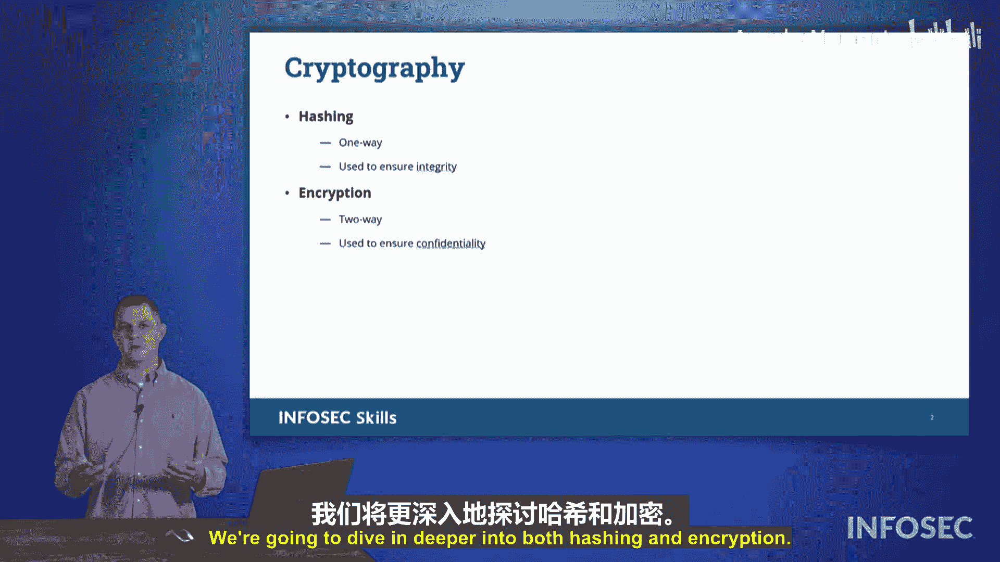

# 【Infosec】CompTIA安全 701认证 ｜ CompTIA Security+ 701 p06 02_01_01_cryptography-intro -BV1LRr5BTEow_p6-

Cryptography is an important concept in cybersecurity oftentimes when we talk about cryptography people immediately gravitate toward encryption。

 but it's not just encryption that we're talking about。When we look at cryptography。

There are two sides of this coin， there's hashing。And there's encryption with encryption because that's where a lot of people gravitate toward encryption is a two way street。

It can you can encrypt something and then you can decrypt it it's a back and forth。

 you can encryptpt and you can decrypt we use encryption to ensure confidentiality。

 we want to keep secret things secret。Hashing on the other hand， hashing is a one way street。

 you can hash something but you cannot dehash something， you derive a hash value from data。

 we use hashing to protect integrity to detect changes。

We're going to dive in deeper into both hashing and encryption。

