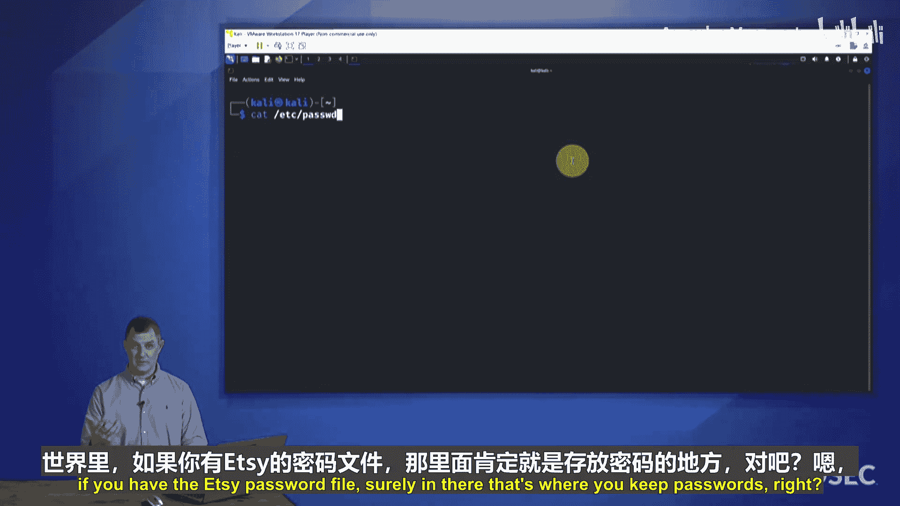

# 【Infosec】CompTIA安全 701认证 ｜ CompTIA Security+ 701 p07 02_01_02_password-hashing -BV1LRr5BTEow_p7-

Next， I want to look at how we use hashing to protect passwords。Historically or traditionally。

 we've protected passwords by encrypting them， that is to say we take a password that a user provides to us。

 we encrypt it in some way using some key that we store somewhere on the system。

And then when that user types in their password， we then either encrypt their password and check the encrypted values or we decrypt their password and check that。

The problem with this approach， though。Is if an attacker gets in our system。

 they're going to be able to go out and find that key somewhere on the system。

 and then they've got access to everyone's passwords， that's no good。

And so instead what we do is we hash passwords these days， this is why if you do a forgot password。

 have you noticed that whenever you do forgot password。

 no longer do services ask you for security questions and then they provide you like， hey。

 here's your password。Instead， they're like。If you don't know your password， we don't。

The reason for that is because they have hashed the password， all they have is the resulting hash。

 they don't have the original input。So if we go over and look at the Etsy in the Etsy file on Linux so if I type in if I do CA。

 Etsy。And then we look at the passwords file。Now you would think。

 and you would be forgiven for thinking this， that it will in the Linux world。

 if you have the Etsy password file， surely in there， that's where you keep passwords， right？

Not exactly。And it's kind of for somewhat historical reasons。

If you'll notice here we've got these users down here at the bottom and in this case i'm logged in as Callli and so we're going to be looking at Callli as our user on here。

 you will see that the second value that is these colon separated values there's an x that's on there that X is where we use to store passwords instead they are now parked in a file。

Called Etsie Shadow。And we have to log in as roots in order to do that because this information is protected and so I'm going to log in as the super user on here and when I do this。

 you will see that we can see。The output， the hash digest of these users inputs。 And so over here。

 we've got。Dollar sign， wide， dollar sign， all this stuff all the way up to this next colon that right there。

Is the password for the user Kelly？Now I'm going to go ahead and share with you what Callie's password is。

 are you ready， you can write it down if you need to。Cie is the user KALI， and the password is。

 don't tell anyone。It's Call。So this is kind of the default login for this user。

 Callli is the username， Callli is the password。That sure doesn't look like Call。And earlier。

 we looked at how hash digests are made up of letters and numbers， strings of letters and numbers。

 0 through9 and A through F。But Tommy， I'm seeing uppercase letters and I'm seeing W and the letter U and X。

 certainly not just a through F。 This is the same。Hash digestig Shaw 512 that we looked at and this is representing this all in base 64 rather than just base 16。

 not very important to know but if you're wondering look。

 what are these uppercase letters numbers and these periods and slash marks where are those coming from。

 it's coming from this base 64 representation。Now， the dollar sign y dollar sign that we've got over here。

 this tells the system or is a record for the system of。What？😮。

Hashing algorithm was used in this case， the Y designates that we're using Shaw 512。

And then next to that we have J9T， some other stuff， and then we have another dollar sign。

 and so this part right over here， this is the actual password for Callli and again that password is Callli。

So what's this other stuff？Well， this other stuff is a thing that we call salting。

So we talked earlier about how hashing。Is a one way street， you can take something， you hash it。

 and then the digest is the output。You can take the output。D hash it。

 that's not a thing and then end up with the original input instead it's kind of metadata it's data about the original input。

It's not the data itself。And recall too that I said it's a one way street。

 I can take some information， run through a hashing algorithm and I end up with a digest。

Not too unlike taking data。Running it through through a shredder。

And then you end up with something or to put it in other way it's kind of silly to think about if I took a potato and I ran it through a shredder。

 I'm going to end up with。Hash browns。But I can't take a pile of hash browns。

 run it back into a shreddder and end up with a potato， it doesn't work like that， right。

 it would be a weird potato and mushy and gross。But it's a one way trip。Potato becomes hash browns。

 but hash browns cannot become potato。Okay， so if I want to add something to this input。

That will alter the final state of our hash。And I want to make it hard for attackers to guess what this aligns to。

I can add a little something to our output。And the output that we're going this little something sound that we're going to add to it。

 just like you put on hash browns is salt。And so the salt is that something， something that we add。

 and that's what we call this little bit right here， iss salting the passwords。

The reason we salt passwords is because。If I have the output。Of what this is。

I cannot dehash something， but what I could do is I could。

Stumble through every possible combination permutation of inputs。

 different passwords and end up with。The final state of this so I could go through and I can hash A A A A A A A A A A A A A A A B。

 A A A A A and so on。 I can take each one of those hash them and see do I have a match and if I do I can do a backwards look up and see what was the input that gave me that output。

That would take forever， but it is possible in order to confound that approach。

 I add a little something something to that password。 Now again。

 this that I have highlighted here is in this particular systems。Set up。

 this is the password CallI hashed for the user Cally。The way that it works is it prompts the user。

 me or you logging in， it prompts us for the user's password。

 you type in Callli and the system will take your input。It adds in the salt， it hashes that。

 and it ends up with a final output。It then takes your stored value。

 what you entered three months ago， and it looks at are those two values the same。

 if they are the same， they're good to go， if they're not the same。

 whatever you entered is not what you entered three months ago。

The system again doesn't know what the password is。

 it just knows these two values are different because the only way to arrive at this particular value。

Is to provide the password rate he gave me three months ago。

And the system will generate its own hash or its own salt。 and it will join those together。

 hashing those using the Shaw 512 algorithm。 And we end up with this unique string of letters numbers that can only be arrived if you enter their correct password。

 So it's in this way that we protect passwords。 And you can see that each of the users on this system have different hashed passwords。

 So Callli， in this case， has a hashed salted password on here using Shaw 512 J9 tells it how it generated the salt and then。

There is the value that it generates along with the hashed value， so we need to safeguard this file。

 only administrative users can have access to this particular file， but from what you can see。

 this is how we safeguard passwords using hashing。